# iOS 26 编程初学者指南，第十版：使用 Swift 6、UIKit 和 Xcode 26 开启 iOS 应用 开发之旅的实用指南


# 贡献者

# 关于作者

Ahmad Sahar 是 Tomafwi Productions 的培训师、演讲者和顾问。他是 Apple 认证 Swift 应用开发培训师，在 iOS 移动应用开发、Flutter 移动应用开发以及如何使用 Apple 软件和硬件方面拥有超过10年的教学经验。他目前持有 Swift 应用开发关联和认证用户认证。

他是马来西亚 DevCon IOS 在线社区的成员，并曾为该小组进行演讲。在空闲时间里，他喜欢构建和编程 LEGO MINDSTORMS® 机器人。

我的母亲 Sharifah；我的父亲 Sahar；我的两个姐姐 Ainol Shareha 和 Ainol Shaharina；以及我亲爱的妻子 Oni——感谢你们的爱与支持。

# 关于评审员

Ian Lockett 是一位位于英国的 iOS 开发人员。在软件行业拥有超过20年的经验，过去15年里，他为从初创公司到大型企业的各类客户和行业开发应用。Ian 以关注细节和交付高质量软件而自豪。Ian 还是“Hacking with Swift Live”会议的志愿者联合组织者。


- 在 Playground 中使用常用数据类型 • 37


- Swift 并发 ....................................................................... 126


- 在新增条目场景中添加图像视图 • 244


- 在 Discord 上加入我们 ............................................................................ 507


- 创建描述描述文件 (provisioning profiles) • 559
- 为你的应用创建图标 • 564


# 前言

欢迎阅读《iOS 26 编程入门》。本书是《iOS 编程入门》系列的第十版，已针对 iOS 26、macOS Tahoe 26 和 Xcode 26 进行了全面更新。

在书中，你将构建一个名为 JRNL 的日志应用。你将从探索 Xcode 开始，这是 Apple 的编程环境，即集成开发环境（IDE）。你将开始学习 Swift 基础（这是 iOS 应用使用的编程语言），并了解如何使用它完成常见的编程任务。

一旦你掌握了 Swift 的基础，你将开始创建 JRNL 应用的用户界面。在此过程中，你将使用故事板（storyboards）并使用片段（segues）连接应用的场景。

完成用户界面后，你将添加代码来实现应用的功能。首先，你将学习如何使用表格视图（table view）显示数据。接下来，你将学习如何向应用添加数据，以及如何确定设备位置并在地图上显示注释。然后，你将学习如何使用 JSON 文件持久化数据、创建自定义视图，以及从相机或相库添加照片。最后，你通过实现集合视图（collection view）代替表格视图，让你的应用能够在 iPad 或 Mac 等大屏幕设备上运行。

现在你已经有了一个完整的应用，但添加最新的 iOS 26 特性又如何？你将从学习如何将应用的用户界面更新为 Apple 在所有平台上的新设计语言。接下来，你将学习如何使用 Icon Composer 创建酷图标。之后，你将学习如何将 Apple Intelligence（苹果智能）功能和 Foundation 框架实现到应用中。

最后，你将学习如何通过内部和外部测试人员测试应用，并将其提交到 App Store。

# 本书对象

本书专为编程经验极少、刚接触 Swift 和 iOS 应用开发世界的人士设计。建议对编程概念有基础了解。

# 本书涵盖内容

- 第 1 章“Hello, Xcode”将带你遍历 Xcode，并介绍你在书中将用到的所有不同部分。
- 第 2 章“简单值与类型”将涉及 Swift 语言如何实现值和类型。
- 第 3 章“条件与可选值”将展示 `if` 和 `switch` 语句的实现，以及如何实现可能包含也可能没有值的变量。
- 第 4 章“范围运算符与循环”将展示如何处理范围以及 Swift 中实现循环的不同方式。
- 第 5 章“集合类型”涵盖了常见的集合类型，如数组、字典和集合。
- 第 6 章“函数与闭包”涵盖了如何使用函数和闭包将指令组合在一起。
- 第 7 章“类、结构体与枚举”将讨论 Swift 中如何表示包含状态和行为的复杂对象。
- 第 8 章“协议、扩展与错误处理”将讨论创建数据类型可以采纳的协议、扩展现有类型的功能，以及如何处理代码中的错误。
- 第 9 章“Swift 并发”将向你介绍并行和异步编程的概念，并展示你如何在应用中实现它们。
- 第 10 章“设置用户界面”涉及创建 JRNL 应用并设置用户将看到的初始屏幕。
- 第 11 章“构建用户界面”涵盖了 JRNL 应用主界面的设置。
- 第 12 章“完成用户界面”涵盖了 JRNL 应用剩余屏幕的设置。
- 第 13 章“修改应用屏幕”将关于在故事板中配置应用的每个屏幕。
- 第 14 章“MVC 与表格视图”涵盖了使用表格视图以及你如何使用它来显示项目列表。
- 第 15 章“将数据导入表格视图”涉及使用数组作为数据源将数据整合到表格视图。
- 第 16 章“在视图控制器之间传递数据”教你如何将视图控制器输入的数据添加到数组中，以及如何将数据从数组传递另一个视图控制器。
- 第 17 章“Core Location 与 MapKit”涉及使用 Core Location 和 MapKit 确定设备位置并在地图上添加注释。
- 第 18 章“JSON 文件”涉及学习如何使用 JSON 文件存储和检索用户数据。
- 第 19 章“自定义视图”教你如何创建和使用一个显示星级评分的自定义视图。
- 第 20 章“相机与相库”讨论如何将照片从相机或相库导入你的应用中。
- 第 21 章“搜索”教你如何为主屏幕实现搜索栏。
- 第 22 章“集合视图”向你展示如何用集合视图代替表格视图，以适应 Mac 或 iPad 等大屏幕设备。
- 23 章“采用 Liquid Glass（液玻璃）”涉及为所有平台实现 Apple 的设计语言，结合了一种名为 Liquid Glass 的新材质。
- 第 24 章“Icon Composer”介绍使用 Icon Composer 构建应用图标。
- 第 25 章“Apple Intelligence”向你展示如何为应用添加 Apple Intelligence 功能。
- 第 26 章“Foundation 模型”向你展示如何在应用中使用 Foundation 框架实现助手。
- 第 27 章“测试并提交应用到 App Store”将关于如何测试并将你的应用提交到 App Store。

# 充分利用本书

本书已针对 iOS 16、macOS Tahoe 26、Xcode 26 和 Swift 6 进行了完全修订。本书的第 4 部分还涵盖了 Apple 在 WWDC 2025 上引入的最新技术，即使用 Liquid Glass 的更新设计、Icon Composer、Apple Intelligence 和 Foundation 框架。

要完成书中的所有练习，你需要：

- 一台运行 macOS 15.0 Sequoia、macOS 26 Tahoe 或更高版本的 Mac 电脑
- Xcode 26.0 或更高版本

若要检查你的 Mac 是否支持 macOS Tahoe 26，请使用此链接：https://www.apple.com/my-os/macos/。如果你的 Mac 受支持，你可以通过“系统设置”中的“软件更新”更新 macOS。

要获取最新版本的 Xcode，可以从 Apple App Store 下载。大多数练习不需要 Apple 开发者帐户并使用 iOS 模拟器即可完成。如果你希望在真实的 iOS 设备上测试正在开发的应用，你需要一个免费或付费的 Apple 开发者帐户。

以下章节需要付费的 Apple 开发者帐户：第 27 章“测试并提交应用到 App Store”。书中包含了如何获取付费 Apple 开发者帐户的说明。

# 下载示例代码文件

你可以从 GitHub 下载本书的示例代码文件：https://github.com/PacktPublishing/ios-26-Programming-for-Beginners-1OE。如果代码有更新，将在 GitHub 仓库中更新。

我们还在丰富的书籍和视频目录中提供了其他代码包，访问地址为 https://github.com/PacktPublishing/。快去看看吧！

# 代码演示 (Code in Action)

访问以下链接查看代码运行的视频：
https://www.youtube.com/playlist?list=PleLcvrwLe184hPVVsrGC2Dk0aPZU1

# 下载彩色图像

我们还提供了一个 PDF 文件，包含书中使用的截图/图表的彩色图像。你可以在此处下载：https://packt.link/gbp/9781806023936。

# 使用的约定

书中使用了多处约定。

代码：表示文本中的代码词、数据库表名、文件夹名、文件名扩展名、路径名、虚假 URL、用户输入以及 Twitter/X 账号。例如：
“所以，这是一个非常简单的函数，名为 `serviceCharge()`。”

代码块设置如下：

```
class ClassName {
  property1
  property2
  property3
  method1() {
    code
  }
  method2() {
    code
  }
}
```

我们希望你注意代码块中的特定部分，相关行项目已加粗：

```
let cat = Animal()
cat.name = "Cat"
cat.sound = "Mew"
cat.numberOfLegs = 4
cat.breathesOxygen = true
print(cat.name)
```

**粗体 (Bold)：** 表示新术语

> 注意 (Notes)
警告或重要提示显示如下所示。

> 提示 (Tips)
提示和技巧显示如下所示。


# 联系我们

我们随时欢迎读者的反馈。

**一般反馈：** 如果您对本书的任何方面有疑问，或有任何一般反馈，请发送邮件至 customercare@packt.com，并在邮件主题中注明书名。

**勘误：** 尽管我们已尽一切努力确保内容的准确性，但错误在所难免。如果您在书中发现错误，如向我们报告我们将不胜感激。请访问 http://www.packt.com/submit-errata，点击 **Submit Errata（提交勘误）** 并填写表格。

**盗版：** 如果您在网上发现我们作品的任何非法副本，如果您能提供地址或网站名称，我们将不胜感激。请通过 copyright@packt.com 联系我们并附上材料链接。

**如果您兴趣成为作者：** 如果您在某个领域专长并兴趣编写或贡献书籍，请访问 http://authors.packt.com/。

# 分享您的想法

一旦您读完 *iOS 26 Programming for Beginners — Tenth Edition*，我们想听听您的想法！扫描下方的二维码直接进入该书的亚马逊评论页面并分享您的反馈。


https://packt.link/r/1806023938

您的评论对我们和技术社区都非常重要，并将帮助我们确保提供卓越质量的内容。

### 书籍免费福利

本书附带了支持您学习的免费福利。现在激活它们即可立即访问（请参“如何解锁”章节查看说明）。

以下是您购买后可以立即解锁内容的快速概述：

# PDF 和 ePub 副本

# 下一代 Web 版阅读器

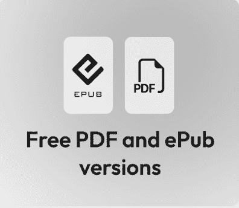


- 访问本书的无 DRM 限制 PDF 副本，可在随地、任何设备上阅读。
- 使用您喜爱的电子阅读器使用无 DRM 限制的 ePub 版本。
- 多设备进度同步：在任何设备上从上次离开的地方继续。
- 高亮和做记：捕捉想法，将阅读转化为持久的知识。
- 书签：在需要时保存并重新查看关键章节。
- 深色模式：切换到深色或深褐色主题，以减轻眼睛疲劳。

# 如何解锁

扫描二维码（或访问 packtpub.com/unlock）。按名称搜索此书，确认版本，然后按照页面上的步骤操作。

**注意：** *请妥善保存您的发票。直接从 Packt 购买的物品不需要发票。*


# 第 1 部分

# Swift

欢迎来到的第一部分。在这一部分中，你将从探索 Xcode 开始，它是 Apple 的编程环境，也被称为集成开发环境（IDE）。之后，你将开始学习 Swift 6 的基础知识（这是 iOS 应用中使用的编程语言），并了解它如何用于完成常见的编程任务。

本部分包含以下章节：

- 第 1 章：Hello, Xcode
- 第 2 章：简单值与可选类型
- 第 3 章：条件判断与可选类型
- 第 4 章：范围运算符与循环
- 第 5 章：集合类型
- 第 6 章：函数与闭包
- 第 7 章：类、结构体与枚举
- 第 8 章：协议、扩展与错误处理
- 第 9 章：Swift 并发

在这一部分的结束时，你将理解创建应用并并在模拟器（Simulator）或设备上运行它的过程，并将掌握 Swift 编程语言的实用知识，以完成常见的编程任务。这将为你的下一章节做好准备，并使你能够创建自己的 Swift 程序。让我们开始吧！

# 1

## # Hello, Xcode

欢迎阅读《iOS 26 Programming for Beginners》。我希望这本书能成为您在 App Store 上创建和发布 iOS 26 应用的有用介绍。

在本章中，你将在 Mac 上下载并安装 Xcode。然后，你将探索 Xcode 的用户界面。之后，你将创建你的第一个 iOS 应用并在模拟器中运行它。最后，你将在 iOS 设备上运行你的应用。

在本章的结束时，你将了解如何创建 iOS 应用、如何在模拟器中运行它，以及如何在 iOS 设备上运行它。

本章将涵盖以下主题：

- 从 App Store 下载并安装 Xcode
- 探索 Xcode 用户界面
- 在模拟器中运行你的应用
- 在 iOS 设备上运行你的应用

### 书籍免费福利

您的购买包含此本书的免费 PDF 副本以及其他专属福利。请查看序言中的“书籍免费福利”章节以立即解锁它们，并最大化您的学习体验。

### 技术要求

为了完成本章的练习，你需要：

- 一台运行 macOS 15 Sequoia 或 macOS Tahoe 26 的 Apple Mac 电脑
- 一个 Apple 账户（如果你没有，你将在本章中创建一个）
- 可选：一台运行 iOS 26 的 iOS 设备

本章的 Xcode 项目位于本书代码包的 Chapter01 文件夹中，可以在此处下载：

```
https://github.com/PacktPublishing/iOS-25-26-Programming-for-Beginners-10E
```

查看以下视频以查看代码运行情况：

```
https://youtube.be/Xckyb2f9rVk
```

在下一节中，你将开始从 App Store 下载 Xcode，这是 Apple 用于开发 iOS 应用的集成开发环境（IDE）。

> 下载总大小非常大（编写时为 13 GB），因此可能需要一些时间下载。在下载之前请确保你有足够的磁盘空间。


### 从 App Store 下载并安装 Xcode

Xcode 是 Apple 开发 iOS、iPadOS、watchOS、tvOS 和 visionOS 应用的 IDE。你需要在 Mac 上下载并安装 Xcode。按照以下步骤操作：

1. 在你的 Mac 上，选择 App Store。
2. 在搜索字段中输入 Xcode 并按回车键。
3. 你将在搜索结果中看到 Xcode。点击“获取”（Get）然后点击“安装”（Install）。
4. 如果你有 Apple 账户，请输入。如果你没有，点击“创建 Apple 账户”：

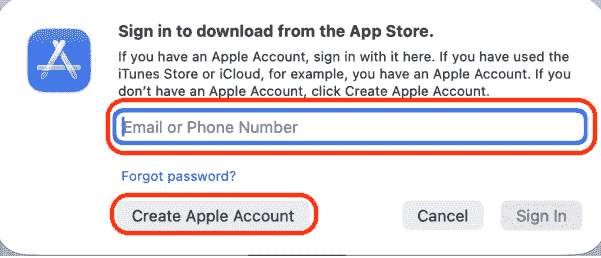

图 1.1：Apple 账户

> 你可以通过此链接查看有关创建 Apple 账户的更多信息：https://support.apple.com/en-us/108647

5. Xcode 安装完成后，启动它。你会看到一个许可协议。点击“同意”（Agree）：

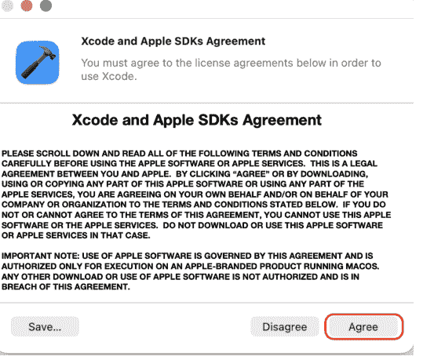

6. 你会被提示输入 Mac 的用户名和密码。完成后后，点击“确定”：

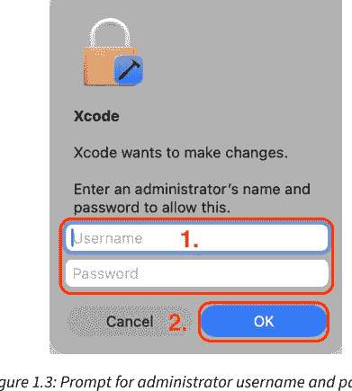

图 1.2：密码提示

7. 你将看到显示可用开发平台的屏幕。现在只需要 macOS 和 iOS。勾选 iOS 26.0，取消勾选其他选项，并点击“下载并安装”（Download & Install）：

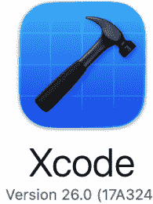

### 选择你想开始使用的组件：

| 平台支持 | |
|---|---|
| macOS 26.0 | 内置 |
| iOS 26.0 | 10.07 GB |
| watchOS 26.0 | 3.83 GB |
| tvOS 26.0 | 4.83 GB |
| visionOS 26.0 | 6.98 GB |

其他组件

- 预测代码完成模型 2 GB

还将安装所需的系统组件。

图 1.4：开发平台

8. 如果提示重启 Xcode 以使用更新的框架，点击“重启 Xcode”。

9. 如果看到“Xcode 新功能”屏幕，点击“继续”。

10. 你将看到“欢迎使用 Xcode”屏幕。点击左侧面板中的“创建新项目...”（Create New Project...）：

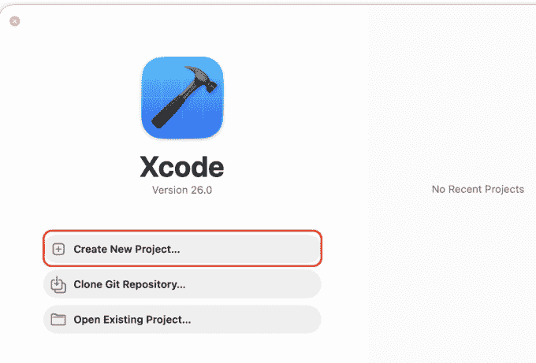

图 1.5：欢迎使用 Xcode 屏幕

11. Xcode 将自动开始下载 iOS 26.0 模拟器。注意，在在此过程完成之前，你无法在模拟器上运行任何应用：

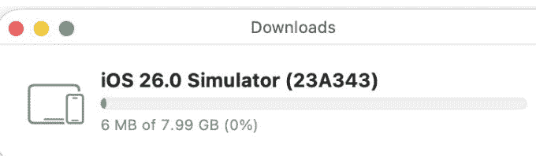

图 1.6：模拟器下载进度条


12. 你将看到如下的新项目屏幕。在“为新项目选择模板”（Choose a template for your new project）部分，选择 iOS。然后选择 App，并点击 Next（下一步）：

为新项目选择模板：

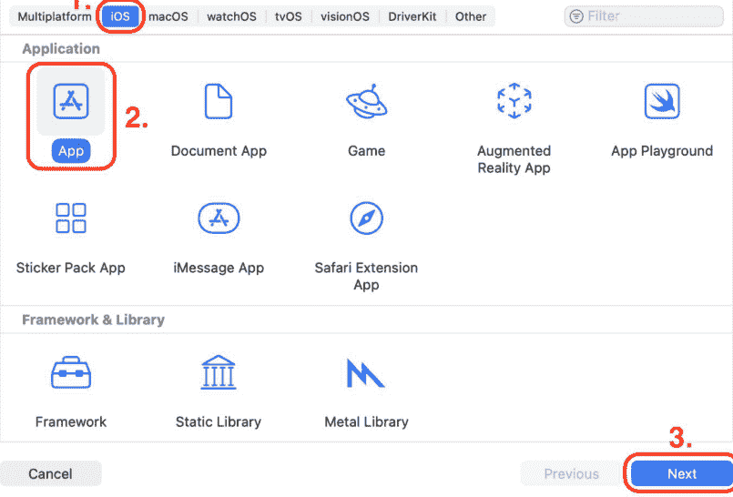

图 1.7：新项目屏幕

13. 你将看到“为新项目选择选项”（Choose options for your new project）屏幕：

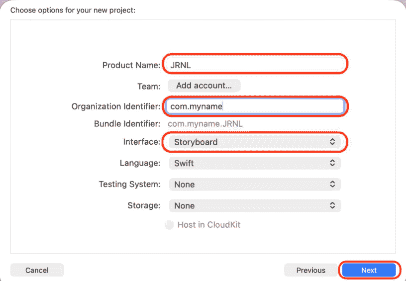

图 1.8：为新项目选择选项

按照如下配置选项：

- **Product Name**（产品名称）：应用的名称。在文本字段中输入 JRNL。
- **Organization Identifier**（组织标识符）：用于在 App Store 上为应用创建唯一标识符。现在输入 com.myname。这被称为反向域名格式，是 iOS 开发者常用的格式。
- **Interface**（界面）：用于为应用创建用户界面的方法。将其设置为 Storyboard。

保留所有其他设置的默认值。完成后点击 Next。

14. 你将看到一个“Save”（保存）对话框。选择一个保存项目的位置，例如桌面或文档文件夹，并点击 Create（创建）：

# 第一章

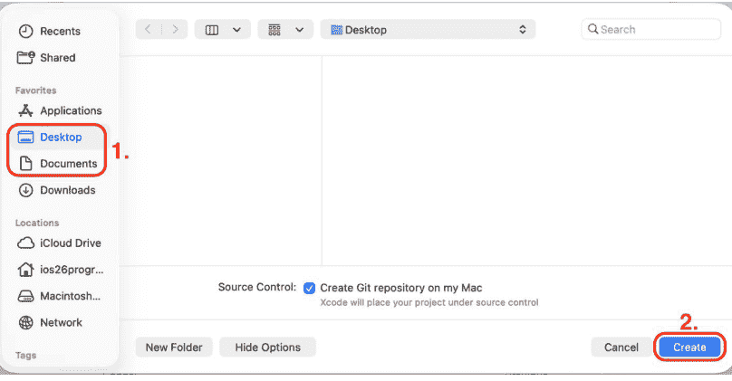

图 1.9：保存对话框

15. 你将看到如下的“Provide Author Information”（提供作者信息）对话框：

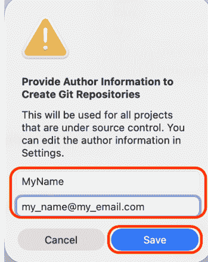

图 1.10：源码控制偏好屏幕

# 12

## Hello, Xcode

你之所以看到这个对话框是因为保存对话框中的源码控制（Source Control）复选框被勾选了。Apple 建议开启源码控制。源码控制（也称为版本控制）不是本书的范围，但如果你想了解它以及 Git，请参阅此链接：https://git-scm.com/video/what-is-version-control。

输入以下信息：

- 你的姓名
- 你的电子邮件地址

完成后点击 Save。Xcode 窗口将出现。

太棒了！你现在已成功下载并安装了 Xcode，并创建了第一个项目。在下一节中，你将学习 Xcode 用户界面。

### 探索 Xcode 用户界面

你已经创建了第一个 Xcode 项目！如你所见，Xcode 用户界面分为几个不同的部分，所示：

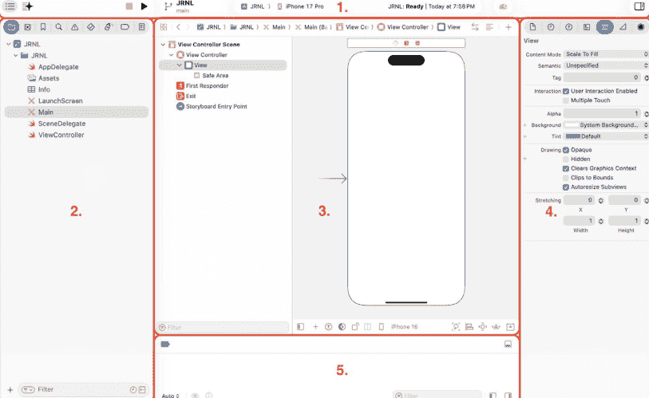

图 1.11：Xcode 用户界面

让我们详细查看每个部分。以下描述与上一个屏幕中显示的数字对应：

- **Toolbar (1)**（工具栏）：用于构建和运行你的应用，并查看运行任务的进度。
- **Navigator area (2)**（导航器区域）：提供快速访问项目各个部分的路径。默认显示 **Project navigator**（项目导航器）。
- **Editor area (3)**（编辑器区域）：允许你编辑源代码、用户界面和其他资源。
- **Inspector area (4)**（检查器区域）：允许你查看并编辑导航器或编辑器区域中选定项目的信息。
- **Debug area (5)**（调试区域）：包含 **debug bar**（调试栏）、**variables view**（变量视图）和 **Console**（控制台）。通过 **Shift + Command + Y** 切换调试区域。

接下来，让我们更仔细地检查工具栏。这里显示的工具栏左侧：

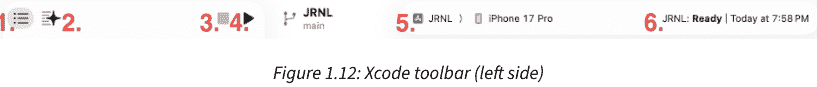

让我们详细查看每个部分。以下描述与上一个屏幕显示的数字对应：

- **Navigator button (1)**（导航按钮）：用于显示或隐藏导航器区域。
- **Coding Assistant button (2)**（编码助手按钮）：用于显示或隐藏编码助手区域。此功能帮助你使用 Xcode 的集成智能编写代码并修复问题。
- **Stop button (3)**（停止按钮）：用于停止当前运行的应用。
- **Run button (4)**（运行按钮）：用于构建并运行你的应用。
- **Scheme menu (5)**（方案菜单）：显示构建项目的特定方案（**JRNL**）以及运行应用的目标（**iPhone 17 Pro**）。方案和目标是不同的。方案指定构建和运行项目的设置。目标指定应用的安装位置，并存在于模拟器和物理设备中。
- **Activity view (6)**（活动视图）：显示运行任务的进度。

工具栏的右侧所示：


让我们详细查看每个部分。以下描述与上一个屏幕显示的数字对应：

- **Xcode Cloud button (1)**（Xcode Cloud 按钮）：允许你登录 Xcode Cloud，这是一项构建在 Xcode 内部的持续集成和交付服务。
- **Inspector button (2)**（检查器按钮）：用于显示或隐藏检查器区域。

不要被所有不同的部分搞晕，你将在接后的章节中详细学习它们。现在你已经熟悉了 Xcode 界面，你将在模拟器中运行刚刚创建的应用，模拟器显示了 iOS 设备的表示。

### 在模拟器中运行你的应用

Simulator 在安装 Xcode 后会被下载并安装。它提供了一个模拟的 iOS 设备，这样你就可以看到应用的外观以及如何运行，而不需要物理 iOS 设备。它可以模拟 iPad 和 iPhone 的所有尺寸和分辨率，因此你可以轻松地在多个设备上测试你的应用。

要在模拟器中运行你的应用，请遵循以下步骤：

- 点击 Destination（目标）弹出菜单查看模拟设备列表。从该菜单中选择 **iPhone 16e**：

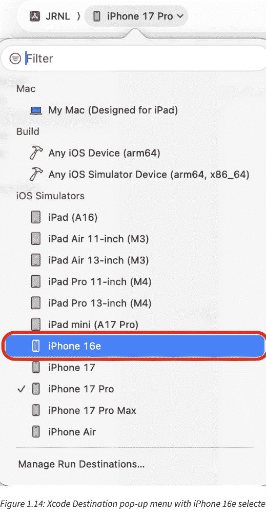

- 2. 点击 **Run** 按钮在选定的模拟器上安装并运行你的应用。
- 3. 模拟器将启动并显示 iOS 设备的表示。
- 4. 回到 Xcode（或按 Command .）以停止当前运行的应用。

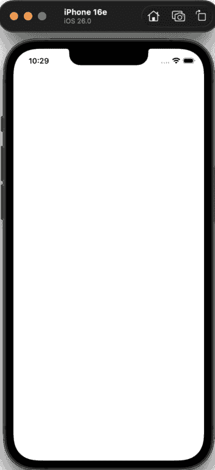

图 1.15：模拟器显示你的应用

# 第一章

你之所以看到这个对话框是因为保存对话框中的源码控制（Source Control）复选框被勾选了。Apple 建议开启源码控制。源码控制（也称为版本控制）不是本书的范围，但如果你想了解它以及 Git，请参阅此链接：https://git-scm.com/video/what-is-version-control。

输入以下信息：

- 你的姓名
- 你的电子邮件地址

完成后点击 Save。Xcode 窗口将出现。

太棒了！你现在已成功下载并安装了 Xcode，并创建了第一个项目。在下一节中，你将学习 Xcode 用户界面。

### 探索 Xcode 用户界面

你已经创建了第一个 Xcode 项目！如你所见，Xcode 用户界面分为几个不同的部分，所示：


图 1.11：Xcode 用户界面

让我们详细查看每个部分。以下描述与上一个屏幕显示的数字对应：

- **Toolbar (1)**（工具栏）：用于构建和运行你的应用，并查看运行任务的进度。
- **Navigator area (2)**（导航器区域）：提供快速访问项目各个部分的路径。默认显示 **Project navigator**（项目导航器）。
- **Editor area (3)**（编辑器区域）：允许你编辑源代码、用户界面和其他资源。
- **Inspector area (4)**（检查器区域）：允许你查看并编辑导航器或编辑器区域中选定项目的信息。
- **Debug area (5)**（调试区域）：包含 **debug bar**（调试栏）、**variables view**（变量视图）和 **Console**（控制台）。通过 **Shift + Command + Y** 切换调试区域。

接下来，让我们更仔细地检查工具栏。这里显示的工具栏左侧：


让我们详细查看每个部分。以下描述与上一个屏幕显示的数字对应：

- **Navigator button (1)**（导航按钮）：用于显示或隐藏导航器区域。
- **Coding Assistant button (2)**（编码助手按钮）：用于显示或隐藏编码助手区域。此功能帮助你使用 Xcode 的集成智能编写代码并修复问题。
- **Stop button (3)**（停止按钮）：用于停止当前运行的应用。
- **Run button (4)**（运行按钮）：用于构建并运行你的应用。
- **Scheme menu (5)**（方案菜单）：显示构建项目的特定方案（**JRNL**）以及运行应用的目标（**iPhone 17 Pro**）。方案和目标是不同的。方案指定构建和运行项目的设置。目标指定应用的安装位置，并存在于模拟器和物理设备中。
- **Activity view (6)**（活动视图）：显示运行任务的进度。

工具栏的右侧所示：


让我们详细查看每个部分。以下描述与上一个屏幕显示的数字对应：

- **Xcode Cloud button (1)**（Xcode Cloud 按钮）：允许你登录 Xcode Cloud，这是一项构建在 Xcode 内部的持续集成和交付服务。
- **Inspector button (2)**（检查器按钮）：用于显示或隐藏检查器区域。

不要被所有不同的部分搞晕，你将在接后的章节中详细学习它们。现在你已经熟悉了 Xcode 界面，你将在模拟器中运行刚刚创建的应用，模拟器显示了 iOS 设备的表示。

### 在模拟器中运行你的应用

Simulator 在安装 Xcode 后会被下载并安装。它提供了一个模拟的 iOS 设备，这样你就可以看到应用的外观以及如何运行，而不需要物理 iOS 设备。它可以模拟 iPad 和 iPhone 的所有尺寸和分辨率，因此你可以轻松地在多个设备上测试你的应用。

要在模拟器中运行你的应用，请遵循以下步骤：

- 点击 Destination（目标）弹出菜单查看模拟设备列表。从该菜单中选择 **iPhone 16e**：


- 2. 点击 **Run** 按钮在选定的模拟器上安装并运行你的应用。
- 3. 模拟器将启动并显示 iOS 设备的表示。
- 4. 回到 Xcode（或按 Command .）以停止当前运行的应用。


图 1.15：模拟器显示你的应用

### Build 部分

除了模拟设备列表外，该菜单还有一个部分显示连接到你的 Mac 的物理设备。

点击工具栏中的 Destination 菜单，查看菜单顶部的物理设备和 Build 部分：

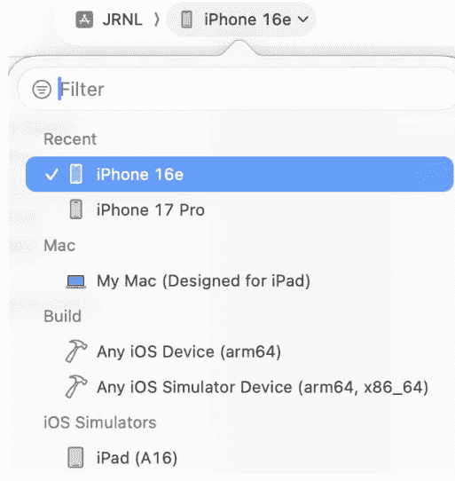

图 1.16：Xcode Destination 菜单显示设备和 Build 部分


# 第 1 章

要在 iOS 设备上运行您的 App，请按照以下步骤操作：

1. 使用 iOS 设备随附的电缆将设备连接到 Mac，并确保 iOS 设备已处于解锁状态。
2. 您的 Mac 将显示“允许连接配件”（Allow Accessory to Connect）的提示。点击“允许”。
3. 您的 iOS 设备将显示“信任此电脑”（Trust This Computer）提示。点击“信任”并根据提示输入设备设备密码。您的 iOS 设备现在已连接到 Mac，并将出现在 Xcode 的目标（Destination）菜单中。
4. 在 Xcode 菜单栏中选择 Window（窗口） | Devices and Simulators（设备与模拟器）。您将看到一个显示“开发者模式已禁用”的消息：

## 错误与警告

> 开发者模式已禁用
> 使用 iPhone11 进行开发，请在“设置 -> 隐私与安全性”中启用开发者模式。

图 1.17：Xcode 设备与模拟器窗口，显示开发者模式已禁用

开发者模式是 Apple 在 2022 年全球开发者大会（WWDC 2022）上引入的，在在运行 iOS 16 或更高版本的设备上安装、运行和调试 App 时需要它。

要观看关于开发者模式的 WWDC 2022 视频，请点击此链接：https://developer.apple.com/videos/play/wwdc2022/110344。


5. 要在您的 iOS 设备上启用开发者模式，前往 设置（Settings） | 隐私与安全性（Privacy & Security），向下滚动到开发者模式（Developer Mode）项目并点击它：

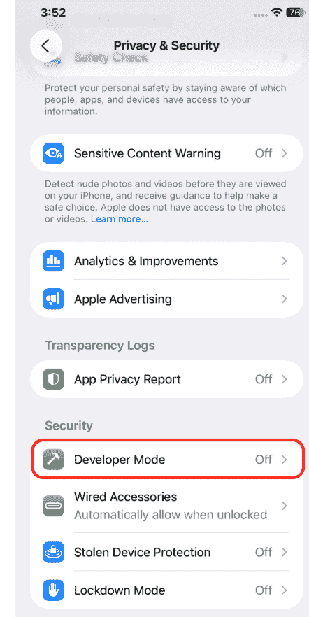

图 1.18：隐私与安全性屏幕，显示开发者模式

6. 开启开发者模式开关：

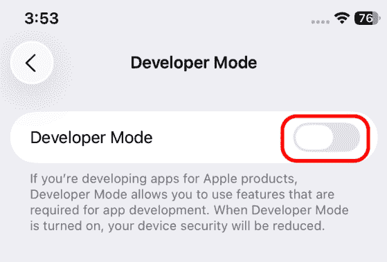

图 1.19：开发者模式开关

7. 将弹出一个警报，警告开发者模式会降低您的 iOS 设备的安全性。点击“重启”（Restart）。

8. 您的 iOS 设备重启并进行解锁后，点击“启用”（Enable）并输入 iOS 设备密码以确认要启用开发者模式。

9. Devices and Simulators 窗口将显示“正在准备 iPhone”（Preparing iPhone）。等待几分钟，然后验证 Devices and Simulators 窗口不再显示“开发者模式已禁用”的文本：

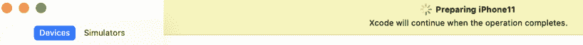

图 1.20：Xcode 设备与模拟器窗口，显示正在准备 iPhone

您的 iOS 设备现在准备好从 Xcode 安装并运行 App。

10. 在 Xcode 中，从 Destination（目标）菜单选择您的 iOS 设备。

11. 点击 **Run**（运行）按钮运行项目（或使用 **Command + R**）。您将在 Xcode 的 **Signing & Capabilities**（签名与能力）面板中遇到以下错误：**Signing for “JRNL” requires a development team:**（为“JRNL”签名需要一个开发团队）：

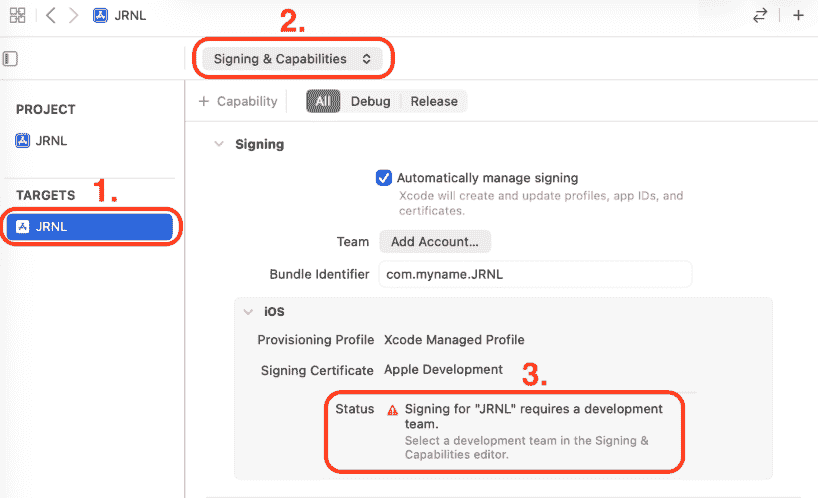

图 1.21：Xcode Signing & Capabilities 面板

这是因为在 iOS 设备上运行 App 需要数字证书，且您需要向 Xcode 添加一个免费或付费的 Apple 开发者账户，以便生成数字证书。

# 第 1 章

使用 Apple 账号创建免费开发者账户将允许您在 iOS 设备上测试 App，但它的有效期仅为 7 天。此外，您需要一个付费的 Apple 开发者账户才能在 App Store 上分发 App。您将在第 27 章“测试并提交您的 App 到 App Store”中学习更多内容。

证书确保了在您的设备上运行的 App 都是您授权的。这有助于防止恶意软件。您也可以通过此链接了解更多相关信息：https://help.apple.com/mac/x/#dev6b6fbbc7。

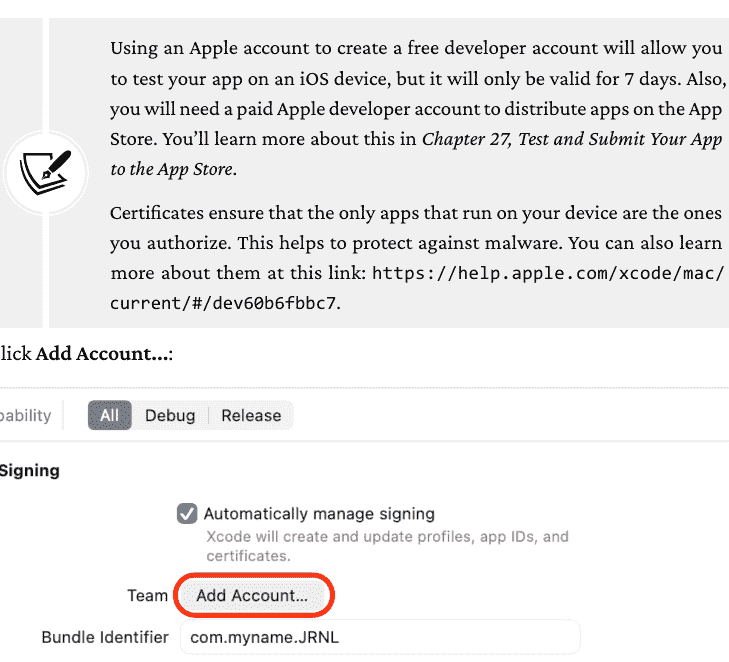

- 点击 Add Account...（添加账户...）

图 1.22：Xcode Signing & Capabilities面板，带有 Add Account... 按钮

- 弹出 Xcode 设置窗口并选中了 Apple Accounts（Apple 账户）面板。点击 Add Apple Accounts......（添加 Apple 账户......

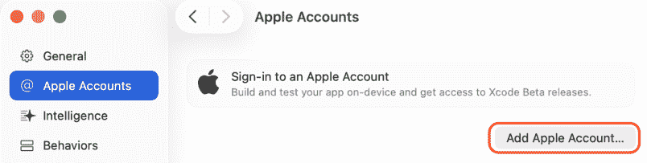

图 1.23：Xcode 设置窗口

14. 在提供的框中输入您的 Apple 账号邮箱或电话号码并点击“下一步”（Next）。然后在提供的框中输入您的密码并再次点击“下一步：

### 登录您的 Apple 账号。

还没有 Apple 账号？您可以免费创建一个。

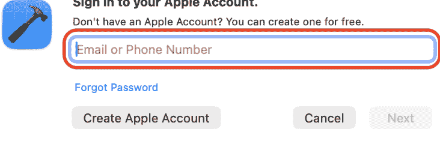

忘记密码（Forgot Password）

图 1.24：Apple 账号登录对话框

您也可以通过选择 Xcode 菜单中的 Settings（设置）来访问 Xcode 设置。

15. 几分钟后，验证 Apple Accounts 面板显示了您的账户名称和邮箱地址：

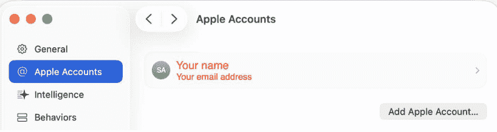

图 1.25：Xcode 设置中的 Apple Accounts 面板

16. 完成后，点击左上角的红色关闭按钮关闭设置窗口。

17. 在 Xcode 的编辑器区域，点击 Signing & Capabilities。确保勾选了 Automatically signing（自动签名），并从 Team（团队）弹出菜单中选择了 Personal Team（个人团队）：

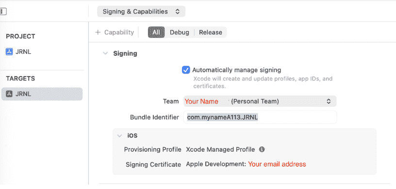

18. 如果您在此屏幕上仍看到错误信息，请尝试通过在 Bundle Identifier（包标识符）中输入一些随机字符来更改它——例如，com.mynameA113.JRNL。

19. 编译并运行您的 App。如果提示输入密码，输入您的 Mac 登录密码并点击 Always Allow（始终允许）。

20. 您的 App 将安装到您的 iOS 设备上。然而，它不会启动，您将看到以下对话框：

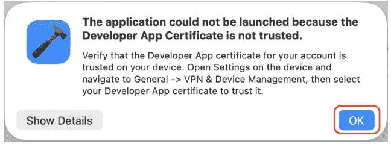

21. 点击 OK 关闭此对话框。

如对话框所述，您需要信任已安装在您的 iOS 设备上的证书。您将在下一节中学习如何操作。

### 在您的 iOS 设备上信任开发者 App 证书

开发者 App 证书（Developer App certificate）是一个特殊文件，随 App 一起安装在您的 iOS 设备上。在运行 App 之前，您需要信任它。请按照以下步骤操作：

1. 在您的 iOS 设备上，点击 Settings（设置） | General（通用） | VPN & Device Management（VPN 与设备管理）：

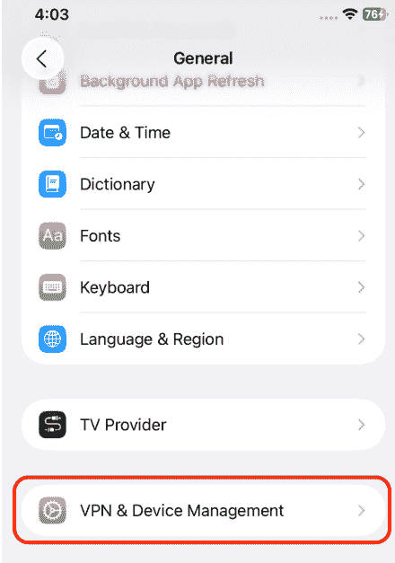

图 1.28：设置中的 VPN 与设备管理

2. 点击您的 Apple 账号：

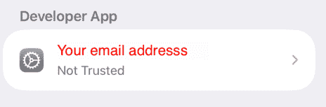

图 1.29：设备管理中的 Apple 

3. 点击 Trust（信任）：

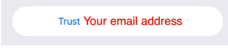

图 1.30：信任 按钮

4. 点击 Allow（允许）：

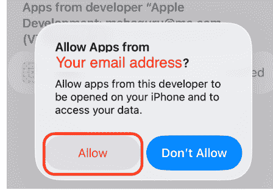

图 1.31：允许 对话框

您应该看到以下文本，显示 App 已被信任：

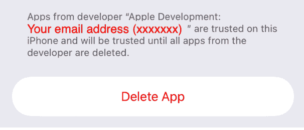

图 1.32：带有证书的设备管理部分

5. 点击 Xcode 中的 Run 按钮再次构建并运行。您将看到 App 在设备上启动。

恭喜！您已在真实设备上运行了 App！

### 总结

在本章中，您学习了如何在 Mac 上下载和安装 Xcode。然后，您熟悉了 Xcode 用户界面的部分。之后，您创建了第一个 iOS App，选择了模拟 iOS 设备并在模拟器中构建和运行。最后，您学习了如何通过 USB 将 iOS 设备连接到 Xcode 以便运行 App。

在下一章中，我们将使用 Swift Playgrounds 开始探索 Swift 语言，并学习简单值和类型。

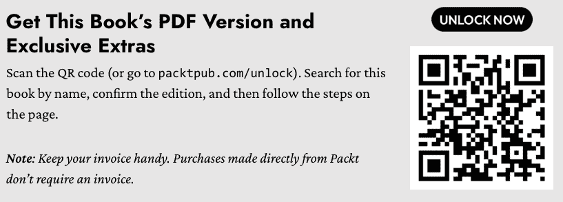

# 2

## 简单值与类型

在上一章对 Xcode 有了简要介绍后，让我们来看看用于编写 App 的 Swift 语言。

首先，您将探索 Swift Playgrounds，这是一种交互式环境，您可以在其中输入 Swift 代码并立即显示结果。然后，您将研究 Swift 如何表示和存储各种类型的数据。之后，您将学习一些酷 特性，例如类型推断和类型安全，这些特性帮助您编写更简洁的代码并避免常见错误。接下来，您将学习如何对数据进行常用操作。最后，您将学习如何向调试区域打印消息以帮助您排除故障。

在本章结束时，您将能够编写存储和处理字母及数字的简单程序。

将涵盖以下主题：

- Swift playgrounds
- 数据类型
- 常量与变量
- 类型推断与类型安全
- 运算符
- print() 语句


如需更多关于 Swift 语言最新版本的信息，请访问 https://docs.swift.org/swift-book/documentation/the-swift-programming-language。

要查看 Apple 在 WWDC 2025 上宣布的 Swift 语言最新更新，请观看此视频：https://developer.apple.com/videos/play/wwdc2025/245。

### 技术要求

为了完成本章的练习，你需要以下设备：

- 一台运行 macOS Sequoia 或 macOS Tahoe 26 的 Apple Mac 电脑
- 安装了 Xcode 26（请参考第 1 章 Hello, Xcode，查看如何安装 Xcode 的说明）

本章的 Playground（笔记本）位于书籍代码包的 Chapter-02 文件夹中，可以在此处下载：

https://github.com/PacktPublishing/iOS-26-Programming-for-Beginners-10E

查看以下视频以了解代码演示：

https://youtube.be/9WA68HayY2w

在下一节中，你将创建一个新的 Playground，并在输入本章介绍的代码。

### Swift Playgrounds

Playgrounds 是交互式编程环境。你在左侧面板中输入代码，结果会立即显示在右侧面板中。这是实验代码和探索 iOS SDK 的极方法。

# 第 2 章

> SDK 是软件开发包（software development kit）的缩写。要了解更多关于 iOS SDK 的信息，请访问 https://developer.apple.com/ios/。

让我们从创建一个新的 Playground 并检查其用户界面开始。按照以下步骤操作：

1. 启动 Xcode，从 Xcode 菜单栏选择 File | New | Playground...：

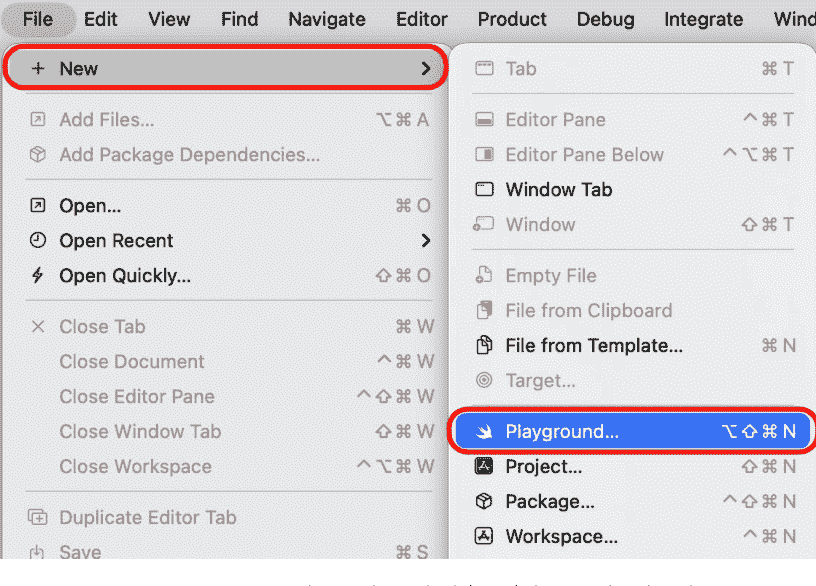

图 2.1：选择了 File | New | Playground... 的 Xcode 菜单栏

2. 显示“Choose a template for your new playground”屏幕。iOS 应该选中。选择 Blank 并点击 Next：

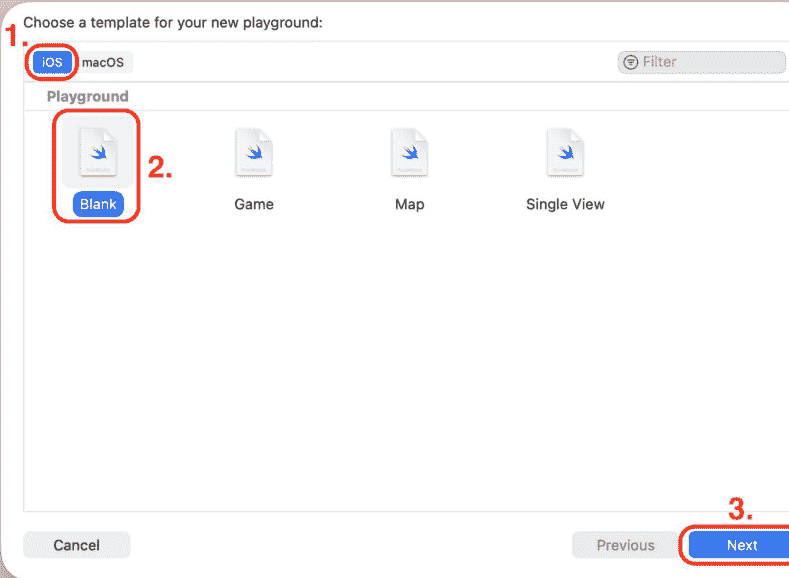

3. 将你的 Playground 命名为 SimpleValues 并保存到你喜欢的任何地方。完成后点击 Create：

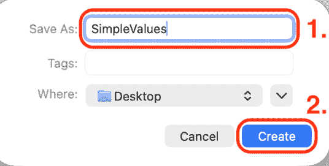

图 2.2：Choose a template for your new playground 屏幕

图 2.3：保存对话框

4. 你将在屏幕上看到 Playground：

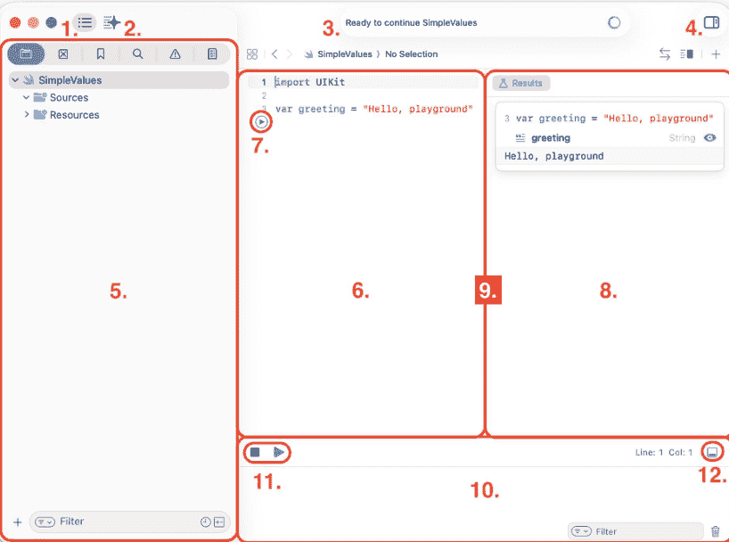

如你所示，它比 Xcode 项目简单得多。让我们详细查看该界面：

- **Navigator 按钮 (1)：** 显示或隐藏导航器（Navigator）区域。
- **Coding Assistant 按钮 (2)：** 显示或隐藏编码助手（Coding Assistant）区域。此功能通过 Xcode 的智能帮助你编写代码并修复问题。
- **Activity View (3)：** 显示当前的操作或状态。
- **Inspector 按钮 (4)：** 显示或隐藏检查器（Inspector）区域。
- **Navigator area (5)：** 提供快速访问项目的各个部分。默认显示项目导航器（Project navigator）。
- **Editor area (6)：** 你在此处编写代码。
- **Run 按钮 (7)：** 从文件开始执行到选定的行。
- **Results area (8)：** 对你编写的代码提供即时反馈。
- **Border (9)：** 此边界分隔了编辑器（Editor）和结果（Results）区域。你可以向左右拖动边界来更改每个区域分配的空间。
- **Debug area (10)：** 显示 `print()` 命令的输出。
- **Run and Stop buttons (11)：** 执行或停止 Playground 中所有代码的运行。
- **Debug 按钮 (12)：** 显示和隐藏调试（Debug）区域。

你可能会发现 Playground 中的文字太小，难以阅读。让我们在下一节看看如何将其变大。

## 修改字体和颜色

Xcode 提供了丰富的自定义选项。你可以在 Settings... 菜单中访问它们。如果你发现文字太小难以查看，请按照以下步骤操作：

- 从 Xcode 菜单选择 Settings... 显示设置窗口。
- 在 Settings 窗口中，点击 Themes 并从弹出菜单中选择 Presentation (Light)，使文字更大、更容易阅读：

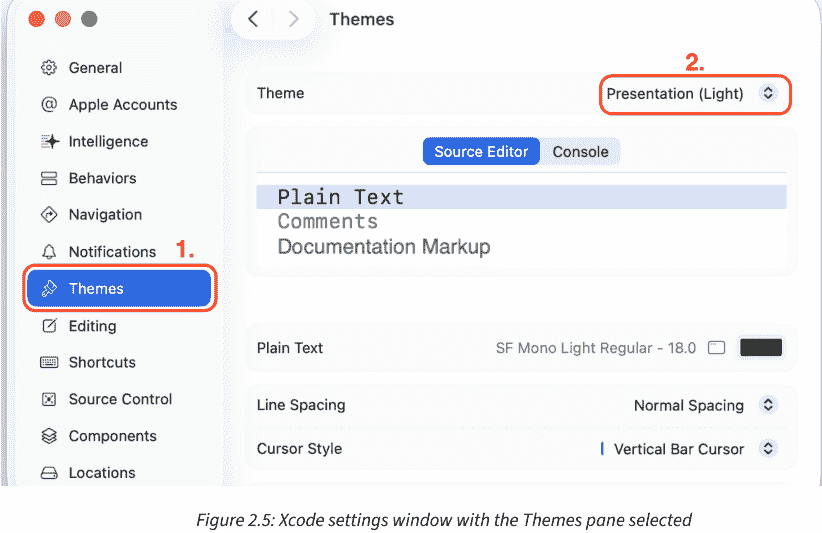

3. 关闭 Settings 窗口返回 Playground。注意，Playground 中的文字比之前变大了。如果你愿意，也可以尝试其他主题。

现在你已经按照喜好自定义了字体和颜色，让我们在下一节看看如何运行 Playground 代码。

### 运行 Playground 代码

你的 Playground 已经包含一条指令。要执行它，请按照以下步骤操作：

1. 执行它，请遵循以下步骤：几秒钟后，你会在 Results area 中看到“Hello, playground”：

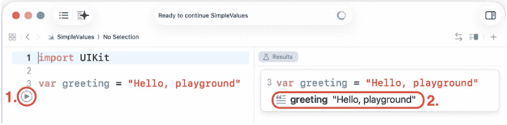

图 2.6：显示 "Hello, playground" 的 Playground

2. 在 Playground 的 Editor area 中输入以下代码：

```
// SimpleValues
42
-23
3.14159
0.1
-273.15
"hello, world"
"albatross"
true
false
```


请注意，任何以 `//` 开头的行都是注释。注释是你给自己创建笔记和提醒的好方法，Xcode 会忽略它们。

- 2. 如果你的程序没有自动运行，请点击最后一行左侧的 Run 按钮来运行代码。

- 3. 等待几秒。Xcode 将评估你的输入并在 Results 区域显示结果，如下所示：

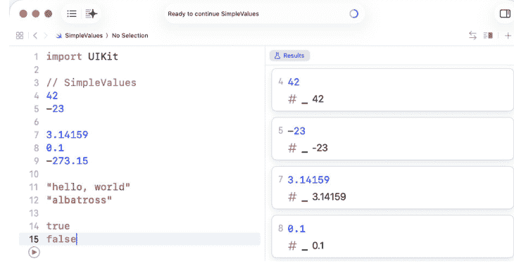

图 2.7：在 Results 区域显示结果的 Playground

请注意，注释不会出现在 Results 区域。

太棒了！你创建并运行了第一个 playground。让我们在下一节中查看如何存储不同的数据类型。

## 常量和变量

现在你已经了解了 Swift 支持的简单数据类型，让我们来看看如何存储它们，以便稍后对它们进行操作。

你可以使用常量或变量来存储值。它们都是带有名称的容器，但常量的值只能设置一次，且设置后无法更改，而变量的值可以随时更改。

在使用常量和变量之前，你必须先声明它们。常量使用 `let` 关键字声明，变量使用 `var` 关键字声明。

让我们通过在 playground 中实现它们来探索常量和变量的工作原理。遵循以下步骤：

- 在你的 playground 中添加以下代码以声明三个常量：

```
let answerToTheUltimateQuestion = 42
let pi = 3.14159
let myName = "Ahmad Sahar"
```

- 点击最后一行左侧的 Run 按钮运行它。在每种情况下，都会创建一个并命名的容器，并将分配的值存储在其中。

> 你可能已经注意到，显示的常量和变量名称以小写字母开头，如果名称包含多个单词，则后续每个单词的首字母都大写。这被称为驼峰命名法（camel case）。强烈建议这样做，因为大多数经验丰富的 Swift 程序员都遵循这一约定。

> 注意，用双引号括起来的字符序列 "Ahmad Sahar" 用于为 `myName` 赋值。这被称为字符串字面量（string literal）。

- 在常量声明之后添加以下代码以声明三个变量并运行它：

```
var currentTemperatureInCelsius = 27
var myAge = 50
var myLocation = "home"
```

与常量一样，每种情况下都会创建一个并命名的容器，并将分配的值存储在其中。

> 存储的值显示在 Results 区域中。

- 4. 常量的值一旦设置就无法更改。为了测试这一点，在变量声明之后添加以下代码：

```
let isRaining = true
isRaining = false
```

当你输入第二行代码时，会弹出一个 `isRaining` 菜单，并提供建议：


使用上下方向键选择 `isRaining` 常量，并按 Tab 键进行选择。此功能称为自动补全（autocomplete），有助于在输入代码时防止拼写错误。

- 5. 当你完成输入后，等待几秒钟。在第二行，你会看到出现一个错误通知（中间有一个白点的红圆圈）：

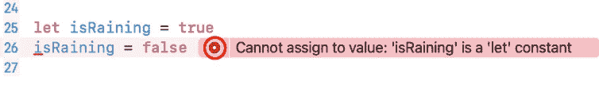

这意味着你的程序中存在错误，Xcode 显示错误是因为你正尝试在常量初始值设置后为其分配新值。

- 6. 点击红圆圈展开错误消息。你会看到下面一个带有 Apply 按钮的框：

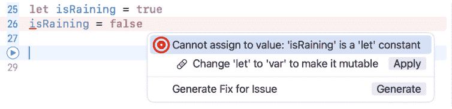

Xcode 告诉你是问题所在（Cannot assign to value: ‘isRaining’ is a ‘let’ constant），并建议了修改方法（将‘let’更改为‘var’使其可变）。“可变”（Mutable）意味着该值在初始设置后可以更改。

- 点击 Apply 按钮。你会发现 `isRaining` 常量的声明已变为变量声明：

```
24
25 var isRaining = true
26 isRaining = false
27
```

图 2.11：应用修复后的代码

由于变量在创建后可以分配新值，因此错误得到了解决。然而，请注意，建议的修复可能不是最佳解决方案。随着你获得更多 iOS 开发经验，你将能够确定最佳行动方案。

如果你查看输入的代码，可能会疑惑 Xcode 是如何知道变量或常量中存储的数据类型的。你将在下一节中学习如何做到。

### 类型推断和类型安全

在上一节中，你声明了常量和变量并为它们赋值。Swift 根据提供的值自动确定常量或变量的类型。这被称为类型推断（type inference）。你可以通过按住 Option 键并点击名称来查看常量或变量的类型。要演示，请遵循以下步骤：

- 在你的 playground 中添加以下代码以声明常量：

```
let cuisine = "Italian"
```

- 按住 Option 键并点击 cuisine 查看其类型。你应该看到 `String`。

- 现在，通过将 `let` 替换为 `var` 将常量改为变量：

```
var cuisine = "Italian"
```

- 现在你可以为 `cuisine` 分配新值：

```swift
cuisine = "Mexican"
```

这种类型推断允许你编写更少的代码，而无需显式说明每个变量和常量的类型。但是，如果你需要，仍然可以指定类型：

```swift
var cuisine: String = "Italian"
```


# 第 2 章

你会得到一个错误信息（二元运算符 '+' 无法应用于类型为 'Int' 和 'Double' 的操作数）。这是因为 a 和 b 是不同的类型。注意，Xcode 无法自动修复此问题，因此它不会显示任何修复建议。

- 要修复错误 c = Double(a) + b

```swift
let c = Double(a) + b
```
`Double(a)` 获取 a 中的值并据此创建一个浮点数。两个操作数都是相同类型，你可以将其与 b 中的值相加。赋值给 c 的值为 24.0，在结果区域（Results area）中将显示 24。

现在你已经知道了如何使用算术运算符，在下一节中，你将查看复合赋值运算符（+=, -=, *= /=）。

## 复合赋值运算符

你可以使用这里所示复合赋值运算符对值进行操作，并将结果赋值给变量：

| | |
|---|---|
| += | 添加一个值并将结果赋值给变量 |
| -= | 减去一个值并将结果赋值给变量 |
| *= | 乘以一个值并将结果赋值给变量 |
| /= | 除以一个值并将结果赋值给变量 |

图 2.15：复合赋值运算符

让我们看看这些运算符是如何使用的。将以下代码添加到你的游场（playground）并运行：

```swift
var d = 1
d += 2
d -= 1
```

`d += 2` 表达式是 `d = d + 2` 的简写，因此 d 的值现在是 1 + 2，3 将赋值给 d。同样，`d -= 1` 是 `d = d - 1` 的简写，所以 d 的值现在是 3 - 1，2 将赋值给 d。

现在你已经熟悉了复合赋值运算符，让我们在下一节中查看比较运算符（==, !=, >, >=, <, <=）。

### 比较运算符

你可以使用比较运算符比较一个值与另一个值，结果将为 true 或 false。你可以使用以下比较运算符：

| | 描述 |
|---|---|
| == | 等于 |
| != | 不等于 |
| > | 大于 |
| < | 小于 |
| >= | 大于等于 |
| <= | 小于等于 |

图 2.16：比较运算符

让我们看看这些运算符是如何使用的。将以下代码添加到你的游场并运行：

```swift
1 == 1
2 != 1
2 > 1
1 < 2
1 >= 1
2 <= 1
```

让我们看看它是如何工作的：

- 1 == 1 返回 true，因为 1 等于 1。
- 2 != 1 返回 true，因为 2 不等于 1。
- 2 > 1 返回 true，因为 2 大于 1。
- 1 < 2 返回 true，因为 1 小于 2。
- 1 >= 1 返回 true，因为 1 大于或等于 1。
- 2 <= 1 返回 false，因为 2 不小于或等于 1。

返回的布尔值将显示在结果区域中。

如果你想检查多个条件，会发生什么？这就是逻辑运算符（AND, OR 或 NOT）派用用场。你将在下一节中学习它们。

### 逻辑运算符

在处理两个或多个条件时，逻辑运算符非常有用。例如，如果你在便利店，如果你有现金或信用卡，就可以支付物品。在这种情况下，OR 是逻辑运算符。

你可以使用以下逻辑运算符：

| | 描述 |
|---|---|
| && | 逻辑与 (AND) - 仅当所有条件都为真时返回 true |
| || | 逻辑或 (OR) - 如果任何一个条件为真则返回 true |
| ! | 逻辑非 (NOT) - 返回相反的布尔值 |

图 2.17：逻辑运算符

查看这些运算符如何使用，将以下代码添加到你的游场并运行：

```swift
(1 == 1) && (2 == 2)
(1 == 1) && (2 != 2)
(1 == 1) || (2 == 2)
(1 == 1) || (2 != 2)
(1 != 1) || (2 == 2)
!(1 == 1)
```

让我们看看它是如何工作的：

- (1 == 1) && (2 == 2) 返回 true，因为两个操作数都是真，所以 AND 返回 true。
- (1 == 1) && (2 != 2) 返回 false，因为一个操作数为假，所以 true AND 返回 false。
- (1 == 1) || (2 == 2) 返回 true，因为两个操作数都是真，所以 OR 返回 true。
- (1 == 1) || (2 != 2) 返回 true，因为一个操作数为真，所以 true OR 返回 true。
- (1 != 1) || (2 == 2) 返回 false，因为两个操作数都是假，所以 false OR 返回 false。
- !(1 == 1) 返回 false，因为 1==1 为真，所以 NOT 返回 false。

返回的布尔值将显示在结果区域中。

到目前为止，你只处理了数字。在下一节中，你将看到如何对单词和句子进行操作，它们使用 Swift 的 String 类型存储为字符串。

### 字符串操作

正如你之前看到的，字符串是一系列字符。它们使用 Swift 的 String 类型存储。

> 有关关于字符串的更多信息，请访问 https://developer.apple.org/documentation/swift-language/strings

让我们看看这些操作是如何使用的。将以下代码添加到你的游场并运行：

```swift
let greeting = "Hello"
let name = "World"
let message = greeting + " " + name
print(message)
```

输出将是 "Hello World"。

到为止，你只处理了数字。在下一节中，你将看到如何对单词和句子进行操作，它们使用 Swift 的 String 类型存储。

### print() 语句

到目前为止，你只处理了数字。在下一节中，你将看到如何对单词和句子进行操作，它们使用 Swift 的 String 类型存储。

正如你在第 1 章 Xcode 中看到的，项目没有像游场那样的结果区域，但项目和 Xcode 都有调试区域。要在程序运行时显示变量和常量的内容，你将学习如何打印到调试区域。

print() 语句是一个函数。你将在第 6 章函数与闭包中学习更多关于函数的知识。

运行以下代码：

```swift
let rating = 3.5
let ratingResult = "The rating is " + String(rating)
print(ratingResult)
```

你将在调试区域看到结果：

```
The rating is 3.5
```

图 2.18：显示 print() 语句结果的调试区域

当你刚开始时，可以随心所欲地使用 print() 。这是理解程序正在发生什么的好方法。

总结

在本章中，你学习了如何创建和使用游场文件，这些文件允许你探索和实验 Swift。

你看到了 Swift 如何表示不同类型的数据，以及如何使用常量和变量。这允许你的程序存储数字、布尔值和字符串。

你还学习了类型推断、类型注解和类型安全，这些有助于你编写更简洁且错误更少的代码。

你查看了如何修复错误以及如何打印到调试区域，这在你尝试查找并修复编写的程序中的错误时非常有用。

在下一章中，你将查看条件判断和可选类型。条件判断处理程序中的逻辑选择，而可选类型处理变量可能也可能没有值的情况。


# 3

## 条件判断与可选类型

在上一章中，你学习了数据类型、常量、变量和操作。此时，你已经可以编写处理字母和数字的简单程序了。然而，程序的运行并不总是按照顺序进行的。你经常需要根据某个条件执行不同的指令。Swift 允许你通过条件判断来实现这一点，你将在本章中学习如何使用它们。

你可能注意到的另一点是，在上一章中，每个变量或常量都被立即赋予了值。如果你需要一个初始可能没有值的变量怎么办？你需要一种方法创建一个可能也可能没有值的变量。Swift 允许你通过可选类型（Optionals）来实现这一点，你也将在本章中学习关于它们。

在本章结束时，你应该能够编写根据条件执行不同操作的程序，并处理可能也可能没有值的变量。

将涵盖以下主题：

- 条件判断
- 可选类型与可选绑定

> 请花些时间理解可选类型。对于初学者来说，它们可能令人生生畏，但正如你所看到的，它们是 iOS 开发的重要部分。

### 技术要求

本章的 Xcode playground 位于本书代码包的 Chapter03 文件夹中，可以从这里下载：

https://github.com/PacktPublishing/IOS-26-Programming-for-Beginners-IOE

查看以下视频了解代码运行效果：

https://youtube.be/ONqhr2gakjQ

创建一个新的 playground并将其命名为 ConditionalsAndOptionals。你可以在学习的过程中输入并运行本章中的所有代码。你将从学习条件判断开始。

### 条件判断

有时，你将根据特定条件执行不同的代码块，例如以下场景：

- 在酒店中在不同的房型之间进行选择。大房间的价格会更高。
- 在网商店中不同的支付方式之间切换。不同的支付方式有不同的流程。
- 在快餐店决定点什么。每种食物的制作流程各不相同。

要实现这一点，你需要使用条件判断。在 Swift 中，这是通过 `if` 语句（用于单条件）和 `switch` 语句（用于多条件）来实现的。

> 有关条件判断的更多信息，请访问 https://docs.swift.org/swift-book/documentation/the-swift-programming-language/controlflow。

让我们在下一节看看如何使用 `if` 语句根据条件执行不同的任务。

### if 语句

`if` 语句在条件返回 `true` 时执行一个代码块，可选地，在条件返回 `false` 时执行另一个代码块。它的结构如下：

```
if condition {
code1
} else {
code2
}
```

现在让我们实现一个 `if` 语句来观察其运行效果。假设你正在为一家餐厅编写应用程序。该程序将允许你检查餐厅是否营业、搜索餐厅以及检查客户是否已达到最低饮酒年龄。按照步骤操作：

- 要检查餐厅是否营业，向你的 playground 中添加以下代码。运行它来创建一个常量，并在常量值为 `true` 时执行语句：

```
let isRestaurantOpen = true
if isRestaurantOpen {
print("Restaurant is open.")
}
```

首先，你创建了一个常量 `isRestaurantOpen`，并给它赋值为 `true`。接下来，你有一个 `if` 语句来检查 `isRestaurantOpen` 中存储的值是否等于 `true`。由于值等于 `true`，执行了 `print()` 语句，Debug 区域打印了 "Restaurant is open."。

- 尝试将 `isRestaurantOpen` 的值改为 `false` 并再次运行你的代码。现在条件返回 `false`，Debug 区域将不会打印任何内容。

- 你也可以在值为 `false` 时执行语句。假设客户搜索了一家不在应用数据库中的特定餐厅，因此应用将显示消息说未找到该餐厅。输入以下代码创建一个常量，并在常量值为 `false` 时执行语句：

```
let isRestaurantFound = false
if isRestaurantFound == false {
print("Restaurant was not found")
}
```

常量 `isRestaurantFound` 被设置为 `false`。接下来，检查 `if` 语句。
`isRestaurantFound == false` 条件返回 `true`，Debug 区域打印了 "Restaurant was not found"。

> 你也可以用 `!isRestaurantFound` 替替 `isRestaurantFound == false` 来检查该条件。

- 4. 将 `isRestaurantFound` 的值改为 `true`。由于条件（现在）返回 `false`，Debug 区域将不会打印任何内容。

- 5. 若要在条件返回 `true` 时执行一组语句，在条件返回 `false` 时执行另一组语句，请使用 `else` 关键字。输入以下代码，检查酒吧的客户是否超过了饮酒限制：

```
let drinkingAgeLimit = 21
let customerAge = 23
if customerAge < drinkingAgeLimit {
  print("Under age limit")
} else {
  print("Over age limit")
}
```

`drinkingAgeLimit` 被赋值为 21，`customerAge` 被赋值为 23。在语句中，检查了 `customerAge < drinkingAgeLimit`。由于 `23 < 21` 返回 `false`，Debug 区域打印了 "Over age limit"。到目前为止，你只处理了单条件。如果有多个条件呢？这就是 `switch` 语句派用用场，你将在下一节中学习它们。

### switch 语句

为了理解 `switch` 语句，让我们从实现一个带有多个条件的 `if` 语句开始。假设你正在为一个信号灯编写程序。灯有三种颜色——红、黄、绿——你希望根据颜色执行不同的操作。

- 1. 向你的 playground 添加以下代码，使用 `if` 语句来实现此功能：

```
var trafficLightColor = "Yellow"
if trafficLightColor == "Red" {
  print("Stop")
} else if trafficLightColor == "Yellow" {
  print("Caution")
} else if trafficLightColor == "Green" {
  print("Go")
} else {
  print("Invalid color")
}
```

第一个 `if` 条件 `trafficLightColor == "Red"` 返回 `false`，因此执行 `else if`。第二个 `if` 条件 `trafficLightColor == "Yellow"` 返回 `true`，Debug 区域打印了 "Caution"。尝试更改 `trafficLightColor` 的值查看不同的结果。

这里使用的代码可行，但读起来有点困难。在这种情况下，`switch` 语句更加简洁且易于理解。`switch` 语句结构如下：

```
switch value {
case firstValue:
code1
case secondValue:
code2
default:
code3
}
```

检查值并匹配某个 `case`，然后执行该案例的代码。如果没有匹配项，则执行 `default` 案例的代码。

- 2. 这里是如何将先前的 `if` 语句重写为 `switch` 语句的。输入以下代码并运行：

```
trafficLightColor = "Yellow"
switch trafficLightColor {
  case "Red":
    print("Stop")
  case "Yellow":
    print("Caution")
  case "Green":
    print("Go")
  default:
    print("Invalid color")
}
```

这里的代码易读得多。`trafficLightColor` 的值为 "Yellow"，因此匹配了 `case "Yellow"`，Debug 区域打印了 "Caution"。尝试更改 `trafficLightColor` 的值查看不同的结果。

关于 `switch` 语句有两点需要记住：

- Swift 中的 `switch` 语句默认不会穿透每个案例的底部进入下一个案例。在先前的示例中，一旦匹配了 `"Yellow"`，`case "Red"`、`case "Green"` 和 `default` 都不会执行。
- `switch` 语句必须覆盖所有可能。在先前的示例中，除 "Red"、Yellow" 或 "Green" 之外的任何 `trafficLightColor` 值将匹配到 `default`，并打印 "Invalid color"。

`if` 和 `switch` 语句的章节到此结束。在下一节中，你将学习可选类型（Optionals），它允许创建没有初始值的变量，以及可选绑定（Optional Binding），它允许在可选类型有值时执行指令。


# 第3章

> 有关可选类型（optionals）的更多信息，请访问 https://docs.swift.org/swift-book/documentation/the-swift-programming-language/thebasics。

让我们学习如何创建和使用可选类型并看看它们在程序中是如何使用的。假设你正在编写一个程序，用户需要输入他们配偶的名字。或者，如果用户未婚，那么这个字段就没有值。在这种情况下，你可以使用可选类型来表示配偶的名字。

一个可选类型可能处于两种可能状态之一。它可以包含一个值，也可以不包含一个值。如果可选类型包含一个值，你就可以访问其内部的值。访问可选类型值的过程被称为**解包**（unwrapping）可选类型。让我们通过以下步骤来看看它是如何运作的：

- 将代码添加到你的游场（playground）中，以创建一个变量并打印其内容：

```swift
var spouseName: String
print(spouseName)
```

- 由于 Swift 是类型安全的，会出现一个错误（变量‘spouseName’在初始化之前被使用）。

- 要解决这个问题，你可以给 spouseName 赋值一个空字符串。按所示修改你的代码：

```swift
var spouseName: String = ""
```

这使得错误消失了，但空字符串仍然是一个值，而 spouseName 不应该有一个值。

- 由于 spouseName 初始不应该有值，让我们把它变成可选类型。要这样做，在类型注解后输入一个问号，并删除空字符串赋值：

```swift
var spouseName: String?
```

你会看到一个警告，因为 spouseName 现在是一个可选字符串而不是一个普通的字符串变量，而 `print( ) 语句期望的是一个普通的字符串变量。

```swift
444 spouseName: String?
print(spouseName) ⚠️ 表达式隐式从 '?' 转换为 'Any'
```

图 3.1：警告通知

尽管有警告，现在也忽略它并运行你的代码。spouseName 的值在结果（Results）中显示为 nil，在调试区域（Debug area）中打印了 nil。nil 是一个特殊的关键字，意味着可选变量 spouseName 没有值。

- 警告出现的原因是 print 语句将 spouseName 视为 Any 类型而不是 String? 类型。点击黄色三角形显示可能的解决方案，并点击旁边的 Apply（应用）来选择其中一个：

```swift
44 var spouseName: String?
45 print(spouseName)
```

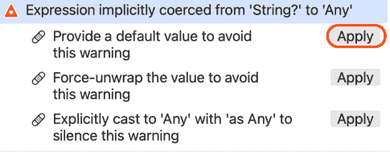

图 3.2：高亮第一个解决方案的展开警告通知

语句将更改为 (spouseName ?? default value)。注意 ?? 运算符的使用。这意味着如果 spouseName 不包含值，则在 print 语句中使用你提供的默认值。

- 如所示，将默认值占位符替换为 "No value in spouseName"。警告将会消失。再次运行你的程序，调试区域中将出现 "No value in spouseName"：

```swift
44 var spouseName: String
45 print(spouseName ?? "No value in spouseName")
```

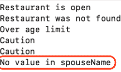

图 3.3：显示默认值的调试区域

7. 让我们给 spouseName 赋值一个值。按所示修改代码：

```swift
var spouseName: String
spouseName = "Nia"
print(spouseName ?? "No value in spouseName")
```

当你运行程序时，Nia 出现在调试区域中。

8. 再添加一行将 spouseName 与另一个字符串连接起来，如下：

```swift
print(spouseName ?? "No value in spouseName")
let greeting = "Hello", + spouseName
```

你将得到一个错误，调试区域会显示错误信息以及错误发生的位置。这是因为你不能使用 `+` 运算符将普通变量与可选类型连接。你需要先解包可选类型。

9. 点击红圈显示可能的解决方案，你会看到以下内容：

```swift
print(spouseName ?? "No value in spouseName")
let greeting = "Hello", + spouseName
```

| 描述 |
| :--- |
| 可选类型 'String' 的值必须解包为 'String' 类型的值 |
| 使用 '?' 进行合并，当可选值包含 'nil' 时提供默认值 |
| 使用 '!' 进行强制解包，当可选值包含 'nil' 时中止执行 |
| 为问题生成修复 |

图 3.4：高亮第二个解决方案的展开错误通知

第二个解决方案建议使用强制解包来解决这个问题。强制解包无论可选类型是否包含值都会进行解包。如果 spouseName 有值，它会修复问题，但如果 spouseName 是 nil，你的代码将会崩溃。

10. 点击 Apply（应用）使用强制解包来解决此问题。在 spouseName 后面加上感叹号：

```swift
let greeting = "Hello", spouseName!
```

11. 运行你的程序，Nia 出现在调试区域。

12. 为了看到可选值包含 nil 时强制解包的效果，将 spouseName 设置为 nil：

```swift
spouseName = nil
```

当你运行程序时，程序会崩溃：

```text
Unexpected error: found nil while unwrapping an Optional value
```

13. 更好的处理方式是使用可选绑定，如下：

```swift
if spouseName
```

你会发现，即使 spouseName 为 nil，程序也不会崩溃。

14. 为了看到 spouseName 有值时使用可选绑定的效果，修改代码：

```swift
var spouseName = "Nia"
if spouseName
```

这时，Nia 会出现在调试区域。

15. 你还可以通过以下更简单的方式来编写上一步中的代码：

```swift
var spouseName = "Nia"
if let name = spouseName
```

在这里，spouseName 被解包并赋值给常量 name。

16. 你还可以使用 `guard` 语句：

```swift
var spouseName = "Nia"
guard let name = spouseName else {
    print("No name")
    return
}
print(name)
```

17. 最后，你还可以使用可选合并运算符来提供一个默认值：

```swift
var spouseName = "Nia"
let name = spouseName ?? "Unknown"
print(name)
```

这样你就学会了如何安全处理可选类型。


查看以下视频以查看代码演示：

https://youtu.be/U52X9c9EAVA

如果你想从头开始，请创建一个新的游程（playground）并将其命名为 RangeOperatorsAndLoops。

你可以在过程中输入并运行本章中的所有代码。

让我们先用范围运算符指定一个数字范围。

## 范围运算符

想象你需要为一家百货商店编写一个程序，自动向 18 到 30 岁之间的客户发送折扣券。如果你需要为每个年龄设置一个 `if` 或 `switch` 语句，将非常麻烦。在这种情况下，使用范围运算符要方便得多。

范围运算符允许你表示一个值的范围。假设你想表示一个从 `firstNumber` 开始到 `lastNumber` 结束的数字序列。你不需要指定每一个值，只需这样指定范围：

```
firstNumber...lastNumber
```

在百货商店的示例中，你可以这样指定客户年龄：

```
18...30
```

> 有关范围运算符的更多信息，请访问 https://docs.swift.org/swift-book/documentation/the-swift-programming-language/basicoperators。

让我们在游程中尝试一下。遵循以下步骤：

- 1. 将以下代码添加到你的游程中并运行它：

```
let myRange = 10...20
```

这将一个从 10 开始到 20 结束的数字序列（包含这两个数字）赋值给 `myRange` 常量。这被称为闭区间范围运算符。`myRange` 的起始和结束值将显示在结果（Results）区域：

### 结果

```
3 let myRange = 10...20
 myRange ClosedRange(10...20)
### lowerBound 10
### upperBound 20
```

图 4.1：显示范围起始和结束值的的结果


记住，你可以拖动结果区域和编辑器之间的边界来更改结果区域的大小。

- 2. 如果你不想在范围内包含序列的最后一个数字，将 `...` 替换为 `..`。在下一行输入并运行以下语句：

```
let myRange2 = 10..20
```

这将从 10 开始到 19 结束的序列存储在 `myRange2` 常量中，这被称为半开范围运算符。

另一种类型的范围运算符，即单侧范围运算符，你将在下一章中学习。

现在你已经知道了如何创建和使用范围，你将在下一节学习循环、不同的循环类型以及如何使用它们。

## 循环

在编程中，你经常需要重复执行相同的操作。例如，公司每个月都需要为每位员工生成工资单。如果公司有 10,000 名员工，编写 10,000 条指令来创建工资单将是无效的。重复 10,000 次单指令会更好，循环就是用于此。

有三种循环类型：`for-in` 循环、`while` 循环和 `repeat-while` 循环。`for-in` 循环将重复已知的次数，而 `while` 和 `repeat-while` 循环将在循环条件为真时进行重复。

> 有关循环的更多信息，请访问 https://docs.swift.org/swift-book/documentation/the-swift-programming-language/controlflow。

让我们逐查看每个类型。

### for-In 循环

`for-in` 循环遍历序列中的每一个值，并且每次执行一组位于大括号中的语句，称为循环体（loop body）。每个值被逐一赋值给临时变量，该临时变量可以在循环体中使用。它看起来像这样：

```
for item in sequence {
  code
}
```

`for-in` 重复次数由序列中项的数量决定。让我们从创建一个 `for-in` 循环来显示 `myRange` 中的所有数字开始。遵循以下步骤：

- 1. 将以下代码添加到你的游程中并运行它：

```
for number in myRange {
  print(number)
}
```

在这里，循环内部语句执行了 11 次，因为 `myRange` 包含了范围中的最后一个数字。你应该能在调试（Debug）区域看到序列中的每个数字，调试区域中打印的最后一个值是 20。

- 2. 让我们尝试相同的程序，但这次使用 `myRange2`。按如下方式修改代码并运行：

```
for number in myRange2 {
  print(number)
}
```

在这种情况下，循环内部语句执行了 10 次，调试区域中打印的最后一个值是 19。

- 3. 你甚至可以在关键字后直接使用范围运算符。输入并运行以下代码：

```
for number in 0...5 {
  print(number)
}
```

从 0 到 5 的每个数字都显示在调试区域。

- 4. 如果你想让序列反转，使用 `reversed()` 函数。要这样做，按如下方式修改代码并运行：

```
for number in (0...5).reversed() {
  print(number)
}
```

从 0 到 5 的每个数字都显示在调试区域。

做得好！让我们在下一节查看 `while` 循环，它用于在条件为真时需要重复循环序列的情况。

### while 循环

`while` 循环包含一个条件和一个位于大括号中的语句，称为循环体。首先检查条件；如果为真，则执行循环体，循环一直持续直到条件为假。以下是 `while` 循环的示例：

```
while condition == true {
  code
}
```

要查看 `while` 循环的运行，在游程中所有代码之后添加以下代码并运行它：

```
var x = 0
while x < 50 {
  x += 5
  print("x is \(x)")
}
```

让我们过一遍代码。最初，`x` 设置为 0。检查 `x < 50` 条件并返回真，因此执行循环体。`x` 的值加 5，现在 `x` 包含 5，调试区域打印 `x is 5`。循环重复，检查 `x < 50`。由于 `x` 是 5，返回真，执行循环体。`x` 的值加 5，现在 `x` 包含 10，调试区域打印 `x is 10`。循环重复直到 `x` 达到 50，此时 `x < 50` 返回假，循环停止。如果条件一开始为假，循环体将不会执行。尝试将 `x` 的值改为 100 这种情况。

### repeat-while 循环

`repeat-while` 循环像 `while` 循环一样包含一个条件和一个循环体，但在检查条件之前先执行循环体。如果条件为真，循环重复直到条件为假。以下是 `repeat-while` 循环的示例：

```
repeat {
  while condition == true
}
```

要查看 `repeat-while` 循环的运行，在游程中所有代码之后添加以下代码并运行它：

```
var y = 0
repeat {
  y += 5
  print("y is \(y)")
} while y < 50
```

让我们过一遍代码。最初，`y` 设置为 0。执行循环体。`y` 的值加 5，现在 `y` 包含 5，调试区域打印 `y is 5`。检查 `y < 50`，由于返回真，循环重复。`y` 的值加 5，现在 `y` 包含 10，调试区域打印 `y is 10`。循环重复直到 `y` 达到 50，此时 `y < 50` 返回假，循环停止。如果条件一开始为假，循环体将至少执行一次。尝试将 `y` 的值改为 100 这种情况。

### 总结

在本章中，你查看了闭区间和半开范围运算符，它们允许你指定数字范围而不是指定每一个数字。

你还学习了三种不同的循环类型：`for-in` 循环、`while` 循环和 `repeat-while` 循环。`for-in` 循环允许固定次数地重复一组语句，而 `while` 和 `repeat-while` 允许在条件为真时重复一组语句。做得好！

在下一章中，你将学习集合类型，它们允许存储由索引引用的数据集合、键值对集合以及无结构数据集合。

# 在 Discord 上加入我们

与其他用户、专家以及作者本人一起阅读这本书。

提问、为其他读者提供解决方案、通过任何提问（AMA）会议与作者聊天，以及更多。扫描二维码或访问链接加入社区。

```
https://packt.link/LdDT/
```


# 5 集合类型

到目前为止，你已经学会了很多知识！你现在可以创建一个程序，在常量或变量中存储数据并对它们执行操作，你还可以使用条件判断和循环来控制流程。但到目前为止，你大多存储的是单个值。

在本章中，你将学习存储值值集合的方法。Swift 有三种集合类型：数组（arrays），它们存储有序的值列表；字典（diction），它们存储无序的键值对列表；以及集合（sets），它们存储无序的值列表。

在本章结束时，你将学会如何创建数组、字典和集合，以及如何对它们执行操作。

本章将涵盖以下主题：

- 数组
- 字典
- 集合

### 技术要求

本章的 Xcode playground 可以在该书籍代码包的 Chapter05 文件夹中找到，你可以从这里下载：

```
https://github.com/PacktPublishing/iOS-26-Programming-for-Beginners-10E
```

查看以下视频以查看代码：

```
https://youtu.be/hlACW615fzs
```

如果你想从零开始，请创建一个新的 playground 并将其命名为 CollectionTypes。你可以一边学习输入并运行本章中的所有代码。

> 要了解更多关于数组、字典和集合的信息，请访问 https://docs.swift.org/swift-book/documentation/the-swift-programming-language/collectiontypes。

你将学习的第一种集合类型是数组，它允许你在一个有序列表中存储信息。

### 数组

假设你想存储以下内容：

- 在便利店要买的物品列表
- 每个月必须做的家务

数组非常适合这种场景。数组在有序列表中存储值。它的结构看起来如下：

| 索引 (Index) | 值 (Value) |
|---|---|
| 0 | value1 |
| 1 | value2 |
| 2 | value3 |

图 5.1：数组的表示

值必须是相同的类型。你可以使用数组索引（从 0 开始）访问数组中的任何值。

如果你使用 `let` 关键字创建数组，则其内容在创建后将无法更改。如果你想在创建后更改数组的内容，请使用 `var` 关键字。

让我们看看如何操作数组。在下一节中，你将通过给它赋值来创建一个数组。

### 创建数组

在之前的章节中，你通过声明常量或变量并为其分配初始值来创建它们。你可以以相同的方式创建一个数组。

想象你的配偶要求你从便利店买一些东西。让我们使用数组来实现一个购物清单。将以下代码添加到你的 playground 并运行它：

```
var shoppingList = ["Eggs", "Milk"]
```

此指令创建了一个名为 `shoppingList` 的数组变量。所赋值的值 `["Eggs", "Milk"]` 是一个数组字面量。它表示一个包含两个 `String` 类型元素的数组，索引 0 处是 "Eggs"，索引 1 处是 "Milk"。

使用 `var` 关键字意味着数组的内容可以修改。由于 Swift 的类型推断，此数组的元素将是 `String` 类型。

想象你需要检查需要去商店买多少件物品。在下一节中，你将学习如何确定数组中的元素数量。

### 检查数组中的元素数量

要找出数组中有多少个元素，使用 `count`。输入并运行以下代码：

```
shoppingList.count
```

由于 `shoppingList` 包含两个元素，结果区域将显示 `2`。

你可以使用 `isEmpty` 来检查数组是否为空。输入并运行以下代码：

```
shoppingList.isEmpty
```

由于 `shoppingList` 包含两个元素，结果区域将显示 `false`。

> 也可以通过 `shoppingList.count == 0` 来查看数组是否为空，但使用 `shoppingList.isEmpty` 性能更好。

想象你的配偶打来电话，要求你在商店时顺便买食用油、鱼和鸡肉。在下一节中，你将看到如何向数组末尾以及指定的数组索引处添加元素。

### 向数组添加新元素

你可以使用 `append(_:)` 向数组的末尾添加新元素。输入并运行以下代码：

```
shoppingList.append("Cooking Oil")
```

"Cooking Oil" 已添加到 `shoppingList` 数组的末尾，现在它包含三个元素——"Eggs"、"Milk" 和 "Cooking Oil"，结果区域中显示了这三个值。

你还可以使用 `+` 运算符将一个数组添加到另一个数组，使用如下代码：

```
shoppingList = shoppingList + ["Fish"]
```

你可以使用 `insert(_:at)` 在指定的索引处添加新项。输入并运行代码：

```
shoppingList.insert("Chicken", at: 1)
```

这会将 "Chicken" 插入到索引 1 处，因此 `shoppingList` 数组包含 "Eggs"、"Chicken"、"Milk"、"Cooking Oil" 和 "Fish"。注意 "Chicken" 是数组中的第二个元素，因为第一个元素位于索引 0。在结果区域可以看到：

```
import UIKit
var shoppingList = ["Eggs", "Milk"]
shoppingList.count
shoppingList.isEmpty
shoppingList.append("Cooking Oil")
shoppingList = shoppingList + ["Fish"]
shoppingList.insert("Chicken", at: 1)
```

图 5.2：在有序列表中插入元素

注意 "Chicken" 是数组中的第二个元素，因为第一个元素位于索引 0。这可以在结果区域中看到：

由于你已经获取了列表中的所有项（重复内容）

在下一节中，你将看到如何向数组末尾以及指定的数组索引处添加元素。

### 数组

（此处：此处原文存在重复内容）

访问特定的元素。在下一节中，你将学习如何通过索引访问元素。

### 访问数组元素

你可以使用索引来访问数组中的元素。输入并运行以下代码：

```
shoppingList[2]
```

这返回索引 2 处的元素，结果区域中显示为 "Milk"。

想象你的配偶打来电话，要求你在商店时顺便买食用油、鱼和鸡肉。由于 `var` 关键字声明的数组，你可以修改其存储的值。

赋值 

（此处：此处原文存在重复内容）

索引 2 处的值显示为 "Milk"。

在下一节中，你将学习如何为指定索引赋值新值。

### 为指定索引赋值新值

你可以通过指定索引替换现有的数组元素。输入并运行以下代码：

```
shoppingList[2] = "Soy Milk"
shoppingList
```

这替换了索引 2 处的 "Milk" 为 "Soy Milk"。`shoppingList` 现在包含 "Eggs"、"Soy Milk"、"Cooking Oil" 和 "Fish"。

注意有效的索引为 0, 1, 2, 3 和 4。使用索引 5 将导致程序崩溃。

想象你的配偶打来电话，要求你在商店时顺便买食用油、鱼和鸡肉。在下一节中，你将看到两种从数组删除元素的方法。

### 从数组删除元素

你可以使用 `remove(at:)` 从数组中删除元素。输入并运行以下代码：

```
let oldArrayValue = shoppingList.remove(at: 1)
oldArrayValue
shoppingList
```

这从 `shoppingList` 中删除了索引 1 处的 "Chicken"，现在包含 "Eggs"、"Milk"、Cooking Oil" 和 "Fish"。被删除的项目存储在 `oldArrayValue` 中。你可以在结果区域看到。

你还可以不保留删除的值。输入并运行以下代码：

```
shoppingList.remove(3)
shoppingList
```

这删除了索引 3 处的 "Fish"，`shoppingList` 现在包含 "Eggs"、"Milk" 和 "Cooking Oil"。

如果你要从数组删除最后一个元素，可以使用 `removeLast()`，并可选地将删除的值赋值给常量或变量。

想象你获取了列表中的所有项，想再次检查列表。你需要逐个访问数组中的每个元素并对每个元素执行操作。你将在下一节中学习如何这样做。

### 遍历数组

还记得上一节学过的 `for-in` 循环吗？你可以用它遍历数组中的每个元素。输入并运行以下代码：

```
for shoppingItem in shoppingList {
    print(shoppingItem)
}
```

这会将数组中的每个元素打印到调试区域。

你还可以使用单侧范围运算符。这些是只有起始值的范围运算符，例如 `1...`。输入并运行以下代码：

```
for shoppingItem in shoppingList[1...] {
    print(shoppingItem)
}
```

这会将从索引 1 元素开始的数组中的元素打印到调试区域。

你现在知道如何使用数组创建有序列表（例如购物清单），以及如何执行数组操作（如访问、添加和删除元素）。在节节，让我们看看如何使用字典存储无序的键值对列表。

## 字典

假设要创建一个联系人应用。你需要存储一组姓名及其对应的电话号码。字典非常适合这种场景，因为它允许将电话号码与联系人姓名关联起来。


# 第 5 章

# 77

字典在无序列表中存储键值对。它的结构如下：

| 键 (Key) | 值 (Value) |
|---|---|
| key1 | value1 |
| key2 | value2 |
| key3 | value3 |

图 5.3：字典的表示

所有的键必须是相同的类型且是唯一的。所有的值必须是相同的类型，但不需要是唯一的。键和值之间的类型不需要相同。你使用键来获取对应的值。

如果你使用 `let` 关键字创建字典，它的内容在创建后将无法更改。如果你想在创建后更改内容，请使用 `var` 关键字。

让我们来看看如何操作字典。在下一节中，你将通过给它赋值来创建一个字典。

## 创建字典

想象一下，你正在创建一个“联系人”应用。对于这个应用，你将使用字典来存储联系人。就像数组一样，你可以通过声明字典并为其分配初始值来创建一个新字典。将以下代码添加到你的 Playground 中并运行：

```
var contactList = ["Shah" : "+60123456789", "Sohini" : "+0223456789"]
```

这条指令创建了一个名为 `contactList` 的变量。赋值的值 `["Shah" : "+60123456789", "Sohini" : "+0223456789"]` 是一个字典字面量。它表示一个包含两个元素的字典。每个元素都是键值对，以联系人姓名为键，联系电话为值。注意，由于联系人姓名是键字段，它应该是唯一的。

由于 `contactList` 字典是一个变量，你可以在它创建后更改字典的内容。由于类型推断，键和值都是 `String` 类型。

想象一下你的应用必须显示联系人的总数。在下一节中，你将学习如何确定字典中的元素数量。

### 检查字典中的元素数量

要找出字典中有多少元素，请使用 `count`。输入并运行以下代码：

```
contactList.count
```

由于 `contactList` 字典中有两个元素，结果（Results）区域中会显示 2。

你可以使用 `isEmpty` 检查字典是否为空。输入并运行以下代码：

```
contactList.isEmpty
```

由于 `contactList` 字典有两个元素，结果（Results）区域会显示 `false`。

> 也可以通过 `contactlist.count == 0` 来查看字典是否为空，但使用 `contactlist.isEmpty` 性能更好。

想象你刚开完一个会议，想向你的应用添加一个新的联系人。由于此字典是使用 `var` 关键字声明的，你可以向它添加键值对。你将在下一节中学习如何操作。

### 向字典添加新元素

要向字典添加新元素，请提供一个键并为其赋值。输入并运行以下代码：

```
contactList["Nithya"] = "+0229876543"
contactList
```

这向 `contactList` 字典中添加了一个键为 "Nithya" 且值为 "+0229876543" 的新键值对。它现在包含了 "Shah" : "+60126789345"、"Sohini" : "+0223456789" 和 "Nithya" : "+0229876543"。你可以在结果（Results）区域看到这些。

想象你想给其中一个联系人打电话，并想拨打该联系人的电话。在下一节中，你将看到如何通过指定所需值的键来访问字典元素。

### 访问字典元素

你可以指定字典键来访问其对应的值。输入并运行以下代码：

```
contactList["Shah"]
```

这返回了键 "Shah" 的值，结果（Results）区域中显示 `+60123456789`。

如果你尝试指定一个字典中不存在的键，将返回一个 `nil` 值。

想象你的联系人之一换了新手机，你必须更新应用中该联系人的电话号码。你可以修改存储在字典中的键值对。你将在下一节中学习如何执行。

### 为现有键分配新值

你可以为现有的键分配新值。输入并运行以下代码：

```
contactList["Shah"] = "+601267893455"
list
```

这为键 "Shah" 分配了一个新值。`contactList` 字典现在包含了 "Shah" : "+601267893455"、"Sohini" : "+0223456789" 和 "Nithya" : "+0229876543"。你可以在结果（Results）区域看到这些。

想象你必须从应用中移除一个联系人。让我们在下一节看看如何从字典中移除元素。

### 从字典中移除元素

要从字典中移除元素，请为现有的键分配 `nil`。输入并运行以下代码：

```
contactList["Sohini"] = nil
list
```

这从 `contactList` 字典中删除了键为 "Sohini" 的元素，它现在包含了 "Shah" : "+601267893455" 和 "Nithya" : "+0229876543"。

如果你想在不赋值给常量或变量的情况下保留被删除的值，请使用 `removeValue(for:)`：

```
var oldDictValue = contactList.removeValue(forKey: "Nithya")
contactList
```

这从 `contactList` 字典中删除了键为 "Nithya" 的元素，并将其赋值给 `oldDictValue`。`oldDictValue` 现在包含 "+0229876543"，而 `contactList` 包含了 "Shah" : "+601267893455"。

### 遍历字典

就像数组一样，你可以使用 `for-in` 循环遍历字典中的每个元素。输入并运行以下代码：

```
for (name, contactNumber) in contactList {
    print("name: \(contactNumber)")
}
```

这调试（Debug）区域打印所有元素。由于字典是无序的，当你再次运行此代码时可能会得到不同的顺序。

你现在已经知道了如何使用字典创建键值对的无序列表（例如联系人列表），以及如何执行字典操作。在下一节中，让我们看看如何使用集合存储值的无序列表。

## 集合

设比你正在编写一个电影应用，想要存储一个电影类型列表。你可以使用集合来实现。

集合在无序列表中存储值。它的结构如下：

| 值 (Value) |
| --- |
| value1 |
| value2 |
| value3 |

图 5.4：集合的表示

如果你使用 `let` 关键字创建集合，它的内容在创建后将无法更改。如果你想在创建后更改内容，请使用 `var` 关键字。


想象你需要在 App 中显示流类型的总数。在下一节中，让我们看看如何查找集合中有多少个元素。

### 检查集合中的元素数量

要查看集合中有多少元素，请使用 `count`。输入并运行以下代码：

```
movieGenres.count
```

由于 `movieGenres` 包含三个元素，结果（Results）区域将显示 `3`。

你可以使用 `isEmpty` 来检查集合是否为空。输入并运行以下代码：

```
movieGenres.isEmpty
```

由于 `movieGenres` 包含三个元素，结果区域将显示 `false`。


> 也可以使用 `movieGenres.count == 0` 来查看集合是否为空，但使用 `movieGenres.isEmpty` 具有更好的性能。

你希望 App 的用户能够向其添加流类型。由于它是使用 `var` 关键字声明的，你可以向它添加元素。你将在下一节中学习如何操作。

### 向集合添加新元素

你可以使用 `insert(_)` 向集合添加新元素。输入并运行以下代码：

```
movieGenres.insert("War")
movieGenres
```

这向 `movieGenres` 集合中添加了一个新项 "War"，该集合现在包含了 "Horror" "Romantic Comedy" "War" 和 "Action"。这在结果区域是可见的。

想象用户可能想要检查你的 App 中是否有某个特定的流类型。在下一节中，你将学习如何检查某个元素是否在集合中。

### 检查集合是否包含某个元素

要检查集合是否包含某些元素，请使用 `contains(_)`。输入并运行以下代码：

```
movieGenres.contains("War")
```

由于 "War" 是 `movieGenres` 集合内部元素之一，结果区域将显示 `true`。

想象用户想从他们的流类型列表中删除一个流。在下一节中，让我们学习如何从集合中移除不再需要的项。

### 从集合中移除项

要从集合中移除项，请使用 `remove(_)`。你正在移除的值可以被丢弃，也可以赋值给变量或常量。如果该值在集合中不存在，将返回 `nil`。输入并运行以下代码：

```
var oldSetValue = movieGenres.remove("Action")
oldSetValue
movieGenres
```

"Action" 从 `movieGenres` 集合中移除并赋值给 `oldSetValue`，现在 `movieGenres` 集合包含 "Horror" "Romantic Comedy" 和 "War"。

若要移除集合中的所有元素，请使用 `removeAll()`。

想象你希望将 App 拥的所有流类型作为推荐提供给用户。你可以遍历集合中的每个元素并对其执行操作。在下一节中，让我们看看如何操作。

### 遍历集合

对于数组和字典，你可以使用 `for-in` 循环遍历集合中的每个元素。输入并运行代码：

```
for genre in movieGenres {
  print(genre)
}
```

你应该在调试（Debug）区域看到每个元素。由于集合是无序的，当你再次再次运行此代码时，可能会得到不同顺序的结果。

想象你希望你的 App 对你喜欢的流类型和另一个人的喜欢的流类型执行某些操作。在下一节中，你将学习在 Swift 中对集合可以进行的各种操作。

## 集合操作

执行并集（union）、交集（intersection）、差集（subtraction）和对称差（symmetric difference）操作非常简单。尝试输入并运行以下代码：

```
let movieGenres2: Set = ["Science Fiction", "War", "Fantasy"]
movieGenres.union(movieGenres)
movieGenres.intersection(movieGenres)
movieGenres.subtracting(movieGenres)
movieGenres.symmetricDifference(movieGenres)
```

在这里，你对两个集合 `movieGenres` 和 `movieGenres2` 执行操作。让我们看看每个集合操作的结果：

- union(:):返回一个包含两个集合所有值的新集合，因此 "Horror" "Romantic Comedy" "War" "Science Fiction" 和 "Fantasy" 将显示在结果区域。
- intersection(:):返回一个仅包含两个集合共同值的的新集合，因此 "War" 将显示在结果区域。
- subtracting(:):返回一个不包含指定集合值的新集合，因此 "Horror" 和 "Romantic Comedy" 将显示在结果区域。
- symmetricDifference(:):返回一个不包含两个集合共同值的的新集合，因此 "Horror" "Romantic Comedy" "Science Fiction" 和 "Fantasy" 将显示在结果区域。

想象你想要比较你喜欢的流类型和其他人喜欢的流类型。在下一节中，你将学习如何检查一个集合是否等于另一个集合、是否是另一个集合的一部分或与另一个集合没有共同点。

### 集合成员身份与相等性

检查集合是否等于另一个集合的子集、超集或不交集非常简单。输入并运行以下代码：

```
let movieGenresSubset: Set = ["Horror", "Romantic Comedy"]
let movieGenresSuperset: Set = ["Horror", "Romantic Comedy", "War", "Science Fiction", "Fantasy"]
let movieGenresDisjoint: Set = ["Bollywood"]
movieGenres == movieGenres2
movieGenresSubset.isSubset(of: movieGenres)
movieGenresSuperset.isSuperset(of: movieGenres)
movieGenresDisjoint.isDisjoint(with: movieGenres)
```

 总结

在本节中，你查看了集合类型。首先，你学习了数组。它们允许你使用有序值列表表示购物列表并对其执行操作。

接下来，你学习了字典。它们允许你使用无序的键值对表示联系人列表并对其执行操作。

最后，你学习了集合。它们允许你使用无序值列表表示电影类型列表并对其执行操作。你还学习了为什么在这种情况下使用集合比数组更合适。

在下一节中，你将学习如何使用函数将一组指令组合在一起。当你想要在程序中多次执行一组指令时，这非常有用。

# 获取本书的 PDF 版本和独家额外内容扫描二维码（或访问 packt.com/unlock）。通过名称搜索本书，确认版本，然后按照页面步骤操作。

注意：请妥善发票。直接从 Packt 购买不需要发票。


6

# 函数与闭包

到目前，你可以编写相当复杂的程序，这些程序可以做出判断并重复指令序列。你还可以使用集合类型为程序存储数据。为了让大型程序更容易理解，Swift 允许你创建函数，将多条指令组合起来并通过调用单个名称来执行。你还可以创建闭包，让你在没有名称的情况下组合多条指令并将其赋值给常量或变量。

在本节结束时，你将学习函数、嵌套函数、作为返回类型的函数、作为参数的函数以及 `guard` 语句。你还学习了如何创建和使用闭包。

本节将涵盖以下主题：

- 函数
闭包

### 技术要求

本节的 Xcode Playground 位于本书代码包的 Chapter06 文件夹，可以通过以下地址下载：

https://github.com/PacktPublishing/IOS-26-Programming-for-Beginners-10E


查看以下视频以查看代码演示：

https://youtu.be/Sv269qS-TGQ

如果你想从零开始，请创建一个新的 Playground（练习）并命名为 FunctionsAndClosures。

你可以在学习过程中输入并运行本章节中的所有代码。让我们从学习函数开始。

## Functions (函数)

函数用于封装若干条共同执行特定任务的指令，例如：

- 计算餐厅就餐的 10% 服务费
- 计算你想要购买的汽车的每月月款

以下是函数的格式：

```
func functionName(parameter1: ParameterType, ...) -> ReturnType {
}
```

[/content]

每个函数都有一个具有描述性的名称。你可以定义一个或多个函数执行完成后输出的值，这些值被称为它的参数（parameters）。参数和返回类型都是可选的。

你通过“调用”（call）函数名来执行它。一个函数的调用格式如下：

```
functionName(parameter1: argument1, ...)
```

你提供了与函数参数类型匹配的输入值（称为参数 arguments）。

> 要想了解更多关于函数的信息，请访问 https://docs.swift.org/swift-book/documentation/the-swift-programming-language/functions/。

让我们在下一节中看看如何创建一个函数来计算服务费。

### Create a function (创建函数)

在最简单的形式下，函数只执行某些指令，没有任何参数或返回类型。你将通过编写一个计算餐费服务费的函数来观察它是如何工作的。服务费应该是餐费成本的 10%。

将以下代码添加到你的 Playground 中，以创建、调用并运行此函数：

```
func serviceCharge() {
  let mealCost = 50
  let serviceCharge = mealCost / 10
  print("Service charge is \(serviceCharge)")
}
serviceCharge()
```

你创建了一个名为 serviceCharge() 的非常简单的函数。它做的只是计算 50 美元餐费的 10% 服务费，即 50/10，返回 5。然后你使用它的名称调用此函数。你将看到 Debug（调试）区域显示 `Service charge is 5`。

这个函数并不是很有用，因为每次你调用它时，`mealCost` 都是 50。此外，结果只打印在 Debug 区域中，无法在程序的其他地方使用。让我们给这个函数添加一些参数和一个返回类型，使其变得更有用。

如下修改你的代码：

```
func serviceCharge(mealCost: Int) -> Int {
  return mealCost / 10
}
let serviceChargeAmount = serviceCharge(mealCost: 50)
print(serviceChargeAmount)
```

这好多了。现在你可以在调用 `serviceCharge(mealCost: )` 函数时设置餐费，并且结果可以赋值给变量或常量。不过，这看起来有点生硬。你应该尝试让 Swift 中的函数签名读起来像一个英语句子，这被认为是最佳实践。让我们在下一节中看看如何做到，你将使用自定义标签（custom labels）让你的函数更符合英语习惯且更容易理解。

### Use custom argument labels (使用自定义参数标签)

注意 `serviceCharge(mealCost:)` 函数并不符合英语习惯。你可以为参数添加自定义标签，使函数更容易理解。

如下修改你的代码：

```
func serviceCharge(forMealPrice mealCost: Int) -> Int {
    mealCost / 10
}
let serviceChargeAmount = serviceCharge(forMealPrice: 50)
print(serviceChargeAmount)
```

该函数原理与之前相同，但调用它时使用的是 `serviceCharge(forMealPrice:)`。这听起来更像英语，并且更容易看出函数的作用。请注意，如果你的函数体只包含一条语句，则 `return` 关键字是可选的。

在下一节中，你将学习如何在其他函数的内部使用几个较小的函数，这些被称为嵌套函数（nested functions）。

## Use nested functions (使用嵌套函数)

在一个函数的体内包含另一个函数是可能的，这些被称为嵌套函数。这允许你将几个相关的函数保持在一个地方，并使得闭包函数更容易理解。

嵌套函数可以使用闭包函数的变量。让我们通过编写一个计算贷款月供的函数来看看嵌套函数是如何工作的。

输入并运行以下代码：

```
func calculateMonthlyPayments(carPrice: Double, downPayment: Double, interestRate: Double, paymentTerm: Double) -> Double {
    func loanAmount() -> Double {
        carPrice - downPayment
    }
    func totalInterest() -> Double {
        interestRate * paymentTerm
    }
    func numberOfMonths() -> Double {
        paymentTerm * 12
    }
    return ((loanAmount()) + (loanAmount()) *
totalInterest() / 100) / numberOfMonths())
}
calculateMonthlyPayments(carPrice: 50000, downPayment: 5000, interestRate:
3.5, paymentTerm: 7.0)
```

在这里，`calculateMonthlyPayments(carPrice: downPayment: interestRate: paymentTerm)` 内部有三个函数。让我们来看看它们：

- 第一个嵌套函数 `loanAmount()` 通过从 `carPrice` 中减去 `downPayment` 来计算总金额。
- 第二个嵌套函数 `totalInterest()` 计算 `interestRate` 乘以 `paymentTerm`。
- 第三个嵌套函数 `numberOfMonths()` 通过 `paymentTerm` 乘以 12 计算月数。

注意，嵌套函数使用了闭包函数的变量。闭包函数使用这些嵌套函数的结果来计算最终金额。

# Chapter 6 (第六章)

### Use functions as parameters (将函数作为参数)

函数可以接收另一个函数作为参数。这是一个强大的功能，允许编写更灵活、可复用的代码。让我们通过将函数传递给另一个函数来看看它是如何工作的。

```swift
func processNumbers(numbers: [Int], operation: (Int) -> Int) {
    for number in numbers {
        print(operation(number))
    }
}

func square(number: Int) -> Int {
    return number * number
}

func double(number: Int) -> Int {
    return number * 2
}

processNumbers(numbers: [1, 2, 3], operation: square)
processNumbers(numbers: [1, 2, 3], operation: double)
```

在这个示例中，`processNumbers` 接收一个接收整数并返回整数的函数 `operation`。我们可以传递 `square` 或 `double`。

### Use functions as return types (将函数作为返回类型)

函数还可以返回另一个函数。当你想要根据某些输入生成函数时，这非常有用。

```swift
func multiplier(factor: Int) -> (Int) -> Int {
    return { number in
        return number * factor
    }
}

let triple = multiplier(factor: 3)
print(triple(5)) // 输出: 15

let quintuple = multiplier(factor: 5)
print(quintuple(5)) // 输出: 25
```

### Use closures (使用闭包)

闭包是自包含的代码块，可以被到处传递。它们与函数相似，但不一定有名称。

```swift
let add = { (a: Int, b: Int) -> Int in
    return a + b
}
print(add(3, 4)) // 输出: 7
```

闭包经常作为函数的参数使用。

```swift
let numbers = [5, 2, 8, 1, 9]
let sortedNumbers = numbers.sorted { (a, b) -> Bool in
    return a < b
}
print(sortedNumbers) // 输出: [1, 2, 5, 8, 9]
```

闭包是 Swift 中一种强大的工具，当你继续学习时，会经常看到它们。


你应该会在 Debug 区域看到此结果：

```
40
Error in item value
50
```

让我们来看看这个函数是如何工作的。函数体的第一行是一个 guard 语句（guard statement）。它检查某个条件是否为真；如果不是，它将退出函数。在这里，它被用于检查用户是否在在线购买终端中输入了有效的价格。

如果是，该值可以成功转换为整数，你就可以计算剩余的卡片余额。否则，执行 guard 语句中的 `else` 子句。一条错误消息会被打印到 Debug 区域，并返回未更改的卡片余额。

对于 `print(buySomething(itemValueEntered: "10", cardBalance: 50))`，商品价格从卡片余额中成功扣除，并返回 40。

对于 `print(buySomething(itemValueEntered: "blue", cardBalance: 50))`，guard 条件失败，执行了其 `else` 子句，导致在 Debug 区域打印一条错误消息并返回 50。

现在你已经知道如何创建和使用函数。你还学习了如何使用自定义参数标签、嵌套函数、将函数作为参数或返回值，以及 guard 语句。

现在，让我们来看看闭包（closures）。像函数一样，闭包允许你组合多条指令，但闭包没有名称，可以赋值给常量或变量。你将在下一节看到它们是如何工作的。

# 闭包

闭包像函数一样包含一组指令，并且接受参数和返回值。然而，闭包没有名称。闭包中的指令序列由花括号 { } 包围，`in` 关键字将参数类型与闭包体分开。

闭包可以赋值给常量或变量，如果你需要在程序中传递它们，它们非常有用。例如，假设你有一个从互联网下载文件的应用，你需要在下载完成后对文件进行某些操作。你可以将一组处理文件的指令列表放在闭包内部，并让程序在文件下载完成后执行它。

要了解更多关于闭包的信息，请访问 https://docs.swift.org/swift-book/documentation/the-swift-programming-language/closures/。

要编写一个对数字数组中的每个元素应用计算的闭包，请将以下代码添加到你的 playground 并点击 Run 运行：

```swift
var numbersArray = [2, 4, 6, 7]
let myClosure = { (number: Int) -> Int in
    let result = number * number
    return result
}
let mappedNumbers = numbersArray.map(myClosure)
```

这会将一个计算数字二次幂的闭包赋值给 `myClosure`。然后，`map()` 函数将此闭包应用到 `numbersArray` 中的每个元素。每个元素都乘以自身，[4, 16, 36, 49] 出现在 Results 区域。

可以用更简洁的方式编写闭包，你将在下一节中看到如何做这一点。

### 简化闭包

新开发者遇到困难的问题之一，是经验丰富的 Swift 程序员在编写闭包时使用的非常简洁的方法。考虑以下示例所示的代码：

```swift
var testNumbers = [2, 4, 6, 7]
let mappedTestNumbers = testNumbers.map({
    (number: Int) -> Int in
    let result = number * number
    return result
})
print(mappedTestNumbers)
```

在这里，你有一个 `testNumbers`（一个数字数组），你使用 `map(_:)` 函数将闭包依次映射到数组的每个元素。闭包中的闭包将数字乘以自身，生成该数字的平方。结果 [4, 16, 36, 49] 然后被打印到 Debug 区域。正如你将看到的，闭包代码可以写得更简洁。

当闭包的类型已经确定时，你可以移除参数类型、返回值或两者。单语句闭包会隐式地返回该语句的值，这意味着你也可以移除 `return` 语句。因此，你可以这样写闭包：

```swift
let mappedTestNumbers = testNumbers.map({ number in
    number * number
})
```

当闭包是函数的唯一参数时，你可以省略包裹闭包的圆括号，如下：

```swift
let mappedTestNumbers = testNumbers.map { number in
    number * number
}
```

你可以通过表示参数在参数列表中相对位置的数字来引用参数，而不是通过名称，如下：

```swift
let mappedTestNumbers = testNumbers.map { $0 * $0 }
```

所以，闭包确实非常简洁，但对新开发者来说理解起来会有挑战。请以你觉得舒服的方式编写闭包。

你现在知道如何创建和使用闭包，以及如何写得更简洁。太棒了！

### 总结

在本章中，你学习了如何将语句分组为函数。你学习了如何使用自定义参数标签、嵌套函数、作为返回类型的函数、作为参数的函数以及 guard 语句。当你需要在不同点完成相同任务时，这将有用。

你还学习了如何创建闭包。当你需要在程序中传递代码块时，这将非常有用。

在下一章中，我们将学习类（classes）、结构体（structures）和枚举（enumerations）。类和结构体允许创建可以存储状态和行为的复杂对象，而枚举可以限制值。

# 7

## 类、结构体和枚举

在上一章中，你学习了如何使用函数和闭包来分组指令。现在是时候考虑如何表示复杂对象了。例如，考虑一辆汽车。可以使用一个 String 常量存储车名，一个 Double 变量存储车价，但它们之间并没有相互关联。

在本章中，你将学习如何使用类和结构体将常量和变量分组到一个实体中，以及如何操纵它们。你还将学习如何使用枚举来对一组相关的值进行分组。

在本章结束时，你将学会如何创建和初始化一个类、从现有的类创建一个子类、创建和初始化一个结构体、区分类和结构体，以及创建一个枚举。

本章将涵盖以下主题：

- 类

### 本章的技术要求

本章的 Xcode playground 可以在本书的代码包的 Chapter07 文件夹中找到，你可以在此处下载：

https://github.com/PacktPublishing/IOS-26-Programming-for-Beginners-10E

查看以下视频了解代码运行效果：

https://youtu.be/Fbh1FIdXro

你想从零开始，创建一个新的 playground 并命名为 ClassesStructuresEnumerations。你可以在过程中输入并运行本章的所有代码。让我们先学习什么是类以及如何声明和定义它。

## 类

类用于表示复杂对象；考虑以下示例：

- 公司的个人员工信息
- 电子商务网站上的商品
- 你为了保险用途的家中物品

类的声明和定义如下所示：

```swift
class ClassName {
  property1
  property2
  property3
  method1() {
    code
  }
  method2() {
    code
  }
}
```

每个类都有一个描述性的名称，并且包含表示对象的变量或常量。与类相关的变量或常量称为属性（properties）。

类还可以包含特定任务的函数。与类相关的函数称为方法（methods）。


# 第 7 章

一旦你声明并定义了一个类，就可以创建该类的实例了。想象你正在为一个动物园开发一个应用程序。如果你有一个 `Animal`（动物）类，你可以使用该类的实例来代表动物园中不同的动物。这些实例中的每个属性将具有不同的值。

> 要了解更多关于类的类信息，请访问 [https://docs.swift.org/swift-book/documentation/the-swift-programming-language/classesandstructures](

让我们来看看如何操作类。你将学习如何声明和定义类、如何根据类声明创建实例，以及如何操作这些实例。在下一节中，你将从开始创建一个代表动物的类。

### 创建一个类声明

让我们声明并定义一个存储动物详情的类。在你的 playground 中添加以下代码：

```swift
class Animal {
    var name: String = ""
    var sound: String = ""
    var numberOfLegs: Int = 0
    var breathesOxygen: Bool = true
    func makeSound() {
        print(sound)
    }
}
```

你声明了一个名为 `Animal` 的非常简单的类。按照惯例，类名以大写字母开头。该类具有用于存储动物名称、它发出的声音、它的腿的数量以及它是否呼吸氧气的属性。该类还有一个方法 `makeSound()`，它可以将它发出的声音打印到 Debug（调试）区域。

现在你已经有一个 `Animal` 类了，让我们在下一节用它来创建一个代表动物的实例。

### 创建类的实例

一旦你声明并定义了一个类，就可以创建该类的实例了。现在你将创建一个代表猫的 `Animal` 类实例。按照以下步骤操作：

- 1. 要创建 `Animal` 类实例，列出它所有的属性并调用它的 `makeSound()` 方法，在声明后输入以下代码并运行：

```swift
let cat = Animal()
print(cat.name)
print(cat.sound)
print(cat.numberOfLegs)
print(cat.breathesOxygen)
cat.makeSound()
```

你可以通过在实例名后输入点 `.`，跟上你想要的属性或方法来访问实例属性和方法。你会在 Debug 区域看到出的实例属性和方法的值。由于这些值是类创建时分配的默认值，因此 `name` 和 `sound` 包含空字符串，`numberOfLegs` 包含零，`breathesOxygen` 包含 `true`，而 `makeSound()` 方法打印空字符串。

- 2. 给这个实例的属性分配一些值。所示修改你的代码：

```swift
let cat = Animal()
cat.name = "Cat"
cat.sound = "Mew"
cat.numberOfLegs = 4
cat.breathesOxygen = true
print(cat.name)
```

现在，当你运行程序时，Debug 区域将显示如下：

```
Cat
Mew
4
true
Mew
```

所有实例属性的值和 `makeSound()` 方法的结果都打印到了 Debug 区域。

注意，在这里你是先创建实例，然后给该实例赋值。在创建实例时进行赋值也是可能的，你可以通过在类声明中实现一个**初始化器**（initializer）来实现。当类创建时，实例属性将具有有效值。让我们为 `Animal` 类添加一个初始化器。所示修改你的类定义：

- 3. 初始化器负责确保在类创建时所有实例属性都具有有效值。让我们为 `Animal` 类添加一个初始化器。所示修改你的类定义：

```swift
class Animal {
    var name: String
    var sound: String
    var numberOfLegs: Int
    var breathesOxygen: Bool
    init(name: String, sound: String, numberOfLegs: Int, breathesOxygen: Bool) {
        self.name = name
        self.sound = sound
        self.numberOfLegs = numberOfLegs
        self.breathesOxygen = breathesOxygen
    }
    func makeSound() {
        print(sound)
    }
}
```

如你所示，初始化器使用了 `init` 关键字，并有一个参数列表用于设置属性值。注意 `self` 关键字区分了属性名和参数。例如，`self.name` 指属性，而 `name` 指参数。

在初始化过程结束，类中的每个属性都应该有一个有效值。

- 4. 此时会在代码中看到一些错误，因为函数调用没有任何参数。你需要更新函数调用来解决这个问题。所示修改你的代码并运行：

```swift
func makeSound() {
    print(sound)
}

let cat = Animal(name: "Cat", sound: "Mew", numberOfLegs: 4, breathesOxygen: true)
print(cat.name)
```

结果与第 2 步相同，但你在单条指令中创建了实例并设置了它的属性。太棒了

现在有不同类型的动物，例如哺乳动物、鸟类、爬行动动物鱼类。你可以为每种类型创建一个类，但也可以基于现有类创建一个子类。让我们在下一节看看如何做到。

### 创建一个子类

类的子类继承现有类的方法和属性。如果你需要，也可以向它添加属性和方法。例如，子类可以与父类不同。

- 1. 要创建一个子类，使用以下代码：

```swift
class Mammal: Animal {
    let hasHair: Bool = true
}
```

到目前为止，你一直在使用多个 `print()` 语句。让我们在下一节看看如何这样做。

### 重写父类方法

你需要实现一个 `description()` 方法，所示：

```swift
class Animal {
    var name: String
    var sound: String
    var numberOfLegs: Int
    var breathesOxygen: Bool
    init(name: String, sound: String, numberOfLegs: Int, breathesOxygen: Bool) {
        self.name = name
        self.sound = sound
        self.numberOfLegs = numberOfLegs
        self.breathesOxygen = breathesOxygen
    }
    func makeSound() {
        print(sound)
    }
    func description() -> String {
        "\(name) sound: \(sound)\nnumberOfLegs: \(numberOfLegs)\nbreathesOxygen: \(breathesOxygen)"
    }
}
```

- 2. 所示修改你的代码，使用 `description()` 方法代替多个 `print()` 语句：

```swift
let cat = Mammal(name: "Cat", sound: "Mew", numberOfLegs: 4, breathesOxygen: true)
print(cat.description())
cat.makeSound()
```

你会在 Debug 区域看到如下：

name: Cat sound: Mew numberOfLegs: 4 breathesOxygen: true
Mew

如你所示，尽管 `Mammal` 类中没有实现 `description()` 方法，但它在 `Animal` 类中实现了。这会被 `Mammal` 类继承，实例属性将打印到 Debug 区域。注意，缺少 `hasHair` 属性的值，且你无法将其放入 `description()` 方法中，因为 `Animal` 类不存在 `hasHair` 属性。

- 3. 你可以更改 `Mammal` 类中 `description()` 方法的实现以显示 `hasHair` 属性的值。在你的 `Mammal` 类中添加并定义以下代码：

```swift
class Mammal: Animal {
    let hasHair: Bool = true
    override func description() -> String {
        super.description() + " hasHair: \(hasHair)"
    }
}
```

这里使用 `override` 指定的 `description()` 方法将替换父类的实现。`super` 关键字用于调用父类的 `description()` 实现。`hasHair` 的值随后被添加到 `super.description()` 返回的字符串中。

你会在 Debug 区域看到如下：

name: Cat sound: Mew numberOfLegs: 4 breathesOxygen: true
hasHair: true
Mew


`hasFurOrHair` 属性的值显示在 Debug 区域，这表明你正在使用 `description()` 方法的 Mammal 子类实现。

你已经创建了类和子类的声明，并为它们都创建了实例。你还为两者添加了初始化器和方法。太棒了！让我们在下一节看看如何声明和使用结构。

## 结构

与类一样，结构都将用于表示对象和执行特定任务的属性和方法分组合在一起。还记得你创建的 `Animal` 类吗？你也可以使用结构来实现相同的功能。不过，类和结构之间存在差异，你将在本章稍后的部分学习更多内容。

以下是结构声明和定义的样式：

```
struct StructName {
    property1
    property2
    property3
    method1() {
        code
    }
    method2(){
        code
    }
}
```

如你所见，结构与类非常相似。它也有描述性名称，并可以包含属性和方法。你也可以创建结构的实例。

> 要了解更多关于结构的信息，请访问 https://docs.swift.org/swift-book/documentation/the-swift-programming-language/classesandstructures。

让我们看看如何使用结构。你将学习如何声明和定义结构、根据结构创建实例以及对它们进行操作。你将在下一节中开始，通过创建一个表示爬行动动物的结构。

### 创建结构声明

继续以动物主题，让我们声明并定义一个可以存储爬行动动物细节的结构。在你的 playground 中所有其他代码之后添加以下代码：

```
struct Reptile {
    var name: String
    var sound: String
    var numberOfLegs: Int
    var breathesOxygen: Bool
    let hasFurOrHair: Bool = false
    func makeSound() {
        print(sound)
    }
    func description() -> String {
        "Structure: \(name)\n        sound: \(sound)\n        numberOfLegs: \(numberOfLegs)\n        breathesOxygen: \(breathesOxygen)\n        hasFurOrHair: \(hasFurOrHair)"
    }
}
```

如你所见，这与你之前做的 `Animal` 类声明几乎相同。结构名称也应该以大字母开头，这个结构具有用于存储动物名称、它发出的声音、几条腿、是否呼吸氧以及是否有毛或毛发的属性。这个结构还有一个方法 `makeSound()`，它将它发出的声音打印到 Debug 区域。

现在你已经有了 `Reptile` 结构声明，让我们在下一节使用它来创建一个表示蛇的实例。

### 创建结构的实例

与类一样，你可以从结构声明中创建实例。你现在将创建一个表示蛇的 `Reptile` 结构实例，打印出该实例的属性值，并调用 `makeSound()` 方法。

# 第7章

在你的 playground 中所有其他代码之后输入以下内容并运行：

```
var snake = Reptile(name: "Snake", sound: "Hiss",
getNumberOfLegs: 0, breathesOxygen: true)
print(snake.description())
snake.makeSound()
```

注意，你不需要实现初始化器；对于它的所有属性，它有一个成员初始化器。真酷！Debug 区域将显示以下内容：

Structure: Reptile name: Snake sound: Hiss numberOfLegs: 0 breathesOxygen:
true hasFurOrHair: false
Hiss

尽管结构声明与类声明非常相似，但类和结构之间存在两个差异：

- 结构不能继承自另一个结构
- 类是引用类型，而结构是值类型

让我们在下一节看看值类型和引用类型之间的区别。

类是引用类型。这意味着当你将类实例赋值给变量时，你存储的是变量中原始实例的内存位置，而不是实例本身。

结构是值类型。这意味着当你将结构实例赋值给变量时，该实例会被复制，你对原始实例所做的任何更改都不会影响该的副本。

现在，你将创建一个类实例和一个结构实例，并观察它们之间的差异。按照以下步骤操作：

1.  你将首先创建一个包含结构实例的变量，并将其赋值给第二个变量，然后更改第二个变量中属性的值。输入以下代码并运行它：
```
struct SampleValueType {
    var sampleProperty = 10
}
var a = SampleValueType()
var b = a
```

```
b.sampleProperty = 20
print(a.sampleProperty)
print(b.sampleProperty)
```

在这个示例中，你声明了一个名为 `SampleValueType` 的结构，它包含一个属性 `sampleProperty`。接下来，你创建了该结构的实例并将其赋值给变量。之后，你将 `a` 赋值给新变量 `b`。然后，你将 `b` 的 `sampleProperty` 值更改为20。

当你打印 `a` 的 `sampleProperty` 值时，Debug 区域会打印 10，这表明对 `b` 的 `sampleProperty` 值的任何更改都不会影响 `a` 的 `sampleProperty` 值。这是因为你赋值了 `a`，`a` 的一个副本被赋值给了 `b`，因此它们是相互独立的实例，不会互相影响。

2.  接下来，你将创建一个包含类实例的变量，并将其赋值给第二个变量，然后更改第二个变量中某个属性的值。输入以下代码并运行它：

```
class SampleReferenceType {
var sampleProperty = 10
}
var c = SampleReferenceType()
var d = c
c.sampleProperty = 20
print(c.sampleProperty)
print(d.sampleProperty)
```

在这个示例中，你声明了一个名为 `SampleReferenceType` 的类，它包含一个属性 `sampleProperty`。然后，你创建了类的实例并将其赋值给变量。之后，你将 `c` 赋值给新变量 `d`。接下来，你将 `d` 的 `sampleProperty` 值更改为20。

当你打印 `c` 的 `sampleProperty` 值时，Debug 区域会打印 20，这表明对 `c` 或 `d` 的任何更改都会影响同一个 `SampleReferenceType` 实例。

现在问题是，你应该使用类还是结构？让我们在下一节探索。

## 在类和结构之间做出决定

你已经看到可以使用类或结构来表示复杂的对象。那么，你应该用哪一个呢？

推荐使用结构，除非你需要某些类类来实现的功能，例如子类。这有助于防止由于类是引用类型而可能发生的细微错误。

太棒了！现在你已经学习了类和结构，让我们在下一节看看枚举（enumerations），它们允许你组合相关的值。

## 枚举

枚举允许你组合相关的值，例如：

- 指向
- 交通灯颜色
- 彩虹的颜色

为了理解为什么枚举在这种情况下是理想的，让我们考虑以下例子。

假设你正在编写一个交通灯程序。你可以使用整数变量来表示交通灯颜色，其中 0 代表红，1 代表黄，2 代表绿，如下：

```
var trafficLightColor = 2
```

虽然这是表示交通灯的一种可能方法，但当你将 3 赋值给 `trafficLightColor` 时会发生什么？由于 3 不是一个有效的交通灯颜色，所以如果我们将 `trafficLightColor` 的可能值限制在它可以显示的颜色上会更好。

以下是枚举声明和定义的样式：

```
enum EnumName {
case value1
case value2
case value3
}
```

每个枚举都有描述性名称，主体包含了关联的值。

> 要了解更多关于枚举的信息，请访问 https://docs.swift.org/swift-book/documentation/the-swift-programming-language/enumerations。

让我们看看如何使用枚举。你将学习如何创建和操作它们。
你将在下一节中开始，创建一个表示交通灯颜色的。

### 创建枚举

让我们创建一个表示交通灯的枚举。按照以下步骤操作：

1.  在你的 playground 中添加以下代码并运行：

```
enum TrafficLightColor {
    case red
    case yellow
    case green
}
var trafficLightColor = TrafficLightColor.red
```

这创建了一个名为 `TrafficLightColor` 的枚举，它组合了红、黄、绿的值。`trafficLight` 变量的值限于红、黄或绿；设置任何其他值都会产生错误。

2.  就像类和结构一样，枚举也可以包含方法。让我们为 `TrafficLightColor` 添加一个方法。按所示修改你的代码，让 `TrafficLightColor` 返回一个表示交通灯的字符串，然后运行它：

```
enum TrafficLightColor {
    case red
    case yellow
    case green
    func description() -> String {
        switch self {
        case .red:
            "red"
        case .yellow:
            "yellow"
        case .green:
            "green"
        }
    }
}
var trafficLightColor = TrafficLightColor.red
print(trafficLightColor.description())
```


`description()` 方法根据 `trafficLightColor.red` 的值返回字符串。由于 `trafficLightColor` 的值为 `TrafficLightColor.red`，因此 `red` 将出现在 Debug 区域。

你已经学习了如何创建和使用枚举来存储分组值，以及如何为它们添加方法。做得好！

### 总结

在本章中，你学习了如何使用类来声明复杂对象、创建类的实例、创建子类以及重写类方法。你还学习了如何声明结构、创建结构实例，并理解了引用类型和值类型的区别。最后，你学习了如何使用枚举来表示一组特定的值。

你现在知道如何使用类和结构来表示复杂对象，以及如何在程序中使用枚举将相关值分归类在一起。

在下一章中，你将学习如何使用协议（protocols）在类和结构中指定共同特征，如何使用扩展（extensions）扩展内置类的功能，以及如何处理程序中的错误。

## 获取本书的 PDF 版本和独家额外

扫描二维码（或访问 packpub.com/unlock）。按名称搜索你的书籍，确认版本，然后按照页面上的步骤操作。

注意：请妥善保存发票。直接从 Packt 购买不需要发票。


## 8
协议、扩展与错误处理

在上一章中，你学习了如何使用类或结构来表示复杂对象，以及如何使用枚举将相关值分归类。

在本章中，你将学习**协议、扩展和错误处理**。协议定义了方法、属性和其他要求的蓝图，类、结构或枚举都可以采用这些蓝图。扩展允许你为现有的类、结构或枚举提供新功能。错误处理涵盖了如何响应并从程序中的错误中恢复。

到本章结束时，你将能够编写自己的协议来满足应用的需求，使用扩展为现有类型添加新功能，并在不导致崩溃的情况下处理应用中的错误情况。

本章将涵盖以下主题：

- 协议
- 扩展
- 错误处理

### 技术要求

本章的 Xcode playground 可以在本书代码包的 Chapter08 文件夹中找到，你可以从此处下载：

https://github.com/PacktPublishing/ios-26-Programming-for-Beginners-10E

查看以下视频以其操作演示：

https://youtu.be/0PGZXd76eY

如果你想从零开始，请创建一个新的 playground并命名为 `ProtocolsExtensionsErrorHandling`。你可以在学习过程中输入并运行本章所有的代码。让我们从协议开始，它是指定类、结构或枚举拥有的属性和方法的方法。

### 协议

协议就像蓝图，决定了对象必须具备哪些属性或方法。在你声明协议后，类、结构和枚举可以采用它，并为要求的属性和方法提供自己的实现。

协议声明的写法如下：

```
protocol ProtocolName {
    var readWriteProperty1 {get set}
    var readOnlyProperty2 {get}
    func methodName1()
    func methodName2()
}
```

与类和结构一样，协议名称以大写字母开头。属性使用 `var` 关键字声明。如果你希望属性是可读可写的，则使用 `{get set}`，而如果你想要一个只读属性，则使用 `{get}`。注意，你只需要指定属性和方法名称；实现是在采用它的类、结构或枚举内部完成的。

> 有关协议更多信息，请访问 https://docs.swift.org/swift-book/documentation/the-swift-programming-language/protocols。

在下一节中，你将创建一个类、一个结构和一个枚举，它们之后将采用你创建的协议。

### 创建示例类、结构和枚举

为了帮助你理解协议，想象一个供快餐店使用的应用程序。管理层决定显示所供应食物的热量计数。该应用目前有以下热量类、结构和枚举，但它们都还没有实现热量计数：

- 一个 Burger 汉堡类
- 一个 Fries 薯条结构
- 一个 Sauce 酱枚举

在你的 playground 中添加以下代码以声明 Burger 类、Fries 结构和 Sauce 枚举：

```
class Burger {
}
struct Fries {
}
enum Sauce {
  case chili
  case tomato
}
```

这些代表了应用中现有的类、结构和枚举。不用担心这些空定义，因为本节不需要它们。如你所见，目前它们都没有热量计数。让我们学习如何创建一个协议，以指定实现热量计数所需的属性和方法。你将在下一节中开始声明此协议。

### 创建协议声明

让我们创建一个协议，指定一个要求的属性 `calories` 和一个方法 `description()`。在类、结构和枚举声明之前，在你的 playground 中输入以下内容：

```
protocol CalorieCountable {
  var calories: Int { get }
  func description() -> String
}
```

该协议名为 `CalorieCountable`。它规定任何采用它的对象都必须有一个存储热量计数的属性 `calories`，以及一个返回字符串的方法 `description()`。`{ get }` 意味着你只需要能够读取存储在 `calories` 中的值，而不需要对其写入。注意，`description()` 方法的定义没有指定，因为它将在类、结构或枚举中定义。采用协议只需要在类名后输入一个冒号，跟跟协议名称，并实现要求的属性和方法。

为了让 `Burger` 类符合此协议，请如下所示修改你的代码：

```
class Burger: CalorieCountable {
  let calories = 800
  func description() -> String {
    "This burger has \(calories) calories"
  }
}
```

如你所见，`calories` 属性和 `description()` 方法已添加到 `Burger` 类中。尽管协议指定了一个变量，但你在这里可以使用常量，因为协议只要求获取 `calories` 的值，而不是设置它。

让我们让 `Fries` 结构也采用此协议。如下所示修改 `Fries` 结构代码：

```
struct Fries: CalorieCountable {
  let calories = 500
  func description() -> String {
    "This fries have \(calories) calories"
  }
}
```

添加到 `Fries` 结构的代码与添加到 `Burger` 类的代码类似，它现在也符合 `CalorieCountable` 协议。

你可以同样地修改 `Sauce` 枚举，但让我们使用扩展来实现。扩展可以扩展现有类、结构或枚举的功能。你将在下一节中通过使用扩展为 `Sauce` 枚举添加 `CalorieCountable` 协议。

## 扩展

扩展允许你在不修改原始对象定义的情况下为对象提供额外功能。你可以在 Apple 提供的对象上使用它们（你无法访问对象的定义），或者当你想要为了可读性和易维护性而分离代码时使用。扩展的写法如下：

```
class ExistingType {
    property1
    method1()
}
extension ExistingType : ProtocolName {
    property2
    method2()
}
```

在这里，扩展被用于为现有类提供额外的属性和方法。

> 有关扩展更多信息，请访问 https://docs.swift.org/swift-book/documentation/the-swift-programming-language/extensions。

让我们看看如何使用扩展。你将在下一节中开始通过扩展让 `Sauce` 枚举符合 `CalorieCountable` 协议。

### 通过扩展采用协议

目前，`Sauce` 枚举并不符合 `CalorieCountable` 协议。你将使用扩展来添加符合协议所需的属性和方法。在 `Sauce` 枚举声明之后输入以下代码：

```
enum Sauce {
    case chili
    case tomato
}
ext Sauce: CalorieCountable {
    var calories: Int {
        switch self {
            case .chili:
                20
        }
    }
}
```


```swift
case .tomato:
    15
}
func description() -> String {
    "This sauce has \(calories) calories"
}
```

如你所见，`Sauce` 枚举的定义没有做任何更改。如果你想扩展现有 Swift 标准类型（如 `String` 和 `Int`）的功能，这种方法也非常有用。

枚举实例不能像结构体和类那样在属性中存储值，因此使用 `switch` 语句根据枚举的值返回卡路里数。`description()` 方法与 `Burger` 类和 `Fries` 结构中的方法相同。

这三个对象都有一个属性和一个 `description()` 方法。太棒了！

在下一节中，让我们看看如何将它们放入数组中，并执行操作以获取一餐饭的总卡路里数。

### 创建一个不同类型的对象数组

通常，数组的元素必须是相同类型。然而，由于 `Burger` 类、`Fries` 结构体和 `Sauce` 枚举都遵循 `CalorieCountable` 协议，你可以创建一个包含遵循该协议元素的数组。按照以下步骤操作：

- 1. 要向数组中添加 `Burger` 类实例、`Fries` 结构体实例和 `Sauce` 枚举实例，请在文件中所有其他代码之后的如下代码：

```swift
let burger = Burger()
let fries = Fries()
let sauce = Sauce.tomato
let foodArray: [CalorieCountable] = [burger, fries, sauce]
```

- 2. 要获取总卡路里数，在创建 `foodArray` 常量的行之后添加以下代码：

```swift
let totalCalories = foodArray.reduce(0, {$0 + $1.calories})
print(totalCalories)
```

`reduce` 方法用于从 `foodArray` 数组的元素生成单个值。该方法的第一个参数是初始值，被设置为 0。第二个参数是一个闭包，它将初始值与元素中 `calories` 属性存储的值相结合。此操作会对 `foodArray` 数组中的每个元素重复执行，并将结果赋值给 `totalCalories`。总数 1315 将显示在 Debug 区域中。

你已经学习了如何创建一个协议并让类、结构体或枚举遵循它，无论是在类定义内部还是通过扩展。

让我们接下来查看错误处理，看看如何响应并从程序中的错误。

## 错误处理

在编写应用时，请记住可能会发生错误情况，而错误处理是你的应用响应并从此类情况恢复的方法。

首先，你创建一个遵循 Swift `Error` 协议的类型，该类型将用于错误处理。通常使用枚举，因为你可以为不同类型的错误指定关联值。当发生意外情况时，你可以通过抛出（throwing）错误来停止程序执行。使用 `throw` 语句提供一个符合 `Error` 协议的类型实例，并带有适当的值。这让你能够看到哪里出了问题。

当然，如果在不停止程序的情况下响应错误会更好。对于这一点，你可以使用 `do-catch` 块，它看起来如下：

```swift
do {
  try expression1
  statement1
} catch {
  statement2
}
```

在这里，你尝试使用 `try` 关键字在 `do` 块中执行代码。如果抛出了错误，则会执行 `catch` 块中的语句。你可以拥有多个 `catch` 块来处理不同的错误类型。

有关错误处理的更多信息，请访问 https://docs.swift.org/swift-book/documentation/the-swift-programming-language/errorhandling。

作为一个示例，假设你有一个需要访问网页的应用。然而，该网页位于何处取决于你编写代码来处理错误，例如尝试备用网络服务器或通知用户服务器已宕机。

让我们创建一个遵循 `Error` 协议的枚举，使用 `throw` 语句在发生错误时停止程序执行，并使用 `do-catch` 块来处理错误。按照以下步骤操作：

- 在你的 playground 中输入以下代码：
```swift
enum ValidationError: Error {
    case noInternetConnection
    case siteDown
    case wrongURL
}
```

这声明了一个名为 `ValidationError` 的枚举，它采了 `Error` 协议。它涵盖了三种可能的错误情况：没有互联网连接、网站宕机或 URL 无法解析。

- 在 `ValidationError` 定义之后输入以下代码，在 `webpageError` 处声明一个检查网站是否开启的函数：
```swift
func checkWebsite(siteUp: Bool) throws -> String {
    if !siteUp {
        throw ValidationError.siteDown
    }
    return "Site is up"
}
```

如果 `siteUp` 为 true，则返回 "Site is up"。如果 `siteUp` 为 false，程序将停止执行并抛出一个错误。

- 3. 在 `checkWebsite(siteUp:)` 函数定义之后输入以下代码并运行程序：

```swift
let siteStatus = true
try checkWebsite(siteUp:siteStatus)
```

由于 `siteStatus` 为 true，"Site is up" 将出现在 Results 区域。

- 4. 将 `siteStatus` 的值改为 false 并运行程序。你的程序崩溃，并在 Debug 区域中显示以下错误消息：

```
Playground execution terminated: An error was thrown and was not caught.
```

- 5. 当然，如果可以在不让程序崩溃的情况下处理错误会总是好的。你可以通过使用 `do-catch` 块来实现。按所示修改你的代码并运行：

```swift
let siteStatus = false
do {
    print(try checkWebsite(siteUp:siteStatus))
} catch {
    print(error)
}
```

`do` 块尝试执行 `checkWebsite(siteUp:siteStatus)`，如果成功则打印状态。如果发生错误，则执行 `catch` 块中的语句，并在 Debug 区域显示错误信息。

你已经学习了如何在不让程序崩溃的情况下处理错误。太棒了！

### 总结

在这一章中，你学习了如何创建协议并让类、结构体或枚举遵循它们。你还学习了如何通过扩展扩展类的功能。最后，你学习了如何使用 `do-catch` 块处理错误。

这些现在看起来可能抽象且难以理解，但在本书的第三部分，你将看到如何使用协议在程序的不同部分实现功能，而不是重复编写程序。最后，你将看到良好的错误处理如何定位你犯的错误。

在下一章中，你将学习并发，这是一种处理异步操作的新方法。

### Swift 并发

Apple 在 Swift 5.5（WWDC21）引入了 Swift 并发，增加了对结构化异步编程的支持。它允许你编写并发代码，代码更易读且更容易理解。在 WWDC24 上，Apple 引入了 Swift 6，通过在编译时诊断数据态使并发编程变得更容易。Swift 并发文档在 WWDC25 之后得到了进一步更新。

> 目前，不建议在大型现有项目中开启严格并发，因为可能会产生大量的错误和警告。然而，作为 Apple 未来的方向，你将在本章和本书第三部分的项目中开启它。

在这一章中，你将学习 Swift 并发的知识。接下来，你将检查一个没有并发的应用并探索其问题。之后，你将使用 `async/await` 在应用中实现并发。最后，你将使用 `async-let` 提高应用的效率。

在本章结束时，你将学会了 Swift 并发的工作原理以及如何更新自己的应用来使用它。

将涵盖以下主题：

- Swift 并发
- 检查没有并发的应用
- 使用 async/await 更新应用
- 使用 async-let 提高效率


### 技术要求

我们将使用一个名为 BreakfastMaker 的示例应用来理解 Swift 并发概念。

本章完整的 Xcode 项目位于本书 Swift 源码包的 Chapter09 文件夹中，可以在此处下载：

https://github.com/PacktPublishing/iOS-26-Programming-for-Beginners-10E

查看以下视频了解代码运行情况：

https://youtu.be/Q2zaTmCpss

让我们在下一节开始学习 Swift 并发。

### Swift 并发

在 Swift 5.5 中，Apple 以结构化的方式增加了对异步和并行代码的支持。

异步代码允许你的应用程序挂起和恢复代码。并行代码允许应用程序同时运行多段代码。这使得你的应用程序可以在执行如从互联网下载数据等操作的同时，通过更新界面来完成任务。

> 你可以在此链接阅读 Apple 的 Swift 并发文档：https://docs.swift.org/swift-book/documentation/the-swift-programming-language/

通过 WWDC24，Apple 发布了 Swift 6。使用 Swift 6 语言，编译器可以保证程序没有数据竞态（data races）。这意味着应用程序一个部分的代码将不再访问另一个部分正在修改的内存区域。然而，当你创建一个新项目时，它默认使用 Swift 5 模式，你必须开启 Swift 6 模式才能启用此功能。WWDC25 之后，Apple 更新了 Swift 并发的迁移指南。

> 要查看 Apple 关于将应用程序迁移到 Swift 6 的文档，点击此链接：https://www.swift.org/documentation/migration/

> 要查看 Apple 关于 Swift 并发最新的 WWDC25 视频，点击此链接：https://developer.apple.com/videos/wwdc25/

# 第 9 章

想象你正在为早餐准备烤吐司。以下是其中一种方法：

- 将两片面包放入烤面包机。
- 等待两分钟，直到面包烤好。
- 将两个鸡蛋放入盛沸水的锅中并盖上。
- 等待七分钟，直到鸡蛋煮熟。
- 装盘并上桌早餐。

这总共需要九分钟。现在，考虑一下这一系列事件。你只是一直站在烤面包机和锅旁边吗？换句话说，在准备吐司和鸡蛋的过程中，你可以做其他事情。这一事件序列可以更准确地描述如下：

- 将两片面包放入烤面包机。
- 等待两分钟，直到面包烤好。
- 将两个鸡蛋放入盛沸水的锅中并盖上。
- 等待七分钟，直到鸡蛋煮熟。
- 装盘并上桌早餐。

在这里，你可以看到你与烤面包机和锅的交互可以挂起然后恢复，这意味着这些操作是异步的，仍需九分钟，但还有另一个因素需要考虑：你不需要等待吐司烤好再把鸡蛋放入锅中。

- 将两片面包放入烤面包机。
- 等待两分钟，直到面包烤好。
- 将两个鸡蛋放入盛沸水的锅中并盖上。
- 等待七分钟，直到鸡蛋煮熟。
- 装盘并上桌早餐。

烤面包和煮鸡蛋是并行进行的，这为你节省了时间。太棒了！但是，请注意你有更多事情需要记录。

## 检查一个不带并发的应用

你已经看到异步和并行操作如何帮助你更快地准备早餐。现在让我们来看一个模拟准备早餐过程的示例应用。最初，该应用没有实现并发，因此你可以看到它是如何影响应用的。按照以下步骤操作：

- 如果你尚未下载，请在此链接下载本书代码源码包的 Chapter09 文件夹：https://github.com/PacktPublishing/iOS-26-Programming-for-Beginners-10E
- 打开 Chapter09 文件夹，你会看到两个文件夹：BreakfastMaker-start 和 BreakfastMaker-complete。第一个文件夹包含你将在本章中修改的应用，第二个包含完成的应用。
- 打开 BreakfastMaker-start 文件夹，并在项目导航器中点击 Main.storyboard 文件。你应该会在 View Controller Scene 下看到四个标签和一个按钮，如下：

![0972ba26734a986e095c78877718e152]

图 9.1：显示 View Controller Scene 的 Main storyboard 文件

该应用将显示一个显示吐司和鸡蛋状态、以及装盘和提供早餐所需时间的屏幕。应用还会显示一个按钮，你可以用它来测试用户界面的响应能力。

> 如果你对这些概念不熟悉，请担心。你将在下一节——第 10 章“设置用户界面”中学习如何使用 storyboard 为你的导航器构建界面。

在项目导航器中点击 ViewController。你应该会在编辑器区域中看到以下代码：

```swift
import UIKit

class ViewController: UIViewController {
    @IBOutlet var toastLabel: UILabel!
    @IBOutlet var eggLabel: UILabel!
    @IBOutlet var plateAndServeLabel: UILabel!
    @IBOutlet var elapsedTimeLabel: UILabel!

    override func viewWillAppear(_ animated: Bool) {
        super.viewWillAppear(animated)
        let startTime = Date().timeIntervalSince1970
        toastLabel.text = "Making toast..."
        toastLabel.text = makeToast()
        eggLabel.text = "Boiling eggs..."
        eggLabel.text = boilEggs()
        plateAndServeLabel.text = plateAndServe()
        let endTime = Date().timeIntervalSince1970
        elapsedTime.text = "((endTime - startTime) * 100).rounded()"
    }

    func makeToast() -> String {
        sleep(2)
        return "Toast done"
    }

    func boilEggs() -> String {
        sleep(7)
        return "Eggs done"
    }

    func plateAndServe() -> String {
        return "Plating and serving done"
    }

    @IBAction func testButton(_ sender: UIButton) {
        print("Button tapped")
    }
}
```

如你所见，这段代码模拟了上一节描述的制作早餐的过程。让我们来解构它：

```swift
@IBOutlet var toastLabel: UILabel!
@IBOutlet var eggLabel: UILabel!
@IBOutlet var plateAndServeLabel: UILabel!
@IBOutlet var elapsedTimeLabel: UILabel!
```

这些 outlet 属性连接到 Main storyboard 中的四个标签。当你运行应用时，这些标签将显示吐司、鸡蛋、装盘和提供的状态，以及完成整个过程所需的时间。


# 第 9 章

此语句调用了 `boilEggs()` 方法，该方法会等待七秒以模拟煮鸡蛋的时间，并返回文本 `Eggs done`，它将由 `eggLabel` 显示。

```
plateAndServeLabel.text = plateAndServe()
```

此语句调用了 `plateAndServe()` 方法，它返回文本 `Plating and serving done`，它将由 `plateAndServeLabel` 显示。

```
let endTime = Date().timeIntervalSince1970
```

此语句将 `endTime` 设置为当前时间。

```
elapsedTimeLabel.text = "Elapsed time is \((endTime - startTime) * 100).rounded() / 100) seconds"
```

此语句计算了经过的时间（大约九秒钟），将由 `elapsedTimeLabel` 显示。

```
@IBAction func testButton(_ sender: UIButton) {
    print("Button tapped")
}
```

每当点击屏幕上的按钮时，此方法都会在 Debug 区域显示 `Button tapped`。

构建并运行应用程序，并在用户界面出现时立即点击按钮：

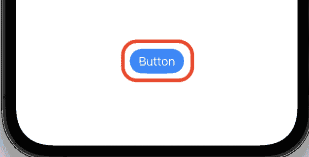

图 9.2：模拟器运行 BreakfastMaker 应用，显示了待点击的按钮

你应该注意到以下问题：

- 刚点击按钮没有反应，大约九秒钟后，你才会在 Debug 区域看到 `Button tapped`
- `Making toast...` 和 `Boiling eggs...` 从未显示过，且 `Toast done` 和 `Eggs done` 在大约九秒后才出现

发生这种情况的原因是，当 `makeToast()` 和 `boilEggs()` 方法运行时，你的应用程序代码没有更新用户界面。你的应用程序确实记录了点击，但只有在 `makeToast()` 和 `boilEggs()` 完成执行后，才能处理这些点击并更新标签。这些问题没有为你的应用程序提供良好的用户体验。

你现在已经体验了没有实现并发的应用程序会产生的问题。在下一节中，你将使用 `async/await` 修改应用程序，使其在 `makeToast()` 和 `boilEggs()` 方法运行的同时能够更新用户界面。

## 使用 async/await 更新应用程序

正如你之前看到的，当 `makeToast()` 和 `poachEgg()` 方法运行时，应用程序是非响应的。为了解决这个问题，你将在应用程序中使用 `async/await`。

在方法声明中编写 `async` 关键字表示该方法是异步的。它的形式如下：

```
func methodName() async -> returnType {
```

在方法调用前编写 `async` 关键字标记了执行可能会被挂起的点，允许其他操作运行。它的形式如下：

```
await methodName()
```

你将修改你的应用程序以使用 `async/await`。这将使其能够挂起 `makeToast()` 和 `poachEgg()` 方法来处理按钮点击、更新用户界面，之后恢复这两个方法的执行。你还将通过开启 Swift 6 语言模式为你的应用程序启用严格并发检查。按照以下步骤操作：

- 1. 在项目导航器中，点击顶部的 BreakfastMaker 图标，然后点击 BreakfastMaker 目标。在 Build Settings 选项卡中，将 Swift Language Version 改为 Swift 6：

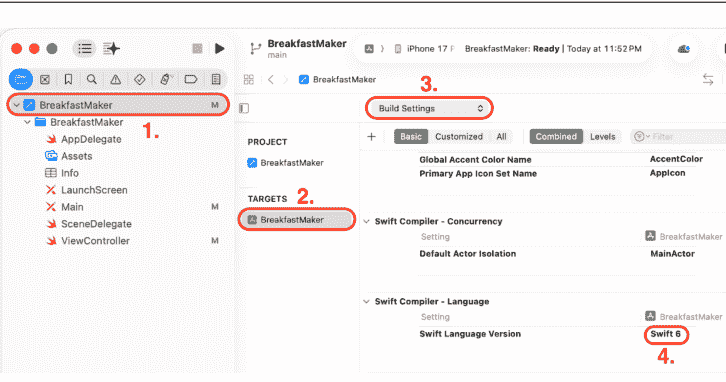

这为你的应用程序启用了严格并发检查。

- 2. 点击项目导航器中的 ViewController。如所示修改 `makeToast()` 和 `boilEggs()` 方法，使其方法体内的代码变为异步的：

```
func makeToast() -> String {
    try await Task.sleep(for: .seconds(2))
    return "Toast done"
}

func boilEggs() -> String {
    try await Task.sleep(for: .seconds(7))
    return "Eggs done"
}
```

`Task` 代表一个异步工作单元。它有一个静态方法 `sleep(for:)`，可以暂停执行指定的时长（以秒为单位）。由于此方法是一个抛出错误的方法，你将使用 `try?` 关键字来调用它，而无需实现 `do-catch` 块。`await` 关键字表示此代码可以挂起以允许其他代码运行。

> 使用 `try?` 将导致任何错误被抑制或忽略。在这种情况下是可以接受的，因为睡眠 2 秒或 7 秒不太产生错误。在其他情况下，这可能是不可接受的，此时 `do-catch` 块是更好的解决方案。你可能希望重读第 8 章“协议、扩展和错误处理”，获取如何实现 `do-catch` 块的信息。

- 3. `Toast()` 和 `boilEggs()` 都会出现错误。点击任何一个错误图标都会显示错误消息：

> 'async' call in a function that does not support concurrency
> Add 'async' to function 'makeToast()' to make it asynchronous
> Generate Fix for Issue

图 9.4：点击错误图标时显示的错误消息

显示错误是因为你正在一个不支持并发的方法内部调用一个异步方法。你需要在方法声明中添加 `async` 关键字以指示它是异步的。

- 4. 对于每个方法，点击 Apply 按钮向方法声明中添加 `async` 关键字。

- 5. 完成上述操作后，验证你的代码看起来像这样：

```
func makeToast() async -> String {
    try? await Task.sleep(for: .seconds(2))
    return "Toast done"
}

func boilEggs() async -> String {
    try? await Task.sleep(for: .seconds(7))
    return "Eggs done"
}
```

- 6. `makeToast()` 和 `poach()` 方法中的错误应该消失，`viewWillAppear()` 方法中会出现新错误。点击其中一个错误图标查看错误消息，它与你在第 2 步看到的消息相同。这是因为你正在一个不支持并发的方法内部调用异步方法。

- 7. 点击 Apply 按钮，会出现更多错误。

- 8. 暂时忽略方法声明中的错误，点击 `makeToast()` 方法调用旁边的错误查看错误消息：

> Expression is 'async' but is not marked with 'await'
* Call is 'async'
* Insert 'await'
* Generate Fix for Issue

图 9.5：点击错误图标时显示的错误消息

显示此错误消息是因为你在调用异步函数时没有使用 `await`。

- 9. 点击 Apply 按钮在方法调用中插入 `await` 关键字。
- 10. 对 `boilEggs()` 方法旁边的错误重复第 7 步和第 8 步。`boilEggs()` 调用处也会插入 `await` 关键字。
- 11. 点击 `viewWillAppear()` 方法声明中的错误图标查看错误消息：

```
override func viewWillAppear(_ animated: Bool) async {
    super.viewAppear(animated)
    let startTime = Date().timeIntervalSince1970
    toastLabel.text = "Making toast..."
    toastLabel.text = await makeToast()
    eggLabel.text = "Boiling eggs..."
    eggLabel.text = await boilEggs()
}
```

图 9.6：viewWillAppear() 方法声明中的错误图标

显示此错误是因为你不能使用 `async` 关键字让 `viewWillAppear()` 方法变为异步，因为父类中没有。

为了解决这个问题，你将移除 `async` 关键字并将 `super.viewAppear()` 之后的代码封装在 `Task` 块中，这将允许同步方法中异步执行。修改你的代码如下：

```
override func viewWillAppear(_ animated: Bool) {
  super.viewAppear(animated)
  Task {
    let startTime = Date().timeIntervalSince1970
    toastLabel.text = "Making toast..."
    toastLabel.text = await makeToast()
```

```
eggLabel.text = "Boiling eggs..."
eggLabel.text = await boilEggs()
    plateAndServeLabel.text = plateAndServe()
    let endTime = Date().timeIntervalSince1970
    elapsedTimeLabel.text = "Elapsed time is \((endTime - startTime) * 100).rounded() / 100 seconds"
  }
}
```

构建并运行应用程序，并在用户界面出现时点击按钮。注意 `Button tapped` 现在立即出现在 Debug 区域，且标签也按预期更新。这是因为应用程序现在能够挂起 `makeToast()` 和 `boilEggs()` 方法来响应点击、更新用户界面并恢复方法执行。太棒了！

但是，如果你查看经过的时间，你会发现准备早餐的时间比之前略长：

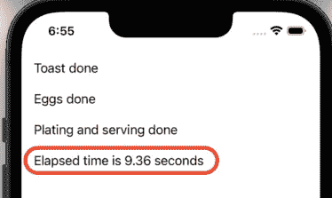

图 9.7：模拟器运行 BreakfastMaker 应用，显示经过的时间

这部分由于 async/await 挂起和恢复方法所需的额外处理，但也涉及另一个因素。尽管 `makeToast()` 和 `boilEggs()` 方法现在是异步的，但 `boilEggs()` 方法在 `makeToast()` 方法完成后才开始执行。在下一节中，你将看到如何使用 `async-let` 并行运行 `makeToast()` 和 `boilEggs()` 方法。

### 使用 async-let 提高效率

尽管你的应用程序对按钮点击有响应，并在 `makeToast()` 和 `boilEggs()` 方法运行时可以更新用户界面，但这两个方法仍然是顺序执行的。这里的解决方案是使用 `async-let`。


在定义常量时在 `let` 语句前编写 `async`，然后在访问常量时编写 `await`，可以允许异步方法的并行执行，如下所示：

```
async let temporaryConstant1 = methodName1()
async let temporaryConstant2 = methodName2()
await variable1 = temporaryConstant1
await variable2 = temporaryConstant2
```

在这个示例中，`methodName1()` 和 `methodName2()` 将并行运行。

你将修改应用使用 `async-let` 来让 `makeToast()` 和 `pooch()` 方法并行运行。在 `ViewController` 控制器中，如下如下修改 `Task` 块中的代码：

```
Task {
let startTime = Date().timeIntervalSince1970
toastLabel.text = "Making toast..."
async let tempToast = makeToast()
eggLabel.text = "Boiling eggs..."
async let tempEgs = boilEggs()
await toastLabel.text = tempToast
await eggLabel.text = tempEgs
plateAndServeLabel.text = plateAndServe
let endTime = Date().timeIntervalSince1970
elapsedTimeLabel.text = "Elapsed time is \((endTime - startTime) * 100).rounded() / 100 seconds"
}
```

编译并运行应用。你会发现流逝的时间现在比以前短了：

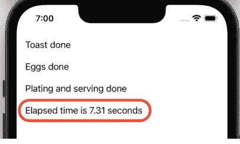

图 9.8：运行 BreakfastMaker 应用的模拟器，显示了流逝的时间

这是因为使用 `async-let` 允许 `makeToast()` 和 `poachEgg()` 方法并行运行，而且 `poachEgg()` 方法不再等待 `makeToast()` 方法完成后才开始执行。太酷了！

你已成功在应用中实现了异步代码。太棒了！关于 Swift 并发还有很多东西需要学习，例如结构化并发和 Actor（模型），但那超出了本章的范围。

为自己拍拍掌鼓励一下吧；你已经完成了这本书的第一部分！

### 总结

在本章中，你学习了 Swift 并发以及如何在 Breakfast-Maker 应用中实现它。

你开始学习 Swift 并发的基础概念。然后，你检查了一个没有并发功能的应用并探索了它的问题。之后，你开启了严格并发检查并使用 `async/await` 在应用中实现了并发。最后，你通过使用 `async-let` 让你的应用更加高效。

你现在理解了 Swift 并发的基础知识，并能够在你自己的应用中使用 `async/await` 和 `async-let`。

在下一章中，你将开始编写你的第一个 iOS 应用，通过使用 Storyboards（故事板）创建它的界面，这允许你在无需编写大量代码的情况下快速构建应用原型。

> 获取本书的 PDF 版本和独家额外。按书名搜索此书，确认版本，然后按照页面上的步骤操作。


注意：请保留好发票。直接从 Packt 购买的不需要发票。

# 第二部分

# 设计

欢迎来到本书的第二部分。到此时，你已经熟悉了 Xcode 用户界面，并且有了使用 Swift 的坚实基础。在这一部分，你将开始创建一个名为 JRNL 的日记应用的用户界面。你将使用 Interface Builder 来构建应用使用的界面，在界面中添加按钮、标签和字段等元素，并使用 segues（过渡）将它们连接起来。正如你所看到的，你可以用极少的代码完成这些操作。

本部分包含以下章节：

- 第 10 章：设置用户界面
- 第 11 章：构建用户界面
- 第 12 章：完成用户界面
- 第 13 章：修改应用屏幕

在本部分结束时，你将能够在 iOS 模拟器中穿于应用的各个屏幕，并知道如何为自己的应用制作用户界面原型。让我们开始吧！

# 10

## 设置用户界面

在书书的*第一部分*中，你学习了 Swift 语言及其工作原理。现在你已经对该语言有了良好的实践知识，可以学习如何开发 iOS 应用。在这一部分，你将构建日记应用 *JRNL* 的**用户界面 (UI)**。你将使用 Xcode 的 **Interface Builder** 来此，代码量将保持在最低。

本章将从学习 iOS 应用开发中使用的常用术语开始，这些术语在书中被广泛使用。接下来，你将浏览 *JRNL* 应用使用的屏幕，并学习用户如何使用该应用。之后，你将开始使用 Interface Builder 重新创建应用的 UI，从标签栏（tab bar）开始，它允许用户在日记列表和地图屏幕之间进行选择。最后，你将在屏幕顶部添加导航栏并配置标签栏按钮。

在本章结束时，你将学习到 iOS 应用开发中常用的术语、你的应用流程将是什么样的，以及如何使用 Interface Builder 添加和配置 UI 元素。

本章将涵盖以下主题：

- iOS 开发中的常用术语
- *JRNL* 应用演示
- 修改你的 Xcode 项目
- 设置标签栏控制器场景（tab controller scene）

### 技术要求

你将修改在第 1 章“Hello, Xcode”中创建的 JRNL 项目。

本章的资源文件和完整的 Xcode 项目位于本书代码包的 Chapter-10 文件夹中，可以在此处下载：

https://github.com/PacktPublishing/iOS-2g-Programming-for-Beginners-10E

查看以下视频了解代码演示：

https://youtube.be/pof2ChUbgg

在开始项目之前，你将学习一些 iOS 开发中使用的常用术语。

### iOS 开发中的常用术语

当你开始使用 UIKit 进入 iOS 应用开发之旅时，你会遇到一些特殊的术语和定义。以下是最常用的术语和定义。现在只需阅读它们即可。尽管你现在可能无法理解一切，但随着学习的，事情会变得清晰：

- View（视图）：视图是 UIView 类或其一个子类的实例。你在屏幕上看到的任何内容（按钮、文本字段、标签等）都是视图。你将使用视图来构建 UI。

> 类（Classes）将在第 7 章“类、结构体和枚举”中介绍。

- Stack view（堆栈视图）：stack view 是 UIStackView 类的实例，它是 UIView 的子类。它用于将视图水平或垂直堆叠在一起。这将在本节稍后通过 Auto Layout 进行讨论。

- View controller（视图控制器）：视图控制器是 ViewController 类的实例。每个视图控制器都有一个 view 属性，决定了视图显示的内容以及用户与视图交互时发生什么。

> 视图控制器将在第 14 章 MVC 和表格视图中详细讨论。

- Table view controller（表格视图控制器）：table view controller 是 UITableView 类的实例，它是 ViewController 的子类。它的 view 属性引用一个 UITableView 实例（表格视图），显示单列 UITableViewCell 实例（表格单元格）。

设置应用通过表格视图显示设备设置：

### Settings

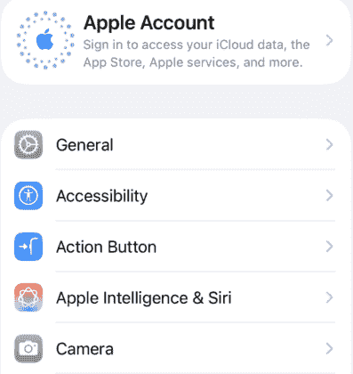

图 10.1：设置应用

正如你看到的，所有不同的设置（通用、辅助功能、隐私等）都显示在表格的单元格中。

- Collection view controller（集合视图控制器）：collection view controller 是 UICollectionView 类的实例，它是 ViewController 的子类。它的 view 属性引用一个 UICollectionView 实例（集合视图），以网格形式显示 UICollectionView 实例（集合单元格）。

### Library

照片应用通过集合视图显示照片：


图 10.2：照片应用

正如你看到的，缩略图显示在集合视图的集合单元格中。

- **Navigation controller（导航控制器）：**导航控制器是 UINavigationController 类的实例，它是 ViewController 的子类。它有一个 viewController 属性，持有一个视图控制器数组。数组中最后一个视图控制器的视图显示在屏幕上，屏幕顶部带有一个导航栏。

设置应用中的表格视图控制器嵌入在导航控制器中，你可以在表格视图上方看到导航栏：

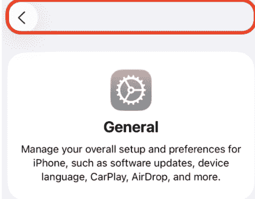

图 10.3：设置应用中的导航栏


当你点击某个设置时，该设置的视图控制器会被添加到赋值给 `viewController` 属性的视图控制器数组中。用户会看到该视图视图从右侧滑入。注意屏幕顶部的导航栏，它可以包含标题和按钮。导航栏左侧会出现一个 `<` 按钮。点击此按钮将返回到上一个屏幕，并将该设置视图控制器从赋值给 `ViewController` 属性的视图控制器数组中移除。

- 标签栏控制器：`UITabBarController` 类的实例，它是 `ViewController` 类的子类。它有一个 `viewController` 属性，包含一个视图控制器数组。数组中第一个控制器的视图显示在屏幕上，底部带有一个按钮的标签栏。最左侧的按钮对应数组中的第一个视图控制器，并且已经是选中状态。当你点击另一个按钮时，相应的视图控制器会被加载，其视图将显示在屏幕上。

Fitness 应用使用标签栏控制器导航到不同的屏幕：

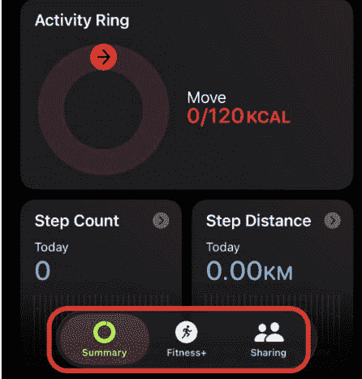

图 10.4：Fitness 应用中的标签栏

正如你所看到的，该应用的不同屏幕（摘要、Fitness+ 和共享）是通过点击相应的标签栏按钮来访问的。

- 模型-视图-控制器 (MVC)：这是 iOS 应用开发中一种非常常用的设计模式。用户与屏幕上的视图进行交互。数据存储在数据模型对象中。控制器管理视图与数据模型对象之间的信息流。

> MVC 将在 14 章“MVC 与表格视图”中进行详细讨论。

- Storyboard 文件：Storyboard 文件包含用户所见内容的视觉化表示。应用的每个屏幕都由一个 storyboard 场景（scene）表示。

打开你在第 1 章《Hello, Xcode》中创建的 JRNL 项目，并点击 Main.story 文件。


图 10.5：显示 Main storyboard 文件的 JRNL Xcode 项目

你会在其中看到一个场景，当你在模拟器中运行应用时，该场景的内容将显示在屏幕上。一个 storyboard 文件中可以包含多个场景。

- 切换 (Segue)：如果一个应用中有多个场景，你使用跳转从一个场景移动到另一个场景。JRNL 项目没有任何跳转，因为它的 storyboard 文件只有一个场景，但你将在本章的后续部分看到它们。

- 自动布局 (Auto Layout)：作为开发者，你必须确保应用在不同屏幕尺寸的设备上看起来良好。自动布局帮助你根据指定的约束来布局 UI。例如，你可以设置约束来确保按钮无论屏幕大小如何都位于屏幕中央，或者在设备从竖屏旋转到横屏时让文本字段扩展到屏幕宽度。

现在你已经熟悉了 iOS 应用开发中术语，让我们浏览一下你将构建的应用。

# JRNL 应用之旅

让我们快速浏览一下你将构建的应用。JRNL 是一个日记应用，允许用户编写自己的个人日记，并可以选择为每条日记目存储照片或地图位置。用户还可以查看地图，显示距离用户当前位置的条目位置。你将在后续章节中看到应用中使用的所有屏幕及其整体流程。

### 日志列表屏幕

当应用启动时，你将看到日志列表屏幕：


图 10.6：日志列表屏幕

让我们学习此屏幕的不同部分。

屏幕底部的 `UITabBar` 实例（标签栏）显示**日志 (Journal)**和**地图 (Map)**按钮。**日志**按钮被选中，你可以看到一个视图在表格单元格中显示日记条目列表。`UISearchController` 实例在屏幕顶部显示搜索栏。这允许你搜索特定的日记条目。

要添加新的日记条目，点击屏幕顶部的 `+` 按钮。这将显示添加新日记屏幕。

### 添加新日记屏幕

当你点击日志列表屏幕顶部的 `+` 按钮时，你将看到添加新日记屏幕：


图 10.7：添加新日记屏幕

让我们学习此屏幕的不同部分。

# 第 10 章

屏幕顶部的导航栏包含 X（取消）和保存（Save）按钮。栈（stack）显示了一个自定义评分控件、一个开关、条目标题文本字段、正文视图和一个占位符照片。点击评分控件允许你为此条目分配 0 到 5 星级。打开开关将获取你的当前位置。

你可以在条目标题文本字段中输入日记条目的标题，并在正文视图中输入详情。你还可以点击占位符照片使用设备相机拍照。一旦你点击保存，你将返回到日志列表屏幕，然后新条目将出现在表格视图中。你也可以点击 X 返回到日志列表屏幕而不创建新的日记条目。

要查看特定日记条目的详情，点击列表中的你想要的条目，然后你将看到日记条目详情屏幕。

## 日记条目详情屏幕

点击日志列表屏幕上的任何一个条目都会显示相应的日记条目详情屏幕：


图 10.8：日记条目详情屏幕

设置用户界面

让我们学习屏幕的不同部分。

屏幕顶部的导航栏包含一个 `<`（返回）按钮。表格视图在表格单元格中显示日记条目的日期、评分、标题文本、正文文本、照片和位置地图。

你可以点击 `<` 按钮返回日志列表屏幕。

### 地图屏幕

点击标签栏中的地图按钮将显示地图屏幕：


图 10.9：地图屏幕

学习此屏幕的不同部分。
底部的标签栏显示日志和地图按钮。地图按钮被选中，你可以看到一个 `MKMapView` 实例（地图视图）在屏幕上显示地图，带有图钉指示日记条目。

点击图钉将显示一个注释，点击注释中的按钮将显示该日记条目的详情屏幕。

应用之旅到此结束。现在，是时候开始为它构建 UI 了！

### 修改你的 Xcode 项目

现在你已经知道应用的屏幕将是什么什么样，可以开始构建它了。如果你还没有这样做，打开你在第 1 章《Hello, Xcode》中创建的 JRNL 项目：


图 10.10：JRNL 项目

验证是否从目标菜单中选择了 iPhone 16。如果你点击并运行应用，将看到一个空白的白色屏幕。如果你在项目导航中点击 Main storyboard 文件，你会发现它包含一个包含空白视图的场景。

要配置 UI，你将使用 Interface Builder 修改 Main storyboard 文件。Interface Builder 允许你添加和配置场景。每个场景代表你将看到的一个界面。你可以将视图和按钮等 UI 对象添加到场景中，并使用属性检查器按需要进行配置。

> 有关如何使用 Interface Builder 的更多信息，请访问此链接：https://apple.com/xcode/mac/current/#/dev31645f17。

现在，你将把现有场景嵌入标签栏中并向其添加另一个场景。标签栏场景将在屏幕底部显示一个带有两个按钮的标签栏。点击按钮将显示与其关联的场景。这些场景对应于应用之旅中显示的日志列表和地图场景。让我们在下一节中查看如何操作。

### 设置标签栏控制器场景

正如你在应用之旅所示，JRNL 应用屏幕底部带有两个按钮的标签栏，用于显示日志列表和地图场景。你将现有视图控制器场景嵌入标签栏中，并为其添加第二个视图控制器场景。按照以下步骤操作：

+ 1. 在项目导航中点击 Main storyboard 文件：


图 10.11：选中了 Main storyboard 文件的项目导航


主 storyboard 文件的内容显示在编辑器（Editor）区域。

- 2. 如果文档大纲（Document Outline）不可见，点击文档大纲按钮以显示它：


- 3. 在文档大纲中选择视图控制器（View Controller）：


- 4. 你将现有的视图控制器场景嵌入到标签栏控制器（tab bar controller）场景中。在编辑器中选择嵌入|标签栏控制器（Embed In | Tab Bar Controller）：


你将看到编辑器中出现一个新的标签栏控制器场景。

- 1. 点击编辑器区域左下角的 + 按钮以显示库（library）：


库允许你选择要添加到场景中的 UI 对象。

- 2. 在库的过滤器过滤字段中输入 `con`。视图控制器对象将出现在结果列表中： 


- 3. 将视图控制器对象拖到 storyboard 中添加新的视图控制器场景，并将其放置在现有视图控制器场景下方：


- 8. 点击 - 按钮缩小视图，并重新排列 storyboard 中的场景，使标签栏控制器场景和视图控制器场景均可见：


图 10.18：显示缩放按钮的编辑器区域

> 如果 – 和 + 按钮不可见，尝试增大 Xcode 窗口。你也可以尝试使用导航器（Navigator）和检查器（Inspector）按钮来隐藏这些区域。

- 9. 在文档大纲中选择标签栏控制器。按住 Ctrl 键从标签栏控制器拖动到新添加的控制器场景：


- 10. 将出现切接（segue）弹出菜单。从此菜单选择视图控制器：


将出现一个连接标签栏控制器场景到视图控制器场景的切接，并且标签栏控制器场景的标签栏中也会出现第二个图标。

- 11. 重新排列编辑器区域中的场景，使其看起来如下截图所示：


图 10.21：重新排列场景的编辑器区域

- 12. 在模拟器（Simulator）中构建并运行你的 App，你将在屏幕底部看到有两个按钮的标签栏：


你已成功为项目添加了标签栏，但正如你所看到的，按钮标题目前命名为 Item。你将在下一节中将它们更改为 Journal（日志）和 Map（地图）。

### 设置标签按钮标题和图标

你的 App 现在在屏幕底部显示标签栏，但按钮标题和图标与 App 演示中显示的不匹配。为了匹配它们，你将在属性检查器（Attributes inspector）中将按钮标题配置为 Journal 和 Map，并配置你的图标。遵循以下步骤：

- 在项目导航器（Project navigator）中点击 Main storyboard 文件。如果不存在文档大纲，点击文档大纲按钮显示它。点击文档大纲中 Item Scene 左侧的 > 按钮进行展开。同样展开其所有内容，直到它看起来如下截图所示：


图 10.23：显示已选择第一个 Item Scene 的文档大纲

- 2. 点击 Item Scene 下方带有星号图标的 Item 按钮。然后，点击属性检查器按钮：


- 3. 在 Bar Item 下，将 Title 设置为 Journal， Image 设置为 person.fill：


- 4. 展开第二个 Item Scene 的内容。点击带有星号图标的 Item 按钮，并在属性检查器的 Bar Item 下，将 Title 设置为 Map，Image 设置为 map：


- 5. 在模拟器中构建并运行你的 App。你会发现按钮标题已分别更改为 Journal 和 Map，且每个按钮都有自定义图标：


点击 Journal 和 Map 按钮将显示 Journal List 场景和 Map 场景。

> person.fill 和 map 图标是 Apple SF Symbols 库的一部分。要了解更多信息，请访问此链接：https://developer.apple.com/design/human-interface-guidelines/sf-symbols

要了解更多关于 Apple 在期间对 SF Symbols 库的更新，请访问此视频：https://developer.apple.com/videos/wwdc2025

正如你在 App 演示中所看到的，某些屏幕需要导航栏。在下一节中，你将学习如何添加导航栏。

### 将视图控制器嵌入导航控制器

正如你在 App 演示中所看到的，Journal List 和 Map 场景都需要顶部的导航栏。为了添加导航栏，请将视图控制器嵌入导航控制器。遵循以下步骤：

- 1. 在文档大纲中点击 Journal List：


- 2. 在编辑器中选择嵌入|导航控制器（Embed In | Navigation Controller）：


- 3. 在文档大纲中点击 Map Scene：


- 4. 对 Map 场景重复执行步骤 2。

- 5. 选择第一个视图控制器的 Navigation Item。在属性检查器中，将 Title 设置为 Journal：


- 6. 选择第二个视图控制器的 Navigation Item。在属性检查器中，将 Title 设置为 Map：


构建并运行你的 App，点击每个标签显示相应的屏幕。注意每个屏幕在导航栏中都有一个标题。

将视图控制器嵌入导航控制器会将视图控制器添加到导航控制器的数组中。导航控制器会在屏幕上显示视图控制器的视图。导航控制器还会显示带有标题的导航栏。

恭喜！你刚刚成功为你的 App 配置了标签栏和导航控制器！

你可能注意到 Interface Builder 中表示的屏幕与你在目标菜单中选择的 iPhone 模型不匹配，并且你发现地图显示阻碍了 App 中屏幕的布局。让我们对 Interface Builder 进行额外配置以修复此。

### 配置 Interface Builder

即使你已配置模拟器使用 iPhone 16e，Interface Builder 显示的场景也是不同的 iPhone 模型。你可能还希望隐藏地图显示。让我们配置 Interface Builder 使用 iPhone 16e SE 并隐藏地图显示。遵循以下步骤：

- 1. Main storyboard 文件应仍被选中。要配置 Interface Builder 中场景的外观，点击设备配置按钮：


将显示不同设备屏幕的弹出窗口。

- 2. 从弹出窗口中选择 iPhone 16e SE，点击编辑器区域任意位置关闭它：


storyboard 中场景的外观将发生变化以反映 iPhone 16e 的屏幕。


3. 如果你想隐藏最小视图，可以从编辑器（Editor）菜单中选择最小视图（Minimap）来取消选中。

| 文档大纲 (Document Outline) |
| :--- |
| 在文档大纲中显示 (Reveal in Document Outline) |
| 最小视图 (Minimap) |
| 画布 (Canvas) |
| 缩放 (Zoom) |
| 对齐指南 (Snap to Guides) |
| 指南 (Guides) |

图 10.36：高亮最小视图的编辑器菜单

4. 验证 Main storyboard 文件中包含以下场景：


图 10.37：显示完成的 Main storyboard 编辑器区域

5. 构建并运行你的应用。它的运行应该和之前一样。

你已经为应用创建了日志列表和地图界面！做得好！

### 总结

在本章中，你学习了一些 iOS 应用开发中常用的术语。这将有助于你更好地理解本书后续内容，以及关于该主题的其他书籍或在线资源。

此外，你还学习了 JRNL 应用使用的不同界面以及用户如何使用该应用。当你从零开始重建应用 UI 时，你可以将你所做的工作与实际应用的界面进行对比。

之后，你还学习了如何使用 Interface Builder 和 storyboards 为你的应用添加一个标签栏控制器场景（tab bar controller scene），并配置按钮标题和图标。最后，你为日志列表和地图界面添加了导航控制器（navigation controllers）。这将让你熟悉了如何为自己的应用添加和配置 UI 元素。

在下一章中，你将继续设置应用的 UI，并熟悉更多 UI 元素。你还将为你的应用添加并配置剩余的界面。

## 加入我们的 Discord

与其他用户、专家以及作者本人一起阅读这本书。

在这里提问、为其他读者提供解决方案、通过“我问你答”（Ask Me Anything）环节与作者聊天，以及更多互动。扫描二维码或访问链接加入社区。

https://packt.link/LdDT/


# 11

## 构建用户界面

在上一章中，你修改了一个现有的 Xcode 项目，为应用添加了一个标签栏（tab bar），允许用户在日志列表和地图界面之间切换，并配置了标签栏按钮的标题和图标。当应用启动时，会显示日志列表界面，但目前它是空的。

正如你在第 10 章“设置用户界面”中的应用导览所示，日志列表界面应该显示一个表格视图（table view），其中包含一个按钮，该按钮将显示用于在表格视图单元格中添加新日志的视图。

在本章中，你将让日志列表界面显示一个包含 10 个空表格视图单元格的表格视图，以及一个点击后会显示“添加新日志记录”界面的按钮。你还将配置一个“取消”按钮来关闭此视图并返回日志列表界面。

你将为应用添加少量的代码，但不必过于担心——你将在本书的后续部分学习更多相关内容。

在本章结束时，你将学会如何向 storyboard 场景添加视图控制器（view controllers）、连接视图控制器中的输出属性（outlets）、设置表格视图单元格以及以模态方式（modally）呈现视图控制器。这为你自己的应用设计用户界面时非常有用。

本章将涵盖以下主题：

- 为日志列表界面添加表格视图
- 将 storyboard 元素连接到视图控制器
- 为表格视图配置数据源方法
- 以模态方式呈现视图

### 技术要求

你将继续在上一章中创建的 JRNL Xcode 项目上工作。

本章完整的 Xcode 项目位于本书书籍代码包的 Chapter11 文件夹中，你可以在此处下载：

https://github.com/PacktPublishing/IOS-2G-Programming-for-Beginners-10E

查看以下视频了解代码演示：

https://youtu.be/b-c-7DL8qQ8U

让我们从为日志列表界面添加表格视图开始，它最终将显示日志记录列表。

## 为日志列表界面添加表格视图

正如你在应用导览中看到的，JRNL 应用在表格视图中显示日志记录。表格视图是 `UITableView` 类的一个实例。它显示一列单元格。表格视图中的每个单元格都是表格视图单元格（table view cell），它是 `UITableViewCell` 类的一个实例。在本节中，你将开始为 Main storyboard 文件中日志列表界面的视图控制器添加表格视图，然后你将添加自动布局约束（Auto Layout constraints），使其填充导航栏和标签栏之间的空间。

> 有关布局视图和使用自动布局约束的更多信息，请参阅链接：https://developer.apple.com/documentation/uikit/view-layout。


打开你在上一章中创建的 JRNL 项目并运行应用，确保一切一切正常工作，然后按照以下步骤操作：

1. 在项目导航器（Project navigator）中点击 **Main** storyboard 文件，选择代表日志列表界面的视图控制器场景，并点击库（Library）按钮：


图 11.1：显示库按钮的编辑器

2. 库将弹出。在过滤框中输入“table”。Table View 对象将出现在结果中。将其拖到日志列表场景的视图控制器中：


表格视图已添加，但它只占据了屏幕的一小部分。正如上一章的应用导览所示，它应该填充导航栏之间的空间。

3. 你将使用“布局添加新约束”（Add New Constraints）按钮将表格视图的边缘与其所在视图的边缘绑定。确保选中了 Table View，并点击该按钮：


图 11.2：选中 Table View 的场景

4. 在顶、左、右和底边缘字段中输入 0，并点击所有的淡红色线条。确保所有线条都变为红色。点击“添加 4 个约束”（Add 4 Constraints）按钮：


这会将表格视图边缘与所在视图边缘之间的间隙设置为 0。现在，无论设备和方向如何，表格视图都将填充可用空间。

5. 验证表格视图的四边现在都占据了导航栏之间的所有可用空间，如下所示：


图 11.3：填充导航栏之间空间的 Table View 场景

你已经为日志列表界面的视图控制器添加了表格视图，并使用了自动布局约束来填充导航栏和标签栏之间的空间，但在构建并运行应用时，日志列表界面仍然为空。

在下一节中，你将为 `JournalViewController` 类实现代码，并将类中的输出属性（outlets）连接到列表界面上的 UI 元素。这将使 `JournalViewController` 类实例能够控制屏幕上显示的内容。

## 将 storyboard 元素连接到视图控制器

你已经为日志列表界面添加了表格视图，但它还没有显示任何内容。你需要修改现有的视图控制器来管理日志列表界面中的表格视图。`ViewController` 文件是在创建 JRNL 项目时由 Xcode 自动生成的。

它包含了名为 `ViewController` 的类的声明和定义，该类目前被设置为日志列表界面的视图控制器。你将把 `ViewController` 文件中的类名改为 `JournalViewController`，并为你添加的表格视图创建一个输出属性。按照以下步骤操作：

1. 在项目导航器中点击 `ViewController` 文件。在编辑器区域中，右键点击类名（ViewController）并选择重构 | 重命名（Refactor | Rename...）：


图 11.4：显示高亮 Rename... 弹出菜单的编辑器区域


## 第 11 章

- 2. 将类名更改为 `JournalListViewController` 并点击重命名（重命名）：


图 11.7：编辑器区域显示了 ViewController 的新名称

- 3. 验证类名和文件名均已更改为 `JournalListViewController`：


图 11.8：文件名和类名均已更改为 JournalListViewController

- 4. 在项目导航器（Project navigator）中点击 Main storyboard 文件，并在文档大纲（document outline）中选择第一个 Journal Scene（包含表格视图的那个）。


- 5. 点击身份检查器（Identity inspector）按钮，并验证在 Custom Class（自定义类）下，Class（类）已设置为 `JournalListViewController`：


这意味着 Journal列表屏幕的内容是由 `JournalListViewController` 类的一个实例进行管理的。

- 6. 点击导航器（Navigator）和检查器（Inspector）按钮来隐藏导航器和检查器区域，这样你就有更多的空间进行工作了：


- 7. 在文档大纲中选中 Journal Scene 的情况下，点击调整编辑器选项（Adjust Editor Options）按钮，并在弹出菜单中选择 Assistant（助手）：


这将会在助手编辑器中显示与此场景相关的任何 Swift 文件。如你所示，Main storyboard 文件的内容显示在编辑器区域的左侧，而 `JournalListViewController` 类定义显示在右侧。

- 8. 查看代码上方的栏，确认已选择了 `JournalListViewController.swift`：


如果你没有看到它，请点击该栏并在弹出菜单中选择 `JournalListViewController.swift`。你可能需要关闭并重新打开项目。

- 9. 要将 Journal 场景中的表格视图（table view）连接到 `JournalListViewController` 类中的输出（outlet），请按 Ctrl + 拖拽从表格视图拖到 `JournalListViewController` 文件中，恰好类名声明下方：

```swift
5 // Created by
   iOS26Programming on
07/08/2025.
6 //
7
8 import UIKit
9
10 class
    JournalListViewController:
    UIViewController {
11
12   override func
13    viewDidLoad() {
14      super.viewDidLoad()
15      // Do any additional
16      setup after
17      loading the view.
18
19 }
```


> 你也可以从文档大纲中的表格视图进行拖拽。

- 10. 将弹出一个小的弹出对话框。在 Name（名称）文本字段中输入输出名称 `tableView`，将 Storage（存储）设置为 Strong（强引用），并点击 Connect（连接）：


图 11.15：创建输出的弹出对话框

- 11. 验证 `textView` 输出声明已添加到 `JournalListViewController` 类中。完成后，点击 X 按钮关闭助手编辑器：


图 11.16：编辑器区域显示了 `textView` 输出

`JournalListViewController` 类现在有一个用于 Journal 列表屏幕中表格视图的输出 `textView`。这意味着 `JournalListViewController` 实例可以管理表格视图显示的内容。

在使用 `Ctrl + 拖拽` 将 storyboard 场景中的元素拖动到文件时，很容易出错。如果你在操作过程中犯了错误，可能会导致 App 在启动时发生崩溃。要检查表格视图与 `JournalListViewController` 类之间的连接是否存在错误，请遵循以下步骤：

- 1. 点击导航器和检查器按钮以显示导航器和检查器区域。
- 2. 如果 Main storyboard 文件未被选中，请点击它。在文档大纲中点击 `Journal` 或 `Journal Scene`，并点击连接检查器（Connections inspector）按钮：


连接检查器显示了你的 UI 对象之间的链接。在 Outlets（输出）部分，你会看到表格视图（table view）的连接。
- 3. 如果你在 `tableView` 处看到了一个小黄色警告图标，请点击该图标以断开连接：


- 4. 在 Outlets（输出）部分，从表格视图拖拽以建立连接：


图 11.19：带有黄色警告图标的表格视图

> 如果你需要在创建后更改输出的名称，请右键点击该输出并从弹出菜单中选择重构 | 重命名（Refactor | Rename）。你已成功为表格视图创建了输出 `tableView`。太棒了！

为了显示单元，你需要在 `JournalListViewController` 中添加数据源方法。你将在下一节中完成。

## 为表格视图配置数据源方法

当你的 App 运行时，`JournalListViewController` 将作为 Journal 屏幕的控制器。它负责加载并显示你之前添加视图。表格视图需要知道有多少个单元格以及每个单元格中显示什么。通常，由控制器提供这些信息。Apple 为此创建了协议 `DataSource`。你需要将表格视图的 `dataSource` 属性设置为 `JournalListViewController` 并实现该协议。

表格视图还需要知道当用户点击单元格时做什么。同样，由表格视图的控制器负责，Apple 为此创建了协议 `Delegate`。你将表格视图的 `delegate` 属性设置为 `JournalListViewController`，尚未实现该协议的方法。

> 协议将在第 8 章“协议、扩展和错误处理”中介绍。

当你需要在本章编写少量代码时，不要担心它的含义；你将在书的第三部分学习关于表格视图及其相关协议的内容。

在下一节中，你将使用连接检查器将表格视图的数据源属性连接到输出。

## 设置表格视图的代理和数据源属性

`JournalListViewController` 的实例将提供表格视图显示的数据，以及当用户与表格视图交互时执行的方法。为了使其工作，你把表格视图的 `dataSource` 和 `delegate` 属性连接到 `JournalListViewController` 类的输出。遵循以下步骤：

- 如果你尚未操作，请点击导航器和检查器按钮再次显示导航器和检查器区域。
- Main storyboard 文件应仍被选中。在文档大纲中选择 Journal Scene 的 Table View 对象，并点击连接检查器。在 Outlets 部分，你会看到 `dataSource` 和 `delegate` 输出旁边有两个空圆。从每个空圆拖拽到文档大纲中的 Journal 图标：

- 3. 验证表格视图的数据源和代理属性已连接到 `JournalListViewController` 类的输出：


### 采用 UITableViewDataSource 和 UITableViewDelegate 协议

到目前为止，你已经将 `JournalListViewController` 类设置为表格视图的数据源和代理。下一步是让它采用 `UITableViewDataSource` 和 `UITableViewDelegate` 协议，并实现任何需要的方法。你还将更改单元格的颜色，使其在屏幕上可见。按照以下步骤操作：

- 1. 点击文档大纲中的 **Table View**，并点击属性检查器（Attributes inspector）按钮。在 **Table View** 中将 **Prototype Cells** 的数量改为 1：


- 2. 点击文档大纲中 **Table View** 侧的 > 符号以显示 **Table View Cell**:


这代表了表格视图将显示的表格视图单元格。

# 第 11 章

- 3. 点击文档大纲中的 Table View Cell。在属性检查器中，在 Table View Cell 下，将 Identifier 设置为 `journalCell` 并按回车：


文档大纲中的 Table View Cell 名称将变为 `journalCell`。

- 4. 在属性检查器中，在 View 下，将 Background 设置为 System Cyan Color（系统青色），以便在运行应用时表格视图单元格可见：


图 11.25：设置了表格视图单元格背景色的属性检查器

- 5. 点击项目导航器中的 `JournalListViewController` 文件。修改类声明，使 `JournalListViewController` 采用 `UITableViewDataSource` 和 `UITableViewDelegate` 协议：

几秒后，会出现一个错误：

```swift
import UIKit

class JournalListViewController: UIViewController,
    UITableViewDataSource, UITableViewDelegate {

    @IBOutlet var tableView: UITableView!
```


- 6. 点击它显示错误。错误信息显示 Type 'JournalListViewController' does not conform to protocol 'UITableViewDataSource'。添加符合协议的存位方法（stubs）：

> Type 'JournalListViewController' does not conform to protocol 'UITableViewDataSource'
* 协议要求函数 'tableView(_:numberOfRowsInSection:)'，类型为 '(UITableView, Int) -> Int (UIKit.UITableViewDataSource.tableView)'
* 协议要求函数 'tableView(_:cellForRowAt:)'，类型为 '(UITableView, IndexPath) -> UITableViewCell (UIKit.UITableViewDataSource.tableView)'

添加符合协议的存位方法


这意味着你需要为 `UITableViewDataSource` 协议实现所需的方法，以便 `JournalListViewController` 符合该协议。

- 7. 点击 Apply（应用），自动将所需方法的存位方法添加到 `JournalListViewController` 类中。

# 第 11 章
# 189

- 8. 验证 `UITableViewDataSource` 协议的两个所需方法的存位方法已自动插入 `JournalListViewController` 类中，如下所示：

```
```

图 11.28：显示 UITableViewDataSource 存位方法的编辑器区域

第一个方法告诉表格视图显示多少个单元格，而第二个方法告诉表格视图在每个表格单元格中显示什么。

- 9. 将第一个方法中的占位符文本替换为 10（如果只是单行代码，`return` 关键字是可选的）。这告诉表格视图显示 10 个单元格：

```

```

图 11.29：显示显示 10 个表格视图单元格代码的编辑器区域

- 10. 将第二个方法中的占位符 `cell` 替换为以下代码：

```swift
tableView.dequeueReusableCell(withIdentifier: "journalCell", for: indexPath)
```

图 11.30：显示为每行显示表格视图单元格代码的编辑器区域

现在不要担心这意味着什么，因为你将在第三部分学习更多关于表格视图的知识。

- 11. 编译并运行你的应用。模拟器将显示一列 10 个青色的表格视图单元格，如下所示：


图 11.31：模拟器显示 10 个表格视图单元格

# 第 11 章
# 191

正如你在第 10 章“设置用户界面”的应用演示中所看到的，屏幕右上角应该有一个 + 按钮。你将在下一节中添加此按钮。

# 模态显示视图 (Present a view modally)

Journal List 屏幕的导航栏可以配置显示标题和按钮。你已经在第 10 章“设置用户界面”中配置了标题。现在，你为导航栏添加并配置一个栏项目（bar item）。点击此按钮时，将显示一个代表“添加新日志条目”的视图。该视图将是一个嵌入在导航控制器的新视图，你将将其添加到项目中。视图将以模态方式显示，这意味着在关闭之前你无法进行任何其他操作。要关闭它，你将在视图的导航栏上添加一个“取消”按钮。你还会添加一个“保存”按钮，但你将在第 16 章“控制器之间传递数据”中实现其功能。让我们从下一节从库中向导航栏添加栏项目开始。

# 为导航栏添加栏按钮 (Add a bar button to the navigation bar)

正如第 10 章“设置用户界面”中的应用演示所示，屏幕右上角有一个 + 按钮。为了实现这一点，你将为 Journal List 屏幕的导航栏添加一个栏项目。

- 1. 点击项目导航器中的 `Main` storyboard 文件。确保选中了 **Journal Scene**。点击库（Library）按钮显示库：


图 11.32：显示库按钮的编辑器区域

- 2. 在过滤字段中输入 `bar`。结果中会出现 **Bar Item** 对象。将栏按钮拖到导航栏的右侧：

# 第 11 章
# 193


- 3. 选中栏按钮，点击属性检查器。在 **Bar Item** 下，将 **Title** 设置为 **Add**：


你现在导航栏上有一个栏按钮。在下一节中，你将添加一个视图控制器来代表点击按钮后显示的界面。

# 添加新的视图控制器 (Add a view controller)

正如第 10 章*设置用户界面*中的应用演示所示，当点击导航栏上的 + 按钮时，将显示界面。你需要向项目中添加一个新的视图控制器来表示此屏幕。

- 1. 点击库按钮显示库，并在过滤字段中输入 `view controller`。结果中会出现 View Controller 对象。将 View Controller 对象拖到 storyboard 中：


- 2. 将视图控制器放置在 Journal scene 的右侧：


- 3. 选择新添加视图控制器场景。在文档大纲中，点击该场景的 **Controller** 图：


图 11.37：选中 Controller 的文档大纲

- 4. 你需要为“取消”和“保存”按钮留位置，因此你把此视图控制器嵌入导航控制器以提供导航栏。从 **Editor** 菜单中选择 **Embed In | Navigation Controller**。

- 5. 验证视图控制器场景左侧出现了一个导航控制器场景：


- 6. 点击文档大纲中新视图控制器场景的 Navigation Item。在属性检查器中，在 Navigation Item 下，将 **Title** 设置为 **New Entry**：


# 第 11 章
# 197

导航项名称将变为 New Entry。

- 7. Ctrl + drag 从 + 按钮拖到导航控制器场景：


- 8. 将出现 Action Segue 弹出菜单。选择 **Present Modally**（模态显示）：


这将使得点击按钮时，视图控制器的视图从屏幕底部弹出。在关闭此视图之前，你无法与任何其他视图交互。


9. 验证转场（segue）已将日记（Journal）场景和导航控制器（Navigation Controller）场景连接在一起：


10. 编译并运行你的应用。点击 + 按钮，新视图控制器的视图将从屏幕底部滑入：


图 11.42：日记场景与导航控制器场景之间的编辑器区域转场

图 11.43：模拟器显示新视图控制器的视图

目前你只能通过向下拖动来关闭此视图。在下一节中，你将为导航栏添加一个“取消”（Cancel）按钮并为其编写程序以关闭视图。你还会添加一个“保存”（Save）按钮，但目前还不会对其编写程序。

## 在导航栏上添加取消和保存按钮

如你之前看到的，将视图控制器嵌入控制器的用处之一是屏幕顶部的导航栏。你可以在它的左侧和右侧放置按钮。按照以下步骤向导航栏添加“取消”和“保存”按钮：

- 1. 在文档大纲中点击新条目（New Entry）场景的 New Entry 导航项。点击库（Library）按钮：


图 11.44：显示库按钮的编辑器区域

- 2. 在过滤字段中输入 `bar b`，并将一个栏按钮项（Bar Button Item）对象拖到导航栏的每一侧：


图 11.45：选中了栏按钮项的库

- 3. 点击右侧的项按钮。在属性检查器（Attributes inspector）中，在 Bar Button Item 下，将 Style（样式）设置为 Done（完成），并将 System Item（系统项）设置为 Save（保存）：


图 11.46：Style 设置为 Done 且 Item 设置为 Save 的属性检查器

- 4. 点击左侧的项按钮并将 System Item设置为 Cancel（取消）：


图 11.47：System Item 设置为 Cancel 的属性检查器

记住，导航控制器有一个属性 `viewController`，它持有一个视图控制器数组。当你点击日记列表（Journal List）屏幕上的 + 按钮时，新的视图控制器会被添加到 `viewControllers` 数组中，其视图从屏幕底部出现并覆盖日记列表屏幕，关闭该视图的唯一方法是向下拖动。

- 5. 为了让“取消”按钮能够关闭视图，你把取消按钮链接到场景退出，并在 `JournalListViewController` 类中实现一个方法，该方法将在日记列表再次出现时执行。在项目导航器（Project navigator）中，点击 `JournalListViewController` 文件，并在视图底部的最后一个大括号之前添加以下方法：

```swift
@IBAction func unwindNewEntryCancel(segue: UIStoryboardSegue) {
}
```

- 6. 在项目导航器中点击 Main storyboard 文件，并点击 New Entry 场景中的取消按钮（显示为 X）。在文档大纲中，按住 `Ctrl + drag` 从取消按钮拖动到场景图标，并在弹出菜单中选择 `unwindEntryCancelWithSegue`：


图 11.48：显示正在设置取消按钮操作的文档大纲

当你的应用运行时，点击 X 按钮将从导航控制器的 `viewControllers` 数组中移除该视图控制器，以模态方式关闭演示视图，并执行 `unwindNewEntryCancel(segue:)` 方法。注意，该方法目前没有执行任何操作。

- 7. 编译并运行你的应用，点击日记列表屏幕导航栏上的 +。新视图将出现。当你点击 X 按钮时，新视图会消失：


图 11.49：显示 X 按钮的模拟器

第 11 章
203

恭喜！你完成了日记列表屏幕的基本结构！

### 总结

在本章中，你在 Main storyboard 文件中的日记列表屏幕添加了一个表格视图（table view），并修改了现有的视图控制器类来实现 `JournalListViewController` 类。

然后，你修改了 `JournalViewController` 类，使其拥有指向 storyboard 场景中表格视图的输出（outlet），将视图控制器输出链接到 storyboard 中的 UI 元素，设置了表格视图，并使其成为表格视图的数据源和代理。最后，你添加了一个按钮来显示第二个视图，并配置了一个“取消”按钮来关闭它。

到此时，你应该已经熟练掌握使用 Interface Builder 向 storyboard 场景添加视图和视图控制器、将视图控制器输出链接到 storyboard 中的 UI 元素、设置表格视图以及模态化展示视图。这在你为自己的应用设计 UI 时非常有用。

在下一章中，你将实现应用的日记条详情屏幕，并为地图屏幕实现地图视图。

获取此书的 PDF 版本和独家额外资源

扫描二维码（或访问 packpub.com/unlock）。通过书名搜索此书，确认版本，然后按照页面上的步骤操作。

注意：请妥善发票。直接从 Packt 购买的物品不需要发票。

# 12
## 完成用户界面

在上一章中，你配置了日记列表屏幕，在表格视图中显示 10 个空表格单元格，在导航栏上添加了一个栏按钮项以模态方式显示代表“添加新日记”屏幕的视图，并添加了“取消”和“保存”按钮。

在本章中，你将添加第 10 章“设置用户界面”中应用介绍期间显示的剩余屏幕。你将添加日记条详情屏幕（将显示一个具有固定数量单元格的表格视图）和地图屏幕。

到本章结束，你将学习如何在 storyboard 场景添加具有固定数量单元格的表格视图、如何实现点击日记列表屏幕时显示屏幕的转场以及如何添加地图。你应用的基础界面将完成，你将在第三部分完成实现。

本章将涵盖以下主题：

- 实现日记条详情屏幕
- 为地图屏幕添加地图视图

### 技术要求

你将继续使用上一章创建的 Journal 项目。本章的完整 Xcode 项目位于代码包的 Chapter12 文件夹中，可以下载：

https://github.com/PacktPublishing/iOS-26-Programming-for-Beginners-10E

查看以下视频了解代码效果：

https://youtube.be/KSRjZmohU

首先，你将添加一个新视图控制器场景场景。该屏幕将在点击日记列表屏幕中的单元格时显示。你将在下一节进行此操作。

### 实现日记条详情场景

- 1. 在项目导航器中点击 Main storyboard 文件并点击库按钮。
- 2. 在过滤字段中输入 `table`，并将一个表格视图控制器（Table View Controller）对象拖到 storyboard 中地图场景旁边：


这将代表日记条详情场景。

- 3. 验证表格视图场景已添加：


注意，它内部已经有一个表格视图（table view），因此你不需要像在上一章中那样向场景添加表格视图。

4. 为了在点击日志列表（Journal List）屏幕中的表格视图单元格时显示日记条目详情（Journal Entry Detail）屏幕，按住 Ctrl+ 从 JournalCell（在 Journal 场景的文档大纲下）拖动到表格视图（Table View）场景，以在两者之间添加一个推段（segue）：


图 12.3：显示 journalCell 的文档大纲

5. 在弹出菜单中，选择 **Selection Segue** 下的 **Show**：


图 12.4：选了 Show 的弹出菜单

这使得在点击日志列表屏幕中的单元格时，日记条目详情屏幕会右侧滑入。

## 6. 验证两个场景之间是否出现了一个推段：


图 12.5：显示日志场景和表格视图场景之间推段的编辑器区域

> 你可以在故事故事板（storyboard）中重新排列场景，使推段更容易可见。

7. 日记条目详情屏幕将始终显示固定数量的单元格。在文档大纲中，点击 **Table View Controller Scene** 下的 **Table View**：


图 12.6：选中的文档大纲中的 Table View

8. 点击属性检查器（Attributes inspector）按钮，并将 **Content** 设置为 **Static Cells**，使日记条目详情屏幕显示固定数量的单元格。


图 12.7：Content 设置为 Static Cells 的属性检查器

9. 编译并运行你的 App。点击日志列表屏幕中的单元格以显示日记条目详情屏幕：


10. 点击 < 按钮返回日志列表屏幕。

你已成功实现了日记条目详情屏幕！太棒了！

如果你的 App 需要显示列表项的详情，可以使用这种方法。例如 iPhone 上的“联系人” App 和“设置” App。

在下一节中，你将让地图屏幕显示地图。

## 实现地图屏幕

当你启动 App 时，会显示日志列表屏幕。点击标签栏中的地图按钮，会出现地图屏幕，但它是空的。为了让地图屏幕显示地图，你将为地图屏幕视图控制器场景中的视图添加一个地图视图（map view）。按照以下步骤操作：

- 选择编辑器区域中 Map 场景的视图控制器场景，这将展开文档大纲中对应的 Map 场景：


图 12.9：显示 Map 场景视图控制器场景的编辑器区域

- 要让此场景显示地图，点击库（Library）按钮并在过滤字段中输入 `map`。一个 **Map Kit View** 对象作为结果之一出现。将其拖到视图控制器场景的视图中：


图 12.10：选了 Map Kit View 对象的库

3. 为了让地图视图填充导航栏和标签栏之间的所有可用空间，请确保已已选中并点击 **Add New Constraints** 按钮：


图 12.11：选了地图视图的视图控制器场景

4. 在所有 **Spacing to nearest neighbor** 字段中输入 `0`，并确保选择了浅红色的约束线（struts）（它们将变为亮红色）。点击 **Add 4 Constraints** 按钮：


5. 验证地图视图填充了导航栏和标签栏之间的空间：


图 12.13：地图视图填充屏幕的视图控制器场景

6. 编译并运行你的 App。点击地图按钮。你应该能看到显示你所在区域的地图，如下所示：


7. 验证两个场景之间是否出现了一个推段：


图 13.1：完成后的 JRNL 应用的日记列表屏幕

如你所见，日记列表屏幕上的表格视图包含照片、日期和一个日记条目标题。在第 11 章“构建用户界面”中，你将 `journalCell` 表格视图单元格的背景颜色设置为青色，并配置表格视图显示 10 个单元格的一列。现在，你将移除背景颜色并向 `journalCell` 表格视图单元格添加用户界面元素，以应用导览中显示的设计。你将在下一节中开始向其添加一个图像视图。

### 为 journalCell 添加图像视图

图像视图（image view）是 `UIImageView` 类的实例。它可以在你的应用中显示单张图像或一系列动画图像。要向 `journalCell` 表格视图单元格添加图像视图，请执行以下步骤：

- 1. 为了在将用户界面元素添加到故事（Storyboard）时更容易看到它们，从编辑器（Editor）中选择 Canvas（画布） | Bounded Rectangles（边界矩形）：


图 13.2：选中了 Canvas | Bounded Rectangles 的编辑器菜单

这将为故事中的用户界面元素应用一个细细的蓝色轮廓。

- 2. 在项目导航器（Project navigator）中点击 **Main** 故事文件。在第一个 **Journal Scene** 下，在文档大纲（document outline）中选择 `journalCell`：


图 13.3：journalCell 的文档大纲

- 3. 你需要在添加图像视图之前移除早之前设置的背景颜色。在属性检查器（Attributes inspector）中，在 **View** 下，将 **Background**（背景）设置为 **Default:**（默认）：


图 13.4：journalCell 的属性检查器设置

- 4. 要向表格视图单元格添加图像视图，点击库（Library）按钮。在过滤字段中输入 `image`。结果中会出现一个 **Image View**（图像视图）对象。将其拖入原型单元格中：


- 5. 为了确保新添加的图像视图的约束可以正确设置，请验证它是 **journalCell** 表格视图单元格的 **Content View**（内容视图）的子视图并已被选中：


- 6. 点击 Add New Constraints（添加新约束）按钮，并输入以下值来设置新添加图像视图的约束：

    - Top（顶部）：0
    - Left（左侧）：0
    - Bottom（底部）：0
    - Width（宽度）：90
    - Height（高度）：90

完成后，点击 Add 5 Constraints（添加 5 处约束）按钮。


图 13.7：添加新约束的对话框

这将图像的顶部、左侧和底部边缘绑定到 `journalCell` 表格视图单元格的相应边缘，并将其宽度和高度设置为 90 点。它还隐式地将表格视图单元格的高度设置为 90 点。

- 7. 在属性检查器中，在 Image View 下，将 Image（图像）设置为 `face.smiling`：


图 13.8：图像设置为 face.smiling 的图像视图

你已成功地向表格添加了图像视图，设置了它的默认图像，并应用了约束来确定其与其包含视图的相对位置。太酷了！

在下一节中，你将添加用于显示日期和日记条目标题的用户界面元素。

### 为 journalCell 添加标签

你将使用标签（labels）在 `journalCell` 表格视图单元格中显示日期和日记条目标题。标签是 `UILabel` 类的实例。它可以在你的应用中显示一行或多行文本。

要向 `journalCell` 表格添加标签，请遵循以下步骤：

- 1. 首先，你将添加一个显示日期的标签。点击库按钮，并将 Label 对象拖到你刚刚添加的图像与原型单元格右侧之间的空间：


图 13.9：选中了 Label 对象的库

注意 Label 现在出现在文档大纲中，并且是 `journalCell` 表格单元格 Content View 的子视图。

- 2. 在属性检查器中，在 Label 下，使用 Font 菜单将 Font（字体）设置为 Title 1：


图 13.10：Label 的属性检查器

- 3. 点击 Add New Constraints 按钮，并输入以下值来设置标签的约束：

    - Top（顶部）：0
    - Left（左侧）：8
    - Right（右侧）：0

Constraint to Margins（约束到边距）应该已经勾选，这将 8 点的标准边距设置为标签的顶部和右侧与表格视图单元格的顶部和右侧之间的空间。完成后，点击 Add 3 Constraints 按钮。

- 4. 验证标签的位置是否如下截图所示，并且新添加的约束是否出现在文档大纲中：


图 13.11：应用了约束的标签

标签顶部边缘与 `journalCell` 内容视图顶部边缘之间的空间被设置为 0 + 8 点。标签左边缘与图像右边缘之间的空间为 8 点。标签右边缘与 `journalCell` 内容视图右边缘之间的空间为 0 + 8 点。标签底部边缘的位置由你设置的文本样式自动设置。

接下来，你将添加一个显示日记条目标题的标签。遵循以下步骤：

- 1. 点击库按钮，并将 Label 对象拖到你刚刚添加的标签与原型单元格底部之间的空间：


图 13.12：选中了 Label 对象的库

注意 Label 出现在文档大纲中，并且是 `journalCell` 单元格 Content View 的子视图。

- 2. 在属性检查器中，在 Label 下，使用 Font 菜单将 Font 设置为 Body，并将 Lines（行数）设置为 2：


图 13.13：Label 的属性检查器

Lines 为 2 将使标签在运行时显示最多两行。

- 1. 点击 Add New Constraints 按钮，并输入以下值设置标签的约束：

    - Top（顶部）：0
    - Left（左侧）：8
    - Right（右侧）：0

Constraint to Margins（约束到边距）应该已经勾选，这将 8 点的标准边距设置为标签右侧与表格视图单元格右侧之间的空间。完成后，点击 Add 3 Constraints 按钮。

- 2. 验证标签的位置是否如下截图所示，并且新添加的约束是否出现在文档大纲中：


图 13.14：应用了约束的标签

标签顶部边缘与你之前添加的标签底部之间的空间被设置为 0 点。标签左边缘与图像右边缘之间的空间为 8 点。标签右边缘与 `journalCell` 内容视图右边缘之间的空间为 0 + 8 点。标签底部的位置由你之前设置的文本样式和行数自动设置。

你可以点击文档大纲中的约束并在 Size inspector（尺寸检查器）中对其修改。

- 5. 构建并运行你的应用：


你已成功添加并配置了标签以显示 `journalCell` 表格视图单元格的日期和日记条目标题，并添加了所有必要的约束。如你所见，日记列表屏幕现在包含了导览所示所示的用户界面元素。太棒了！

在下一节中，你将向新建日记屏幕添加一个包含用户界面元素的堆栈视图（stack view）。

### 修改新建日记屏幕

让我们看看导览中新建日记屏幕的什么样：


图 13.16：完成后的 Journal 应用的新建日记屏幕


Apple 了一个了一个丰富的用户界面元素库，你可以在应用程序中使用这些元素。这有助于所有 iOS 应用具有一致的外观和体验。如你所见，“新增日记条目”屏幕包含以下元素：

- 一个显示星级评分的自定义视图
- 一个允许你获取当前位置的开关（switch）
- 一个用于日记条目标题的文本字段
- 一个用于日记条目正文的文本视图
- 一个用于显示用手机手机相机拍摄照片的图像视图

你现在将修改该屏幕，以匹配应用导览中显示的设计。从下一节开始，添加一个允许用户设置星级评分的自定义视图。

### 在新条目场景中添加自定义视图

正如你在应用导览所示，“新增日记条目”屏幕有一个显示星级评分的自定义视图。这个自定义视图是水平堆栈视图（horizontal stack view）的子类。你将在本章添加水平堆栈视图，并在第 19 章“自定义视图”中完成自定义视图的实现。

堆栈视图是 `UIStackView` 类的实例。它允许你轻松地将一组视图按列或行进行布局。要在“新增日记条目”场景中添加堆栈视图，请遵循以下步骤：

1. 在 **Main**  Storyboard 文件中，点击文档大纲中的 **New Entry Scene**：


图 13.17：显示 New Entry Scene 的编辑器区域

2. 要向场景中添加水平堆栈视图，点击库（Library）按钮。在过滤字段中输入 `hori`。结果中会出现一个 Horizontal Stack View 对象。将其拖到编辑器区域中 New Entry 场景的视图中：


注意，你刚刚添加的堆栈视图是文档大纲中 New Entry Scene 视图的子视图。

3. 点击属性检查（Attributes inspector）按钮。在 Stack View 下，如果尚未设置，将 Spacing（间距）设置为 8；在 View 下，将 Background（背景）设置为 System Cyan Color（系统青色）：


图 13.19：显示 Spacing 和 Background 设置的属性检查器

Spacing 决定了堆栈视图中元素之间的间距。

4. 点击尺寸检查（Size inspector）按钮。在 View 下，将 Width（宽度）设置为 252，Height（高度）设置为 44：


图 13.20：显示堆栈视图尺寸的尺寸检查器

## 第 13 章

显示星级评分的自定义视图由五个按钮组成。每个按钮的高度为 44 点，宽度为 44 点，每个按钮之间的空间为 8 点。自定义视图的总宽度将为 5 x 44 + 4 x 8，总宽度为 252 点。

- 点击 Add New Constraints（添加新约束）按钮，输入以下值来设置堆栈视图的约束：
  - Width: 252
  - Height: 44

完成后，点击 Add 2 Constraints（添加 2 个约束）按钮。
在 Size 检查器中设置 UI 元素的尺寸方便你以后添加约束，因为预期的值已经在 Add New Constraints 对话框中设置好了。

你会看到堆栈视图被红色框包围。点击文档大纲中粉红的小箭头。


你会在文档大纲中看到两个 Missing Constraints（缺少约束）错误：


堆栈视图被红色框包围是因为 Missing Constraints 错误。这意味着堆栈视图相对于其父视图的位置目前是模糊的。你将在稍后将此堆栈视图嵌入另一个堆栈视图时修复它。

8. 点击 < Structure 按钮返回。

你已成功地向 New Entry 场景中添加了一个水平堆栈视图。在下一节中，你将向它添加一个允许你获取当前位置的 UI 元素。

## 在新条目场景中添加开关

如应用导览所示，在创建新日记条目时，你可以切换开关来获取当前位置。开关是 `UISwitch` 类的实例。它显示一个提供二选一的控件，例如开启/关闭。你还将添加一个标签（label）来描述开关的作用，并将这两个对象放在水平堆栈视图中。

遵循以下步骤：

1. 要在编辑器区域的 New Entry 场景中添加开关，点击库（Library）按钮。在过滤字段中输入 `swi`。结果中会出现一个 Switch 对象。将其拖到水平堆栈视图下的 New Entry 场景视图中：


图 13.23：库中的 Switch 对象

注意，你刚刚添加的开关是文档大纲中 New Entry Scene 视图的子视图。

2. 在开关旁边添加标签，从库中拖入 Label 对象：


注意，你刚刚添加的标签位于文档大纲中。

3. 双击标签，将文本更改为 Get Location：


图 13.24：显示 Get Location 的标签

4. 你将把标签嵌入水平堆栈视图中。在文档大纲中，按住 Shift 键并点击 Switch：


图 13.25：文档大纲中的标签和开关

5. 从菜单中选择 Stack View。


6. 点击属性检查器。在 Stack View 下，将 Spacing 设置为 8：


你已成功地向 New Entry 场景添加了包含开关的水平堆栈视图。在下一节中，你将添加文本字段和文本视图。

## 在 New Entry 场景中添加文本字段和文本视图

如应用导览所示，你将使用文本字段和文本视图输入标题和正文。文本字段是 `UITextField` 类的实例，它显示可编辑区域。文本视图是 `UITextView` 类的实例。它也显示可编辑区域，但通常显示多行。

## 第 13 章

显示星级评分的...

要在 New Entry 场景中添加文本字段和文本视图，请遵循以下步骤：

1. 要向 New Entry 场景添加文本字段，点击库（Library）按钮。在过滤字段中输入 `text`。结果中会出现一个 Text Field 对象。将其拖到包含开关的 New Entry 场景视图中：


注意，你刚刚添加的文本字段在文档大纲中是 New Entry Scene 视图的子视图。

2. 在属性检查器中，在 **Text Field** 下，将 **Placeholder** 设置为 *Journal Title*：


图 13.30：设置了 Journal Title 的属性检查器

3. 要向场景中添加文本视图，点击库（Library）按钮。在过滤字段中输入 `text`。结果中会出现一个 Text View 对象。将其拖到你添加的文本字段下的 New Entry 场景视图：


图 13.31：库中的 Text View 对象

注意，你刚刚添加的视图在文档大纲中是 New Entry Scene 视图的子视图。如果你愿意，你也可以更改默认文本。

4. 你将使用约束将文本视图的高度设置为其默认值 128 点。选中文本视图，点击 Add Constraints（添加约束）按钮并勾选 Height 约束。之后，点击 Add 1 Constraint（添加 1 个约束）按钮。文本视图现在看起来如下所示：


图 13.32：应用了约束的文本视图

注意文本视图周围的红色框，因为其相对于父视图的位置是模糊的。现在不要担心，因为你稍后会修复它。

你已成功地向 New Entry 场景添加了文本字段和文本视图。在下一节中，你将添加一个允许用户在其拍摄并显示照片的 UI 元素。


# 在“新建条目”场景中添加图像视图

如应用演示所示，用户可以使用设备相机为日记条目拍摄照片。选中的照片将通过图像视图显示在“新建日记条目”屏幕上。在第11章“构建用户界面”中，你已为 journalCell 表视图添加了一个图像视图。现在，你将为“新建条目”场景添加一个图像视图。按照以下步骤操作：

- 1. 要向场景中添加图像视图，点击 Library（库）按钮。在过滤字段中输入 image。结果中会出现一个 Image View（图像视图）对象。将其拖到文本视图下方的 New Entry 场景视图：


注意，你刚刚添加的图像出现在文档大纲中，它是 New Entry 场景视图的子视图。

- 2. 点击 Size（尺寸）检查器按钮。在 View（视图）栏下，将 Width（宽度）和 Height（高度）均设置为 300。
- 3. 点击 Attributes（属性）检查器按钮。在 Image View 下，将 Image（图像）设置为 face.smiling。
- 4. 你将使用约束来设置图像视图的宽度和高度。点击 Add New Constraints（添加新约束）按钮，并勾选 **Width**（宽度）和 **Height**（高度）约束（它们的值已设置为 **300**）。之后，点击 **Add 2 Constraints**（添加2个约束）按钮。图像视图现在看起来如下所示：


图 13.34：应用了约束的图像视图

注意图像视图周围的红色轮廓，因为它相对于包含视图的位置是不确定的。现在不用担心，你稍后会修复它。

“新建条目”场景的所有用户界面元素都已添加。在下一节中，你将把它们全部嵌入到一个垂直堆栈视图（stack view）中，以解决定位问题。

# 在堆栈视图中嵌入用户界面元素

“新建条目”现在已拥有所有所需的用户界面元素，但元素相对于包含视图的位置是不确定的。你将所有元素嵌入到一个垂直堆栈视图中，并使用约束来解决定位问题。按照以下步骤操作：

- 在文档大纲中，选择你之前添加的所有用户界面元素，此处所示：


图 13.35：显示已选元素的文档大纲

- 从 Editor（编辑器）菜单选择 Embed In | Stack View。
- 在文档大纲中选择 Stack View。在 Attributes 检查器中，在 Stack View 下，将 Alignment（对齐）设置为 Center（居中），并将 Spacing（间距）设置为 8。
- 选中 stack view，点击 Add New Constraints（添加新约束）按钮。输入以下值来设置堆栈视图：
  - Top（顶部）：20
  - Left（左侧）：20
  - Right（右侧）：20

Constrain to Margins（约束到边距）应该已经被勾选，这会设置 8 点的标准边距。
完成后后，点击 Add 3 Constraints（添加3个约束）按钮。堆栈视图现在看起来如下所示：


注意所有红线都消失了。堆栈视图顶部、右侧和左侧边缘与包含视图对应边缘之间的空间已设置为 20 + 8 点。堆栈视图底部边缘的位置是根据其包含的所有元素的高度自动得出的。

- 5. 你会发现包含标签（label）和开关（switch）的 stack view 没有延伸到包含堆栈视图的完整宽度。要修复此，在文档大纲中选择包含标签和开关的 Stack View，点击 Add New Constraints 按钮。将左、右约束设置为 8，并点击 Add 2 Constraints 按钮。堆栈视图将扩展到几乎占满包含堆栈视图的完整宽度：


- 6. 注意到文本字段（text field）和文本视图（text view）都没有延伸到堆栈视图的完整宽度。在文档大纲中选择 Journal Title，点击 Add New Constraints 按钮。将左、右约束设置为 8，并点击 Add 2 Constraints 按钮。文本字段将扩展到几乎占满堆栈视图的完整宽度。

- 7. 在文档大纲中选择 Text View，点击 Add New Constraints 按钮。将左、右约束设置为 8，并点击 Add 2 Constraints 按钮。文本视图将扩展到堆栈视图的完整宽度。验证文本字段和文本视图是否如下截图所示：


图 13.38：堆栈视图中应用约束的文本字段和文本视图

所有的定位问题现在都已解决。

- 8. 构建并运行你的应用，点击 + 按钮显示“新建条目”屏幕：


图 13.39：显示“新建条目”屏幕的模拟器

你已经为“新建条目”屏幕添加了所有必需的用户界面元素和约束。做得好！在下一节中，你将配置静态表视图并在“日记详情”（Journal Detail）屏幕上添加用户界面元素。

# 修改日记条目详情屏幕

让我们看看应用中的日记条目详情屏幕是什么样的：


图 13.40：完成后的应用的日记条目详情屏幕

向上滚动显示日记条目详情屏幕的剩余部分：


图 13.41：日记条目详情屏幕的剩余部分

如你所见，日记条目详情屏幕具有以下元素：

- 显示日期的标签
- 显示评分的视图
- 显示标题的标签
- 显示正文的标签
- 显示照片的图像视图
- 显示位置的图像视图

此外，你需要通过滚动查看来布局来调整日记条目详情屏幕。

# 配置静态表视图的行和大小

“新建条目”现在拥有了所有必需的用户界面元素，但元素相对于包含视图的位置是不确定的。你将所有元素嵌入到一个垂直堆栈视图中，并使用约束来解决定位问题。按照以下步骤操作：

- 在文档大纲中，选择你之前添加的所有用户界面元素，此处所示：


图 13.42：显示已选元素的文档大纲

- 从 Editor 菜单选择 Embed In | Stack View。
- 在文档大纲中选择 Stack View。在 Attributes 检查器中，在 Stack View 下，将 Alignment（对齐）设置为 Center（居中），并将 Spacing（间距）设置为 8。
- 选中 stack view，点击 Add New Constraints 按钮。输入以下值来设置堆栈视图：
  - Top（顶部）：20
  - Left（左侧）：20
  - Right（右侧）：20

Constrain to Margins（约束到边距）应该已经被勾选，这会设置 8 点的标准边距。
完成后，点击 Add 3 Constraints 按钮。堆栈视图现在看起来如下所示：


注意所有红线都消失了。堆栈视图顶部、右侧和左侧边缘与包含视图对应边缘之间的空间已设置为 20 + 8 点。堆栈视图底部边缘的位置是根据其包含的所有元素的高度自动得出的。

- 5. 你会发现包含标签和开关的 stack view 没有延伸到包含堆栈视图的完整宽度。要修复此，在文档大纲中选择包含标签和开关的 Stack View，点击 Add New Constraints 按钮。将左、右约束设置为 8，并点击 Add 2 Constraints 按钮。堆栈视图将扩展到几乎占满包含堆栈视图的完整宽度：


- 6. 注意到文本字段和文本视图都没有延伸到堆栈视图的完整宽度。在文档大纲中选择 Journal Title，点击 Add New Constraints 按钮。将左、右约束设置为 8，并点击 Add 2 Constraints 按钮。文本字段将扩展到几乎占满堆栈视图的完整宽度。

- 7. 在文档大纲中选择 Text View，点击 Add New Constraints 按钮。将左、右约束设置为 8，并点击 Add 2 Constraints 按钮。文本视图将扩展到堆栈视图的完整宽度。验证文本字段和文本视图是否如下截图所示：


图 13.38：堆栈视图中应用约束的文本字段和文本视图

所有的定位问题现在都已解决。

- 8. 构建并运行你的应用，点击 + 按钮显示“新建条目”屏幕：


图 13.39：显示“新建条目”屏幕的模拟器

你已经为“新建条目”屏幕添加了所有必需的用户界面元素和约束。做得好！在下一节中，你将配置静态表视图并在“日记详情”屏幕上添加用户界面元素。

# 修改日记条目详情屏幕

让我们看看应用中的日记条目详情屏幕是什么样的：


图 13.40：完成后的应用的日记条目详情屏幕

向上滚动显示日记条目详情屏幕的剩余部分：


图 13.41：日记条目详情屏幕的剩余部分

如你所见，日记条目详情屏幕具有以下元素：

- 显示日期的标签
- 显示评分的视图
- 显示标题的标签
- 显示正文的标签
- 显示照片的图像视图
- 显示位置的图像视图

此外，你需要通过滚动查看来布局来调整日记条目详情屏幕。

# 配置静态表视图的行和大小

在节一节中，你使用了堆栈视图来帮助管理“新建条目”屏幕中的多个元素。在这里，你将使用静态表视图。使用静态表视图的优势是它内置了视图滚动，因此它可以容纳比设备屏幕更高的视图。按照以下步骤操作：

- 1. 在文档大纲中，点击第一个 Table Cell，并从库中拖入一个 Label 对象。在 Attributes 检查器中，使用 Label 的 Font 菜单将样式设置为 SemiBold，并将 Alignment 设置为 right。
- 2. 点击 Add New Constraints 按钮，将标签的顶部、左侧和右侧约束设置为 0。确保 Constraint to Margins 被勾选，并点击 Add 3 Constraints 按钮。标签现在看起来如下所示：


图 13.47：应用了约束的标签

- 3. 在文档大纲中，点击第二个 Table Cell，并从库中拖入一个 Horizontal Stack View 对象。在 Attributes 检查器中，在 Stack View 下，将 Spacing 设置为 8。在 View 下，将 Background 设置为 System Cyan。
- 4. 点击 Size 检查器。在 View 下，将 Width 设置为 252，Height 设置为 44。
- 5. 点击 Add New Constraints 按钮并设置宽度和高度约束（它们的值已经存在）。点击 Add 2 Constraints 按钮。

# 修改应用屏幕

你已经根据应用演示设置了单元格的数量和大小。在下一节中，你将为每个单元格添加用户界面元素。

# 为静态表单元格添加用户界面元素

在上一节中，你使用堆栈视图来帮助管理“新建条目”屏幕中的多个元素。在这里，你将使用带有静态表视图。


## 第 13 章

## 257

6. 点击对齐（Align）按钮，勾选容器内水平排列（Horizontally in Container）和容器内垂直排列（Vertically in Container）。点击添加 2 个约束（Add 2 Constraints）按钮。


图 13.48：对齐按钮和对话框

7. 栈视图（stack view）现在将看起来如下所示：


图 13.49：应用了约束的栈视图

8. 点击第三个表格单元（Table View Cell），从库中拖入一个标签（Label）对象。在属性检查器（Attributes inspector）中，将 Label 下的样式（Style）设置为半粗（Semibold），对齐方式（Alignment）设置为左对齐。

9. 点击添加新约束（Add New Constraints）按钮，将 Label 的顶部、左侧、右侧约束设置为 0。确保勾选了“约束到边距”（Constrain to Margins），并点击添加 3 个约束按钮。该标签现在看起来如下所示：


10. 点击第四个表格单元，从库中拖入一个文本视图（Text View）对象。在属性检查器的 Text View 栏下，取消勾选“可编辑”（Editable）和“可选择”（Selectable），因为你会在日记条目详情（Journal Entry Detail）部分中不需要编辑或选择文本。你也可以根据需要更改默认文本。

11. 点击添加新约束按钮，将顶部、左侧、右侧和底部约束设置为 0。确保勾选了“约束到边距”，并点击添加 4 个约束按钮。该文本视图现在看起来如下所示：


12. 点击第五个表格单元，从库中拖入一个图像视图（Image View）对象。在属性检查器的 Image View 栏下，将图像（Image）设置为 face.smiling。

13. 在尺寸检查器（Size inspector）的 View 栏下，将宽度（Width）和高度（Height）设置为 300。

14. 点击添加新约束按钮，并设置宽度和高度约束（这些值应该已经存在）。点击添加 2 个约束按钮。

15. 点击对齐按钮，勾选容器内水平排列和容器内垂直排列。点击添加 2 个约束按钮。该图像视图现在看起来如下所示：


图 13.52：应用了约束的图像视图对象

16. 点击第六个表格单元，从库中拖入一个图像视图对象。在属性检查器的 Image View 栏下，将图像设置为 map。

17. 对此图像视图重复步骤 13 到 15。它现在看起来如下所示：


图 13.53：应用了约束的图像视图对象

18. 所有必需的用户界面元素都已添加到条目详情（Entry Detail）场景（scene）中。编译并运行你的 App，点击日记列表（Journal List）屏幕上的某一行以导航到日记条目详情（Journal Entry Detail）屏幕：


图 13.54：模拟器显示日记条目详情屏幕

19. 向滚动查看日记条目详情屏幕的剩余部分。


图 13.55：模拟器显示日记条目详情的的剩余

太棒了！你已经修改了 App 的屏幕，并准备在本书的后续部分为它们添加功能。

### 总结

在本章中，你根据 App 导览的设计修改了日记列表、新增日记条目和日记条目详情屏幕。对于日记列表屏幕，你通过添加图像视图和两个标签修改了 journalCell 表格视图。你通过添加一个自定义视图、一个开关（switch）、一个文本字段、一个文本视图和一个图像视图修改了新增日记条目屏幕。你还配置了图像视图以显示默认图像。对于日记条目详情屏幕，你添加了文本视图、标签和图像视图，并配置了图像视图显示默认值。

你现在对如何使用 Interface Builder 添加和配置多个用户界面元素有了更多经验，如何使用尺寸检查器设置它们的大小和位置，以及使用添加新约束和对齐按钮应用必要的约束。这对于确保兼容不同的屏幕尺寸和方向非常有用。你现在应该能够轻松地原型化。


### 技术要求

本章完成的 Xcode playground 和项目位于书籍代码包的第 14 文件夹中，你可以从此处下载：

https://github.com/PacktPublishing/IOS-26-Programming-for-Beginners-10E

查看以下视频以了解代码运行效果：

https://youtube.be/SHQmm6Ch57E

创建一个新的 playground 并将其命名为 UITableViewBasics。你可以使用这个 playground 在学习过程中不断输入并运行本章中的所有代码。在开始之前，让我们先看看 MVC 设计模式，这是编写 iOS 应用时常用的方法。

### MVC 设计模式

模型-视图-控制器（Model-View-Controller，MVC）设计模式是构建 iOS 应用的一种方法。MVC 将应用程序分为三个不同的部分：

- **Model（模型）**：处理数据存储、表示和数据处理任务。
- **View（视图）**：包括屏幕上用户可以交互的所有内容。
- **Controller（控制器）**：管理模型和视图之间信息流。

MVC 的一个特点是视图和模型之间互不交互；相反，所有的通信都由控制器管理。

例如，想象你正在一家餐厅。你看着菜单并选了你想要的东西。然后，服务员过来拿下你的订单并发送给厨师。厨师准备好你的菜，完成后，服务员把菜端给你给你。在这种情况下，菜单是视图，服务员是控制器，而厨师是模型。此外，请注意，你与厨房之间的所有交互都通过服务员进行；你和厨师之间没有交互。

> 要了解更多关于 MVC 的信息，请访问 https://developer.apple.com/library/archive/documentation/Conceptual/DevPedia-CocoaCore/MVC.html。

为了查看 MVC 在 iOS 应用中如何工作，让我们学习更多关于视图控制器（view controllers）。我们将看到实现一个管理表格视图（table view）所需的视图控制器，该视图用于日志列表（Journal List）屏幕。

### view controllers

到为止，你已经实现了 JournalViewController，这是一个管理日志列表屏幕上表格视图的控制器。然而，你仍然不知道你添加到它的代码是如何工作的，所以让我们现在来看一看。

> 你可能希望重读第 11 章“构建用户界面”，在该章节中你实现了 JournalViewController 类。

当 iOS 应用启动时，第一个要显示的屏幕的视图控制器会被加载。视图控制器有一个 `view` 属性，并会自动加载分配给 `view` 属性的视图实例。该视图可能包含子视图，子视图也会被加载。

如果其中一个子视图是表格视图，它将具有 `dataSource` 和 `delegate` 属性。`dataSource` 属性赋值给一个为表格视图提供数据的对象。`delegate` 属性赋值给一个处理与表格视图交互的对象。通常，表格视图的视图控制器会被赋值给表格视图的 `dataSource` 和 `delegate` 属性。

表格视图发送给其控制器的方法调用在 `UITableViewDataSource` 和 `UITableViewDelegate` 协议中声明。记住，协议只提供声明；这些方法调用的实现位于控制器中。视图控制器将从模型对象中获取数据并提供给表格视图。控制器还处理用户输入并根据需要修改模型对象。

让我们在下一节中仔细观察表格视图和表格视图协议。

### Table views

JRNL 应用在日志列表屏幕上使用了表格视图。表格视图通过单列排列的行来展示表格视图单元格（cells）。

> 要了解更多关于表格视图的信息，请访问 https://developer.apple.com/documentation/swift/tableview

表格视图显示的数据通常由视图控制器提供。为表格视图提供数据的视图控制器必须遵循 `UITableViewDataSource` 协议。该协议声明了一系列方法，告诉表格视图有多少个单元格以及每个单元格显示什么内容。

> 要了解更多关于 `UITableViewDataSource` 协议的信息，请访问 https://developer.apple.com/documentation/swift/tableviewdatasource

为了启用用户交互，表格视图的视图控制器还必须遵循 `UITableViewDelegate` 协议，该协议声明了一系列用户与表格视图交互时触发的方法。

> 要了解更多关于 `UITableViewDelegate` 协议的信息，请访问 https://developer.apple.com/documentation/swift/tableviewdelegate

为了学习表格视图如何工作，你将在 `UITableViewBasics` playground 中实现一个控制表格视图的视图控制器子类。由于 playground 中没有 storyboard，你无法像在之前的章节中那样使用库添加 UI 元素。相反，你将通过代码完成一切。

你将从创建 `TableViewExampleController` 类开始，这是一个管理表格视图的控制器实现。之后，你将创建一个 `TableViewExampleController` 实例并让它在 playground 的 live view（实时视图）中显示表格视图。

# 第 14 章

## 271

遵循以下步骤：

1. 打开你创建的 TableViewBasics playground，移除 `var` 语句并添加 `import PlaygroundSupport` 语句。你的 playground 现在应该包含以下内容：

```
import UIKit
import PlaygroundSupport
```

第一个 `import` 语句导入了创建 iOS 应用的 API。第二个语句允许 playground 显示 live view，你将用它来显示表格视图。

2. 在 `import` 语句之后添加以下代码以声明 `TableViewExampleController` 类：

```
class TableViewExampleController: UIViewController {
}
```

该类是 UIViewController 的子类，Apple 提供的用于管理屏幕上视图的类。

3. 在大括号内添加以下代码，在 `TableViewExampleController` 类中声明表格视图属性和一个数组属性：

```swift
class TableViewExampleController: UIViewController {
  var tableView: UITableView!
  var journalEntries: [[String]] = [
    ["sun.max","12 Sep 2025","Nice weather today"],
    ["cloud.rain","13 Sep 2025","Heavy rain today"],
    ["cloud.sun","14 Sep 2025","It's cloudy out"]
  ]
}
```

`tableView` 属性是一个可选属性。感叹号表示该属性是隐式解包的（unwrapped）。这意味着 Swift 在使用它之前不会检查该属性是否有值。它也意味着你必须在使用之前确保该属性有值。如果没有，程序将崩溃。

`journalEntries` 数组是为表格视图提供数据的模型对象。

你刚刚声明并定义了 `TableViewExampleController` 的初始实现。酷！在下一节中，你将学习如何设置表格视图显示的单元格数量、每个单元格的内容以及如何从表格视图删除行。

## 采用 UITableViewDataSource 协议

表格视图通过单列行展示表格视图单元格。但在此之前，它需要知道有多少个单元格以及每个单元格中放置什么。为了向表格视图提供这些信息，你将让 `TableViewExampleController` 类采用 `UITableViewDataSource` 协议。

该协议有两个方法：

- `tableView(_:numberOfRowsInSection:)`：由表格视图调用，以确定显示多少个表格单元格
- `tableView(_:cellForRowAt:)`：由表格视图调用，以确定在每个表格单元格中显示什么

`UITableViewDataSource` 协议还有一个可选方法 `tableView(_:cellForRowAt:commit:)`，当用户向左滑动行时由表格视图调用。你将使用此方法处理用户想要删除行的情况。

让我们添加一些代码让 `TableViewExampleController` 类遵循 `UITableViewDataSource` 协议。遵循以下步骤：

1. 要让 `TableViewExampleController` 类采用 `UITableViewDataSource` 协议，在父类后输入逗号然后输入 `UITableViewDataSource`。你的代码看起来应该是这样的：

```swift
class TableViewExampleController: UIViewController,
UITableViewDataSource {
```

2. 因为你还没有实现两个必需的方法，会出现一个错误。点击该错误：

```
import PlaygroundSupport
class TableViewExampleController: UIViewController,
UITableViewDataSource {
var tableView: UITableView!
var journalEntries: [[String]] = [
```

图 14.1：编辑器区域显示错误图标


# 第 14 章

## 273

错误信息表明 `TableViewExampleController` 类没有遵守 `UITableViewDataSource` 协议。

- 点击 Apply（应用）按钮为该类添加符合协议所需的存根：

```swift
3 class TableViewExampleController: UIViewController,
4 UITableViewDataSource {
5 var tableView: UITableView
6 var journalEntries: {
7 ["sun.max", "12 Sept 2025",
8 "cloud.rain", "13 Sept 2025",
9 "cloud.sun", "14 Sept 2025"]
10 }
11 }
```


- 验证你的代码看起来如下：

```swift
class TableViewExampleController: UIViewController,
UITableViewDataSource {

func tableView(_ tableView: UITableView, numberOfOfRowsInSection section: Int) -> Int {
    code
}

func tableView(_ tableView: UITableView, cellForRowAt indexPath: IndexPath) -> UITableViewCell {
    code
}

var tableView: UITableView!
var journalEntries: [[String]] = [
    ["sun.max", "12 Sept 2025", "Nice weather today"],
    ["cloud.rain", "13 Sept 2025", "Heavy rain today"],
    ["cloud.sun", "14 Sept 2025", "It's cloudy out"]
]
```

5. 在类定义中，惯例要求在任何方法声明之前顶部声明属性。重新排列代码，使属性声明位于顶部，如下：

```swift
class TableViewExampleController: UIViewController,
UITableViewDataSource {
    var tableView: UITableView!
    var journalEntries: [[String]] = [
        ["sun.max","12 Sep 2025","Nice weather today"],
        ["cloud.rain","13 Sep 2025","Heavy rain day"],
        ["cloud.sun","14 Sep 2025","It's cloudy out"]
    ]
    func tableView(_ tableView: UITableView,
        numberOfRowsInSection section: Int) -> Int {
```

6. 为了让表格视图为 `journalEntries` 数组中的每个元素显示行，点击 `tableView(_:numberOfInSection:)` 方法内部的代码占位符并输入 `journalEntries.count`。完成后的方法如下：

```swift
func tableView(_ tableView: UITableView, numberOfRowsInSection
section: Int) -> Int {
    journalEntries.count
}
```

`journalEntries.count` 返回 `journalEntries` 数组内部元素的数量。由于其中有三个元素，这将使表格视图显示三行。

7. 为了让表格视图在每个单元格中显示日记详情，点击 `tableView(_:cellForRowAt:)` 方法内部的代码占位符并输入以下内容：

```swift
func tableView(_ tableView: UITableView, cellForRowAt indexPath:
IndexPath)
-> UITableViewCell {
    let cell = tableView.dequeueReusableCell(withIdentifier:
        "cell", for: indexPath)
    let journalEntry = journalEntries[indexPath.row]
    var content = cell.defaultContentConfiguration()
    content.image = UIImage(systemName: journalEntry[0])
    content.text = journalEntry[1]
```

## 275

```swift
content.secondaryText = journalEntry[2]
cell.contentConfiguration = content
return cell
```

让我们来分解一下：

```swift
let cell = tableView.dequeueReusableCell(withIdentifier: "cell"
for: indexPath
```

此语句创建一个新的表格视图单元格或重用现有的表格单元格，并将其赋值给 `cell`。假设你有 1000 个项目要显示在表格视图中。你不需要 1000 行包含 1000 个表格视图单元格的行——你只需要足够填充屏幕的内容。滚动出屏幕顶部的表格视图单元格可以被重用于显示屏幕底部出现项目，反之亦然。表格视图可以显示多一种类型的单元格，你将单元格重用标识符设置为“cell”以识别这种特定的表格视图单元格类型。该标识符稍后将在表格视图注册。

```swift
let journalEntry = journalEntries[indexPath.row]
```

`indexPath.row` 值定位表格视图中的行。第一行的 `indexPath` 包含 section 0 和 row 0。`indexPath.row` 为第一行返回 0，因此此语句将 `journalEntries` 数组中的第一个元素分配给 `journalEntry`。

```swift
var content = cell.defaultContentConfiguration()
```

默认情况下，一个 `UITableViewCell` 实例可以存储图像、文本字符串和辅助文本字符串。你通过使用表格视图单元格的 `contentConfiguration` 属性来设置这些。此语句检索表格视图单元格样式的默认配置并将其赋值给变量 `content`。

```swift
content.image = UIImage(systemName: journalEntry[0])
content.text = journalEntry[1]
content.secondaryText = journalEntry[2]
cell.contentConfiguration = content
```

这些语句使用来自 `journalEntry` 的详情更新内容，它是一个包含三个元素的数组。第一个元素用于指定分配给 `image` 属性的图像。第二个元素分配给 `text` 属性。第三个元素分配给 `secondaryText` 属性。最后一行将 `content` 分给表格视图单元格的 `contentConfiguration` 属性。

```swift
return cell
```

此语句返回表格视图单元格，然后将其显示在屏幕上。`tableView(_:cellForRowAt)` 方法为表格视图中的每行执行。

8. 为了处理表格视图删除，在 `tableView(_:cellForRow:)` 之后输入以下代码：

```swift
func tableView(_ tableView: UITableView, commit
editingStyle: UITableViewCell.EditingStyle, forRowAt indexPath: IndexPath) {
    if editingStyle == .delete {
        journalEntries.remove(at: indexPath.row)
        tableView.reloadData()
    }
}
```

这将移除用户滑动的对应的日记元素并刷新表格视图。`TableViewExampleController` 类现在遵守 `UITableViewDataSource` 协议。在下一节中，你将让它遵守 `UITableViewDelegate`。

## 遵守 Delegate 协议

用户可以点击表格视图进行选择。为了处理用户交互，`TableViewExampleController` 类遵守 `UITableViewDelegate`。你将实现该协议的一个可选方法 `tableView(_:didSelectRow:)`，它在用户点击行时调用。遵循以下步骤：

1. 在类声明中，从 `UITableViewDataSource` 拷贝 `UITableViewDataSource` 类型并输入 `UITableViewDelegate`。你的代码看起来如下：

```swift
class TableViewExampleController: UIViewController,
    UITableViewDataSource, UITableViewDelegate {
```

2. 在 `tableView(_:didSelectRow:)` 的实现之后输入以下内容：

```swift
func tableView(_ tableView: UITableView, didSelectRow indexPath: IndexPath) {
    let selectedJournalEntry = journalEntries[indexPath.row]
    print(selectedJournalEntry)
}
```

此方法将获取与点击行对应的 `journalEntries` 元素并打印到调试区域。

3. 验证你的 `tableViewExampleController` 类如下：

```swift
class TableViewExampleController: UIViewController,
    UITableViewDataSource, UITableViewDelegate {
    var tableView: UITableView!
    var journalEntries: [[String]] = [
        ["sun.max","12 Sep 2025","Nice weather today"],
        ["cloud.rain","13 Sep 2025","Heavy rain day"],
        ["cloud.sun","14 Sep 2025","It's cloudy out"]
    ]
    func tableView(_ tableView: UITableView,
        numberOfRowsInSection section: Int) -> Int {
        journalEntries.count
    }
    func tableView(_ tableView: UITableView, cellForRowAt
    indexPath: IndexPath) -> UITableViewCell {
        let cell = tableView.dequeueReusableCell(
            withIdentifier: "cell", for: indexPath)
        let journalEntry = journalEntries[indexPath.row]
        var content = cell.defaultContentConfiguration()
        content.image = UIImage(systemName: journalEntry[0])
        content.text = journalEntry[1]
        content.secondaryText = journalEntry[2]
        cell.contentConfiguration = content
        return cell
    }
}
```


## MVC 与表格视图

```swift
for forRow(indexPath: IndexPath) {
    if editingStyle == .delete {
        journalEntries.remove(at: indexPath.row)
        tableView.reloadData()
    }
}

func tableView(_ tableView: UITableView, didSelectRowAt indexPath: IndexPath) {
    let selectedjournalEntry = journalEntries[indexPath.row]
    print(selectedjournalEntry)
}
```

TableViewExampleController 类现在遵循了 `UITableViewDelegate` 协议。

你已经完成了 `TableViewExampleController` 类的实现。在下一节中，你将学习如何创建该类的实例。

## 创建 TableViewExampleController 实例

现在你已经声明并定义了 `TableViewExampleController` 类，你将编写一个方法来创建一个实例。按照以下步骤操作：

- 1. 在 `journalEntries` 变量声明后输入代码以声明新方法。

```swift
func createTableView() {
}
```

这声明了一个新方法 `createTableView()`，你将用它来创建一个表格视图实例并将其赋值给 `tableView` 属性。

- 2. 在左大括号后输入以下代码：

```swift
tableView = UITableView(frame: CGRect(x: 0, y: 0, width: view.frame.width, height: view.frame.height))
```

这创建一个新的表格视图实例并将其赋值给 `tableView`。

# 第 14 章

- 3. 在下一行输入以下代码，将表格视图的 `dataSource` 和 `delegate` 属性设置为 `UITableViewExampleController` 的实例：

```swift
tableView.dataSource = self
tableView.delegate = self
```

表格视图的 `dataSource` 和 `delegate` 属性指定了包含 `UITableViewDataSource` 和 `UITableViewDelegate` 方法的对象。

- 4. 在下一行输入以下代码设置表格视图的背景颜色：

```swift
tableView.backgroundColor = .white
```

- 5. 在下一行输入以下代码，将表格单元格的标识符设置为 "cell"：

```swift
tableView.register(UITableViewCell.self, forCellReuseIdentifier: "cell")
```

该标识符将在 `tableView(_:cellForRowAt:)` 方法中使用，用于识别要使用的表格单元格类型。

- 6. 在下一行输入以下代码，将表格视图作为 `UITableViewExampleController` 实例视图的子视图添加：

```swift
view.addSubview(tableView)
```

- 7. 验证完成的方法看起来如下：

```swift
func createTableView() {
    tableView = UITableView(frame: CGRect(x: 0, y: 0,
        width: view.frame.width, height: view.frame.height))
    tableView.dataSource = self
    tableView.delegate = self
    tableView.backgroundColor = .white
    tableView.register(UITableViewCell.self, forCellReuseIdentifier: "cell")
    view.addSubview(tableView)
}
```

现在你必须确定何时调用此方法。控制器有一个 `view` 属性。赋值给 `view` 属性的视图会在控制器加载时自动加载。视图加载成功后，控制器的 `viewDidLoad()` 方法会被调用。你在 `TableViewControllerExample` 类中重写 `viewDidLoad()` 方法，在 `createTableView()` 之前创建以下代码：

```swift
override func viewDidLoad() {
    super.viewDidLoad()
    view.bounds = CGRect(x: 0, y: -150, width: 375, height: 667)
    createTableView()
}
```

这设置了活动视图的大小，创建一个表格实例，并将其分配为 `TableViewControllerExample` 实例的视图。随后调用数据源方法来确定显示多少个单元格以及每个单元格显示的内容。`tableView(_:numberOfInSection:)` 返回 `journalEntries` 中的元素数量，因此将显示三个表格单元格。`tableView(_:cellForRow:)` 创建单元格、新的单元格配置，设置单元格属性并将更新后的配置分配给单元格。

验证你的 Playground 看起来像这样：

```swift
import UIKit
import PlaygroundSupport
class TableViewExampleController: UIViewController, UITableViewDataSource, UITableViewDelegate {
    var tableView: UITableView!
    var journalEntries: [[String]] = [
        ["sun.max","12 Sept 2025","Nice weather day"],
        ["cloud.rain","13 Sept 2025","Heavy rain day"],
        ["cloud.sun","14 Sept 2025","It's cloudy out"]
    ]
    override func viewDidLoad() {
        super.viewDidLoad()
        view.bounds = CGRect(x: 0, y: -150, width: 375, height: 667)
        createTableView()
    }
    func createTableView() {
        tableView = UITableView(frame: CGRect(x: 0, y: 0,
            width: view.frame.width,
            height: view.frame.height))
        tableView.dataSource = self
        tableView.delegate = self
        tableView.backgroundColor = .white
        tableView.register(UITableViewCell.self, forCellReuseIdentifier: "cell")
        view.addSubview(tableView)
    }

    func tableView(_ tableView: UITableView, numberOfOfInSection section: Int) -> Int {
        journalEntries.count
    }

    func tableView(_ tableView: UITableView, cellForRowAt indexPath: IndexPath) -> UITableViewCell {
        let cell = tableView.dequeueReusableCell(withIdentifier: "cell", for: indexPath)
        let journalEntry = journalEntries[indexPath.row]
        var content = cell.defaultContentConfiguration()
        content.image = UIImage(systemName: journalEntry[0])
        content.text = journalEntry[1]
        content.secondaryText = journalEntry[2]
        cell.contentConfiguration = content
        return cell
    }
}
```


# 在 Discord 上加入我们

与其他用户、专家以及作者本人一起阅读这本书。

提出提问、为其他读者提供解决方案、通过“我问你答”（Ask Me Anything）环节与作者聊天，并探索更多可能。扫描二维码或访问链接加入社区。

https://packt.link/LdDT/


# 15

## 将数据存入表格视图

在上一章中，你学习了模型-视图-控制器（MVC）设计模式和表格视图（table views）。你还回顾了日志列表（Journal List）屏幕中的表格视图。此时，日志列表屏幕显示的是一个不包含任何数据的单元格。如第 10 章“设置用户界面”所示，它应该显示日记条目的列表。

在本章中，你将为日志列表屏幕实现模型对象，使其显示日记条目列表。你将首先学习将使用的模型对象的要求。然后，你将创建一个可以存储日记条目实例的 Swift 类。之后，你将创建一个静态方法，返回一个包含示例日记条目实例的数组。该数组将用作日志列表屏幕上表格视图的数据源。

在本章结束时，你将学会如何创建模型对象、如何创建示例数据，以及如何配置控制器来填充表格视图。

本章将涵盖以下主题：

- 模型对象
- 创建一个表示日记条目的类
- 创建示例数据
- 在集集合视图（collection view）中显示数据

### 技术要求

你将继续基于你在第 13 章“修改应用屏幕”中修改过的 JRNL 项目。本章的资源文件和完成的 Xcode 项目位于本书代码包的第 15 文件夹中，你可以在此处下载：

https://github.com/PacktPublishing/iOS-26-Programming-for-Beginners-10E

查看以下视频以了解代码演示：

https://youtu.be/E-xh-3_xIYY

让我们从下一节开始，检查用于存储日记条目数据所需的模型对象。

### 模型对象

正如你在第 14 章“MVC 和表格视图”中所学的，iOS 应用的一种常见设计模式是 MVC。回顾一下，MVC 将应用分为三个部分：

- **Model（模型）**：处理数据存储、表示和数据处理任务
- **View（视图）**：屏幕上用户可以交互的任何内容
- **Controller（控制器）**：管理模型和视图之间的信息流

重新回顾你在应用导览中看到的日志列表屏幕设计，它如下：


图 15.1：模拟器显示应用导览中的日志列表屏幕

如你所示，每个表格视图单元格都显示一张图片、日期和一个标题。

构建并运行你的应用，日志列表屏幕将如下：


你可以看到，所有单元格目前都显示占位符。根据 MVC 设计模式，你已经部分完成了所需的视图（表格视图）和控制器（`JournalListViewController` 类）的实现。你需要创建一个自定义的 `UITableViewCell` 实例来管理表格视图单元格显示的内容，并且需要添加提供日记条目数据的模型对象。

每个日记条目将存储以下内容：

- 创建条目的日期
- 评分值
- 标题文本
- 正文文本
- 可选的图片
- 可选的地理位置

将数据存入表格视图

在第 14 章“MVC 和表格视图”中，你使用 String 数组数组来表示日记条目。然而，String 数组只能存储字符串，必须能够存储 String 以外的数据类型。为了解决这个问题，你将创建一个 `JournalEntry` 类来存储日记条目所需的所有数据。接下来，你将创建一个静态方法，返回存储在 `JournalEntry` 实例数组中的示例数据。之后，你将创建一个自定义的 `UITableView` 类来管理表格单元格显示的数据。最后，你将修改 `JournalListViewController`，使其为表格视图提供显示数据

## 创建表示日记条目的类

为了在应用中创建一个可以表示日记条目的模型对象，你将向项目中添加一个新的 Swift 文件，命名为 `JournalEntry`，并声明具有日记条目所需属性的 `JournalEntry` 类。在操作之前，你将配置项目使用 Swift 6，并将主项目文件夹更改为遵循组（group）的形式。按照以下步骤操作：

1. 在 Project navigator（项目导航器）中，点击左上角的 JRL 图标。点击 JRL 目标并选择 Build Settings（编译设置）。滚动到 Swift Compiler - Language，并将 Swift Language Version 设置为 Swift 6：


图 15.3：Build Settings

2. 右键点击 JRNL 文件夹并选择 Convert to:（转换为）：


（注：此处为 Group）

3. 重新排列组中的文件，直到它们看起来像：


图 15.5：重新排列的文件

4. 在 Project navigator 中右键点击 `JournalListViewController` 文件并选择：


图 15.6：New Group（新建组）

5. 将组名的占位符替换为 Journal List 并按回：


图 15.7：Journal List

6. 重复步骤 3 创建另一个文件夹并将占位符文本替换为 View。Project navigator 看起来应该是：


图 15.8：View

7. 现在你将创建一个包含 `JournalEntry` 实现的文件。右键点击 Model 文件夹并选择：


图 15.9：New File...（新建文件）

8. iOS 应该已被选中。选择 Swift File 并点击 Next（下一步）：


图 15.10：Swift File

9. 将文件命名为 `JournalEntry` 然后点击 Create（创建）。该文件将出现在 Project navigator 中，其内容将出现在 Editor area 中：


图 15.11：显示 JournalEntry 内容的 Editor area


# 第 15 章

## 299

让我们来分析一下：

- `date` 属性是 `Date` 类型，将存储创建日记条目的日期。
- `rating` 属性是 `Int` 类型，将存储日记条目的星级评分。
- `title` 属性是 `String` 类型，将存储日记条目的标题文本。
- `body` 属性是 `String` 类型，将存储日记条目的正文文本。
- `photo` 属性是 `UIImage?` 类型，将存储照片。这是一个可选属性，因为并不是所有的日记条都需要照片。
- `latitude` 和 `longitude` 属性是 `Double?` 类型，将存储创建日记条目的的位置。这些是可选属性，因为并不是所有的日记条都需要位置。

由于你的类没有初始化器，将会出现错误。

15. 在 `longitude` 属性之后添加以下代码来实现初始化器：

```
// MARK: - Initialization
init?(rating: Int, title: String, body: String, photo: UIImage? = nil, latitude: Double? = nil, longitude: Double? = nil) {
    if title.isEmpty || body.isEmpty || rating < 0 || rating > 5 {
        return nil
    }
    self.date = Date()
    self.rating = rating
    self.title = title
    self.body = body
    self.photo = photo
    self.latitude = latitude
    self.longitude = longitude
}
```

在第 7 章“类、结构体和枚举”中会介绍类。

让我们分析一下：

```
init?(rating: Int, title: String, body: String, photo: UIImage? = 
    nil, latitude: Double? = nil, longitude: Double? = nil) {
```

`JournalEntry` 类的初始化器包含一个 `Int`、两个 `String` 值、一个可选的 `UIImage` 值以及两个可选的 `Double` 值参数。所有可选值的默认值均为 `nil`。`init` 关键字后面的问号表示这是一个失败性初始化器（failable initializer）；如果不满足某些条件，它将不会创建 `JournalEntry` 实例。

```
if title.isEmpty || body.isEmpty || rating < 0 || rating > 5 {
    return nil
}
```

如果以下任一或所有条件返回 `true`；标题为空、正文为空、评分小于 0 或评分大于 5，则初始化器将无法创建 `JournalEntry` 实例。

```
self.date = Date()
```

该语句创建一个 `Date` 对象（默认为当前日期），并并在创建 `JournalEntry` 实例时将其赋值给 `date` 属性。

```
self.rating = rating
self.title = title
self.body = body
self.photo = photo
self.latitude = latitude
self.longitude = longitude
```

这些语句将参数值赋值给 `JournalEntry` 实例的对应属性。注意使用 `self` 来区分与同名参数的属性。

16. `MARK: -` 语句可以方便你在代码中进行导航。点击工具栏下方路径的最后部分，你将在菜单中同时看到“属性”（Properties）和“初始化”（Initialization）部分。这允许你轻松地跳转到这些章节：

```
class JournalEntry {
    // MARK: - Properties
    let date: Date
    let rating: Int
    let title: String
    let body: String
    let photo: UIImage
    let latitude: Double?
    let longitude: Double?

    // MARK: - Initialization
    init(rating: Int, title: String, body: String, photo: UIImage?, latitude: Double? = nil, longitude: Double? = nil) {
        if title.isEmpty {
            return nil
        }
        if rating < 0 {
            return nil
        }
        self.date = Date()
    }
}
```

图 15：显示属性和初始化部分的菜单

此时，你已经有了一个名为 `JournalEntry` 的类，它可以存储单个日记条目的的所有细节。在下一节中，你将创建一个静态方法，返回一个包含 `JournalEntry` 实例的数组。

## 创建示例数据

正如你在第14 章“MVC 和表格视图”中所看到的，可以使用数组作为表格视图的数据源。现在你需要创建一个扩展，其中包含一个静态方法返回返回包含三个示例日记条目的数组。

在项目导航器中点击 `JournalEntry` 文件，在文件中所有其他代码之后找到以下内容：

```
// MARK: - Sample data
extension JournalEntry {
    static func createSampleJournalEntryData() -> [JournalEntry] {
        let photo1 = UIImage(systemName: "sun.max")
        let photo2 = UIImage(systemName: "cloud")
        let photo3 = UIImage(systemName: "cloud.sun")
guard journalEntry1 = JournalEntry(rating: 5, title: "Good",
body: "Today is a bad day", photo: photo1) else {
  fatalError("Unable to instantiate journalEntry1")
}
guard journalEntry2 = JournalEntry(rating: 0, title: "Bad",
body: "Today is a bad day", photo: photo2) else {
  fatalError("Unable to instantiate journalEntry2")
}
guard journalEntry3 = JournalEntry(rating: 3, title: "OK",
body: "Today is an OK day", photo: photo3) else {
  fatalError("Unable to instantiate journalEntry3")
}
return [journalEntry1, journalEntry2, journalEntry3]
```

该扩展包含一个 `createSampleJournalEntryData()` 方法，它从 Apple 库中创建三个 `UIImage`，创建 `JournalEntry` 实例并返回该数组。`static` 关键字意味着它是类型的方法，而不是实例的方法。

到本章为止，你已经实现了 `JournalEntry` 类。你还添加了一个生成三个示例条目的静态方法。在下一节中，

## 在表格视图中显示数据

在第 14 章“MVC 和 表格视图”中，你使用了表格视图配置来设置表格视图的数据。到本章为止，你已经实现了一个返回包含 `JournalEntry` 实例数组的静态方法。现在你将修改 `JournalViewController` 以使用该数组作为数据源。为了实现这一点，你将：

- 1. 创建自定义的 `UITableViewCell` 实例并将其赋值为标识（identity）。
- 2. 修改 `JournalViewController` 类以从 `createJournalEntryData()` 获取示例数据。
- 3. 修改 `JournalViewController` 中的数据源方法以填充表格视图。

你将从创建一个自定义的 `UITableViewCell` 实例开始。

## 创建 UITableViewCell 子类

目前，日记列表屏幕上的表格视图的是不包含任何数据的单元。你需要一种方法来设置图像视图和标签的值，因此你为此创建一个新的 `UITableViewCell` 子类 `JournalEntryTableCell`。你将此类指定为日记列表屏幕上表格视图的标识。

遵循以下步骤：

- 1. 在项目导航器中，右键点击 `View` 文件夹并选择从模板新建文件（New File from Template...）。
- 2. 应该已经选择了 iOS。选择 `Cocoa Touch Class`，然后点击 Next：

图 15.15：为你的新文件选择模板

> 使用 Cocoa Touch Class 模板将允许你设置父类并为你将创建的类自动插入模板代码。

3. 将出现你新文件的选项：

如下配置类：

- Class（类）：JournalListTableViewCell
- Subclass of（子类）：UICollectionView
- Also create XIB：取消勾选
- Language（语言）：Swift

完成后点击 **Next**。点击 **Create**，文件 `JournalListTableViewCell` 将添加到项目的 **View** 组中。在文件中，你将看到代码：

```
import UIKit
class JournalListTableViewCell: UICollectionView {
  override func awakeFromNib() {
    super.awakeFromNib()
    // Initialization code
}
```


```swift
override func setSelected(_ selected: Bool, animated: Bool) {
  super.setSelected(selected, animated: animated)
  // 配置选中状态下的视图
}
```

- 5. 如图所示，从 `JournalListTableViewCell` 类声明中删除所有代码：

```swift
class JournalListTableViewCell: UITableViewCell {
}
```

- 6. 要创建与 `journalCell` 表视图子视图对应的属性，请在 `JournalEntry` 类声明的大括号之间输入代码：

```swift
// MARK: - Properties
@IBOutlet var imageView: UIView!
@IBOutlet var dateLabel: UILabel!
@IBOutlet var titleLabel: UILabel!
```

- 7. `JournalListTableViewCell` 类的实现已经完成。你将把此类赋值为 `journalCell` 表视图的标识。在项目导航器（Project navigator）中点击 Main storyboard，并在文档大纲（document outline）中点击 Journal Scene 下的 `JournalCell`：


图 15.17：显示已选中 journalCell 的文档大纲

- 8. 点击标识检查器（Identity inspector）。在 Custom 区域，将 Class（类）设为 `JournalListTableViewCell`。这将该实例设为 `journalCell` 的自定义表视图子类。完成后按 Return 键：

第 15 章
307


图 15.18：显示 journalCell 类设置的标识检查器

你刚刚声明并定义了 `JournalListTableViewCell` 类，并将其赋值为 `JournalCell` 表视图单元格的自定义表视图单元格子类。在下一节中，你将将其连接到 `journalCell` 表视图单元格中的图像视图和标签，以便你可以控制它们的显示内容。

### 连接 journalCell 中的输出（outlets）

为了管理 Journal List 屏幕中表视图单元格的内容，你将使用连接检查器（Connections inspector）将图像视图和标签连接到 `journalCell` 表视图单元格。按照以下步骤操作：

- 1. 在文档大纲中选中 `journalCell`，点击连接检查器显示其输出。


图 15.19：显示 journalCell 输出的连接检查器

- 2. 从 `photoImageView` 输出拖到表单元格中的图像视图：


图 15.20：显示 photoImageView 的连接检查器

- 3. 从 `dateLabel` 输出拖到表单元格中的顶部标签：


图 15.21：显示 dateLabel 的连接检查器

- 4. 从 `titleLabel` 输出拖到表单元格中的底部标签：


图 15.22：显示 titleLabel 的连接检查器

# 第 15 章
309


> 记住，如果你操作错误，可以点击 x 按钮断开连接，并再次从输出拖到 UI 元素。

Main storyboard 文件中的 `journalCell` 表视图单元格现在已设置为自定义表视图子类 `JournalListTableViewCell`。表视图单元格的图像视图和标签的输出已创建并赋值。现在，你可以在运行应用程序时，设置 `photoImageView`、`dateLabel` 和 `titleLabel` 输出，以便在每个单元格中显示照片、日期和标题。

在下一节中，你将更新 `JournalListViewController` 类中的数据源方法，以提供表视图中要显示的表单元格数量，并为每个单元格提供日志条目的照片、日期和标题。

## 更新 JournalListViewController 中的数据源方法

`JournalListViewController` 类中的数据源方法目前设置为显示 10 个表单元格，每个单元格包含一个显示微笑脸脸的图像视图和两个标签。你将更新它们，以从 `SampleJournalData` 实例获取要显示的单元格数量以及放入每个单元格中的数据。按照以下步骤操作：

- 在项目导航器中点击 `JournalListViewController`。

- 重新调整 `JournalListViewController` 类中的代码，使 `tableView` 输出和 `let viewDidLoad()` 方法位于表视图代理方法之前：

```swift
class JournalListViewController: UIViewController,
    UITableViewDataSource, UITableViewDelegate {
    @IBOutlet var tableView: UITableView
    override func viewDidLoad() {
        super.viewDidLoad()
    }
    func tableView(_ tableView: UITableView,
    numberOfRowsInSection section: Int) -> Int {
```

在属性声明之前添加一个 `MARK` 语句，如下：

```swift
// MARK: - Properties
@IBOutlet var tableView: UITableView!
```

在 `viewDidLoad` 方法之前添加一个 `MARK` 语句：

```swift
// MARK: - View controller
override func viewDidLoad() {
```

在 `tableView` 声明之前添加一个 `MARK` 语句：

```swift
// MARK: - UITableViewDataSource
tableView(_ tableView: UITableView,
```

在 `unwindEntry(segue:)` 方法之前添加一个 `MARK` 语句：

```swift
// MARK: - Methods
@IBAction func unwindEntry(segue:) {
```

验证 `JournalListViewController` 中的代码：

```swift
class JournalListViewController: UIViewController,
    UITableViewDataSource, UITableViewDelegate {
    @IBOutlet var tableView: UITableView!

// MARK: - Properties
    private var journalEntries: [JournalEntry] = [] // journalEntries 数组的使用仅限于 JournalListViewController 类

    // MARK: - View controller
    override func viewDidLoad() {
        super.viewDidLoad()
    }

    // MARK: - UITableViewDataSource
    func tableView(_ tableView: UITableView,
    numberOfRowsInSection section: Int) -> Int {
        10
    }

    // MARK: - UITableViewDelegate

    // MARK: - Methods
    @IBAction func unwindEntry(segue: UIStoryboard) {
    }
}
```

第 15 章
311

- 8. 在 `tableView` 声明之后输入以下代码以创建 `journalEntries` 属性，它包含 `JournalEntry` 数组：

```swift
@IBOutlet var tableView: UITableView!
private var journalEntries: [JournalEntry] = []
```

> 有关关于 Swift 访问控制的更多信息请访问此链接：https://docs.swift.org/swift-book/documentation/the-swift-programming-language/access

- 9. 修改 `viewDidLoad()` 方法，以便在应用程序启动时填充 `journalEntries` 数组：

```swift
override func viewDidLoad() {
  super.viewDidLoad()
  journalEntries = JournalEntry.createSampleData()
}
```

`createSampleData()` 方法将创建 `JournalEntry` 实例并将其赋值给 `journalEntries` 数组。

- 10. 更新 `tableView(_:numberOfRowsInSection:)` 以使表视图显示 `journalEntries` 数组中的每个元素：

```swift
func tableView(_ tableView: UITableView, numberOfRowsInSection section: Int) -> Int {
  journalEntries.count
}
```

- 11. 更新 `tableView(_:cellForRowAt:)` 以使用 `journalEntries` 数组中的对应元素设置每个单元格的视图和标签：

```swift
func tableView(_ tableView: UITableView, cellForRowAt indexPath: IndexPath
) -> UITableViewCell {
    let journalCell = tableView.dequeueReusableCell(withIdentifier:
        "JournalCell", for: indexPath) as! JournalListTableViewCell
    let journalEntry = journalEntries[indexPath.row]
    journalCell.photoImageView.image = journalEntry.photo
    journalCell.date.text = journalEntry.date.formatted(
        .dateTime(.month, .day, .year))
    journalCell.titleLabel.text = journalEntry.title
    return journalCell
}
```

让我们拆解一下：

```swift
```

> 有关关于类型转换和 `as!` 操作符的更多信息请访问此链接：https://docs.swift.org/swift-book/documentation/the-swift-programming-language/typecasting

```swift
let journalCell = tableView.dequeueReusableCell(withIdentifier:
    "JournalCell", for: indexPath) as! JournalListTableViewCell
```

此语句说明了该单元格被解用作为 `JournalListTableViewCell` 的实例。

```swift
let journalEntry = journalEntries[indexPath.row]
```

此语句获取了与表视图中当前单元格对应的 `JournalEntry` 实例。也就是说，表视图中的第一个表单元格对应 `journalEntries` 数组中的第一个 `JournalEntry` 实例，第二个表单元格对应第二个 `JournalEntry` 实例，依此类推。


## 第 15 章

此语句从 `JournalEntry` 实例获取照片，并将其赋值给 `journalCell` 实例的 `photoImageView` 属性。

```
journalCell.date.text = journalEntry.date.formatted(
  .dateTime.month().day().year()
)
```

此语句从 `JournalEntry` 实例获取日期，将其格式化为字符串，并赋值给 `journalCell` 实例的 `date` 属性的文本。

```
journalCell.titleLabel.text = journalEntry.title
```

此语句从 `JournalEntry` 实例获取存储在 `title` 中的字符串，并将其赋值给 `journalCell` 实例的 `titleLabel` 属性的文本。

```
return journalCell
```

此语句返回填充好的 `journalCell` 实例以便在表格视图中显示。

- 2. 构建并运行应用程序。你将看到日志列表屏幕上的表格视图显示 `journalEntries` 数组中每个 `JournalEntry` 实例的文本和图像：


图 15.23：显示日志列表屏幕的模拟器

点击某行将显示日志详情屏幕，但此屏幕没有显示所选日志条目的任何数据。你将在下一章中解决这个问题。

恭喜！到此时，日志列表屏幕已显示来自 `journalEntries` 数组的文本和图像。然而，你无法从 `journalEntries` 数组中添加或删除日志条目。你将在下一章学习如何进行操作。

### 总结

在本章中，你实现了日志列表屏幕的模型对象，使其能够显示日志条目列表。你学习了将用到的模型对象，创建了一个用于存储日志条目实例的 Swift 类，并创建了一个返回示例日志条目的静态方法。然后，你为表格视图创建了 `UITableViewCell` 的自定义实例，并使用返回示例日志条目的的方法来填充数组。该数组随后被用作日志列表屏幕中表格视图的数据源。

你现在已经知道如何创建模型对象、如何创建数据以及如何配置视图控制器使用这些示例数据来填充表格视图。如果你想创建自己使用表格视图的应用程序，这将非常有用。

在下一章中，你将学习如何从日志列表屏幕中添加和删除日志条目。你还将学习如何在视图控制器之间传递数据。


# 16

## 在视图控制器之间传递数据

在上一章中，你配置了 `JournalViewController` 类（日志列表屏幕的视图控制器），在表格视图中显示包含示例数据的结构的日志条目。

在本章中，你将学习如何将数据从一个视图控制器传递到另一个。你将首先为“添加新日志”屏幕实现一个视图控制器，然后添加代码将数据从“添加新日志”屏幕传递到日志列表屏幕。接下来，你将在日志列表屏幕上学习删除日志条目。之后，你将学习文本字段和视图代理方法，最后，你从日志列表屏幕将数据传递到日志详情屏幕。

到本章结束，你将学会如何在视图控制器之间传递数据，以及如何使用文本字段和视图代理方法。这将使你能够轻松地在自己的应用程序中视图控制器之间传递数据。

本章将涵盖以下主题：

- 将数据从“添加新日志”屏幕传递到日志列表屏幕
- 从表格视图中删除行
- 文本字段和视图代理方法
- 将数据从日志列表屏幕传递到日志详情屏幕

### 技术要求

你将继续处理上一章中修改过的 JRNL 项目。

本章的 Playground 和完成的 Xcode 项目位于该书籍代码包的第 16 文件夹中，可以在此处下载：

https://github.com/PacktPublishing/iOS-26-Programming-for-Beginners-10E

查看以下视频查看代码运行效果：

https://youtu.be/pmFLqVcqZKE

让我们从下一节开始，学习数据如何在“添加新日志”屏幕和日志列表屏幕之间传递。

## 将数据从“添加新日志”屏幕传递到日志列表屏幕

如第 10 章“设置用户界面”中的介绍所示，“添加新日志”屏幕允许用户输入数据以创建新的日志条目。为此，用户将点击日志列表屏幕右上角的 + 按钮以显示“添加新日志”屏幕。然后用户将输入新日志条目的详情。点击保存按钮将关闭“添加新日志”屏幕，并在日志列表屏幕的表格视图上添加一个包含表格单元格的新行。表格视图将显示新添加的日志条目的照片、日期和标题。

对于这项工作，你将为管理“添加新日志”屏幕的视图实现 `prepare(for:sender:)` 方法。该方法会在从一个控制器跳转到另一个控制器时触发。通过此方法，你将使用用户输入的信息创建一个日志条目并将其赋值给变量。你将在 `JournalViewController` 类中实现一个取消方法，以便在你在日志列表屏幕时可以访问该变量。然后，你将新条目添加到 `JournalEntries` 数组并重绘表格视图。

> 如需了解更多关于 prepare(for:sender:)，请参阅 https://developer.apple.com/documentation/viewcontroller/162149-prepare


### 创建 AddJournalViewController 类

在下一节中，你将创建一个新的视图控制器来管理“添加日志”屏幕。

目前，“添加日志”屏幕没有视图控制器。你将向项目中添加新文件并实现 `AddJournalViewController` 类、连接输出。按以下步骤操作：

1. 打开上一章的 JRNL 组。在项目导航器中，右键点击 JRNL 组创建一个新组。
2. 将组命名为 Add Entry Screen，并将其移动到 Journal 组下方。
3. 右键点击 Add Entry Screen 组并选择 New File....
4. 已选择 iOS。选择 Cocoa Touch Class 并点击 Next。
5. 使用以下信息配置类：
   - Class: AddJournalViewController
   - Subclass of: UIViewController
   - Also create XIB: 取消
   - Language: Swift
   完成后点击 Next。
6. 点击 Create，AddJournalViewController 将出现在项目导航器中。

`AddJournalViewController` 文件已创建，其中包含 `AddJournalViewController` 类。你将将其设置为点击日志列表屏幕 + 时显示的视图控制器场景的自定义类。按以下步骤操作：

1. 点击项目导航器中的 **Main** storyboard 文件，并点击文档大纲中的 **New Entry Scene**：


图 16.1：编辑器检查按钮和、New Entry Scene

2. 点击 Identity 检查按钮，在 **Custom Class** 下，将 **Class** 设置为 AddJournalViewController：


图 16.2：New Entry Scene 的 Identity 检查设置

太棒了！在下一节中，让我们 **New Entry Scene** 中的用户界面元素连接到 `AddJournalViewController` 类的输出。通过这样做，`AddJournalViewController` 实例将能够访问用户在添加屏幕上输入的数据。


## 将 UI 元素连接到 AddJournalEntryViewController 类

目前，新增条目（Add New Entry）场景的 AddJournalEntryViewController 实例没有方法与其内部的 UI 元素通信。你将在 AddJournalEntryViewController 类中创建输出（outlets），并将 New Entry Scene 中对应的 UI 元素分配给这些输出。按照以下步骤操作：

- 1. 在项目导航器（Project navigator）中，点击 AddJournalEntryViewController 文件，在打开的大括号之后向 AddJournalEntryViewController 类中添加以下属性： 
```swift
// MARK: - Properties

@IBOutlet var textField: UITextField!
@IBOutlet var bodyTextView: UITextView!
@IBOutlet var imageView: UIImageView!
```

- 2. 点击 Main.story 文件，并在文档大纲（document outline）中点击 New Entry Scene。
- 3. 点击连接检查器（Connections inspector）按钮以显示 New Entry Scene 的所有输出。将 textField 输出拖动到 New Entry Scene 中的文本字段上：


图 16.3：显示 titleField 输出的连接检查器

- 4. 将 bodyView 输出拖动到 New Entry Scene 中的文本视图：


图 16.4：显示 bodyView 输出的连接检查器

- 5. 将 photoImageView 拖动到 New Entry Scene 中的图像视图：


图 16.5：显示 photoImageView 的连接检查器

记住，如果你犯了错误，可以从输出处向拖动以断开连接。至此，你已经将 New Entry Scene 中的 UI 元素连接到了 AddJournalEntryViewController。在下一节中，你将实现代码以便用户点击保存（Save）按钮时创建一个 JournalEntry 实例。

### 从用户输入创建 JournalEntry 实例

你已经实现了 AddJournalEntryViewController，并将输出连接到了 New Entry Scene 中的文本字段、文本视图和图像视图。当用户在文本字段和文本视图中输入数据时，你将使用 `prepare(for:)` 方法为 Journal List 创建一个新的 JournalEntry。按照以下步骤操作：

- 1. 在项目导航器中，点击 AddJournalEntryViewController 文件，在声明之后向 AddJournalEntryViewController 类添加以下属性： 

```swift
// MARK: - Properties

@IBOutlet var textField: UITextField!
@IBOutlet var bodyTextView: UITextView!
@IBOutlet var imageView: UIImageView!
var journalEntry: JournalEntry?
```

- 2. 取消 `prepare(for:)` 方法的注释。它看起来应该是这样： 


- 3. 在方法的大括号之间添加以下代码：

```swift
let title = textField.text ?? ""
let body = bodyTextView.text ?? ""
let photo = imageView.image
journalEntry = JournalEntry(rating: 0, title: title, body: body, photo: photo)
```

这将会将 JournalEntry 实例分配给该属性。在下一节中，你将实现从表格视图删除行的代码。

## 从表格视图中删除行

正如你在第 14 节表格视图（Table Views）中所学的，表格行的删除是由 `tableView(_:commit:forRowAt:)` 方法处理的，这是 `UITableViewDataSource` 中声明的方法之一。你将在 JournalListViewController 中实现此方法。按照以下步骤操作：

- 1. 在项目导航器中，点击 JournalListViewController 文件，并在表格方法中添加以下代码：

```swift
func tableView(_ tableView: UITableView, commit editingStyle: UITableView.EditingStyle, forRowAt indexPath: IndexPath) {
    if editingStyle == .delete {
        journalEntries.remove(at: indexPath.row)
        tableView.reloadData()
    }
}
```

这将允许你通过向左滑动显示删除（Delete）按钮，当你点击删除按钮时，相应的 JournalEntry 实例将从 `journalEntries` 数组中移除，并且表格视图将重绘。

### 使用新条目更新日志列表

在日志列表（Journal List）屏幕上，条目显示在表格视图中。你将实现将新条目添加到列表的代码。按照以下步骤操作：

- 1. 在 Main.storyboard 中，点击 New Entry Scene，并将保存按钮拖到 unwindSave 方法：

```swift
@IBAction func unwindSave(segue: UIScene) {
    if let source = segue.source as? AddJournalEntryViewController, let newEntry = source.journalEntry {
        journalEntries.insert(newEntry, at: 0)
        tableView.reloadData()
    }
}
```


图 16.7：显示 unwindSave 的弹出菜单

- 2. 构建并运行你的项目。在任何行上向左滑动以显示删除按钮：


图 16.10：模拟器显示日志列表屏幕上的删除按钮

- 3. 点击删除按钮，该行将从表格视图中移除：


图 16.11：模拟器显示重绘后的表格视图


## 文本字段和文本视图代理方法

目前，“添加新日记条”屏幕存在两个问题。第一个问题是，一旦软件键盘出现在屏幕上，无法将其关闭。第二个问题是，即使文本字段和文本视图为空，你仍然可以点击“保存”按钮。

为了方便处理文本字段，Apple 实现了 `UITextFieldDelegate`，该协议声明了一系列可选方法，用于管理文本字段对象中文本的编辑和验证。Apple 还实现了 `UITextViewDelegate`，该协议声明了用于接收文本对象相关事件的方法。

> 你可以通过此链接了解更多关于 `UITextFieldDelegate` 协议的信息：https://developer.apple.com/documentation/swift/UITextfielddelegate

你可以通过此链接了解更多关于 `UITextViewDelegate` 协议的信息：https://developer.apple.com/documentation/swift/UITextviewdelegate。

你在 `AddJournalEntryViewController` 类中实现 `UITextFieldDelegate` 和 `UITextViewDelegate` 协议的方法，以便用户在条目为空时关闭软件键盘。按照以下步骤操作：

- 1. 在项目导航器中，点击 `AddJournalEntryViewController` 文件。在 `AddJournalEntryViewController` 类定义的结束大括号后添加一个扩展，以使其符合 `UITextFieldDelegate` 和 `UITextViewDelegate` 协议：

```
extension AddJournalEntryViewController: UITextFieldDelegate, UITextViewDelegate {
}
```

- 2. 如下所示修改 `viewDidLoad()` 方法，将 `AddJournalEntryViewController` 实例设置为文本字段和文本视图的代理：

```swift
override func viewDidLoad() {
    super.viewDidLoad()
    textField.delegate = self
    textView.delegate = self
}
```

这意味着文本字段和文本视图代理方法的实现在 `AddJournalEntryViewController` 类中。

- 在扩展的起始大括号后添加以下代码，以便在文本字段中输入完成后并按下回车（Return）键时关闭软键盘：

```
extension AddJournalEntryViewController: UITextFieldDelegate,
UITextViewDelegate {
    // MARK: UITextFieldDelegate
    func textFieldShouldReturn(_ textField: UITextField) -> Bool {
        textField.resignFirstResponder()
        return true
    }
}
```

- 在 `textFieldShouldReturn(_: )` 方法后添加以下代码，以便在文本视图中输入完成后并按下回车（Return）键时关闭软件键盘：

```swift
// MARK: - UITextDelegate
func textView(_ textView: UITextView, shouldChangeTextInRanges
ranges: [NSValue], replacementText text: String) -> Bool {
    if (text == "\n") {
        textView.resignFirstResponder()
    }
    return true
}
```

当你点击屏幕上的文本字段或文本视图时，它会获得第一响应者（first responder）状态，软件键盘会从底部弹出。你在键盘上输入的任何内容都将发送具有第一响应者状态的对象。实现上述方法后，在文本字段或文本视图中点击软件键盘上的回车键将让它放弃第一响应者状态，这将导致键盘消失。

- 5. 构建并运行你的 App，点击文本字段。如果软件键盘没有出现，请从模拟器的 I/O 菜单中选择 `Keyboard | Toggle Software Keyboard`：

| I/O | Features | Debug | Window | Help |
|---|---|---|---|---|
| Input | | | | 使用与 macOS 相同的键盘语言 |
| Keyboard | | | | 连接硬件键盘 |
| Audio Input | | | | |
| Audio Output | | | | | |

图 16.12: 选择了 `Keyboard | Toggle Software Keyboard` 的模拟器 I/O 菜单

- 6. 使用软键盘在文本字段或文本视图中输入一些文本：


图 16.13: 显示软件键盘的模拟器

- 7. 在文本字段或文本视图输入文本后，点击软件键盘上的回车键，它应该会自动消失。

第一个问题已经解决，用户现在可以关闭软件键盘了。太好了！现在，你将修改 App，让用户只有在文本字段和文本视图中有文字时点击保存。按照以下步骤操作：

- 1. 为了禁用“保存”按钮，你需要能够对其进行设置。在输出（outlets）之后输入以下内容，为“保存”按钮创建一个输出：

```swift
@IBOutlet var textField: UITextField!
@IBOutlet var var: UITextView!
@IBOutlet var imageView: UIImageView!
@IBOutlet var saveButton: UIBarButtonItem!
var newJournalEntry: JournalEntry;
```

- 2. 在项目导航器中，点击 `Main` storyboard 文件，并在文档大纲中点击 `New Entry Scene`。

- 3. 点击连接检查器（Connections inspector）按钮，并将 `saveButton` 输出拖到 `New Entry Scene` 中的保存（Save）按钮上：


图 16.14: 显示 `saveButton` 输出的连接检查器

- 4. 在项目导航器中，点击 `AddJournalEntryViewController`。在结束大括号之前添加一个方法，如果文本字段或文本视图中有文字则启用“保存”按钮：

```swift
// MARK: - Private methods
private func updateSaveButtonState() {
    let textField = textField.text ?? ""
    let textFieldView = bodyTextView.text ?? ""
    saveButton.isEnabled = !textField.isEmpty && !textFieldView.isEmpty
}
```


至此，`JournalEntryDetailViewController` 文件已经创建，并在其中包含了 `JournalDetailViewController` 类的声明。现在，你将设置点击日志列表屏幕上的视图单元格时显示的视图控制器场景（scene）的标识。按照以下步骤操作：

- 在项目导航器（Project navigator）中点击 Main  storyboard 文件，并在文档大纲中选择 Entry Detail Scene。

- 点击身份检查器（Identity inspector）按钮，在 Custom Class（自定义类）下，将 Class 设置为 `JournalDetailViewController`：


图 16.16：Entry Detail Scene 的身份检查器设置

太棒了！在下一步，你将把 Entry Detail Scene 中的用户界面元素连接到 `JournalEntryDetailViewController` 类中的出口（lets）。通过这样做，`JournalEntryDetailViewController` 将能够显示日志条目的详情。

## 将 UI 元素连接到 JournalEntryDetailViewController 类

目前，用于日志详情页面的 `JournalEntryDetailViewController` 实例还没有与其中的 UI 元素通信的方法。你将在 `JournalEntryDetailViewController` 类中创建出口，并将 Entry Detail Scene 中对应的 UI 元素分配给每个出口。按照以下步骤操作：

- 在项目导航器中，点击 `JournalEntryDetailViewController`，删除大括号之间除 `viewDidLoad()` 方法以外的所有代码。

- 在起始大括号之后，向 `JournalEntryDetailViewController` 类添加以下属性：

```
// MARK: - Properties
@IBOutlet var dateLabel: UILabel!
@IBOutlet var titleLabel: UILabel!
```

```
@IBOutlet var bodyTextView: UITextView!
@IBOutlet var photoImageView: UIImageView!
```

3. 点击 Main  storyboard 文件，并在文档大纲中选择 Entry Detail Scene。
4. 点击连接检查器（Connections inspector）按钮，并将 `dateLabel` 出口拖到 Entry Detail 场景中的第一个标签：


5. 从 `titleLabel` 出口拖动到 Entry Detail 场景中的第二个标签：


6. 从 `bodyTextView` 出口拖动到 Entry Detail 场景中的文本视图（text view）：


7. 从 `photoImageView` 出口拖动到 Entry Detail 场景中的图像视图（image view）：


> 记住，如果你操作错误，可以点击 x 按钮断开连接，并再次从出口拖动到 UI 元素。

你现在已成功将 Entry Detail Scene 中的 UI 元素连接到 `JournalEntryDetailViewController` 类中的出口。在下一节中，你将实现代码，以便用户点击日志列表屏幕上的表格单元格时，显示 `JournalEntry` 实例的详情。

## 显示日志条目的详情

到目前为止，你已经实现了 `JournalEntryDetailViewController` 类，并将类中的出口连接到 Entry Detail Scene 中的标签、文本视图和图像视图。当用户点击日志列表屏幕上的表格单元格时，你将从数据源获取相应的 `JournalEntry` 实例，并将其推送到 `JournalEntryDetailViewController` 实例以在日志场景中显示。为了实现这一点，你将在 `JournalListViewController` 类中实现 `prepare(for:sender:)` 方法。按照以下步骤操作：

1. 在项目导航器中，点击 Main storyboard 文件，并点击连接日志场景和 Entry Detail 场景的过渡（segue）。点击属性检查器（Attributes inspector）面板，在 Storyboard Segue 下，将 Identifier 设置为 `entryDetail:`：


图 16.21：显示 Identifier 设置为 `entryDetail` 的属性检查器

你稍后将使用此标识符来识别从日志列表屏幕跳转到日志详情屏幕时使用的过渡。

2. 在项目导航器中点击 `JournalEntryDetailViewController` 文件，并在出口声明之后向 `JournalEntryDetailViewController` 类添加以下属性：

```
// MARK: - Properties
@IBOutlet var dateLabel: UILabel!
@IBOutlet var titleLabel: UILabel!
@IBOutlet var bodyTextView: UITextView!
@IBOutlet var imageView: UIImageView!
var selectedJournalEntry: JournalEntry?
```

传递给 `JournalEntryDetailViewController` 实例的 `JournalEntry` 实例将被赋值给 `selectedJournalEntry` 属性。

3. 在项目导航器中点击 `JournalListViewController` 文件，并在 `JournalListViewController` 类表格数据数据之后实现 `prepare(for:sender:)` 方法，所示：

```
// MARK: - Navigation
override func prepare(for segue: UIStoryboardSegue, sender: Any?) {
    super.prepare(for: segue, sender: sender)
    guard segue.identifier == "entryDetail" else { return }
    guard let journalEntryDetailViewController = segue.destination as? JournalEntryDetailViewController,
        let indexPath = tableView.indexPathForRow else {
        fatalError("Could not get indexPath")
    }
    let selectedJournalEntry = journalEntries[indexPath.row]
    journalEntryDetailViewController.selectedJournalEntry = selectedJournalEntry
}
```

让我们拆解这段代码：

```
guard segue.identifier == "entryDetail" else { return }
```

这段代码检查是否使用了正确的过渡；如果不是，方法退出。

```swift
guard let journalEntryDetailViewController = segue.destination as? JournalEntryDetailViewController,
    let indexPath = tableView.indexPathForRow else {
    fatalError("Could not get indexPath")
}
```

这段代码检查目标视图控制器是否为 `JournalEntryDetailViewController` 实例，获取用户点击的表格单元，并获取该单元的索引路径（indexPath）。

```swift
let selectedJournalEntry = journalEntries[indexPath.row]
```

该语句从 `journalEntries` 数组获取相应的 `JournalEntry` 实例。

```swift
journalEntryDetailViewController.selectedJournalEntry = selectedJournalEntry
```

该语句将 `JournalEntry` 实例赋值给目标视图控制器的 `selectedJournalEntry` 属性。

你现在已经添加了代码，当从日志列表屏幕跳转到 Entry Detail 屏幕时，会将与表格单元格对应的日志传递给 `JournalEntryDetailViewController`。在下一节中，你将修改 `JournalEntryDetailViewController` 类以显示日志条目的详情。

## 修改 EntryDetailViewController 以显示选定的日志详情

跳转到 Entry Detail 屏幕时，与用户点击的表格单元格对应的 `JournalEntry` 实例将被赋值给 `JournalEntryDetailViewController` 实例的 `selectedJournalEntry` 属性。你将在类中添加访问该属性并显示日志条目的详情。按照以下步骤操作：

1. 在项目导航器中，点击 `JournalEntryDetailViewController` 类，并所示修改 `JournalEntryDetailViewController` 类的 `viewDidLoad()` 方法以显示日志条目的详情：

```swift
override func viewDidLoad() {
    super.viewDidLoad()
    dateLabel.text = selectedJournalEntry?.date.formatted(
        .day().month(.wide).year()
    )
    titleLabel.text = selectedJournalEntry?.title
    bodyTextView.text = selectedJournalEntry?.body
    photoImageView.image = selectedJournalEntry?.photo
}
```

你可以看到，早早传递给此视图的 `JournalEntry` 实例的属性被用于填充用户界面元素。注意，日期属性需要在格式化为字符串之前才能赋值给 `dateLabel`。

2. 构建并运行你的项目，点击一个表格单元格。响应该表格单元格的日志条目详情将在日志详情屏幕上显示：


恭喜！你已成功为“日记详情”界面实现了一个视图控制器。现在，你可以在用户点击“日志列表”界面上的表格视图单元格时，在其中显示日记详情。

### 总结

在本章中，你学习了如何将数据从一个视图控制器传递到另一个。你实现了“添加新日记”界面的视图控制器，然后添加了代码将数据从“添加新日记”界面传递到“日志列表”。接下来，你学习了如何在日志列表界面删除日记。之后，你学习了文本字段和文本视图的代理方法，最后，你学习了如何将数据从日志列表界面传递到“日记详情”界面。

你现在已经知道如何在视图控制器之间传递数据，以及如何使用文本字段和文本视图代理方法。这将使你能够轻松地在自己的应用程序视图控制器之间传递数据。太酷了！

在下一章节中，你将为地图界面添加一个视图控制器，并配置它使用地图标记显示日记位置。你还将配置地图标记，在点击标记呼出框（callout）中的按钮时显示“日记详情”界面。

## 加入我们的 Discord

与其他用户以及作者本人一起阅读这本书。

提问、为其他读者提供解决方案、通过“我问你”（Ask Me Anything）环节与作者聊天，以及更多互动。扫描二维码或访问链接加入社区。

https://packt.link/LdIDT/


# 17

## Core Location 和 MapKit

在上一章中，你学习了如何将数据从“添加新日记”界面传递到“日志列表”，以及从“日志列表”传递到“日记详情”。你还学习了 `UITextFieldDelegate` 和 `UITextViewDelegate` 方法。

在本章中，你将学习如何使用 Apple 的 `Core Location` 框架获取设备位置，以及如何使用 Apple 的 `MapKit` 框架设置地图区域、显示地图标记并创建地图快照。如果你计划构建使用地图的应用程序（如 Apple Maps），这些知识将非常有帮助。

首先，你将修改“添加新日记”界面，使用户能够将其当前位置添加到新日记中。接下来，你将创建一个 `MapViewController` 类（地图界面的视图控制器），并配置它显示以你的位置为中心的地图区域。然后，你将更新 `JournalEntry` 类以遵循 `MKAnnotation` 协议，这允许你将日记作为标记添加到地图上。之后，你将修改 `MapViewController` 类，在你之前设置的地图区域内为每条日记显示一个大钉。你将配置大钉显示呼出框，并配置呼出框中的按钮，以便在点击时显示“日记详情”界面。最后，你将修改 `JournalEntryViewController` 类，在“日记详情”界面上显示显示日记记录位置的地图快照。

在本章结束时，你将学会了如何使用 `Core Location` 获取设备位置，以及如何使用 `MapKit` 指定地图区域、为地图添加标记视图并创建地图快照。

本章将涵盖以下主题：

- 使用 `Core Location` 框架获取设备位置
- 更新 `JournalEntry` 类以遵循 `MKAnnotation` 协议
- 在地图界面上显示标记视图
- 在“日记详情”界面上显示地图快照

### 技术要求

你将继续在上一章中修改的 JNL 项目。

本章的资源文件和完成的 Xcode 项目可以在书籍代码包的 `Chapter7` 文件夹中找到，可以从此处下载：

https://github.com/PacktPublishing/IOS-26-Programming-for-Beginners-10E

查看以下视频了解代码运行效果：

https://youtube.be/H5Jy2zgK4SIo

在下一节中，你将学习如何使用 `Core Location` 框架获取设备位置。

### 使用 Core Location 框架获取设备位置

每部 iPhone 都有多种确定位置的方法，包括 Wi-Fi、GPS、蓝牙、磁力计、气压计和移动硬件。Apple 创建了 `Core Location` 框架，用于使用 iOS 设备上所有可用组件收集位置数据。

> 欲了解更多关于 Core Location 的信息，请参阅 https://developer.apple.com/documentation/corelocation。

要配置你的应用使用 `Core Location`，你需要创建一个 `CLLocationManager` 实例，它用于配置、启动和停止位置服务。接下来，你将创建一个 `CLLocationUpdate` 实例，这是一个包含 `Core Location` 框架交付的位置信息的结构。调用 `CLLocationUpdate` 的 `liveUpdates` 方法告诉 `Core Location` 开始交付包含用户位置、授权状态和位置可用性的位置更新。

欲了解更多关于 `CLLocationManager` 类的信息，请参阅 https://developer.apple.com/documentation/corelocation/configuring_your_app_to_use_location_services。

你可以在这里观看 Apple WWDC 2023 关于精简位置更新的视频：https://developer.apple.com/videos/play/wwdc2023/10180/。

由于位置信息被视为敏感用户数据，你还需要获得使用位置服务的授权。你也可以检查 `CLLocationUpdate` 方法交付的位置更新的授权状态。

你可以在这里观看 Apple WWDC 2024 题“位置新变化”的视频：https://developer.apple.com/videos/play/wwdc024/10212/。

在下一节中，你将修改 `AddJournalViewController` 类，使用户在创建新日记时分配位置。

# 修改 AddJournalViewController 类

目前，“添加条目”界面有一个开关，但它还没有任何功能。你可以为 `AddJournalViewController` 类中的该开关添加一个 outlet，并在开关打开时添加你的位置。按照以下步骤操作：

1. 在项目导航器中，点击 `AddJournalViewController` 文件。在该文件中，在 `import` 语句之后添加导入 `Core Location` 框架的语句。

```swift
import UIKit
import CoreLocation
```

2. 在文件的其他代码之后为 `AddJournalViewController` 类添加扩展：

```swift
extension AddJournalViewController {
  // MARK: CoreLocation
}
```

你稍将在该扩展中实现请求用户私有数据以及确定用户位置的代码。

3. 在 `AddJournalViewController` 类的其他 outlet 之后，为“获取位置”开关及其旁边的标签添加 outlet：

```swift
@IBOutlet var photoImageView: UIImage!
@IBOutlet var saveButton: UIButton!
@IBOutlet var locationSwitch: UISwitch!
@IBOutlet var locationSwitchLabel: UILabel!
var newJournalEntry: JournalEntry?
```

4. 在所有属性声明之后，添加属性以存储 `CLLocation` 类的实例、管理位置更新的异步任务以及当前设备位置：

```swift
var newJournalEntry: JournalEntry?
private let locationManager = CLLocationManager()
private var locationTask: Task<Void, Error>?
private var currentLocation: CLLocation?
```

所有属性都是私有的，因为它们只在该类内使用。

5. 在 `AddJournalViewController` 扩展的大括号之前，实现一个确定用户位置的方法：

```swift
private func fetchLocation() {
  locationManager.requestWhenInUseAuthorization()
  locationTask = Task {
    for try await update in liveUpdates() {
      if let location = update.location {
        updateCurrentLocation(location)
      } else if update.authorizationDenied {
```


# 第 17 章

```swift
failedToLocation(message: "Check Location Services settings for JRNL in Settings > Privacy & Security.")
} else if update.locationUnavailable {
    failedToLocation(message: "Location Unavailable")
}
}
```

让我们来拆解一下：

```swift
locationManager.requestWhenInUseAuthorization()
```

此语句请求用户许可使用其位置信息。

```swift
locationTask = Task {
```

此语句分配了一个异步任务，该任务将持续获取位置并赋值给 `locationTask` 属性。

```swift
for try await update in CLLocationUpdate.liveUpdates() {}
```

此语句获取 `CLLocationUpdate.liveUpdates()` 更新，并将每个更新赋值给一个更新实例。

```swift
if let location = update.location {
    updateCurrentLocation(location)
}
```

此语句从更新实例中获取位置并调用 `updateCurrentLocation` 方法。

```swift
else if update.authorizationDenied {
    failedToLocation(message: "Check Location Services settings for JRNL in Settings > Privacy & Security.")
}
```

如果用户未授权使用其私有数据，此语句将调用 `failedToGetLocation(message:)` 方法。

```swift
else if update.locationUnavailable {
    failedToGetLocation(message: "Location Unavailable")
}
```

如果用户的位置不可用，此语句将调用 `failedToGetLocation(message:)` 方法。

你会看到错误信息，因为 `fetchLocation()` 用的方法尚未实现。

- 在 `AddJournalEntryController` 扩展的结束大括号之前，实现由 `fetchLocation()` 类调用的 `updateCurrentLocation(_:)` 方法：

```swift
func updateCurrentLocation(_ location: CLLocation) {
    let interval = location.timestamp.timeIntervalSinceNow
    if abs(interval) < 30 {
        locationTask?.cancel()
        getLocationSwitchLabel.text = "Done"
        let lat = location.coordinate.latitude
        let long = location.coordinate.longitude
        currentLocation = CLLocation(latitude: lat, longitude: long)
    }
}
```

该方法首先获取位置的时间戳。此位置可能是旧的缓存位置，而不是实际的当前位置，因此需要将其与当前日期和时间进行比较。如果持续时间小于 30 秒，则表示用户的位置是当前的。在这种情况下，分配给 `locationTask` 的异步任务被取消，“**Get Location**（获取位置）开关的文本被设置为 Done，并且 `currentLocation` 属性设置为此位置。

# 第 17 章

7. 在 `AddJournalEntryViewController` 扩展的结束大括号之前，实现由 `fetchUserLocation()` 类调用的 `failedToLocation(message:)` 方法：

```swift
private func failedToLocation(message: String) {
    locationTask?.cancel()
    getLocationSwitch.setOn(false, animated: true)
    getLocationSwitchLabel.text = "Get location"
    let alertController = UIAlertController(title: "Failed to get location", message: message, preferredStyle: .alert)
    let okAction = UIAlertAction(title: "OK", style: .default)
    alertController.addAction(okAction)
    present(alertController, animated: true)
}
```

该方法将取消分配给 `locationTask` 的异步任务，将“Get Location”开关和标签的值重置为初始值，并显示配置有适当错误信息的警界面。

8. 在 `AddJournalEntryViewController` 类中，在结束大括号之前实现一个当“Get Location”开关值改变时要执行的操作：

```swift
// MARK: Actions
@IBAction func locationSwitchValueChanged(_ sender: UISwitch) {
    if getLocationSwitch.isOn {
        getLocationSwitchLabel.text = "Getting location..."
        fetchUserLocation()
    } else {
        currentLocation = nil
        getLocationSwitchLabel.text = "Get location"
        locationTask?.cancel()
    }
}
```

如果开启了“Get Location”，开关标签将设置为 Getting location... 并调用 `fetchUserLocation()` 方法。如果关闭了开关，位置将设置为 `nil`，开关标签重置为 Get location，且分配给 `locationTask` 的异步任务被取消。

- 9. 修改 `prepare(for:sender:)` 方法，为 `JournalEntry` 实例添加位置信息：

```swift
override func prepare(for segue: UIStoryboardSegue, sender: Any?) {
    let title = textField.text ?? ""
    let body = bodyView.text ?? ""
    let photo = photoImageView.image
    let rating = 3
    let lat = currentLocation().coordinate.latitude
    let long = currentLocation().coordinate.longitude
    newJournalEntry = JournalEntry(rating: rating, title: title, body: body, photo: photo, latitude: lat, longitude: long)
}
```

- 10. 修改 `updateSaveButtonState()` 方法，如果“Get Location”开关开启，在找到位置后启用保存按钮：

```swift
private func updateSaveButtonState() {
    let textFieldText = textField.text ?? ""
    let textViewText = bodyView.text ?? ""
    let textFieldValid = !textFieldText.isEmpty && !textViewText.isEmpty
    if getLocationSwitch.isOn {
        saveButton.isEnabled = textFieldValid && currentLocation != nil
    } else {
        saveButton.isEnabled = textFieldValid
    }
}
```

11. 在 `updateCurrentLocation(_:)` 中调用 `updateSaveButtonState()`，以便在找到位置后更新保存状态：

```swift
currentLocation = CLLocation(latitude: lat, longitude: long)
updateSaveButtonState()
```

12. 在 Main storyboard 中，点击大纲中的 New Scene。

13. 大多数日记条不需要位置，因此将“Get Location”开关的默认设置为 Off。点击开关并点击 Attributes inspector。

14. 点击大纲中的 New Scene 并点击 Connections。将 `getLocationSwitch` outlet 连接到 Get Location 开关。

15. 将 `getLocationSwitchLabel` 连接到标签。

16. 将 `locationSwitchValueChanged` action 连接到 Get Location 开关，并在弹出菜单中选择 Value Changed。

你已完成 AddJournalEntryViewController 的修改。在下一节，你将学习如何配置应用程序访问用户数据。

### 修改 Info.plist 文件

由于应用程序使用了用户数据，你需要请求用户许可。为此，你为应用程序的 Info 属性列表文件添加新设置。遵循以下步骤：

- 1. 在项目导航中，点击 Info 属性列表文件。如果你将指针悬停在 Information Property List 行上，会出现一个 + 按钮。点击它创建一个行：

| Key | Type | Value |
| --- | --- | --- |
| Information Property List | Dictionary | (1 item) |
| Application Scene Manifest | Dictionary | (2 items) |

- 2. 在新行中，将 Key 设置为 Privacy - Location When Usage Description，并将 Value 设置为 This app uses your location for journal entries.。完成后，你的 Info 属性列表文件应如下：

| Key | Type | Value |
| --- | --- | --- |
| Information Property List | Dictionary | (2 items) |
| Privacy - Location When In Usage Description | String | This app uses your location for journal entries. |
| Application Scene Manifest | Dictionary | (2 items) |

- 3. 启动模拟器并从模拟器的 Features 菜单中选择 Location | Apple 来模拟位置。


# 第 17 章

355


图 17.7：位置 | 从模拟器功能中选择 Apple

4. 编译并运行你的应用，点击 + 按钮显示添加新日记条目”屏幕。输入日记条目的标题和正文，并打开“获取位置”（Get Location）开关：


图 17.8：显示“获取位置”开关的添加新日记条目屏幕

5. 当弹出提示时，点击“在应用期间允许”（Allow While Using App）按钮：


请注意，此警报会在你在本章首次启动应用时出现，你选择的设置将在后续启动中作为默认值。一旦确定了位置，“获取位置”开关旁边的标签将显示“完成”（Done），“保存”按钮将变为激活状态。

6. 点击保存。你将返回日记列表屏幕。

此时，“获取位置”开关及其旁边的标签已连接到 `AddJournalEntryViewController` 类中的属性（outlets），获取设备位置的方法已分配给“获取位置”开关，所有将位置添加到新 `JournalEntry` 实例的代码都已添加。太棒了

在下一节中，你将为地图屏幕创建一个控制器，并配置它显示你当前的设备位置。

### 创建 MapViewController 类

在第 12 章“完成用户界面”中，你为地图屏幕添加了一个视图。地图视图是 `MKMapView` 类的实例。你可以在 Apple Maps 中查看它的外观。

> 要了解更多关于 `MKMapView` 的信息，请访问 https://developer.apple.com/documentation/mapkit/mkmapview。

当你编译并运行应用时，你将在屏幕上看到一张地图。地图上不可见的部分可以通过设置地图视图的 `region` 属性来指定。

> 要了解更多关于区域以及如何创建区域，请访问 https://developer.apple.com/documentation/mapkit/mkmapview/1452789-region。

你将创建一个新类 `MapViewController` 作为地图屏幕的视图控制器，并将使用位置功能来确定将显示的地图区域的中心点。按照以下步骤操作：

- 1. 在项目内部右键点击 `JRNL` 组并选择“新建组”（New Group）。将此组命名为 `Map Screen`，并将其移动到 `Journal Entry Detail` 组的下方。

- 2. 右键点击 `Map` 组并选择“从模板新建文件...”（New File From Template...）。

- 3. iOS 应该已经被选中。选择“Cocoa Touch Class”并点击下一步。

- 4. 使用以下详细信息配置类：
    * 类 (Class): MapViewController
    * 子类 (Subclass): UIView
    * 同时也创建 XIB (Also create XIB): 取消勾选
    * 语言 (Language): Swift

完成后点击下一步。

- 5. 点击创建。`MapViewController` 文件出现在项目导航器中，其内容出现在编辑器区域中。

- 6. 在现有的导入语句之后添加代码以导入 `CoreLocation` 和 `MapKit` 框架：

```swift
import UIKit
import CoreLocation
import MapKit
```

- 7. 在文件中所有其他代码之后，为 `MapViewController` 类添加一个新的扩展（extension）：

```swift
extension MapViewController {
    // MARK: - CoreLocation
}
```

你稍后将在此扩展中实现添加用户私有数据权限权限以及确定用户位置的代码。

- 8. 在 `MapViewController` 类中，起始大括号之后为地图视图添加一个属性：

```swift
// MARK: - Properties
@IBOutlet var mapView: MKMapView!
```

- 9. 在 `mapview` 属性之后添加持有 `CLLocationManager` 实例和异步任务的属性：

```swift
@IBOutlet var mapView: MKMapView!
private let locationManager = CLLocationManager()
private var locationTask: Task<Void, Error>?>
```

- 10. 在 `MapViewController` 扩展的大括号之前，实现一个确定用户位置的方法：

```swift
private func fetchUserLocation() {
    locationManager.requestWhenInUseAuthorization()
    navigationItem.title = "Getting location..."
    locationTask = Task {
        for await update in CLLocation.liveUpdates() {
            if let location = update.location {
                updateMapWithLocation(location)
            } else if update.authorizationDenied {
                failedGetLocation(message: "Check Location Services settings for JRNL in Settings > Privacy & Security.")
            } else if update.locationUnavailable {
                failedToGetLocation(message: "Location Unavailable")
            }
        }
    }
}
```

此方法类似于在 `AddJournalEntryViewController` 扩展中实现的 `fetchUserLocation()` 方法。首先，它会请求使用用户私有数据的权限，并将地图屏幕的标题设置为“正在获取位置...”。接下来，一个持续确定用户位置的异步任务将被分配给 `locationTask`，如果找到了用户位置，地图将更新以显示用户位置。否则，将显示带有适当错误消息的警报。

注意，由于 `fetchUserLocation()` 调用的方法尚未实现，你将看到错误。

- 1. 在 `MapViewController` 中实现缺失的方法：

```swift
private func updateMapWithLocation(_ location: CLLocation) {
    let interval = location.timestamp.timeIntervalNow
    if abs(interval) < 30 {
        locationTask?.cancel()
        let lat = location.coordinate.latitude
        let long = location.coordinate.longitude
        navigationItem.title = "Map"
        mapView.region = MKRegion(center: CLLocation2D(latitude: lat, longitude: long), span: MKSpan(latitudeDelta: 0.01, longitudeDelta: 0.01))
    }
}

private func failedToGetLocation(message: String) {
    locationTask?.cancel()
    navigationItem.title = "Location not found"
    let alertController = UIAlertController(title: "Failed to get location", message: message, preferredStyle: .alert)
    let okAction = UIAlertAction(title: "OK", style: .default)
    alertController.addAction(okAction)
    present(alertController, animated: true)
}
```

- 12. 修改 `MapViewController` 的 `viewDidLoad()` 方法以调用 `fetchUserLocation()`，如下：

```swift
override func viewDidLoad() {
    super.viewDidLoad()
    fetchUserLocation()
}
```

- 13. 在项目导航器中点击 `Main` storyboard 文件，然后点击大纲中的 `Map Scene`。点击身份检查器（Identity inspector），并在“自定义类”（Custom Class）下将类设置为 `MapViewController`：


图 17.10：Map  的身份检查器设置

- 14. 点击连接检查器（Connections inspector）显示 Map Scene 的所有属性。从 `mapView` 属性拖到 Map Scene 中的地图视图：


> 记住，如果你犯了错误，可以点击 x 断开连接并再次从属性拖到 UI 元素。

- 15. 编译并运行你的应用，验证是否在模拟器 | 功能 | 位置 菜单中选择了 Apple。点击地图标签按钮，显示以你选择的位置为中心的地图区域，在本例中，它是 Apple 园区：


图 17.12：模拟器显示以你选择的位置为中心的地图


由于 `viewDidLoad()` 只在 `MapViewController` 实例加载其视图时被调用，如果用户在初始设置后更改了位置，地图将不会更新。此外，你会发现，如果在真实的 iOS 设备上运行程序，确定位置需要长时间。我们将在下一章节中解决这两个问题。

你可以通过在模拟器中选择 `Features | Location | Custom Location` 并输入目标位置的经纬度来模拟任何位置。

你已成功为 Map 屏幕创建了一个新的视图控制器，并配置其显示一个以你的设备位置为中心的地图区域。太棒了在下一节中，你将学习 `MKAnnotation` 协议以及如何让类遵守该协议。

### 更新 `JournalEntry` 类以遵守 `MKAnnotation` 协议

当你在 iPhone 上使用地图应用时，可以长按地图来放置一个图钉：


要在你自己的应用程序地图视图中添加图钉，你需要一个遵守 `MKAnnotation` 协议的类。该协议允许你将该类的实例与特定位置关联。

> 要了解更多关于 `MKAnnotation` 协议的信息，请参见 https://developer.apple.com/documentation/mapkit/mkannotation。

任何类都可以通过实现包含位置的 `coordinate` 属性来采用 `MKAnnotation` 协议。可选的 `MKAnnotation` 协议属性是 `title`（包含注释标题的字符串）和 `subtitle`（包含注释副标题的字符串）。

当遵守 `MKAnnotation` 协议的类实例位于屏幕上可见的地图区域时，地图会要求它（通常是视图控制器）提供相应的 `MKAnnotationView` 实例。该实例将以图钉的形式出现在地图上。


# 第 17 章

地图屏幕现在可以显示图钉（pins），但点击图钉只会让它放大。在下一节中，你将编写代码让图钉显示带有按钮的呼泡（callout）。

由于 `viewDidLoad()` 只在 `MapViewController` 实例加载其视图时被调用一次，任何添加到 `journalEntries` 数组中带有位置的日记条目都不会作为注释添加到地图上。你将在下一个章节解决这个问题。


### 配置图钉显示呼泡

目前，地图屏幕显示的是标准的 `MKAnnotationView` 实例，它们看起来像图钉。点击图钉只会让它放大。`MKAnnotationView` 实例可以在点击时配置显示呼泡。要实现这一点，你将实现 `MKMapView` 协议中的 `map(_:viewFor:)` 方法。按照以下步骤操作：

- 1. 在项目导航器中点击 `MapViewController`。在 `MKMapViewDelegate` 扩展中，在左大括号后添加以下方法：

```swift
// MARK: - MKMapViewDelegate
func map(_ mapView: MKMapView, viewFor annotation: anyAnnotation) -> MKAnnotation? {
    let identifier = "mapAnnotation"
    guard annotation is JournalEntry else {
        return nil
    }
    if let annotationView = mapView.dequeueReusableAnnotationView(withIdentifier: identifier) {
        annotationView.annotation = annotation
        return annotationView
    } else {
        let annotationView = MKMarkerAnnotationView(annotation:annotation, reuseIdentifier:identifier)
        annotationView.canShowCallout = true
        let calloutButton = UIButton(type: .detailDisclosure)
        annotationView.rightCalloutAccessoryView = calloutButton
        return annotationView
    }
}
```

让我们拆解一下：

```swift
func mapView(_ mapView: MKMapView, viewFor annotation: anyAnnotation) -> MKAnnotationView?
```

这是 `MKMapViewDelegate` 协议指定的方法之一。当 `MKAnnotation` 实例位于地图上时会触发它，并返回用户将在屏幕上看到的 `MKAnnotationView` 实例。

```swift
let identifier = "mapAnnotation"
```

常量 `identifier` 被赋值为 "mapAnnotation"。这将是 `MKAnnotationView` 实例的重用标识。

```swift
guard annotation is JournalEntry else {
  return nil
}
```

此 `guard` 语句检查注释是否为 `JournalEntry` 实例，如果不是则返回 `nil`。

```swift
if let annotationView = mapView.dequeueReusableAnnotationView(withIdentifier: identifier) {
  annotationView.annotation = annotation
  return annotationView
```

此 `if` 语句检查是否存在初始可见但不再屏幕上的 `MKAnnotationView` 实例。如果有，它可以被重用并赋值给常量 `annotationView`。`JournalEntry` 实例被赋值给 `annotationView` 的 `annotation` 属性，并返回 `annotationView`。

```swift
} else {
  let annotationView = MKMarkerAnnotationView(annotation:annotation, reuseIdentifier:identifier)
```

如果没有可重用的 `MKAnnotationView` 实例，则执行 `else` 部分。使用之前指定的重用标识创建一个新的 `MKAnnotationView` 实例。

```swift
annotationView.canShowCallout = true
let calloutButton = UIButton(type: .detailDisclosure)
annotationView.rightCalloutAccessoryView = calloutButton
```

`MKAnnotationView` 实例配置了呼泡。当你点击地图上的图钉时，将出现一个呼泡，显示标题（日记日期）、副标题（日记标题）和一个按钮。你稍后将编写按钮以显示日记详情。

```swift
return MKAnnotationView
```

返回自定义的 `MKAnnotationView` 实例。

> 要了解更多关于 `map(_:viewFor:)` 方法的信息，请查看 https://developer.apple.com/documentation/mapkit/mkmapviewdelegate/1452045-mapview

- 2. 编译并运行你的 App，使用模拟器的 Features | Location 菜单将位置设置为 Apple。你应该会在地图屏幕上看到一个图钉。点击图钉显示呼泡：


图 17.16：iOS 模拟器在点击图钉时显示呼泡

你成功创建了一个在点击时显示呼泡的 `MKAnnotationView`，但点击呼泡中的按钮没有任何反应。你将在下一节中配置该按钮以显示日记详情屏幕。

### 从地图屏幕跳转到日记详情屏幕

此时，地图屏幕现在显示了一个 `MKAnnotationView` 实例，点击它会显示包含日记详情的呼泡。不过，呼泡中的按钮尚未生效。

为了从呼泡按钮显示日记详情屏幕，你将在地图屏幕和日记详情屏幕之间添加一个跳转（segue）。接下来，你将实现 `map(_:didSelect:)` 方法（`MKMapViewDelegate` 协议方法），在点击呼泡时执行。按照以下步骤操作：

- 1. 在项目导航器中，点击 Main.storyboard 文件。在文档大纲中找到 Map Scene 下的图钉图标。按住 Ctrl 从图钉图标拖动到 Storyboard 中的 Entry Detail 场景，从弹出菜单中选择 Show，在 Map Scene 和 Entry Detail 场景之间添加一个跳转：


- 2. 你将为此跳转设置一个标识，以便 `map(_:annotationView:calloutAccessoryControlTapped:)` 方法知道要执行哪个跳转。选择连接 Map Scene 到 Entry Detail 场景的跳转：


图 17.18：Map Scene 和 Entry Detail 场景之间的跳转

- 3. 在属性检查器（Attributes inspector）中，在board Segue 下将 Identifier 设置为 `showMapDetail`：


- 4. 在项目导航器中点击 ViewController。在 ViewController 类中，在其他声明后添加一个日记的属性：

```swift
private var annotations: [JournalEntry] = []
private var selectedAnnotation: JournalEntry?
```

- 5. 在 `map(_:viewFor:)` 方法后添加 `map(_:annotationView:calloutAccessoryControlTapped:)`：

```swift
func mapView(_ mapView: MKMapView, annotationView: MKAnnotationView, calloutAccessoryControlTapped control: UIControl) {
    guard let annotation = annotations.first as? JournalEntry else {
        return
    }
    selectedAnnotation = annotation
    performSegue(withIdentifier: "showMapDetail", sender: self)
}
```

此方法在用户点击呼泡按钮时触发。注释将被赋值给 `selectedAnnotation` 属性，showMapDetail 标识的跳转将被执行，从而显示日记屏幕。

> 要了解更多关于 `map(_:annotationView:calloutAccessoryControlTapped:)` 方法的信息，请查看 https://developer.apple.com/documentation/mapkit/mkmapviewdelegate/161211-mapview

- 6. 编译并运行你的 App，使用模拟器的 Features | Location 菜单将位置设置为 Apple。你应该会在地图屏幕上看到一个图钉。点击图钉显示呼泡并点击呼泡中的按钮。

- 7. 日记详情屏幕出现了，但它没有包含任何关于日记的内容：


- 8. 为了让日记详情屏幕显示日记条目的详情，你将使用 `prepare(for:sender:)` 方法将选定的日记传递给日记屏幕视图控制器。在 MapViewController 类中，取消注释并修改 `prepare(for:sender:)` 方法如下：

```swift
// - Navigation
override func prepare(for segue: UIStoryboardSegue, sender: Any?) {
    super.prepare(for: segue, sender: sender)
    guard segue.identifier == "showMapDetail" else {
        fatalError("Unexpected segue identifier")
    }
    guard let entryDetailViewController = segue.destination as? JournalEntryDetailViewController else {
        fatalError("Unexpected view controller")
    }
    entryDetailViewController.selectedJournalEntry = selectedAnnotation
}
```

- 9. 编译并运行你的 App，并使用 Apple 模拟器的 Features | Location 菜单验证位置。你应该会在地图屏幕上看到一个图钉。点击图钉显示呼泡并点击呼泡中的按钮。日记详情屏幕出现，显示你在地图上点击的那个日记条目的详情。


你已经将日记条详情屏幕连接到地图屏幕，并成功地从地图屏幕上选定的日记条目传递数据到日记条详情屏幕。太棒了！在接下来的章节中，你将配置日记条详情屏幕以显示日记条目位置的地图快照。

## 在日记条详情屏幕上显示地图快照

地图屏幕目前显示一个代表日记条目的大头。当你点击地图屏幕上的大头并点击调用按钮时，日记条目的详情将显示在日记条详情屏幕上，但日记详情屏幕上的第二个图像视图当前显示的是占位符地图图像。你可以使用 `MKMapSnapshotter` 类捕获地图区域将其转换为图像。

有关 `MKMapSnapshot` 类的更多信息，请参阅 https://developer.apple.com/documentation/mapkit/mkmapsnapshot。

要配置快照中捕获的地图区域和外观，使用了 `MKMapSnapshot.Options` 对象。

有关 `MKMapSnapshot.Options` 对象的更多信息，请参阅 https://developer.apple.com/documentation/mapkit/mkmapsnapshot/options。

你将把 Entry Detail Scene（条目详情场景）中的第二个图像连接到 `JournalEntryDetailViewController` 中的输出（outlet），并用显示第一个条目位置的地图快照替换占位图像。按照以下步骤操作：

- 在项目导航器（Project navigator）中，点击 `JournalEntryDetailViewController`。在 `import UIKit` 语句之后输入以下内容以导入 `MapKit` 框架。

```
import UIKit
import MapKit
```

- 在 `JournalEntryDetailViewController` 类中所有其他输出之后添加以下输出：

```
@IBOutlet var textView: UITextView
@IBOutlet var photoImageView: UIImageView
@IBOutlet var mapImageView: UIImageView
var selectedJournalEntry: JournalEntry?
```

- 在大括号之前添加一个生成地图快照的方法：

```swift
// MARK: - Private methods
private func getMapSnapshot() {
    guard let lat = selectedJournalEntry?.latitude,
          let long = selectedJournalEntry?.longitude else {
    mapImageView.image = nil
    return
}
```

```swift
let options = MKMapSnapshotter.Options()
options.region = MKCoordinateRegion(center:
    CLLocation2D(latitude: lat, longitude: long),
    span: MKCoordinateSpan(latitudeDelta: 0.01,
    longitudeDelta: 0.01))
options.size = CGSize(width: 300, height: 300)
options.preferredConfiguration = MKStandardMapConfiguration()
let snapshotter = MKMapSnapshotter(options: options)
snapshotter.start { snapshot, error in
  if let snapshot {
    self.mapImageView.image = snapshot.image
  } else if let error {
    print("snapshot error: \(error.localizedDescription)")
  }
}
```

此方法检查 `journalEntry` 的纬度和经度属性是否有有值。如果是，则会创建、配置并配置一个 `MKMapSnapshotter.Options` 对象，并将其分配给一个 `MKMapSnapshotter` 对象。该 `MKMapSnapshotter` 对象用于生成地图快照，该快照将被分配给 `mapImageView` 的 `image` 属性。

- 4. 在 `viewDidLoad()` 方法结束括号之前调用 `getMapSnapshot()` 方法：

```
photoImageView.image = selectedJournalEntry?.photo
getMapSnapshot()
```

- 5. 在项目导航器中，点击 Main storyboard 文件并点击文档大纲（document outline）中的 Entry Detail Scene。点击连接检查器（Connections inspector）按钮，并将 `mapimageView` 输出连接到 storyboard 中 Entry Detail scene 中的第二个图像视图：


> 直接拖动到文档大纲中的图像视图可能会更简单。

- 6. 构建并运行你的应用，使用模拟器的 `Features | Location` 菜单验证位置是否已设置为 Apple。你应该能在地图屏幕上看到一个大头。点击大头在调用气泡内显示一个调用气泡。日记条详情屏幕出现，并显示你在地图屏幕上点击的日记条目详情。向下滚动，你将在第二个图像视图中看到地图快照：


图 17.23：显示带有地图快照的日记条详情屏幕的模拟器

日记条详情屏幕现在可以显示日记条位置的地图快照。酷！

### 总结

在本章中，你修改了添加新日记条屏幕，使用户可以将当前位置添加到新的日记条中。接下来，你创建了一个 `MapViewController` 类并配置其显示以该位置为中心的自定义地图区域。然后，你更新了 `JournalEntry` 类以遵循 `MKAnnotation` 协议。之后，你修改了 `MapViewController` 类，在地图内显示每个日记条的大头。你配置了大头以显示调用气泡，并在调用气泡中设置按钮在点击时显示日记条详情屏幕。最后，你修改了 `JournalEntryViewController` 类，在日记条详情屏幕上显示日记条的地图快照。

你现在知道如何使用 Apple 的 Core Location 框架获取设备位置，如何使用 Apple 的 MapKit 框架创建自定义地图区域并显示地图注释，以及如何创建地图快照，这些将非常有用。


## 创建 SharedData 类

在本节中，你将创建 `SharedData` 类的初始实现，它最终将作为 `JournalListView` 和 `MapViewController` 类的数据源。请按照以下步骤操作：

- 在项目导航器（Project navigator）中，将作为 Journal List Screen 组的 Model 组移动到 `SceneDelegate` 文件正下方的新位置：


这反映了模型对象不再被 Journal List 界面使用，而是被整个应用使用。

- 右键点击 Model 组，并选择 New File from Template....（从模板新建文件...）。

- iOS 应该已经被选中。选择 Swift File（Swift 文件）并点击 Next（下一步）。

- 将文件命名为 SharedData 并点击 Create（创建）。该将将出现在项目导航器中，其内容将出现在编辑器区域。

- 用以下代码替换该文件的内容，以声明并定义 `SharedData` 类：

```swift
import UIKit
class SharedData {
    // MARK: Properties
    @MainActor static let shared = SharedData()
    private var journalEntries: [JournalEntry] = []

var numberOfJournalEntries: Int {
    journalEntries.count
}
var allJournalEntries: [JournalEntry] {
    journalEntries
}

// MARK: - Initialization
private init() {
}
// MARK: - Access methods
func journalEntry(at index: Int) -> JournalEntry {
    journalEntries[index]
}
func addJournalEntry(_ newJournalEntry: JournalEntry) {
    journalEntries.insert(newJournalEntry, at: 0)
}
func removeJournalEntry(at index: Int) {
    journalEntries.remove(at: index)
}
```

让我们来分析一下代码：

```swift
@MainActor static let shared = SharedData()
```

此语句创建了该类的单例，这意味着你的应用中唯一的 `SharedData` 实例存储在 `shared` 属性中。该属性标记为 `@MainActor`，以确保它只能从主队列（main queue）访问。

> 欲了解更多信息，请在此处观看 Apple WWDC 2022 视频，标题为 Eliminate data races using Swift Concurrency（使用 Swift 并发并发消除数据竞争）：https://developer.apple.com/videos/play/wwdc2022/110351/。

```swift
private var journalEntries: [JournalEntry] = []
```

此语句创建了一个名为 `journalEntries` 的空数组，用于存储 `JournalEntry` 实例。`private` 关键字意味着 `journalEntry` 数组只能由 `SharedData` 类中的方法修改。这是为了确保应用的其他部分无法更改 `journalEntries` 数组。

```swift
var numberOfJournalEntries: Int {
  journalEntries.count
}
```

此计算属性返回 `journalEntries` 数组中的项数。

```swift
var allJournalEntries: [JournalEntry] {
  journalEntries
}
```

此计算属性返回 `JournalEntries` 数组的拷贝。

```swift
private init() {
}
```

`init(data:)` 体为空。这防止了意外创建 `SharedData` 实例。

```swift
func journalEntry(at index: Int) -> JournalEntry {
  journalEntries[index]
}
```

此方法返回 `journalEntries` 数组中指定索引处的 `JournalEntry` 实例。

```swift
func addJournalEntry(_ newJournalEntry: JournalEntry) {
  journalEntries.insert(newJournalEntry, at: 0)
}
```

此方法将参数提供的 `JournalEntry` 实例插入到 `JournalEntries` 数组的索引 0 处。

```swift
func removeJournalEntry(at index: Int) {
  journalEntries.remove(at: index)
}
```

此方法从 `journalEntries` 数组中指定索引处的 `JournalEntry` 实例。

### JSON 文件

你已完成 `SharedData` 类的初始实现。在下一节，你将修改应用以使用它，从更新 `JournalListViewController` 类开始。

### 修改 JournalListViewController 类

现在你已经创建了 `SharedData` 类，将修改应用以使用它。你将开始修改 `JournalListViewController` 类以使用 `SharedData`。请按照以下步骤操作：

- 在项目导航器中，点击 `JournalListViewController` 文件。从 `JournalListViewController` 类中移除 `journalEntries` 属性：

```swift
@IBOutlet var tableView: UITableView!
private var journalEntries: [JournalEntry] = [] // remove
```

- 在 `viewDidLoad()` 中，移除创建样本数据并将其添加到 `journalEntries` 数组的语句：

```swift
override func viewDidLoad() {
  super.viewDidLoad()
  journalEntries = JournalEntry.createSampleJournalData() //
  remove
}
```

- 修改 `tableView(_:numberOfRowsInSection:)` 方法，从 `SharedData` 获取表格的行数：

```swift
func tableView(_ tableView: UITableView, numberOfOfRowsInSection section: Int) -> Int {
  SharedData.shared.numberOfJournalEntries
}
```

4. 修改 `tableView(_:cellForRowAt:)` 以从 `SharedData` 获取所需的 `JournalEntry` 实例：

```swift
let journalCell = tableView.dequeueReusableCell(withIdentifier:
  "journalCell", for: indexPath) as! JournalListTableViewCell
let journalEntry = SharedData.shared.journalEntry(at: indexPath.row)
journalCell.photoImageView.image = journalEntry.photo
```

5. 修改 `tableView(_:cellForRowAt:)` 以从 `SharedData` 移除 `JournalEntry` 实例：

```swift
if editing {
  SharedData.shared.removeEntry(at: indexPath)
}
```

6. 修改 `prepare(for:)` 方法从 `SharedData` 获取行Journal：

```swift
```

..)
```

7. 修改 `unwindSegue(:)` 方法将 `newEntry` 添加到 `SharedData`：

```swift
if sourceViewController = = as JournalViewController,,
 =.Entry.newEntry

}
```

你已对 `JournalListViewController` 完成了所有修改。在下一节中，我们将修改 `MapViewController`。

### 修改 MapViewController 类

在本节中，你将修改 `MapViewController` 类以使用 `SharedData`。正如上一节所述，在实际设备上运行时，确定位置需要很长时间，且屏幕不会更新。你将按照以下步骤解决这些问题：

- 在项目导航器中，点击 `MapViewController` 文件。从 `MapViewController` 类中移除 `annotations` 属性：

```swift
@IBOutlet var mapView: MKMapView!
private let locationManager = CLLocationManager()
private var locationTask: Task<Void, Error?>
private var annotations: [JournalEntry] = [] // remove
private var selectedAnnotation: JournalEntry?
```

- 修改 `viewDidLoad()` 方法，移除高亮语句：

```swift
override func viewDidLoad() {
    super.viewDidLoad()
    fetchUserLocation() // remove
    mapView.delegate = self
    annotations = JournalEntry.createSampleJournalData() // remove
    mapView.addAnnotations(annotations) // remove
}
```

- 为了缩短确定用户位置的时间，在 `fetchUserLocation()` 中添加语句，将位置管理器的精度设置为 `CLLocationAccuracyKilometer`：

```swift
locationManager.requestWhenUseAuthorization()
locationManager.desiredAccuracy = CLLocationAccuracyKilometer
navigationItem.title = "Getting location..."
```

该属性的默认值为 `CLLocationAccuracyBest`，需要长时间。

4. 为了在 Map 界面出现时更新用户的位置，首先在 `viewDidLoad()` 方法之后实现以下方法：

```swift
override func viewWillAppear(_ animated: Bool) {
    super.viewWillAppear(animated)
    fetchUserLocation()
}
```

`viewWillAppear()` 控制器生命周期方法是在 WWDC 2023 中引入的。你可以在此链接了解更多该方法：https://developer.apple.com/documentation/uitkit/uiviewcontroller/4195485-viewWillAppear

5. 在 `updateMapWithLocation(_:)` 方法中添加以下语句，在位置确定并设置地图区域后，地图显示 `SharedData` 的所有注释：

```swift
mapView.region = MKCoordinateRegion(center:
CLLocationSpan(latitude: lat, longitude: long),
span: MKCoordinateDelta(latitudeDelta: 0.01,
longitudeDelta: 0.01))
mapView.addAnnotations(SharedData.shared.allJournalEntries)
```

通过此更改，如果你在 Journal List 界面，点击 Map 标签按钮将更新用户位置、重绘地图并重新加载地图注释。在下一节，我们将测试应用以验证 Journal List 和 Map 界面都从单一源显示数据。

### 测试你的应用

你已对 `MapViewController` 类完成了所有所需的修改。现在让我们测试你的应用。
请按照以下步骤操作：

- 1. 启动模拟器并从模拟器的 Features 菜单中选择 Location | Apple 以模拟位置。构建并运行你的应用。


2. 点击 + 按钮并添加新的日记条目。确保 Get Location（获取位置）开关已打开：


图 18.2：模拟器显示的“添加新日记条目”界面

3. 点击 Map（地图）标签页按钮进入地图屏幕：


图 18.3：模拟器显示的 Map 标签页按钮

4. 注意，你之前添加的日记条目以图钉的形式显示在地图屏幕上。点击该图钉，然后点击弹出（callout）按钮：


日记条目的详情将显示在日记条目详情屏幕上：


图 18.5：模拟器显示的日记条目详情界面

你已成功创建了一个单例并配置 App 使用它，但数据一旦 App 就会丢失。稍后，你将编写代码将日记条目保存到设备存储中。在此之前，你将修改 `JournalEntry` 类，以便以 JSON 格式存储数据。你将在下一节中完成操作。

### 修改 JournalEntry 类以兼容 JSON

目前，退出 App 时所有应用数据都会丢失。你需要实现一种保存 App 数据的方法。iOS 提供了许多存储 App 数据的方法，其中一种是将数据转换为 JavaScript 对象表示（JSON）格式，并将其作为文件写入设备存储器。JSON 是一种在文件中存储数据结构的方法，人类和计算机都可以轻松读取。

为了帮助你理解 JSON 格式，请看下方的示例：

```json
[
  {
    "dateString": "May 17, 2023",
    "rating": 5,
    "entryTitle": "Good",
    "entryBody": "Today is a good day",
    "photoData": "<photo data for the sun.max image>",
    "latitude": null,
    "longitude": null
  },
  {
    "dateString": "May 17, 2023",
    "rating": 0,
    "entryTitle": "Bad",
    "entryBody": "Today is a bad day",
    "photoData": "<photo data for the cloud image>",
    "latitude": 37.331354,
    "longitude": -122.031791
  },
  {
    "dateString": "May 17, 2023",
    "rating": 3,
    "entryTitle": "Good",
    "entryBody": "Today is a good day",
    "photoData": "<photo data for the cloud.sun>",
    "latitude": null,
    "longitude": null
  }
]
```

此示例是 JSON 格式下的 `journalEntries` 数组表示。如你所见，它以左中括号开头，内部每个项目由包含日记条目信息的键值对组成，用大括号括起来并用逗号分隔。

在文件末尾，你可以看到右中括号。中括号表示数组，大括号表示字典。字典中的键对应于 `JournalEntry` 实例中的属性，值对应于赋值给这些属性的值。


了解更多关于配合 Swift 类型使用 JSON，请访问 https://developer.apple.com/documentation/foundation/archives_and_serialization/using_json_with_custom_types。

要了解更多关于解析 JSON 文件，请观看此处的视频：https://dev-cdn.apple.com/videos/wwdc/2017/212vz78e2gz12/212/212_hd_weights_new_in_foundation.mp4。

自定义 Swift 类型在转换为 JSON 之前和之后需要遵循 `Codable` 协议。


要了解更多关于 Codable，请访问 https://developer.apple.com/documentation/swift/codable。

JSON 支持日期、字符串、数字、布尔值和 null 值，但不支持图像。为了遵循 `Codable` 协议，你将修改 `JournalEntry` 类使用 JSON 支持的类型，并修改 App 的部分以处理更新后的 `JournalEntry` 实例。遵循以下步骤：

- 1. 在项目导航器（Project navigator）中，点击 `JournalEntry` 文件。按所示修改 `JournalEntry` 类声明以采用 `Codable` 协议：

```swift
class JournalEntry: NSObject, MKAnnotation, Codable {
```

- 2. 会出现错误，因为 `UIImage` 不符合 `Codable`。修改属性使 `JournalEntry` 遵循 `Codable`：

```swift
var date: Date
var rating: Int
var entryTitle: String
var body: String
var photoData: Data?
var latitude: Double?
var longitude: Double?
```

- 3. 修改初始化器：

```swift
init(date: Date, rating: Int, entryTitle: String, body: String, photoData: Data?, latitude: Double?, longitude: Double?) {
    self.date = date
    self.rating = rating
    self.entryTitle = entryTitle
    self.body = body
    self.photoData = photoData
    self.latitude = latitude
    self.longitude = longitude
    super.init()
}
```

- 4. 实现一个保存数据到文件的方法：

```swift
func save() {
    let encoder = JSONEncoder()
    do {
        let data = try encoder.encode(journalEntries)
        try data.write(to: savedDataURL)
    } catch {
        print("Error saving data: \(error)")
    }
}
```

- 5. 实现一个从文件加载数据的方法：

```swift
func load() {
    if let data = try? Data(contentsOf: savedDataURL) {
        let decoder = JSONDecoder()
        do {
            journalEntries = try decoder.decode([JournalEntry].self, from: data)
        } catch {
            print("Error loading data: \(error)")
        }
    }
}
```

- 6. 更新 `init` 方法以调用 `load()`：

```swift
override init() {
    super.init()
    load()
}
```


# 第 18 章

## 399

这类似于在你的 Mac 上获取 Documents 目录的路径并在其中创建一个文件。

> 要要了解更多关于访问 iOS 文件系统的信息，请访问 https://developer.apple.com/documentation/foundation/filemanager。

- 在计算属性 `savedDataURL` 之后，实现一个方法从设备存储中的文件加载日记条目：

```swift
private func loadJournalEntriesData() {
  do {
    let data = try Data(contentsOf: savedDataURL)
    let entries = try JSONDecoder().decode([JournalEntry].self,
    from: data)
    journalEntries = entries
  } catch {
    print("Failed to read JSON data: \(error.localizedDescription)")
  }
}
```

该方法尝试从 `savedDataURL` 指定的位置加载存储的文件。如果成功，它将尝试将数据解码为 `JournalEntry` 实例数组，并将其赋值给 `journalEntries` 数组。

- 在 `loadJournalEntriesData()` 方法之后，实现一个方法将日记条目保存到设备存储中的文件中：

```swift
private func saveJournalEntriesData() {
  do {
    let json = try JSONEncoder().encode(journalEntries)
    try json.write(to: savedDataURL)
  } catch {
    print("Failed to write JSON data: \(error.localizedDescription)")
  }
}
```

该方法尝试使用 `JSONEncoder` 实例将 `journalEntries` 数组编码为 JSON 格式，并将其写入到 `savedDataURL` 指定位置的文件中。

你已经在应用中实现了加载和保存日记条目的方法。现在，你将修改 `SharedData` 类，以便在适当的时间调用这些方法。按照以下步骤操作：

- 1. 在 `SharedData` 类中，修改初始化器以调用 `loadJournalEntriesData()` 方法。

```swift
// MARK: - Initialization
private init() {
    loadJournalEntriesData()
}
```

这将在应用启动时加载已保存的日记条目。

- 2. 修改 `addJournalEntry(:)` 方法，在添加了新的日记条目后调用 `saveJournalEntriesData()` 方法：

```swift
func addJournalEntry(_ newJournalEntry: JournalEntry) {
    journalEntries.insert(newJournalEntry, at: 0)
    saveJournalEntriesData()
}
```

- 3. 修改 `removeJournalEntry(:)` 方法，在从视图中删除某行后调用 `saveJournalEntriesData()`：

```swift
func removeJournalEntry(at index: Int) {
    journalEntries.remove(at: index)
    saveJournalEntriesData()
}
```

- 4. 构建并运行你的应用。验证模拟位置已设置，并添加一个新的日记条目。你的应用运行方式应该和之前一样。

- 5. 停止你的应用并重新运行。你之前添加的日记条目应该仍然存在：


图 18.6：模拟器显示你应用中的持久化应用数据

如果你在模拟器中运行应用，可以在 `loadJournalEntriesData()` 方法中使用 `print(savedDataURL)` 语句将文件路径打印到调试区域（Debug area）。这将告诉你 `journalEntriesData.json` 文件存储在 Mac 上的位置。

你已成功为你的应用实现了使用 JSON 文件的保存和加载！太棒了！

### 总结

在本章中，你创建了一个单例 `SharedData`，并配置了你的应用使用它。接下来，你修改了 `JournalEntry` 类以兼容 JSON 格式，这样你就可以向 JSON 文件保存日记条目，并从 JSON 文件加载日记条目。之后，你添加了方法在添加或删除日记条目时保存日记数据，并在应用启动时加载日记数据。

你现在已经知道如何创建一个类来存储、加载和保存来自 JSON 文件的数据，供你自己的应用使用。

在下一章中，你将实现一个自定义的用户界面元素，允许你为日记条目设置星级评分。

## 加入我们的 Discord

与其他用户、专家以及作者本人一起阅读这本书。

提问、为其他读者提供解决方案、与作者进行“Ask Me Anything”活动聊天，以及更多功能。扫描二维码或访问链接即可加入社区。

https://pack.link/LdIDT/


# 19

## 自定义视图

此时，你的 JRNL 应用已经可以正常运行。所有屏幕都能正常工作，但由于缺少评分用户界面，你无法像应用导览所示那样为日记条目设置星级评分。你还无法设置自定义图片，但这将在第 20 章“相机与照片库”中解决。

目前为止，你一直在使用 Apple 的标准 UI 元素。在本章中，你将创建一个 `UIView` 类的自定义视图子类，以星形的形式显示日记评分，并修改此子类，使用户可以通过点击它为日记条目设置评分。之后，你将在日记条目详情界面上实现它。

到本章结束，你将学会如何为自己的应用创建自定义视图。

本章将涵盖以下主题：

- 创建自定义 `UIView` 子类
- 将你的自定义视图添加到“新条目”屏幕
- 将你的自定义视图添加到“条目详情”屏幕

### 技术要求

你将继续在上一章修改的项目上工作。

本章的完成项目位于：https://github.com/PacktPublishing/iOS-Programming-for-Beginners

### 创建 UIView 子类

到目前你一直在使用 Apple 的预定义元素，例如标签和按钮。你只需点击库（Library），搜索对象并将其拖入 Storyboard。然而，某些情况下 Apple 提供的对象并不适用或不存在。在这种情况下，你需要自己构建。让我们回顾应用导览中看到的“添加条目”屏幕：


图 19.1：添加条目屏幕显示星级

你可以在位置开关上方看到一组五星。目前，“新条目”场景和“条目详情”场景在 Storyboard 中都有占位符视图。你将创建一个 `UIView` 子类 `RatingView$，并在两个场景中使用它。该类的实例将以星形显示评分。

在本章的剩余部分中，`RatingView` 类的实例将被称为 `rating`（就像 `UIButton` 类的实例被称为 `button` 一样）。

让我们从创建 `UIStack` 类的子类开始。按照以下步骤操作：

- 在项目导航器中，右键点击 `JRNL` 文件夹并从弹出菜单中选择 New Group。将此组命名为 `View`。将此组移动到 `Model` 组下方的位置：


图 19.2：项目导航器显示 `View` 组位于 `Model` 组下方

- 2. 右键点击 `View` 文件夹并从弹出菜单中选择 New File from Template...。

- 3. iOS 应该是 iOS。选择 Cocoa Touch Class 并点击 Next。

- 4. 按照以下配置文件：

  - Class：RatingView
  - Subclass：UIStackView
  - Language：Swift

点击 Next。

- 5. 点击 Create。`RatingView` 文件将出现在项目导航器中。

- 6. 删除此文件中的所有注释代码，并在 `RatingView` 类声明后输入以下内容以声明这些属性：

```swift
// MARK: - Properties
private var ratingButtons: [UIButton] = []
var rating = 0
private let buttonSize = CGSize(width: 44.0, height: 44.0)
private let buttonCount = 5
```

`ratingButtons` 属性是一个将包含该类所有按钮的数组。


`rating` 属性用于存储日记条目的评分。它决定了将绘制的星星的数量和类型。例如，如果 `rating` 包含 3，则 rating 视图将显示三个实心星和两个空心星。

`button` 属性决定了屏幕上绘制按钮的高度和宽度。

`buttonCount` 属性决定了屏幕上绘制的按钮总数。

- 7. 在属性声明后为该类实现初始化器：

```swift
// MARK: - Initialization
required init(coder: NSCoder) {
    super.init(coder: coder)
}
```

- 8. 在初始化器之后实现一个在屏幕上绘制星星的方法：

```swift
// MARK: - Private methods
private func setupButtons() {
    for button in ratingArrangedSubviews() {
        removeArrangedSubview(button)
        button.removeFromSuperview()
    }
    ratingButtons.removeAll()
    }
let filledStar = UIImage(systemName: "star.fill")
let emptyStar = UIImage(systemName: "star")
let highlightedStar = UIImage(systemName: "star.fill").withTintColor(.red, renderingMode: .alwaysOriginal)
    for _ in 0..<buttonCount {
        let button = UIButton()
        button.setImage(emptyStar, for: .normal)
        button.setImage(filledStar, for: .selected)
        button.setImage(highlightedStar, for: .highlighted)
        button.setImage(highlightedStar, for: [.highlighted, .selected])
        button.translatesAutoresizingMaskIntoConstraints = false
        button.heightAnchor.constraint(equalToConstant: buttonSize.height).isActive = true
        button.widthAnchor.constraint(equalToConstant: buttonSize.width).isActive = true
        addArrangedSubview(button)
        ratingButtons.append(button)
    }
}
```

让我们分解一下这段代码：

```swift
for button in ratingButtons {
    removeArrangedSubview(button)
    button.removeFromView()
}
ratingButtons.removeAll()
```

这些语句从堆栈视图（stack view）和 `ratingButtons` 数组中移除任何现的按钮。

```swift
let filledStar = UIImage(systemName: "star.fill")
let emptyStar = UIImage(systemName: "star")
let highlightedStar = UIImage(systemName: "star.fill")
    .withTintColor(.red, renderingMode: .alwaysOriginal)
```

这些语句从 Apple 的 SFSymbols 库中创建三个 `UIImage` 实例。`filledStar` 将存储一个实心星的图像，`emptyStar` 将存储一个空心星的图像，而 `highlightedStar` 将存储一个被着色的实心星图像。

> 需更多关于 Apple SFSymbols 库的信息，请访问 https://developer.apple.com/design/human-interface-guidelines/sf-symbols。

```swift
for _ in 0..<buttonCount {
```

由于 `buttonCount` 被设置为 5，这个 `for` 循环将重复五次。

```swift
let button = UIButton()
```

此语句将一个 `UIButton` 实例赋值给 `button`。

> 有更多关于 `UIButton` 的信息，请访问 https://developer.apple.com/document/uikit/uibutton。

```swift
button.setImage(emptyStar, for: .normal)
button.setImage(filledStar, for: .selected)
button.setImage(highlightedStar, for: .highlighted)
button.setImage(highlightedStar, for: [.highlighted, .selected])
```

这些语句设置了 `UIButton` 实例不同状态下的图像。`.normal` 状态显示空心星。当处于 `.selected` 状态时，显示实心星。如果你点击该 `UIButton` 实例，它将处于 `.highlighted` 状态或 `.highlighted` 和 `.selected` 状态，这取决于在点击之前它是处于 `.normal` 状态还是 `.selected` 状态。然后它显示一个红色的实心星。

```swift
button.translatesAutoresizingMaskIntoConstraints = false
button.heightAnchor.constraint(equalToConstant: buttonSize.height).isActive = true
button.widthAnchor.constraint(equalToConstant: buttonSize.width).isActive = true
```

这些语句设置了按钮的大小。第一条语句将 `UIButton` 实例的 `translatesAutoresizingMaskIntoConstraints` 设置为 `false`；否则，系统将创建一组由视图的自动调整掩罩（auto-resizing mask）指定的约束，你将无法设置自己的约束。接下来的两条语句通过使用存储在 `buttonSize` 中的值通过编程设置高度和宽度约束，来设置实例的高度和宽度。

```swift
addArrangedSubview(button)
```

此语句通过编程方式将 `UIButton` 实例作为堆栈视图的子视图。

```swift
ratingButtons.append(button)
```

此语句将 `UIButton` 实例添加到 `ratingButtons` 数组中。

# 第 19 章

9. 在初始化器中调用 `setupButtons()` 方法：

```swift
required init(coder: NSCoder) {
    super.init(coder: coder)
    setupButtons()
}
```

你已经创建了一个名为 `RatingView` 的自定义 `UIStackView` 子类，并添加了代码让它在屏幕上显示五颗星。现在，让我们添加代码，使用户在点击 rating 视图中的星星时能够更改评分。按照以下步骤操作：

- 1. 在 `setupButtons()` 方法之后，当 `ratingButtons` 数组中的按钮被点击时，实现一个更改 rating 视图属性的方法：

```swift
@objc func ratingButtonTapped(_ button: UIButton) {
    guard let index = ratingButtons.first(of: button) else {
        fatalError("The button, \(button), is not in the ratingButtons array: \(ratingButtons)")
    }
    let selectedRating = index + 1
    if selectedRating == rating {
        rating = 0
    } else {
        rating = selectedRating
    }
}
```

当 `ratingButtons` 数组中的按钮被点击时，`guard` 语句将按钮的索引赋值给 `index`。然后将 `selectedRating` 设置为 `index + 1` 处存储的值。如果 `rating` 属性的值与 `selectedRating` 相同，则将其设置为 0；否则，将其设置为与 `selectedRating` 相同的值。

例如，假设你点击了 rating 视图中的第三颗星。由于第三颗星是 `ratingButtons` 数组中的第三个元素，`index` 将设置为 2，`selectedRating` 将设置为 `2 + 1 = 3`。假设 `rating` 属性的初始值为 0，`selectedRating == rating` 将返回 `false`，`rating` 属性的值将被设置为 3。

- 2. 在设置约束的语句之后，在 `setupButtons` 方法的 `for` 循环中将此方法作为按钮动作：

```swift
button.widthAnchor.constraint(equalToConstant: buttonSize.width)
isActive = true
button.addTarget(self, action: #selector(ratingButtonTapped(_)), for: .touchUpInside)
```

- 3. 在括号之前添加一个根据 rating 更改按钮状态的方法：

```swift
private func updateSelectionStates() {
    for (index, button) in ratingButtons.enumerated() {
        button.isSelected = index < rating
    }
}
```

为了查看它是如何工作的，假设 `rating` 属性设置为 3。按钮的默认状态为 `.normal`。第一个按钮的索引为 0，因此 `isSelected` 为 `0 < 3` 返回 `true`。由于 `.selected` 状态的图像是实心星，因此该按钮被设置为实心星。接下来两个按钮也是如此。

第四个按钮的索引为 3，因此 `isSelected` 为 `3 < 3` 返回 `false`。这意味着按钮状态保持为 `.normal`。由于 `.normal` 状态的图像是空心星，因此该按钮被设置为空心星。第五个按钮也是如此。

简之，当 `rating` 属性设置为 3 时，rating 显示前三个按钮为实心星，后两个按钮为空心星。

- 4. 你需要在每次 `rating` 属性值变化时调用 `updateSelectionStates()` 方法。为了做到，如下所示修改 `rating` 属性：

```swift
var rating = 0 {
  didSet {
    updateSelectionStates()
  }
}
```

这被称为属性观察器，每当 `rating` 属性的值变化时，都会调用 `updateSelectionStates()` 方法。

你已经创建了评分视图的实现。在下一节中，你将将其添加到。

### 添加你的自定义到

到为止，你已经在项目中创建了一个新的 `RatingView` 类，并配置了它在点击星星时设置其评分属性。在本节中，你将把 New Entry 场景中 Get Location 关方的堆栈视图对象的标识设置为 `RatingView` 类，在 `AddJournalEntryViewController` 类中为其配置一个输出（outlet），并添加代码在创建日记条目时使用评分属性的值。按照以下步骤操作：

- 在导航器中，点击 `AddJournalEntryViewController` 文件。在 `AddJournalEntryViewController` 类中所有其他属性声明之后，添加一个新的输出：

```swift
@IBOutlet var getLocationSwitch: UISwitch!
@IBOutlet var getLocationSwitchLabel: UILabel!
@IBOutlet var rating: RatingView!
```

- 修改 `prepare(for:sender:)` 方法，以便在创建日记条目时获取评分视图的评分：

```swift
let photo = photoImage.image
let rating = ratingView.rating
let lat = currentLocation?.coordinate.latitude
```


4. 点击身份检查器（Identity inspector）按钮。在自定义类（Custom Class）下，将类（Class）设置为 RatingView：


图 19.4：将 Class 设置为 RatingView 的身份检查器

5. 点击属性检查器（Attributes inspector）按钮。验证 Stack View 下的设置，并在 View 下，将背景（Background）设置为 Default（默认）：


图 19.5：将 Background 设置为 Default 的属性检查器

# 第 19 章

6. 在文档大纲中点击 **New Entry Scene**（新建项目场景），并点击连接检查器（Connections inspector）按钮。在 Story板（Storyboard）的 **New Entry** 场景中，将 rating itemView 输出连接到 rating view：


图 19.6：显示 rating view 的连接检查器

7. 构建并运行你的应用。点击 + 按钮进入添加新日目（Add New Journal Entry）屏幕，你将看到 rating view 显示在 **Get Location** 开关上方。添加日目条目的标题、正文和评分，并点击 **Save**（保存）：


图 19.7：模拟器在 Add New Journal Entry 屏幕上显示 rating view

现在，日目列表上可以看到带有评分的新日目。在下一节中，你将修改日目详情屏幕（Journal Entry Detail screen）以显示该日目的评分。

### 将你的自定义视图添加到日目屏幕

此时，你已经能够在使用“添加新日目”屏幕创建新日目时设置评分，但你设置的评分在日目屏幕上并不可。你将为评分添加一个输出（outlet）并修改 JournalEntryDetailViewController 类中的代码，并在 Story板的 Entry 屏幕中添加评分。遵循以下步骤：

-   在项目导航器（Project navigator）中，点击 `JournalEntryDetailViewController` 文件。在所有其他属性声明之后添加一个评分的输出：

```swift
@IBOutlet var imageView: UIImageView
@IBOutlet var mapView: UIView
@IBOutlet var ratingView: RatingView!
```

-   修改 `viewDidLoad()` 方法中的代码以设置 rating view 的评分值：

```swift
super.viewDidLoad()
dateLabel.text = selectedJournalEntry?.date.formatted(
.dateTime.day(.wide).month(.wide).year
)
ratingView.rating = selectedJournalEntry?.rating ?? 0
titleLabel.text = selectedJournalEntry?.entryTitle
```

-   点击 Main storyboard 文件并在文档大纲中点击 Entry Detail screen。选择第二个表格单元格中的堆视图（stack view）。点击身份检查器按钮，在自定义类（Custom Class）下，将类（Class）设置为 RatingView：


图 19.8：将 Class 设置为 RatingView 的身份检查器

4. 点击属性检查器按钮并验证 Stack View 下的设置。在 View 下，取消勾选 User Interaction Enabled（启用交互）复选框（因为用户不应能够在日目详情屏幕上更改评分），并将背景（Background）设置为 Default（默认）：


图 19.9：将 Background 设置为 Default 的属性检查器

5. 在文档大纲中点击 Entry Detail Scene 并点击连接检查器按钮。将 ratingView 输出连接到 Story板中 Entry Detail 场景中的 rating view：


图 19.10：显示 ratingView 输出的连接检查器

6. 构建并运行你的应用。点击你在上一节中添加的日目，你将在日目详情屏幕的 rating view 中看到评分：


图 19.11：模拟器在日目详情屏幕上显示 rating view

你已成功地在日目详情屏幕上添加并配置了评分视图！干得好！

### 总结

在本章中，你创建了 `UICollectionView` 类的自定义子类，它以星形的形式显示日目评分，并修改了该子类，使用户可以通过点击为日目设置评分。之后，你将其添加到了“添加新日目”屏幕。最后，你在日目详情屏幕上实现了它。

你现在已经知道如何为自己的应用创建自定义视图。在下一章中，你将学习如何处理来自照相机或相库的照片。

# 获取本书的 PDF 版本和独家额外资源

扫描二维码（或或访问 packpub.com/unlock）。按书名搜索书籍，确认版本，然后按照页面上的步骤操作。

注意：请妥善保存发票。直接从 Packt 购买不需要发票。


# 20

## 相机与照片库

在上一章中，你创建了 `RatingView` 类并添加到“添加新日目”和“日目详情”屏幕中。

在本章中，你将完成“添加新日目”屏幕的实现，允许用户从**相机**或**照片库**获取照片，然后将其添加到新的日目中。你将首先为“添加新日目”屏幕上的图像视图添加一个**点击手势识别器（tap gesture recognizer）**，并配置其显示**图像选择器控制器（image picker controller）**实例。然后，你将实现 `UIImagePickerControllerDelegate` 的方法，这允许你访问相机或照片库并在保存之前将照片调小。到本章结束，你已经学会了如何访问相机或照片库。

本章将涵盖以下主题：

-   创建一个新的 `UIImagePickerController` 实例
-   实现 `UIImagePickerController` 方法
-   获取相机使用权限

### 技术要求

你将继续在上一章修改过的 Journal 项目上工作。

本章的资源文件和完成的 Xcode 项目可以在代码包的 `Chapter20` 文件夹中找到，下载地址：https://github.com/PackPublishing/SwiftProgrammingForBeginners

查看以下视频演示代码：https://youtu.be/UY9AB8TLjOU

# 20

> 更多关于 `UIImagePickerController` 类的信息请参见 https://developer.apple.com/documentation/uikit/uimagepickercontroller

要在“添加新日目”屏幕上显示图像选择器，你将在 Story板中 New Entry 场景的图像视图添加点击手势识别器实例。之后，你将添加一个方法在点击图像视图时创建并显示图像选择器。遵循以下步骤：

1. 在项目导航器中，点击 Main storyboard。在文档大纲中点击 New Entry Scene。
2. 点击 Story板中 New Entry 场景的图像视图。点击属性检查器按钮，并在 View 下勾选 User Interaction Enabled 复选框：


图 20.2：显示 User Interaction Enabled 复选框的属性检查器


3. 点击 Library（库）按钮以显示库。在过滤器字段中输入 `tap`。一个 `Tap Gesture Recognizer` 对象将作为结果之一出现。将其拖到图像视图中：


图 20.3：选中了 Tap Gesture Recognizer 对象的库

4. 如果你需要更多空间进行工作，点击 Navigator（导航器）和 Inspector（检查器）按钮。点击 Adjust Editor Options（调整编辑器选项）按钮，并在弹出菜单中选择 Assistant（助手）：


图 20.4：选中了 Assistant 的 Adjust Editor Options 菜单

# 第 20 章

5. 你应该能在助手编辑器中看到 `AddJournalEntryViewController` 文件的内容。在文档大纲中，按住 `Ctrl` 并拖动 `Tap Gesture Recognizer` 到 `locationSwitchChanged(_:)` 方法和结束大括号之间的空间：


图 20.5：显示拖放目的地的编辑器区域

6. 在弹出对话框中，将 Name（名称）设置为 `getPhoto`，将 Type（类型）设置为 `UITapGestureRecognizer`。点击 Connect（连接）：


图 20.6：创建操作的弹出对话框

7. 验证 `AddJournalEntryViewController` 类中已创建了 `getPhoto(_:)` 方法。点击 `x` 关闭助手编辑器窗口。


图 20.7：显示 getPhoto(_:) 方法的助手编辑器

你已成功在 New Entry（新建）场景的图像视图中添加了点击识别器，并将其链接到 AddJournalEntryViewController 类中的 `getPhoto(_:)` 方法。现在你将修改 `getPhoto(_:)` 方法以创建并显示 `UIImagePicker` 实例。

按照以下步骤操作：

- 在 Project navigator（项目导航器）中，点击 `AddJournalEntryViewController`。在文件中所有其他代码之后添加一个新的 extension（扩展），使 `AddJournalEntryViewController` 类声明符合 `UIImagePickerControllerDelegate` 和 `UINavigationControllerDelegate`：

```swift
extension AddJournalEntryViewController:
UIImagePickerControllerDelegate, UINavigationControllerDelegate {
}
```

2. 如图所示修改 `getPhoto()` 方法：

```swift
@IBAction func getPhoto(_ sender: UITestureRecognizer) {
    let imagePickerController = UIImagePickerController()
    imagePickerController.delegate = self
    #if targetEnvironment(simulator)
    imagePickerController.sourceType = .photoLibrary
    #else
    imagePickerController.sourceType = .camera
    imagePickerController.showsCameraControls = true
    #endif
    present(imagePickerController, animated: true)
}
```

让我们来拆解一下：

```swift
let imagePickerController = UIImagePickerController()
```

此语句创建了 `UIImagePickerController` 类的实例并将其赋值给 `imagePickerController`。

```swift
imagePickerController.delegate = self
```

此语句将图像选择器的 `delegate` 属性设置为 `AddJournalEntryViewController` 实例。

```swift
#if targetEnvironment(simulator)
imagePickerController.sourceType = .photoLibrary
#else
imagePickerController.sourceType = .camera
imagePickerController.showsCameraControls = true
#endif
```

这段代码被称为条件编译块。它以 `#if` 编译指令开始，并以 `#endif` 编译指令结束。如果你在模拟器（Simulator）中运行，则只有将图像选择器控制器的 `sourceType` 属性设置为照片库的语句会被编译。

如果你在实际设备上运行，则将图像选择器控制器的 `sourceType` 属性设置为相机并显示相机控制控件的语句会被编译。这意味着图像选择器控制器在模拟器中运行时将使用照片库，在实际设备上运行时将使用相机。

> 你可以在此链接了解更多关于条件编译块：https://docs.swift.org/swift-book/documentation/the-swift-programming-language/statements/#Conditional-Compilation。

```swift
present(imagePickerController, animated: true)
```

此语句在屏幕上显示图像选择器控制器。

你已经实现了点击图像视图时显示图像选择器控制器所需的所有代码。在下一节中，你将实现 `UIImagePickerControllerDelegate` 方法，这些方法将在用户选择图像或取消时被调用。

## 实现 UIImagePickerControllerDelegate 方法

`UIImagePickerControllerDelegate` 协议有一组方法，你必须在代理对象中实现这些方法以便与图像选择器界面进行交互。

> 要了解更多关于 `UIImagePickerControllerDelegate` 协议，请访问 https://developer.apple.com/documentation/uikit/imagepickercontroller/rollerdelegate。

图像选择器控制器出现在屏幕上，用户可以选择照片或取消。如果用户取消，将触发 `imagePickerControllerDidCancel(_:)` 方法；如果用户选择了照片，将触发 `imagepicker(_:didFinishPickingMediaWithIn:)` 方法。

# 第 20 章

你将在 `AddJournalEntryViewController` 中实现这些方法。在 Project navigator 中，点击 `AddJournalEntryViewController`。在 `UIImagePickerController` 扩展中输入以下代码：

```swift
// MARK: - UIImagePickerControllerDelegate
func UIImagePickerControllerDidCancel(_ picker: UIImagePickerController) {
    dismiss(animated: true)
}

func imagePickerController(_ picker: UIImagePickerController, didFinishPickingMediaWith info: [UIImagePickerController.InfoKey: Any]) {
    guard let selectedImage = info[.originalImage] as? UIImage else {
        fatalError("Expected a dictionary containing an image, but was provided: \(info)")
    }
    let smallerImage = selectedImage.preparingThumbnail(of: CGSize(width: 300, height: 300))
    photoImageView.image = smallerImage
    dismiss(animated: true)
}
```

当用户取消时，会触发 `imagePickerControllerDidCancel(_:)` 方法。图像选择器控制器被关闭，用户返回到 Add New Entry（新建）屏幕。当用户选择照片时，会触发 `imagepicker(_:didFinishPickingMediaWith:)` 方法。该照片随后赋值给 `selectedImage`。接下来，将使用 `selectedImage` 的 `preparingThumbnail(of:)` 方法来创建一个宽度和高度均为300的较小图像，这与 Journal Detail（日志详情）上图像视图的大小相同。此图像将赋值给 `photoImageView` 属性，图像选择器将被关闭。

> 你可以在此链接了解更多关于 `preparingThumbnail(of:)` 方法：https://developer.apple.com/documentation/uikit/uiimage/3750835-preparingthumbnail

所有所需的 `UIImagePickerController` 代理方法已实现。在下一节中，你将修改 `Info.plist` 文件，以便你的应用程序请求访问相机或照片库的权限。

### 获取相机或照片库的权限

Apple 规定，如果应用程序想要访问相机或照片库，必须通知用户。如果不这样做，你的应用程序将被拒绝并不允许进入 App Store。

你将修改项目中的 `Info.plist` 文件，以便你的应用程序在尝试访问相机或照片库时显示消息。按照以下步骤操作：

- 在 Project navigator 中点击 `Info.plist` 文件。将指针悬停在 Information Property List 行并点击 `+` 创建新行。

- 在新行中，将 Key（键）设置为 `Privacy - Photo Library Usage Description`，将 Value（值）设置为 `This app uses photos in your photo library when creating journal entries`。

- 添加新行，将 Key 设置为 `Privacy - Camera Usage Description`，将 Value 设置为 `This uses your camera when creating journal entries`。你的 `Info.plist` 文件看起来如下：

| Key | Type | Value |
|---|---|---|
| Information Property List | | (4 Items) |
| Privacy - Camera Usage Description | String | This uses your camera when creating journal entries |
| Privacy - Photo Library Usage Description | String | This app uses photos in your photo library when creating journal entries |
| Privacy - Location When In Usage Description | String | This uses your location for journal entries |
| Application Scene Manifest | Dictionary | (2 Items) |

图 20.8：添加了键的 Info.plist

- 构建并运行你的应用程序。进入 Add New Journal Entry 屏幕并点击图像视图。图像选择器将会出现：


图 20.9：显示图片选择器的模拟器

如果你在真实的 iOS 设备上运行该程序，将弹出一个对话框请求使用相机权限。点击 OK 继续。

5. 选择一张照片，它将出现在“添加新日记”屏幕的图像视图中。为日记输入输入示例详情并点击保存：


图 20.10：模拟器显示在“添加新日记”屏幕上的照片

6. 你将返回日记列表屏幕。点击新添加的日记条目。你会发现照片已显示在日记详情页屏幕上：


图 20.11：模拟器显示在日记详情页屏幕上的照片

你现在可以在“添加新日记”屏幕上为新的日记条目添加照片，并在日记详情屏幕上显示它们。太棒了！

### 总结

在本章中，你通过添加让用户从相机或照片库获取照片并将其添加到新日记的方法，完成了“添加新日记”屏幕的实现。首先，你为“添加新日记”屏幕中的图像视图添加了一个点击手势识别器，并配置其显示图像选择器控制器。然后，你实现了 `UIImagePickerControllerDelegate` 协议，这允许你从相机或照片库获取照片，并在将其保存到日记实例实例之前对其进行缩小处理。你还修改了 `Info` 属性列表文件，以允许访问相机和照片库。

你现在能够编写自己的应用程序，从相机或照片库导入照片了。

在下一章中，你将实现一种让用户在日记列表屏幕上搜索日记条目的方法。

## 加入我们的 Discord

与其他用户以及作者本人一起阅读这本书。

提问、为其他读者提供解决方案、通过“我问你答”（AMA）环节与作者聊天以及更多互动。扫描二维码或访问链接加入社区。

https://packt.link/LdID/


# 21
## 搜索

在上一章中，你添加了一种让用户从相机或照片库获取照片的方法，这些照片可以添加到新的日记条目中。

在本章中，你将为日记列表屏幕实现一个搜索栏。你将从修改 `JournalViewController` 类以遵循 `UISearchResultsUpdating` 协议并在日记列表屏幕上显示搜索栏开始。接下来，你将修改数据源方法，以便在用户输入搜索词时显示正确的日记条目。之后，你将修改 `prepare(for sender:)` 方法，以确保在日记详情屏幕上显示正确的日记条目详情。最后，你将修改用于删除日记条目的方法。

到本章结束时，你将学会如何为自己的应用程序实现搜索栏。举个例子，如果你正在创建一个联系人应用，你可以使用搜索栏来搜索特定的联系人。

本章将涵盖以下主题：

- 在日记列表屏幕上实现搜索栏
- 修改表格视图数据源方法
- 修改 `prepare(for sender:)` 方法
- 修改移除日记条目的方法

### 技术要求

你将继续基于你在上一章中修改过的 JRNL 项目进行工作。

本章的资源文件和完成的 Xcode 项目位于本书代码包的 `Chapter-21` 文件夹中，你可以从此处处下载：

https://github.com/PacktPublishing/IOS-26-Programming-for-Beginners-10E

查看以下视频以查看代码运行效果：

https://youtube.be/xvlpa9wVGE

让我们开始修改 `JournalListViewController` 类，以遵循 `UISearchResultsUpdating` 协议并在日记列表屏幕上显示搜索栏。

## 为日记列表屏幕实现搜索栏

目前，你的日记列表屏幕上只有几个条目。但随着使用程序的时间越长，条目会越来越多，寻找特定条目将变得困难。为了方便查找日记条目，你将在日记列表屏幕的导航栏中实现一个搜索栏。你使用 Apple 的 `UISearchController` 来完成。此类包含一个 `UISearchBar` 类，你可以将其安装到用户界面中。为了执行搜索，你将采用 `UISearchResultsUpdating` 协议并实现该协议所需的 `updateSearchResults(for:)` 方法。

> 要了解更多关于 `UISearchController` 类的信息，请参阅 https://developer.apple.com/documentation/ukit/uisearchcontroller。

现在为 `JournalListViewController` 类添加一个 `UISearchController` 类实例，遵循 `UISearchResultsUpdating` 协议并实现 `updateSearchResults(for:)` 方法。按照以下步骤操作：

1. 在项目导航器中点击 `JournalListViewController` 文件。在所有代码之后添加一个新的扩展，使 `JournalViewController` 类遵循 `UISearchResultsUpdating`：

```swift
extension JournalListViewController: UISearchResultsUpdating {
```

2. 你会看到一个错误，因为遵循 `UISearchResultsUpdating` 所需的方法尚未实现。在扩展中添加以下代码：

```swift
// MARK: - Search
func updateSearchResults(for searchController: UISearchController) {
}
```

你在搜索栏中输入的任何内容都会打印。

3. 在 `JournalViewController` 类中声明以下属性：

```swift
@IBOutlet var tableView: UITableView!
private var search = UISearchController(searchResultsController: nil)
private var filteredData: [JournalEntry] = []
```

`search` 属性将存储 `UISearchController` 实例。filteredData` 将存储匹配搜索文本的 `JournalEntry` 数组。

4. 所示修改 `JournalViewController` 类中的 `viewDidLoad()` 方法：

```swift
override func viewDidLoad() {
    super.viewDidLoad()
    search.searchResultsUpdater = self
    search.obscuresBackgroundPresentation = false
    search.searchBar.placeholder = "Search"
    navigationItem.searchController = search
}
```

拆解一下：

```swift
search.searchResultsUpdater = self
```

该语句将 `JournalListViewController` 设置为更新搜索结果的对象。

```swift
search.obscuresBackgroundPresentation = false
```

该语句在用户与搜索栏交互时会隐藏包含搜索内容的视图。由于你正在使用日记列表上的表格显示搜索结果，因此此值设置为 `false`。

```swift
search.searchBar.placeholder = "Search"
```

该语句设置搜索栏的占位符文本。

```swift
navigationItem.searchController = search
```

该语句将搜索栏添加到屏幕的导航栏上。

5. 构建并运行你的程序，你将在日记列表屏幕上看到搜索栏。在搜索栏中输入一些：


图 21.1：模拟器显示日记列表屏幕上的搜索栏

6. 注意你在搜索栏中输入的文字出现在调试区域：


你已经为日记列表屏幕添加了搜索栏。太棒了！在下一节中，你将修改 `JournalViewController` 文件以显示与搜索栏输入的搜索文本匹配的日记条目。

### 修改表格视图数据源方法

正如在14章“MVC和表格视图”中学到的，可以使用 `UITableViewDataSource` 方法来决定显示多少行表格，以及每行中放置的内容。

在上一节中，你添加了一个新属性 `filteredData` 来存储匹配搜索文本的 `JournalEntry` 实例数组。你将修改 `updateSearchResults(for:)` 方法，用匹配搜索文本的 `JournalEntry` 实例填充 `filteredData`，并修改 `UITableViewDataSource` 方法，以便在搜索栏激活的日记列表中显示 `filteredData` 的内容。按照以下步骤操作：

1. 在项目导航器中点击 `JournalViewController` 文件。如所示修改 `UISearchUpdating` 扩展中的 `updateSearchResults(for:)` 方法：

```swift
// MARK: - Search
func updateSearchResults(for searchController: UISearchController) {
    guard let searchText = searchController.searchBar.text
    else { return }
    filteredData = SharedData.shared.allJournalEntries.filter {
        entry in
        entry.entryTitle.lowercased().contains(searchText.
```


```swift
lowercased()
}
tableView.reloadData()
}
```

此方法获取 `journalEntry` 数组的副本，然后仅将与搜索文本匹配的 `JournalEntry` 实例添加到 `filteredTableData` 数组中。完成后，将刷新视图。

-   修改 `tableView(_:numberOfRowsInSection:)` 方法，以便在搜索栏在使用时，从 `filteredTableData` 数组中获取 `JournalEntry` 实例的数量：

```swift
//MARK: - UITableViewDataSource
func tableView(_ tableView: UITableView, numberOfRowsInSection
 section: Int) -> Int {
    if search.isActive {
        return filteredTableData.count
    } else {
        return SharedData.shared.numberOfJournalEntries
    }
}
```

-   修改 `tableView(_:cellForRowAt:)` 方法，以便在搜索栏在使用时，从 `filteredTableData` 数组中获取指定行的 `JournalEntry` 实例：

```swift
func tableView(_ tableView: UITableView, cellForRowAt indexPath
 IndexPath) -> UITableViewCell {
    let journalCell = tableView.dequeueReusableCell(withIdentifier:
    "Journalcell", for: indexPath) as! JournalListTableViewCell
    var journalEntry: JournalEntry
    if search.isActive {
        journalEntry = filteredTableData[indexPath.row]
    } else {
        journalEntry = SharedData.shared.journalEntry(at:
        indexPath.row)
    }
    if let tempData = journalEntry.photoData {
        journalCell.photoImageView.image = UIImage(data: tempData)
```

4.  编译并运行你的应用，并在搜索栏中输入与某个一个日目标题匹配的文本。标题与搜索文本匹配的日目将显示出来：


图 21.3：模拟器显示标题与搜索文本匹配的日目

你现在可以显示标题与搜索文本匹配的日目了，但当你点击它们时，日目详情界面可能显示也可能不显示所点击日目的详情。你将在下一节中修复这个问题。

### 修改 prepare(for:sender:) 方法

当你在搜索栏中输入文本时，标题与搜索文本匹配的日目将出现在日列表界面的表格中。但如果你点击其中一个，日目详情界面可能显示也可能不显示所点击日目的详情。这是因为 `prepare(for: sender:)` 方法将引用 `SharedData` 实例中的 `journalEntries` 数组，而不是 `filteredTableData` 数组。要修复此，请遵循以下步骤：

-   修改 `JournalViewController` 类中的 `prepare(for: sender:)` 方法，以便在搜索激活时，将来自 `filteredTableData` 数组的适当 `journalEntry` 赋值给目标视图控制器的 `journalEntry` 属性：

```swift
guard let journalEntryDetailViewController = segue.destination as?
journalEntryDetailViewController, let indexPath =
tableView.indexPathForSelectedRow else {
    fatalError("Could not get indexPathPath")
}
let selectedJournalEntry: JournalEntry
if search.isActive {
    selectedJournalEntry = filteredTableData[indexPath.row]
} else {
    selectedJournalEntry = 
    SharedData.shared.journalEntry(at: indexPath.row)
}
journalDetailViewController.selectedJournalEntry =
selectedJournalEntry
```

2.  编译并运行你的应用，并在搜索栏中输入与某个一个日目标题匹配的文本。标题与搜索文本匹配的日目将显示出来：


图 21.4：模拟器显示标题与搜索文本匹配的日目

3.  点击其中一个日目，现在在日目详情界面上显示的详情将与所点击的日目匹配：


图 21.5：模拟器在日目详情界面上显示所点击日目的详情

你的应用现在可以正确地在日目详情界面中显示所点击日目的详情。太酷了！在下一节中，你将修改在 `JournalListViewController` 类中用于删除日目的方法。

### 修改删除日目的方法

为止为止，用于从 `SharedData` 实例中的 `JournalEntry` 数组中删除 `JournalEntry` 实例的方法使用表格行来识别要删除的 `JournalEntry` 实例的索引。然而，当搜索栏激活时，表格行可能与要删除的日目实例的索引不匹配。你将在 `JournalEntry` 类中添加一个属性来存储用于识别日目实例的值，并修改 `SharedData` 和 `JournalViewController` 中的方法以使用该属性来删除 `JournalEntry` 实例。

在项目导航器中，点击 `JournalEntry` 文件。为 `JournalEntry` 类添加一个新属性来存储 UUID 字符串：

```swift
class JournalEntry: NSObject, MKAnnotation, Codable {
    // MARK: Properties
    var key = UUID().uuidString
    let date: Date
    let rating: Int
}
```

当创建一个新的 `JournalEntry` 实例时，`key` 会被分配一个由 `UUID` 类生成的字符串，并且保证是唯一的

点击项目导航器中的 `SharedData` 文件。在 `SharedData` 类中添加一个方法来删除传入的 `JournalEntry`：

```swift
func removeSelectedEntry(_ journalEntry: JournalEntry) {
    journalEntries.removeAll { $0.key == journalEntry.key }
}
```

3.  点击 `JournalViewController` 文件。如所示修改 `JournalViewController` 类中的 `tableView(_:commit:)` 方法：

```swift
func tableView(_ tableView: UITableView, commit editingStyle: UITableViewCell.EditingStyle, forRow indexPath: IndexPath) {
    if editingStyle == .delete {
        if search.isActive {
            let selectedJournalEntry = filteredTableData[indexPath.row]
            filteredTableData.remove(at: indexPath.row)
            SharedData.shared.removeSelectedEntry(selectedJournalEntry)
        } else {
            SharedData.shared.removeJournalEntry(at: indexPath.row)
        }
        tableView.reloadData()
    }
}
```

此方法现在检查搜索栏是否激活。如果是，则 `filteredTableData` 中被点击的日目将被赋值给 `selectedJournalEntry`。该实例随后作为参数传递给 `removeSelectedEntry(_:)` 方法从 `journalEntries` 数组中删除。

4.  编译并运行你的应用。由于你对 `JournalEntry` 类做了更改，之前保存的目将无法加载，因此你需要创建新的日目：

图 21.6：模拟器显示日列表界面上的日目

5.  在搜索栏中输入与某个日目标题匹配的文本。标题与搜索文本匹配的日目将显示出来。向某行左滑动并点击 X 按钮退出搜索：


图 21.7：模拟器显示要删除的行

## 第21 章

当搜索栏激活时，向表格行左滑动将将其从表格中删除，并从 `SharedData` 实例中的 `journalEntries` 数组中删除对应的日目。

-   6. 验证删除的日目不再出现在日列表界面上：


图 21.8：模拟器显示日列表界面上剩余的日目

你已成功修改了删除日目的方法，日列表界面上的搜索栏实现现在已完成。非常极！

### 总结

在本章中，你为日列表界面实现了搜索栏。首先，你修改了 `ListViewController` 类以遵循 `UISearchUpdating` 协议并在日列表界面上显示搜索栏。接下来，你修改了数据源方法，以便在用户输入搜索词时显示正确的日目。之后，你修改了 `prepare(for: sender:)` 方法以确保在日目详情界面显示正确的日目详情。最后，你修改了用于删除日目的方法。

你现在已经学会了如何在自己的应用中实现搜索栏，并且已经完成了 JRNL 应用。做得好！

在下一章中，你将学习如何为你的应用为 iPad 和 Mac 做准备。


# 获取本书的 PDF 版本和独家额外内容扫描二维码（或访问 packptub.com/unlock）。按名称搜索此书，确认版本，然后按照页面上的步骤操作。

注意：请妥善保存发票。直接从 Packt 购买不需要发票。


# 22

## 集合视图 (Collection Views)

在上一章中，你为日志列表（Journal List）屏幕实现了一个搜索栏，你的 App 现在已经完成了。然而，你的 App 是为了适应 iPhone 屏幕设计的，如果你在 iPad 或 Mac 上运行它，你会发现它没有充分利用更大的屏幕空间。

在本章中，你将把日志列表屏幕上的表格（table view）替换为集合视图（collection view），这将使得你在 iPad 或 Mac 上运行 App 时能够更好地利用额外的屏幕空间。你还将使用尺寸类（size classes）在设备旋转时动态修改列数和集合视图单元的大小。

首先，在 Main storyboard 文件中，你将在把日志列表屏幕上的表格视图替换为集合视图，并配置集合视图单元以显示以前表格视图单元显示的相同信息。接下来，你将重构 `JournalViewController` 和 `JournalListUITableViewClasses` 以适配你添加的集合视图和集合视图单元。之后，你将添加代码动态更改集合视图单元的大小，以适应 App 运行的显示。最后，你将在不同设备上测试你的 App。

在本章结束时，你学习了集合视图、如何使用集合视图代理（delegate）和数据源（data source）协议，以及如何根据尺寸类动态修改 App 的界面。

本章将涵盖以下主题：

- 集合视图
- 修改日志列表屏幕以使用集合视图
- 使用尺寸类动态修改集合视图单元的大小
- 在不同设备上测试你的 App

### 技术要求

你将继续基于上一章中修改过的 JRNL 项目。

本章的资源文件和完成的 Xcode 项目位于本书代码包的 Chapter 22 文件夹中，你可以在此处下载：

https://github.com/PacktPublishing/IOS-26-Programming-for-Beginners-10

查看以下视频查看代码运行效果：

https://youtu.be/AcqGTM4hQL4

让我们从下一节开始学习集合视图。

### 集合视图

集合视图是 `UICollectionView` 类的一个实例。它管理一个有序的元素集合，并使用可自定义的布局展示它们。

> 了解更多关于集合视图的信息，请访问 https://developer.apple.com/documentation/u/uicollectionview

集合视图显示的数据通常由视图控制器（view controller）提供。为集合视图提供数据的视图控制器必须遵循 `UICollectionViewDataSource` 协议。该协议声明了一个方法列表，告诉集合视图显示多少单元以及每个单元显示什么。

> 了解更多关于 `UICollectionViewDataSource` 协议，请访问 https://developer.apple.com/documentation/u/uicollectionviewdatasource

# 第 22 章

为了提供用户交互，集合视图的视图控制器还必须遵循 `UICollectionViewDelegate` 协议，该协议声明了当用户与集合视图交互时触发的方法。

> 了解更多关于 `UICollectionViewDelegate` 协议，请访问 https://developer.apple.com/documentation/uikit/collectionViewdelegate

集合视图的布局方式由 `UICollectionViewLayout` 对象指定。这决定了集合视图边界内的单元位置、补充视图（supplementary views）和装饰视图（decoration views）。

你将在 App 中 `UICollectionViewFlowLayout` 类，它是 `UICollectionViewLayout` 类的子类。集合视图中的单元从一行或一列到下一行，每行包含尽可能多的单元。

> 了解更多关于 `UICollectionViewFlowLayout` 类，请访问 https://developer.apple.com/documentation/uikit/webviewflowlayout

流布局（flow layout）与集合视图的代理对象配合，确定每个分区和网格中项目、头部和页脚的大小。该代理必须符合 `UICollectionViewFlowLayout` 协议。这允许你动态调整布局信息。

> 了解更多关于 `UICollectionViewFlowLayoutDelegate` 协议，请访问 https://developer.apple.com/documentation/uikit/uicollectionflowlayoutdelegate

现在你已经对集合视图有了基本的了解，下一节将通过将表格视图替换为集合视图来修改日志列表屏幕。

## 修改日志列表屏幕以使用集合视图

目前，JRN App 中的日志列表屏幕使用表格视图（table view）。表格视图使用单列排列的行来展示表格单元。这在 iPhone 上效果很好，但如果你在 iPad 上运行 App，你会发现日志列表屏幕上浪费了大量空间，所示：


图 22.1：模拟器显示 iPad 上包含表格视图的日志列表屏幕

为了解决这个问题，你把表格视图替换为集合视图，这将允许你更有效地利用可用屏幕空间，所示：


图 22.2：模拟器显示 iPad 上包含集合视图的日志列表屏幕

实现集合视图，你需要执行以下操作：

1. 在 Main storyboard 中，将表格视图替换为集合视图。
2. 向集合视图添加 UI 元素。
3. 修改 `JournalTableViewCell` 以管理内容。
4. 修改 `JournalViewController` 以管理集合视图显示的内容。
5. 添加方法根据设备动态更改集合视图的大小。

你将在下一节中开始修改 Main storyboard 中的 `Journal Scene` 以使用集合视图。

### 替换表格视图

目前，Main storyboard 中的 `Journal Scene` 包含一个表格视图。你将其替换为集合视图。按照以下步骤操作：

1. 打开上一章中修改的 JRN 项目，并选择 iPad (16) 作为目标：


2. 编译并运行你的 App，注意它在 iPad 上的外观：


虽然 App 工作正常，但注意屏幕右侧浪费了大量空间。

3. 点击停止按钮。点击 Main storyboard 文件。在文档大纲中，点击 Journal Scene 下的 table。按下 Delete 键将其删除：


4. 点击 Library 按钮显示库。在过滤字段中输入 colle。Collection View 对象将作为结果之一出现。将其拖到编辑器区域中 Journal scene 的视图中间：


图 22.6：选中 Collection View 对象的库

5. 确保集合视图已选中，然后点击 Auto Layout Add New Constraints 按钮：


图 22.7：选中集合视图的 Journal scene

6. 在顶、左、右、底边缘约束字段中输入 ø，并点击所有的淡红色支柱（struts）。确保所有支柱都变为亮红色且未勾选 Constrain to margins。然后，点击 Add 4 Constraints 按钮：


这会将集合视图边缘与包含视图边缘之间的空间设置为 0，将集合视图的边缘与包含视图的边缘绑定。


7. 验证集合视图（collection view）的所有四边现在是否占据了导航栏和标签栏之间所有的可用空间，如下：


图 22.9：填充屏幕的日志场景中的集合视图

8. 在保持集合视图选中状态的情况下，点击尺寸检查器（Size inspector）按钮。在 Collection View 下，将 Estimate Size（估算大小）设置为 None。


你将添加代码来动态确定集合视图的大小。

9. 你需要重新建立日志列表场景（Journal List）与日志条目详情场景（Journal Entry Detail）之间的戏胶（segue）。在文档大纲（document outline）中，按住 Ctrl 并拖动 Collection View Cell，到编辑器区域（Editor area）的 Entry Detail 场景，并在弹出菜单中选择 Show。


10. 点击新添加的 storyboard 戏胶，点击属性检查器（Attributes inspector）按钮。在 Storyboard Segue 下，将 Identifier（标识符）设置为 entryDetail。


你已经在日志场景中添加了一个集合，并设置了 Auto Layout 约束使其填充屏幕，目前原型集合视图（prototype collection view）是空的。你将在下一节向集合视图中添加元素。

### 向集合视图添加 UI 元素

你已经将日志场景中的表格视图（table view）替换为集合视图，但集合视图内部的原型集合视图是空的。你需要在原型集合视图单元格添加一个图像和两个标签，并为它们设置约束。这将使其与之前使用的表格单元格匹配。按照以下步骤操作：

- 1. 在文档大纲中选择日志场景的 Collection View。拖动集合视图单元格的右边缘向右，直到它到达屏幕右侧：


- 2. 点击尺寸检查器按钮，在 Collection View Cell 下，将 Height（高度）设置为 90。

- 3. 要向表格视图单元格添加图像视图，点击库（Library）按钮。在过滤字段中输入 `imag`。结果中会出现一个 Image View 对象。将其拖入原型单元格中：


图 22.14：添加了图像视图的原型单元格

- 4. 选中图像视图，点击 Add New Constraints（添加新约束）按钮，并输入以下值为新添加的图像视图设置约束：
    - Top: 0
    - Left: 0
    - Bottom: 0
    - Width: 90

不应勾选 Constrain to margins（约束到边距）。完成后，点击 Add 4 Constraints 按钮：


图 22.15：图像视图的约束

点击属性检查器按钮。在 Image View 下，将 Image to face 设置为 smiling：


接下来，你将添加一个标签来显示日志条目的日期。点击库按钮。在过滤字段中输入 `label`。结果中会出现一个 Label 对象。将其拖到你刚刚添加的图像视图与单元格右侧之间的空间：


7. 在属性检查器中，在 Label 下，使用字体菜单将 Font 设置为 Title 1：


8. 点击 Add New Constraints 按钮，并输入以下值为标签设置约束：
    - Top: 0
    - Left: 8
    - Right: 0

应勾选 Constrain to margins，这将设置 8 点的标准边距。完成后，点击 Add 3 Constraints 按钮。


图 22.19：标签的约束

9. 最后，你将添加一个标签来显示日志条目的标题。点击库按钮。在过滤字段中输入 `label1`。结果中会出现一个 Label 对象。将其拖到你刚刚添加的标签与单元格底部之间的空间：


图 22.20：带有第二个标签的原型单元格

10. 在属性检查器中，在 Label 下，使用字体菜单将 Font 设置为 Body，并将 Lines 设置为 2：


11. 点击 Add New Constraints 按钮，输入以下值为标签设置约束：
    - Top: 0
    - Left: 8
    - Right: 0

应勾选 Constraint to margins，这将设置 8 点的标准边距。完成后，点击 Add 3 Constraints 按钮。


图 22.22：第二个标签的约束

原型集合视图现在有一个图像视图和两个标签，所有必要的约束都已添加。太棒了！在下一节中，你将修改 JournalListTableViewCell 类来管理集合视图。

### 修改 JournalListTableViewCell 类

最初，JournalListTableViewCell 类用于管理日志屏幕中的表格视图。由于你将表格视图替换为了集合视图，JournalListTableViewCell 的所有连接都需要重新建立，以与新添加的 UI 元素配合。

按照以下步骤操作：

- 1. 首先，你将准确地描述 JournalListTableViewCell 类。在项目导航器中点击 JournalListTableViewCell 文件。在文件中右键点击类名，从弹出菜单中选择 Refactor | Rename...：


- 2. 将名称改为 JournalListCollectionView 并点击 Rename：


- 3. 你将修改类声明，因为该类现在用于管理集合视图单元格。将父类改为：

```swift
class JournalListCollectionView: UICollectionViewCell {
```

- 4. 你将此类分配为集合视图单元格的标识。在项目导航器中点击 Main storyboard 文件，并在文档大纲中点击 Collection View Cell：


图 22.25：编辑器区域显示日志场景中的 Collection View 按钮

- 5. 点击 Identity检查器按钮。在 Custom Class 部分，将 Class 设置为 JournalListCollectionView。这将 JournalListCollectionView 实例设置为集合视图单元格的自定义子类。完成后按 Return：


图 22.26：身份检查器显示 Class设置为 JournalListCollectionView

- 6. 点击属性检查器按钮。在 Collection Reusable View 下，将 Identifier 设置为 journalCell：


注意文档大纲中集合视图单元格的名称已改为 journalCell。

- 7. 在文档大纲中选中 journalCell，点击 Connections（连接）检查器按钮显示 journalCell 的 outlet（输出）。

- 8. 从 photoImageView 拖动到表格视图单元格中的图像视图。

- 9. 从 titleLabel 拖动到表格视图单元格底部的标签。

- 11. 验证连接如下所示：


图 22.28：连接检查器显示 journalCell 的连接

> 记住，如果你犯了错误，可以点击 x 断开连接并再次从 outlet 拖到 UI 元素。

Main storyboard 中的 journalCell 集合视图单元格现在已使用 JournalCollectionView 类进行设置。集合视图单元格的图像视图和标签的 outlet 也已分配。在下一节中，你将更新 JournalViewController 类以使用集合视图而不是表格视图。

### 修改 JournalListViewController 类

目前，JournalListViewController 类有一个 UITableView 对象的 outlet，并实现了管理表格视图的数据源和委托方法。你将修改此类以使用集合视图。按照以下步骤操作：

- 首先，你将修改类声明以处理 UICollectionView 实例。在项目导航器中点击 JournalListViewController 文件。所示修改类声明：

```swift
class JournalListViewController: UIViewController,
CollectionViewDataSource, UICollectionViewDelegate,
CollectionViewDelegateLayout {
}
```

在这里，你将数据源和委托协议更改为集合视图对应的，并添加了对新协议 UICollectionViewDelegateLayout 的遵循。该协议用于确定集合视图中集合视图单元格的布局方式。你会看到一个错误，因为集合视图数据源方法尚未实现。不要担心这个错误，你将在本节稍后的步骤中修复它。


要更改 tableview outlet 的名称，右键点击它，并从弹出菜单中选择 Refactor | Rename...：


将名称更改为 collection 并点击 Rename：


由于 view controller 将管理一个 collection view，请将输出类型从 UITableView 更改为 never：

5. 要在 UI 元素与你的代码之间建立连接，点击 Project navigator（项目 导航器）中的 Main story-board 文件，并点击文档大纲（document outline）中的第一个 Journal Scene。

6. 点击 Connections inspector（连接检查器）按钮，从 collectionView outlet 拖动到文档大纲中的 Collection View：


图 22.31：Connections inspector 显示了 JournalListViewController 的连接。

7. 点击文档大纲中的 Collection View。将 datasource 和 delegate 的 outlets 拖动到文档大纲中的控制器（显示为 Journal）。


图 22.32：Connections inspector 显示了 JournalListView 的连接。

8. 现在你将修复 JournalListViewController 类中的错误。点击 Project navigator 中的 Journal-ViewController 文件，并将代码中的 table view 数据源方法替换为以下 collection view 数据源方法：

```swift
// MARK: - UICollectionViewDataSource
func collectionView(_ collectionView: UICollectionView, numberOfItemsInSection section: Int) -> Int {
    if search.isActive {
        return filteredTableData.count
    } else {
        return SharedData.shared.numberOfOfJournalEntries()
    }
}

func collectionView(_ collectionView: UICollectionView,
    cellForItemAt indexPath: IndexPath) -> UICollectionViewCell {
    let journalCell = 
        collectionView.dequeueReusableCell(withReuseIdentifier:
            "JournalCell", for: indexPath) as! 
        JournalListCollectionView
    let journalEntry: JournalEntry
    if search.isActive {
        journalEntry = filteredTableData[indexPath.item]
    } else {
        journalEntry = SharedData.shared.journalEntry(at:
            indexPath.item)
    }
    if let photoData = journalEntry.photoData {
        journalCell.imageView.image = UIImage(data:photoData)
    } else {
        journalCell.imageView.image = nil
    }
    journalCell.dateLabel.text = 
        journalEntry.date.formatted(
            .dateTime.month().day().year())
    journalCell.titleLabel.text = journalEntry.entryTitle
    return journalCell
}
```

如你所示，它们与之前使用的 table view 数据源方法非常相似。

9. 由于你现在使用 collection view，不能再使用 tableView(_:commit:forRowAt:) 来删除单元格。请将 tableView(_:commit:forRowAt:) 方法替换为以下内容：

```swift
// MARK: - UICollectionView delete method
func collectionView(_ collectionView: UICollectionView,
    contextMenuConfigurationForItemsAt indexPaths:
    [IndexPath], point: CGPoint) ->
    UIContextMenuConfiguration? {
    guard let indexPath = indexPaths.first else {
        return nil
    }
    let config = UIContextMenuConfiguration(previewProvider: nil,
        elements: { UIMenu in
        let delete = UIAction(title: "Delete") {
            action in
            if self.search.isActive {
                let selectedJournalEntry =
                self.filteredTableData[indexPath.item].remove(at: indexPath.item)
                SharedData.shared
                .removeSelectedJournalEntry(selectedJournalEntry)
            } else {
                SharedData.shared.removeJournalEntry(at:
                indexPath.item)
            }
            collectionView.reloadData()
        }
        return UIMenu(children: [delete])
    })
    return config
}
```

该方法不是向左滑动删除，而是实现了一个包含单个选项 **Delete**（删除）的上下文菜单，该菜单会在长按 collection view 时会出现。

10. 你还会在 prepare(for: sender: ) 方法中看到一个错误。如所示修改 prepare(for: sender: ) 方法中的 guard 语句：

```swift
guard let journalEntryDetailViewController = 
segue.destination as?
JournalEntryDetailViewController, let indexPath = 
collectionView.indexPathsForSelectedItems?.first else {
    fatalError("Could not get indexPath")
}
```

JournalViewController 中的所有错误都已解决。酷！在下一节中，你将添加代码来根据设备尺寸和方向更改 collection view cells 的大小。

### 使用 size classes 动态修改 collection view cell 大

正如你之前看到的，List 屏幕上的 table view 使用单列排列的行显示 table view cells。这在 iPhone 上运行得很好，但正如你所看到的，如果你在 iPad 上运行该程序，会导致大量的空间浪费。尽管你可以对 iPhone 和 iPad 使用相同的 UI，但如果能针对每种设备进行定制会更好。

为了做到这一点，你将添加一些代码，让应用程序能够识别屏幕尺寸，并动态修改 collection view cells 的大小以适应设备。尽管你可以对 iPhone 和 iPad 使用相同的 UI，但如果能针对每种设备进行定制会更好。

为了做到这一点，你将添加一些代码，让应用程序能够识别屏幕尺寸，并动态修改 collection view cells 的大小以适应设备。

正如你之前看到的，List 屏幕上的 table view 使用单列排列的行显示 table view cells。这在 iPhone 上运行得很好，但正如你所看到的，如果你在 iPad 上运行该程序，会导致大量的空间浪费。尽管你可以对 iPhone 和 iPad 使用相同的 UI，但如果能针对每种设备进行定制会更好。

为了做到这一点，你将添加一些代码，让应用程序能够识别屏幕尺寸，并动态修改 collection view cells 的大小以适应设备。

正如你之前看到的，List 屏幕上的 table view 使用单列排列的行显示 table view cells。这在 iPhone 上运行得很好，但正如你所看到的，如果你在 iPad 上运行该程序，会导致大量的空间浪费。尽管你可以对 iPhone 和 iPad 使用相同的 UI，但如果能针对每种设备进行定制会更好。

为了做到这一点，你将添加一些代码，让应用程序能够识别屏幕尺寸，并动态修改 collection view cells 的大小以适应设备。

正如你之前看到的，List 屏幕上的 table view 使用单列排列的行显示 table view cells。这在 iPhone 上运行得很好，但正如你所看到的，如果你在 iPad 上运行该程序，会导致大量的空间浪费。尽管你可以对 iPhone 和 iPad 使用相同的 UI，但如果能针对每种设备进行定制会更好。

为了做到这一点，你将添加一些代码，让应用程序能够识别屏幕尺寸，并动态修改 collection view cells 的大小以适应设备。

正如你之前看到的，List 屏幕上的 table view 使用单列排列的行显示 table view cells。这在 iPhone 上运行得很好，但正如你所看到的，如果你在 iPad 上运行该程序，会导致大量的空间浪费。尽管你可以对 iPhone 和 iPad 使用相同的 UI，但如果能针对每种设备进行定制会更好。

为了做到这一点，你将添加一些代码，让应用程序能够识别屏幕尺寸，并动态修改 collection view cells 的大小以适应设备。

正如你之前看到的，List 屏幕上的 table view 使用单列排列的行显示 table view cells。这在 iPhone 上运行得很好，但正如你所看到的，如果你在 iPad 上运行该程序，会导致大量的空间浪费。尽管你可以对 iPhone 和 iPad 使用相同的 UI，但如果能针对每种设备进行定制会更好。

为了做到这一点，你将添加一些代码，让应用程序能够识别屏幕尺寸，并动态修改 collection view cells 的大小以适应设备。

正如你之前看到的，List 屏幕上的 table view 使用单列排列的行显示 table view cells。这在 iPhone 上运行得很好，但正如你所看到的，如果你在 iPad 上运行该程序，会导致大量的空间浪费。尽管你可以对 iPhone 和 iPad 使用相同的 UI，但如果能针对每种设备进行定制会更好。

为了做到这一点，你将添加一些代码，让应用程序能够识别屏幕尺寸，并动态修改 collection view cells 的大小以适应设备。

## Size classes

为了确定应用程序运行的屏幕尺寸，必须考虑设备方向对 UI 的影响。这在 iPhone 上运行得很好，但正如你所看到的，如果你在 iPad 上运行该程序，会导致大量的空间浪费。 尽管你可以对 iPhone 和 iPad 使用相同的 UI，但如果能针对每种设备进行定制会更好。

### Size classes 节

正如你之前看到的，List 屏幕上的 table view 使用单列排列的行显示 table view cells。这在 iPhone 上运行得很好，但正如你所看到的，如果你在 iPad 上运行该程序，会导致大量的空间浪费。尽管你可以对 iPhone 和 iPad 使用相同的 UI，但如果能针对每种设备进行定制会更好。

为了做到这一点，你将添加一些代码，让应用程序能够识别屏幕尺寸，并动态修改 collection view cells 的大小以适应设备。

> 有关 size classes 的更多信息，请参见此链接：https://developer.apple.com/design/human-interface-guidelines/layout.


类被自动分配给视图，描述了高度和宽度：

| 设备 | 竖屏 | 横屏 |
| :--- | :--- | :--- |
| iPad | regular | regular |
| iPhone Pro Max | compact | regular |
| iPhone 16 | compact | regular

图 22.33：不同设备的 size classes

对于 Journal 应用，你将配置 collection view 在 size class 为 compact 时使用单列，在 size class 为 regular 时使用两列。

### 修改 JournalViewController 类

你运行得很好，但正如你所看到的，如果你在 iPad 上运行该程序，会导致大量的空间浪费。 尽管你可以对 iPhone 和 iPad 使用相同的 UI，但如果能针对每种设备进行定制会更好。

你已经让 JournalViewController 采用了 UICollectionViewLayout 协议。现在你将使用 UICollectionViewFlowLayout 实例化并设置 collection views 布局来设置 collection view 大。

按照以下步骤操作：

- 点击 Project navigator 中的 JournalViewController 文件。在 JournalViewController 类中，在右括号之前添加以下方法：

```swift
func setupCollectionView() {
    let flowLayout = UICollectionViewFlowLayout()
    flowLayout.sectionInset = UIEdgeInsets(top: 10, left: 10,
    bottom: 10, right: 10)
    flowLayout.minimumInterItemSpacing = 0
    flowLayout.minimumLineSpacing = 10
    collectionView.collectionViewLayout = flowLayout
}
```

该方法创建 UICollectionViewLayout 类的实例，将 collection view 的边缘内边设置为10 点，将最小项目间距设置为0 点，将最小行间距设置为10 点，并将其调整到 collection view。Section 反映了 section 边缘的间距。Minimum inter-item 是同一行内项目之间的最小间距。

- 在 setupCollectionView() 方法之后添加以下 UICollectionViewFlowLayout 方法：

```swift
// MARK: - UICollectionViewFlowLayout
func collectionView(_ collectionView: UICollectionView,
      layout collectionViewLayout: UICollectionViewFlowLayout,
      sizeForItemAt indexPath: IndexPath) -> CGSize {
    let numberOfColumns: CGFloat = traitCollection.horizontalSizeClass == .compact ? 1 : 2
    let width = collectionView.frame.width
    let inset = 10.0
    let contentWidth = width - inset * (numberOfColumns + 1)
    let cellWidth = contentWidth / numberOfColumns
    let cellHeight = 90.0
    return CGSize(width: cellWidth, height: cellHeight)
}
```

该方法决定了列数，并设置了 collection view cells 的大小。


此方法返回一个 collection view 单元格尺寸所需的 `CGSize` 实例。

```swift
let numberOfColumns: CGFloat = 
    traitCollection.horizontalSizeClass == .compact ? 1 : 2
```

这段代码设置了显示的列数。

```swift
let viewWidth = collectionView.frame.width
```

该语句获取屏幕宽度并将其赋值给 `viewWidth`。

```swift
let inset = 10.0
contentWidth = viewWidth - inset * (numberOfColumns
+ 1)
```

这段代码减去了边缘内边距占的空间，以便确定单元格的大小。

```swift
let cellWidth = contentWidth / numberOfColumns
```

该语句通过将 `contentWidth` 除以列数来计算单元格宽度并将其赋值给 `cellWidth`。

```swift
let cellHeight = 90.0
```

该语句将 90 赋值给 `cellHeight`，用于设置单元格的高度。

```swift
return CGSize(width: cellWidth, height: cellHeight)
}
```

这返回包含单元格大小的 `CGSize` 实例。

假设你正在竖屏模式下的 iPhone 17 Pro Max 上运行。水平尺寸类为 `.compact`，因此 `numberOfColumns` 被设置为 1。`viewWidth` 将赋值为 iPhone 屏幕宽度，即 414 点。`contentWidth` 设置为 414 - (10 x 2) = 394，`cellWidth` 设置为 `contentWidth / numberOfColumns = 394`，`cellHeight` 设置为 90，因此返回的 `CGSize` 实例为 (394, 90)，允许一行显示一个单元格。

当你将 iPhone 旋转到横屏模式时，水平尺寸类为 `.regular`，因此 `numberOfColumns` 被设置为 2。`viewWidth` 将赋值为 iPhone 屏幕的高度，即 896 点。`contentWidth` 设置为 896 - (10 x 3) = 866。`cellWidth` 设置为 `contentWidth / numberOfColumns = 433`，`cellHeight` 设置为 90，因此返回的 `CGSize` 实例为 (433, 90)，允许一行显示两个单元格。

3. 修改 `viewDidLoad()` 方法以调用 `setupCollectionView()` 方法：

```swift
override func viewDidLoad() {
    super.viewDidLoad()
    search.searchResultsUpdater = self
    search.obscuresBackgroundDuringPresentation = false
    search.searchBar.placeholder = "Search titles"
    navigationItem.searchController = search
}
```

4. 在 `viewDidLoad()` 方法之后添加以下方法，以便在设备旋转时重新计算列数和 collection view 单元格的大小：

```swift
override func viewWillLayoutSubviews() {
    super.viewWillLayoutSubviews()
    collectionView.collectionViewLayout.invalidateLayout()
}
```

你已经实现了根据尺寸类更改 collection view 单元格大小所需代码。太了！在下一节中，你将在不同的模拟设备和你的 Mac 上测试你的 App。

### 在不同设备上测试你的 App

现在你已经实现了所有动态设置 collection view 单元格大小的代码，你将在不同的模拟设备和你的 Mac 上测试你的 App。按照以下步骤操作：

- 1. 模拟器应仍设置为 iPad。构建并运行你的 App。它将显示两列，所示：


图 22.34：显示两列的 iPad 模拟器

- 2. 从设备（Device）菜单中选择向左旋转（Rotate Left），你仍然会看到两列，单元格的大小扩大以填充屏幕：


图 22.35：向左旋转的 iPad 屏幕，显示两列

- 3. 停止你的 App 并从目标（Destination）菜单中选择 iPhone 16e。再次在模拟器上运行你的 App，它将显示单列，所示：


图 22.36：显示单列的 iPhone 模拟器

> 模拟器在启动 iPhone 实例时不会自动关闭 iPad 实例。请手动关闭 iPad 实例以获得更好的性能。

- 4. 从设备（Device）菜单中选择向左旋转，你仍然看到单列，但单元格大小已扩大以填充屏幕：


- 5. 停止你的 App 并从目标（Destination）菜单中选择 iPhone 17 Pro Max。再次在模拟器上运行你的 App，它将显示单列，所示：


- 6. 从设备（Device）菜单中选择向左旋转，你将看到两列：


- 7. 停止你的 App 并从目标（Destination）菜单中选择 iPhone 17 Pro Max。再次在模拟器上运行你的 App，它将显示单列，所示：


> 模拟器在启动 iPhone 实例时不会自动关闭 iPad 实例。请手动关闭 iPad 实例以获得更好的性能。

# 第 22 章


查看以下视频以了解代码运行效果：

https://youtu.be/jkd0y2NbbM

让我们在下一节开始学习新的设计系统和 Liquid Glass（液体玻璃）。

## 认识 Liquid Glass

苹果全新的 Liquid Glass 材料将玻璃的光学特性与流动感相结合。控制和导航元素被放置在一个独立的函数层上，并对用户体验进行了修改，以使用户关注内容。

> 要了解新设计系统的概述，请观看此视频：https://developer.apple.com/videos/play/wwdc2025/219/

> 要学习有关新设计系统的最佳实践，请观看此视频：https://developer.apple.com/videos/play/wwdc2025/356/

使用最新 SDK 重新编译的应用的用户界面将自动更新。但是，你可能需要对应用进行更改，以完全采用新设计。

> 要要学习如何将你的应用更新到新设计，请观看此视频：https://developer.apple.com/videos/play/wwdc2025/284/

在本书中，你一直使用标准的用户界面元素来构建应用，除了你在第 19 章“自定义视图”中构建的 `RatingView` 元素。因此，当你使用 Xcode 26 编译并运行 JRNL 应用时，它会自动采用包含 Liquid Glass 的新设计。尽管如此，你仍然可以对你的应用进行一些调整，你将在本节中学习如何操作。

### 修改你的应用

当你使用 Xcode 26 编译并运行 JRNL 应用时，你可以看到它已经自动采用了苹果的新设计，并结合了 Liquid Glass。你仍然可以进行一些修改以完全拥抱新的视觉效果，具体如下：

- 在向下滚动时自动最小化标签栏
- 在日记列表（Journal List）屏幕上添加显示日记条目数量的标题
- 为 `RatingView` 中的星形按钮添加 Liquid Glass 效果

让我们在下一节看看如何实现这些更改，从向下滚动时最小化标签栏开始。

### 在向下滚动时最小化标签栏

在 iOS 26 中，标签栏已使用 Liquid Glass 外观进行了更新。它浮在内容上方，并可以配置为向上或向下滚动时最小化，从而保持对内容的关注。若要在向下滚动时最小化标签栏，请遵循以下步骤：

- 1. 在项目导航器器中，点击 `JournalListViewController`（位于 Journal List Scene 组中）。在 `viewDidLoad()` 方法中添加以下行：

```swift
// MARK: - View controller lifecycle
override func viewDidLoad() {
    super.viewDidLoad()
    tabBarController?.tabBarMinimizeBehaviour = .onScroll
}
setupCollectionView()
```

- 2. 编译并运行你的项目。你会看到在向下滚动时，标签栏会最小化：


> 此功能在 iOS 26 的测试版本中可行，但在发布版本中似乎不起作用。苹果可能会以后恢复此功能。

太棒了！在下一节中，你将学习如何在日记列表屏幕上添加显示日记条目数量的标题。

# 为日记列表屏幕添加标题

在 iOS 26 中，每个视图控制器的 `UINavigationItem` 都获得了一个出现在标题之后的新标题。你将添加代码以在日记列表屏幕的标题下方显示日记条目的数量。遵循以下步骤：

- 在项目导航器中点击 `JournalViewController` 文件。添加一个新的方法 `setupCollectionView()` 来在日记列表的标题中显示日记条目的数量：

```swift
func updateSubtitleCount() {
  let noOfJournalEntries = SharedData.shared.numberOfJournalEntries
  switch noOfJournalEntries {
    case 0:
      navigationItem.subtitle = "No journal entries"
    case 1:
      navigationItem.subtitle = "1 journal entry"
    default:
      navigationItem.subtitle = "\(noOfJournalEntries) journal entries"
  }
}
```

- 在 `viewDidLoad()` 的结束大括号之前调用 `updateSubtitleCount()`。这将在应用启动并在日记列表屏幕上显示日记条目的数量：

```swift
navigationItem.searchController = search
updateSubtitleCount()
```

- 当删除日记条目时，显示的日记条目数量需要更新。修改 `collectionView(_:contextMenuConfigurationForItemsAt:point:)` 以在删除日记条目时调用 `updateSubtitleCount()`：

```swift
collectionView.reloadData()
self.updateSubtitleCount()
return UIMenu(children: [delete])
```

- 4. 当添加新日记条目时，显示的日记条目数量也需要更新。修改 `unwindNewEntrySave(segue: )` 方法以添加新日记条目时调用 `updateSubtitleCount()`：

```swift
collectionView.reloadData()
updateSubtitleCount()
}
```

- 5. 编译并运行你的项目。你会在日记列表屏幕标题下方看到日记条目的数量：


太棒了！在下一节中，我将通过为 `RatingView` 中的按钮添加 Liquid Glass 效果来修改它们。

### 为 RatingView 添加 Liquid Glass 效果

在 iOS 26 中，按钮已使用 Liquid Glass 外观进行了更新。现在有两种新样式：`.glass()` 和 `.prominentGlass()`。`.glass()` 配置应用标准的 Liquid Glass 效果，而 `.prominentGlass()` 则将你的应用色调应用到按钮。在项目导航器中点击 `RatingView`（位于 View 组）并修改 `setupButtons()` 方法如下：

```swift
button.addTarget(self, action: #selector(ratingButtonTapped), for: .touchUpInside)
button.configuration = .glass()
addArrangedSubview(button)
}
```

当你编译运行项目并添加新日记条目时，你会看到如下所示：


图 23.3：RatingView 中的按钮

RatingView 按钮也将显示新的外观。

你成功更新了应用以使用 Liquid Glass！漂亮！

### 总结

在本章中，你更新了 JRNL 应用以利用新设计。首先，你学习了利用 Liquid Glass 的新设计系统。接下来，你修改了应用以采用新设计。

你现在对如何在自己的应用中实现新设计有了基本的了解。做得！

在下一章中，你将学习如何使用 Icon Composer 创建应用图标。

# Icon Composer

作为 2025 年全球开发者大会引入的重大设计变化的一部分，苹果引入了 Icon Composer，它可以同时为所有苹果平台使用 Liquid Glass 材料创建叠加图标。使用 Icon Composer 创建图标具有新的多层格式，你可以调整每层的属性并预览动态光照效果。完成后，你可以将图标添加到 Xcode 项目中。在本章中，你将使用 Icon Composer 为 JRN 应用构建图标。首先，你将使用苹果的 Keynote 应用为图标的每层创建不同的文件。接下来，你将图像添加到 Icon Composer 并调整每层的属性。最后，你将其添加到项目中。

在本章结束时，你将学到如何使用 Icon Composer 为自己的应用创建图标。

将涵盖以下主题：

- 关于 Icon Composer
- 为每个图标层创建图像
- 使用 Icon Composer 创建图标
- 将图标添加到项目


### 技术要求

你将继续基于第 23 章“采用 Liquid Glass”（Adopt Liquid Glass）中修改过的 JRNL 项目。

本章的资源文件和完成的 Xcode 项目位于本书代码包的 Chapter-24 文件夹中，可以从此处下载：

https://github.com/PacktPublishing/10S-26-Programming-for-Beginners-10E

查看以下视频了解代码运行效果：

https://youtube.be/sShKNJo2jRs

让我们在下一节中继续学习 Icon Composer。

# 关于 Icon Composer

Icon Composer 在 WWDC 2022 期间引入，用于创建 App 图标的单文件表示。该文件包含了所有 Apple 平台上图标和小组件风格的样式和尺寸。要创建初始图标艺术作品，你可以使用你喜欢的设计工具，例如 Photoshop 或 Canva。你将导出艺术作品的一个或多个层，并将其导入 Icon Composer。在 Icon Composer 中，你可以对艺术作品进行组织和样式化，充分利用 Liquid Glass 的动态属性。最后，你把图标添加到项目中。

> 要想了解更多关于如何使用 Icon Composer，请观看此视频：
https://developer.apple.com/videos/play/wwdc2025/361/
Icon Composer 文档可在此链接查看：
https://developer.apple.com/documentation/Xcode/creating-your-app-using-icon-composer

让我们在下一节查看如何生成图标的各个层。

# 为每个图标层创建图像

创建图标的典型方法是使用 Adobe Photoshop 或 Canva 等应用程序。尽管如此，任何可以将图标的各个层生成为独立文件的应用程序都可以被使用。你将使用 Keynote（Apple Mac 免费提供）打开一个包含示例图标设计的演示文稿，并将其导出为各个层以供 Icon Composer 使用。

# 第 24 章

按照以下步骤操作：

- 1. 如果你还没有安装 Keynote 应用，请在此链接下载并安装：https://apps.apple.com/us/app/keynote/id409183694?mt=12
- 2. 请从此链接下载本章的项目文件，它们位于本书代码包的 Chapter24 文件夹中：https://github.com/PacktPublishing/IOS-26-Programming-for-Beginners-10E
- 3. 打开 Chapter-24 文件夹，打开 resources 文件夹，并打开 JRNLIImages 文件。你会看到一个包含四个幻灯片的 Keynote 演示文稿，如下：


图 24.1：JRNLIImages 文件的内容

- 4. 如果没有选中第一个幻灯片，请选中它。点击工具栏上的“格式”按钮。注意背景被设置为“无填充”（No Fill），此演示文稿中的所有幻灯片都是如此。这是确保导出时背景透明的必要条件：


- 5. 点击工具栏上的“文档”按钮。注意幻灯片大小被设置为 1024 x 1024，这是 iOS 26 图标所需的尺寸：


- 6. 从“文件”菜单选择“导出为 | 图像...”（Export To | Images...）：


图 24.4：选择了“导出为 | 图像...”的 Keynote 文件菜单

- 7. 在**导出演示文稿**（Export Your Presentation）窗口中，将**格式:**（Format:）设置为 **PNG**，并勾选**带透明背景导出**（Export with transparent backgrounds）框。点击**保存**（Save）并将导出的文件保存到桌面或文档文件夹：

# 导出演示文稿

| PDF | PowerPoint | 电影 | 动画 GIF | 图像 | HTML | Keynote '09 |
| :--- | :--- | :--- | :--- | :--- | :--- | :--- |
| 幻灯片：全部 | 从：1 到 4 | 为构建的每个阶段创建图像 | | | | |


2. 取消 发送副本 保存...

图 24.5：导出演示文稿窗口

> 你可以尝试不同的字体、颜色和 SF Symbols，使用此 Keynote 文件创建你自己的 App 图标。

你已成功导出了将用于图标的独立图形文件！太棒了！在下一节中，你将使用 Icon Composer 利用这些图形文件创建图标。

# 使用 Icon Composer 创建图标

到此时，你已经将图标的各个层保存为带有透明背景的 PNG 文件。现在你将使用 Icon Composer 组合并修改这些文件以创建你的 App 图标。按照以下步骤操作：

- 1. 从 Xcode 菜单中选择“打开开发者工具 | Icon Composer”（Open Developer Tool | Icon Composer）：


图 24.6：带有“打开开发者工具 | Icon Composer”的 Xcode 菜单

- 2. 如果显示协议（Icon Agreement）屏幕，点击“同意”（Agree）：


图 24.7：协议屏幕

- 3. Icon Composer 将启动并显示文件选择框。点击“新建文档”（New Document）。

- 4. 一个新的 Icon Composer 文档。打开包含文件的文件夹，并将它们拖入 Icon Composer 文档的左侧：


图 24.8：显示文件的 Icon Composer 文档

- 5. 验证 Icon Composer 已自动合成你的 App 图标并对每个图像应用了 Liquid Glass 效果：


图 24.9：显示 App 图标的 Icon Composer 文档

- 6. 显示的图标为亮色模式（Light）。点击模式按钮在深色（Dark）模式下预览图标：


图 24.10：显示深色模式 App 图标的 Icon Composer

- 7. 你将修改图标的背景颜色和层透明度。确保点击了默认（Default）模式，点击屏幕左侧的“图标”。在屏幕右侧点击颜色旁边的按钮并选择白色：


图 24.11：背景设置为白色的 Icon Composer

注意图标背景已变为白色。

- 8. 点击第一层并将不透明度设置为 80：


- 9. 对文档中的所有其他层重复此操作，验证你的图标现在看起来如下：


- 10. 从“文件”菜单选择“保存”保存完成的图标。

你的图标现在完成了！真酷！在下一节中，你将把图标添加到 JRNL 项目并查看它在模拟器中的外观。

# 将图标添加到项目

此时你已经为项目创建了图标。接下来你将使用 Xcode 导入图标并使用模拟器预览它在各种模式下的外观。按照这些步骤操作：

- 1. 打开上一章第 23 章“采用 Liquid Glass”（Adopt Liquid Glass）中修改的 JRNL 项目。
- 2. 将 Icon Composer 文件拖入你项目的项目导航器（Project navigator）。


图 24.14：显示 Icon Composer 拖拽指令的 Xcode 项目

- 3. 在“添加这些文件的选项”（Choose options for adding these files）窗口中，按照所示所示配置并点击“完成”（Finish:）：


图 24.15：添加这些文件的选项

- 4. 在项目导航器中，点击 JRNL 项目并选择项目目标。在“通用”（General）标签页中，将 App Icon 设置为与上一步添加的 Icon Composer 相同的名称：


图 24.16：显示 App Icon 设置为 Icon Composer 相同名称的 Xcode 项目

- 5. 构建并运行项目然后停止运行。你将在模拟器屏幕上看到你 App 的新图标：


图 24.17：模拟器显示 JRNL App 的新应用图标

- 6. 从模拟器菜单栏中的“功能”（Features）菜单选择“切换外观”（Toggle Appearance）。模拟器将切换到深色模式，JRNL 图标也将自动变为深色变体：


图 24.18：深色模式下的模拟器显示更改后的 JRNL App 图标

你已经使用 Icon Composer 创建了图标并成功将其添加到 JRNL 项目中！太棒了！

### 总结

在本章中，你学习了如何使用 Icon Composer 为 JRNL 应用构建图标。

你首先使用 Keynote 为图标的每一层生成带有透明背景的 PNG 文件。接下来，你将 PNG 文件添加到 Icon Composer 并调整每一层的属性。最后，你将其添加到项目并在模拟器中测试以查看其效果。

你现在知道如何使用 Icon Composer 为你自己的应用创建图标。


# 在 Discord 上加入我们

与其他用户、专家以及作者本人一起阅读这本书。

提问问题、为其他读者提供解决方案、通过“任何问我答”（Ask Me Anything）环节与作者聊天，以及更多互动。扫描二维码或访问链接加入社区。

https://packt.link/LdDT/


# 25

# Apple Intelligence（苹果智能）

在 2024 年 Apple 全球开发者大会（WWDC）上，Apple 推出了 Apple Intelligence。这是一个个人智能系统，它将强大的生成式模型引入 Apple 设备，为你的应用开启了新的 AI 驱动功能。这些功能包括写作工具（Writing Tools）、图像乐场（Image Playground）、Genmoji 以及支持 App 意图（App Intents）的 Siri。

在本章中，你将在你的应用中实现 Apple Intelligence 功能。首先，你将学习 Apple Intelligence 及其功能。接下来的，你将看到预测性代码补全（predictive code completion）如何帮助你编写应用。之后，你将学习写作工具并查看它在应用中如何工作。然后，你将在你的应用中实现图像乐场，最后，你将学习 Genmoji 并查看它在应用中如何工作。

在本章结束时，你将学会如何在 Xcode 和你的应用中使用 Apple Intelligence 功能。

本章将涵盖以下主题：

- 关于 Apple Intelligence 
- 在 Xcode 中使用预测性代码补全
- 在你的应用中实现写作工具
- 在你的应用中实现图像乐场
- 在你的应用中实现 Genmoji

### 技术要求

你将继续处理在第 24 章中修改过的 JRNL 项目——Icon Composer。
本章的资源文件和完成后的 Xcode 项目位于本书代码包的第 25 文件夹中，你可以从此处下载：

https://github.com/PacktPublishing/10S-26-Programming-for-Beginners-10E

查看以下视频了解代码运行效果：

https://youtu.be/wgfrkZaj4VI

让我们在下一节开始学习 Apple Intelligence。

# 关于 Apple Intelligence

Apple Intelligence 是一个人工智能平台，由设备端和服务器端处理组成，它将开启惊人的新功能，帮助用户交流、工作和表达自我。这些功能包括：

- 预测性代码补全：帮助你使用 Xcode 编写代码
- 写作工具：帮助用户对文本进行校对、重写和总结
- 图像乐场：允许用户创建趣味的图像
- Genmoji：让用户创建适应任何场合的表情符号
- 带有 App 意图的 Siri：允许开发者赋予 Siri 在其应用内执行操作的能力

Apple Intelligence 对所有 Apple 用户免费，且 Apple 在 2025 年继续为其添加了新功能。

> 欲了解更多有关 Apple Intelligence 的最新更新，请观看此视频：https://developer.apple.com/videos/play/wwdc2025/360/
你可以在此链接查看关于 Apple Intelligence 的开发者文档：https://developer.apple.com/apple-intelligence/

在下一节中，你将学习 Apple Intelligence 如何帮助你为应用编写代码。

# 在 Xcode 中使用预测性代码补全

如你所知，当你输入代码时，Xcode 会通过在弹出菜单中显示建议来帮助你。代码补全将此提升到了另一个层次，通过设备端 AI 编码模型提供更详尽的代码建议。该模型针对 Swift 和 Apple SDK 进行了专门训练，能够根据周围的代码上下文（如函数名和注释）推断你正尝试做什么。

为了查看实际效果，你将向项目添加一个新文件并创建一些示例结构和函数。按照以下步骤操作：

- 1. 打开本书代码包中第 24 文件夹中完成的 Xcode 项目，该项目可以从 https://github.com/PacktPublishing/iOS-26-Programming-for-Beginners-10E 下载。
- 2. 进入 Xcode 菜单中的 Settings（设置）并点击 Editing（编辑）标签页。点击 Completion（补全）并将 Display code predictions（显示代码预测）设置为 Automatically（自动）：


图 25.1：显示显示代码预测设置为“自动”的设置窗口

- 3. 将弹出“Download predictive code completion model?”（下载预测性代码补全模型？）提示。点击 Download 按钮下载并安装语言模型，并等待其完成：


图 25.2：“下载预测性代码补全模型？”提示

- 4. 点击设置窗口中的 Components（组件）并验证是否存在 Predictive Code Completion Model（预测性代码补全模型）：


图 25.3：显示 Components 标签页的设置窗口

- 5. 在 Project navigator（项目导航器）中右键点击 JRNL 文件夹并选择 New File from Template...（从模板新建文件...）。
在模板选择器中选择 Swift File 并将其命名为 Employee。它将出现在项目导航器中。

- 6. 在 import 语句后输入以下注释和代码：

```swift
// This file contains the definition of the Employee structure, a
// method that will generate sample data, an EmployeeDatabase structure
// containing an array of Employee instances and methods to add, delete
// find employees in an array.
struct Employee
```

- 7. Xcode 将显示预测性代码建议。按 Tab 接受它：

```swift
import Foundation
// This file contains the definition of the Employee
// structure, a method that will generate sample
// data, an EmployeeDatabase structure containing
// an array of Employee instances and methods to
// add, delete and find employees in an array.
struct Employee: Identifiable { ... }
```


- 8. Xcode 将显示 Employee 结构的可能属性列表。按 Tab 接受它：

```swift
add, delete and find employees in an array.
struct Employee: Identifiable { Type 'Employee'...
var id: UUID
var name: String
var email: String
var age: Int
```


注意 Xcode 已自动为你创建了 Employee 结构。酷！

- 9. 在 Employee 定义后输入 extension 并按 Tab 接受建议。

- 10. 验证 Xcode 已创建了生成示例数据的方法：

```swift
extension Employee {
    static func generateSampleData(count: Int = 20) -> [Employee] {
        var employees: [Employee] = []
        for i in 1...count {
            let id = UUID()
            let name = "Employee \(i)"
            let email = "\(name.lowercased()).\(Int.random(in: 1...100))@example.com"
            let age = Int.random(in: 18...65)
            employees.append(Employee(id: id, name: name, email: email, age: age))
        }
        return employees
    }
}
```

注意可能存在你需要修复的语法错误。随着 Apple 时间更新语言模型，情况可能会改善。

修复语法错误后，你的代码应该如下：

```swift
struct Employee: Identifiable {
    var id: UUID
    var name: String
    var email: String
    var age: Int
}

extension Employee {
    static func generateSampleData(count: Int = 20) -> [Employee] {
        var employees: [Employee] = []
        for i in 1...count {
            let id = UUID()
            let name = "Employee \(i)"
            let email = "\(name.lowercased()).\(Int.random(in: 1...100))@example.com"
            let age = Int.random(in: 18...65)
            employees.append(Employee(id: id, name: name, email: email, age: age))
        }
        return employees
    }
}
```

- 1. 在 extension 后输入 struct Emp 并持续按 Tab 接受建议，直到不再出现建议。生成的代码所示：

```swift
struct EmployeeDatabase {
    private var employees: [Employee] = []

    mutating func addEmployee(_ employee: Employee) {
        employees.append(employee)
    }

    mutating func deleteEmployeeWith(id: UUID) {
        if let index = employees.firstIndex(where: { $0.id == id }) {
            employees.remove(at: index)
        }
    }
}
```

- 2. 在 deleteEmployee(with:) 函数声明后输入 func 并持续按 Tab 接受建议，直到不再有更多建议。生成的代码所示：

```swift
func findEmployee(withId id: UUID) -> Employee? {
    return employees.first(where: { $0.id == id })
}
```


13. 验证生成的代码类似于此处所示的代码：

```swift
struct Employee: Identifiable {
    var id: UUID
    var name: String
    var email: String
    var age: Int
}

extension Employee {
    static func generateSampleData(count: Int = 20) -> [Employee] {
        var employees: [Employee] = []
        for i in 1...count {
            let id = UUID()
            let name = "Employee \(i)"
            let email = "\(name.lowercased())\.\(Int.random(in: 1...100))@example.com"
            let age = Int.random(in: 18...65)
            employees.append(Employee(id: id, name: name, email: email, age: age))
        }
        return employees
    }
}

struct EmployeeDatabase {
    private var employees: [Employee] = []

    mutating func addEmployee(_ employee: Employee) {
        employees.append(employee)
    }

    mutating func deleteEmployee(withId id: UUID) {
        if let index = employees.firstIndex(where: { $0.id == id }) {
            employees.remove(at: index)
        }
    }
}
```

```swift
func findEmployee(withID id: UUID) -> Employee? {
    return employees.first(where: { $0.id == id })
}
```

在预测代码补全的帮助下，你成功创建了注释中描述的类和方法，而且只需要极少的输入！太棒了！

然而，请注意生成的代码并非完美，你需要根据需要修复错误和其他问题。

在下一节中，你将学习如何在应用中实现写作工具（Writing Tools），以对文本进行校对、重写和总结。

## 在你的应用中实现写作工具

写作工具（Writing Tools）是 Apple Intelligence 的功能，全范围内可用，并帮助你校对、重写和总结文本。只要你的应用中使用了 `UITextView`、`NSTextView` 或 `WKWebView`，写作工具就会在应用运行支持的环境运行时出现。Apple 还引入了文本委托方法和属性，以便你的应用在写作工具使用时可以采取适当的操作。


> 要查看 Apple 关于写作工具的 WWDC24 视频，请访问 https://developer.apple.com/videos/play/wwdc2024/10168/

为了查看写作工具的功能，你将在 Mac 上运行 JRNL 应用，并使用写作工具修改添加新日志条目（Add New Journal Entry）屏幕中的文本。你还将探索 Apple 引入的新文本委托方法和属性。遵循以下步骤：

- 1. 在你的 Mac 上打开“系统设置”，在侧边栏中选择“Apple Intelligence 与 Siri”，并开启 Apple Intelligence：


图 25.7：开启了 Apple Intelligence 的系统设置

- 2. 在 Xcode 中，打开 JRNL 项目，从工具栏上的目标菜单中选择“我的 Mac（为 iPad 设计）”：


图 25.8：带有“我的 Mac（为 iPad 设计）”的目标菜单

- 3. 点击项目导航器顶部的 JRNL 图标，点击 JRNL 目标，点击“Signing & Capabilities”（签名与能力）选项卡。将 Team 设置为免费或付费的 Apple 开发者账户，并根据需要修改 Bundle Identifier，直到描述文件（provisioning profile）中没有错误：


图 25.9：“Signing & Capabilities”选项卡

在设备上运行应用的详细信息将在第 1 章“Hello, Xcode”中进行介绍。

- 1. 在你的 Mac 上构建并运行应用，点击 `+` 按钮显示“添加新日志条目”屏幕：


图 25.10：高亮了 `+` 按钮的日志屏幕

- 2. 在文本视图输入几段文本。选择所有文本，右键点击并选择“校对”（Proofread）：


- 3. 点击左、右箭头按钮逐个查看更改，完成审查后点击“完成”（Done）：


图 25.12：在文本视图中审阅写作工具

- 4. 选择所有文本，右键点击并选择“写作工具”（Writing Tools）。尝试其他写作工具功能并观察它们的作用：


图 25.13：显示可用功能的写作工具窗口

- 5. 你可能希望写作工具激活时禁用文本视图中的编辑。点击项目导航器中的 `AddJournalViewController` 文件。在代码后添加以下扩展：

```swift
extension AddJournalViewController {
    // MARK: - Writing Tools delegate methods
    func textViewToolsWillBegin(_ textView: UITextView) {
        textView.isEditable = false
    }

    func textViewToolsDidEnd(_ textView: UITextView) {
        textView.isEditable = true
    }
}
```

这段代码在写作工具激活时禁用文本视图中的编辑。

- 6. 在某些情况下，你可能希望完全禁用写作工具。在 `AddJournalViewController` 类的 `viewDidLoad()` 方法中，在代码后添加此行：

```swift
textView.writingToolsBehavior = .none
```

这段代码成功禁用了写作工具，写作工具项将不再出现。

你已成功探索了写作工具的工作原理。太棒了！在下一节中，你将学习如何实现写作工具来对应用中的文本进行校对、重写和总结。

## 在你的应用中实现 Playground

写作工具（Writing Tools）是 Apple Intelligence 的功能，全范围内可用，并帮助你校对、重写和总结文本。只要你的应用中使用了 `UITextView`、`NSTextView` 或 `WKWebView`，写作工具就会在应用运行支持的环境运行时出现。Apple 还引入了文本委托方法和属性，以便你的应用在写作工具使用时可以采取适当的操作。


> 要查看 Apple 关于写作工具的 WWDC24 视频，请访问 https://developer.apple.com/videos/play/wwdc2024/10168/

为了查看写作工具的功能，你将在 Mac 上运行 JRNL 应用，并使用写作工具修改“添加新日志条目”屏幕中的文本。你还将探索 Apple 引入的新文本委托方法和属性。遵循以下步骤：

- 1. 在你的 Mac 上打开“系统设置”，在侧边栏中选择“Apple Intelligence 与 Siri”，并开启 Apple Intelligence：


图 25.7：开启了 Apple Intelligence 的系统设置

- 2. 在 Xcode 中，打开 JRNL 项目，从工具栏上的目标菜单中选择“我的 Mac（为 iPad 设计）”：


图 25.8：带有“我的 Mac（为 iPad 设计）”的目标菜单

- 3. 点击项目导航器顶部的 JRNL 图标，点击 JRNL 目标，点击“Signing & Capabilities”（签名与能力）选项卡。将 Team 设置为免费或付费的 Apple 开发者账户，并根据需要修改 Bundle Identifier，直到描述文件（provisioning profile）中没有错误：


图 25.9：“Signing & Capabilities”选项卡

在设备上运行应用的详细信息将在第 1 章“Hello, Xcode”中进行介绍。

- 1. 在你的 Mac 上构建并运行应用，点击 `+` 按钮显示“添加新日志条目”屏幕：


图 25.10：高亮了 `+` 按钮的日志屏幕

- 2. 在文本视图输入几段文本。选择所有文本，右键点击并选择“校对”（Proofread）：


- 3. 点击左、右箭头按钮逐个查看更改，完成审查后点击“完成”（Done）：


图 25.12：在文本视图中审阅写作工具

- 4. 选择所有文本，右键点击并选择“写作工具”（Writing Tools）。尝试其他写作工具功能并观察它们的作用：


图 25.13：显示可用功能的写作工具窗口

- 5. 你可能希望写作工具激活时禁用文本视图中的编辑。点击项目导航器中的 `AddJournalViewController` 文件。在代码后添加以下扩展：

```swift
extension AddJournalViewController {
    // MARK: - Writing Tools delegate methods
    func textViewToolsWillBegin(_ textView: UITextView) {
        textView.isEditable = false
    }

    func textViewToolsDidEnd(_ textView: UITextView) {
        textView.isEditable = true
    }
}
```

这段代码在写作工具激活时禁用文本视图中的编辑。

- 6. 在某些情况下，你可能希望完全禁用写作工具。在 `AddJournalViewController` 类的 `viewDidLoad()` 方法中，在代码后添加此行：

```swift
textView.writingToolsBehavior = .none
```

这段代码成功禁用了写作工具，写作工具项将不再出现。

你已成功探索了写作工具的工作原理。太棒了！在下一节中，你将学习如何实现写作工具来对应用中的文本进行校对、重写和总结。

## 在你的应用中实现 Playground

Playground 是 Apple Intelligence 的功能，全范围内可用，并允许你根据文本提示生成图像。可用样式有动画、插画和素描，处理完全在设备上完成以保护用户隐私。要了解更多关于在应用中实现 Playground 的信息，请访问 https://developer.apple.com/documentation/imageplayground

你将在日志屏幕中添加照片或 AI 图像。为了实现这一点，你需要在用户长按图像视图时添加 AI 图像。遵循以下步骤：

- 1. 在项目导航器中，点击 storyboard 文件。在大纲中点击 New Entry Scene。

- 2. 点击库（Library）按钮显示库。在过滤框中输入“long”。会出现 Long Gesture Recognizer 对象。将其拖到图像视图：


图 25.14：库中的 Long Gesture Recognizer

- 3. 在导航器中点击 Inspector 如果你需要更多空间。点击 Adjust Options 并选择 Assistant：


图 25.15：选中 Assistant 的 Adjust Options

- 4. 在大纲中将 Long Gesture Recognizer 拖拽到 getPhoto 方法和右括号之间的空间：


图 25.16：显示拖拽区域

- 5. 在弹出框中，将 Name 设置为 getAIImage并将 Type 设置为 UILongGestureRecognizer。点击 Connect：


图 25.17：用于创建操作的弹出框

- 6. 验证 AddJournalViewController 类中已创建 getAIImage 方法。点击 x 关闭助手窗口：


你已在 New Entry Scene 的图像视图中添加了手势识别器，并将其链接到 AddJournalViewController 类中的 getAIImage 方法。现在你还需要在用户长按图像视图时添加 AI 图像。遵循以下步骤：

- 1. 在项目导航器中，点击 AddJournalViewController 文件。在文件中所有 import 语句后添加导入语句以导入 ImagePlayground 框架：

```swift
import UIKit
import CoreLocation
import ImagePlayground
```

- 2. 在 getAIImage 方法后添加以下私有方法：

```swift
private func generateAIImage(prompt: String) async throws -> UIImage? {
    var generatedImage: UIImage?
    do {
        let creator = try await ImageCreator()
        let images = creator.images(
            for: [.text(prompt)],
            style: .sketch,
            limit: 1)
        for try await image in images {
            let anImage = image.cgImage
            generatedImage = UIImage(cgImage: anImage)
        }
    } catch {
        // Handle error
    }
    return generatedImage
}
```


## 第 25 章

## 527

```swift
}
catch {
  generatedImage = UIImage(systemName: "exclamationmark.triangle")
  print("Image creation error.")
  return generatedImage
}
```

此方法实例化一个 `ImageCreator` 实例并根据文本提示生成单张 AI 图像。使用了 `.sketch` 样式，你可以尝试其他样式：你需要的 `.animation` 或 `.illustration`。如果 AI 图像生成成功，生成的图像将转换为 `UIImage` 实例并返回。如果 AI 图像生成失败，则返回一个三角形内的感叹号图像。


你可以通过此链接了解更多关于 `ImageCreator` 类的信息：https://developer.apple.com/documentation/imageplayground/imagecreator

- 如所示修改 `getAIImage(:)` 方法：

```swift
@IBAction func getAIImage(_ sender: UILongPressGestureRecognizer) {
  if sender.state == .ended {
    photoImageView.image = UIImage(systemName: "progress.indicator")
    guard let prompt = bodyTextView.text else { return }
    Task {
      let generatedImage = try await getAIImage(prompt: prompt)
      photoImageView.image = generatedImage
    }
  }
}
```

此方法让 `photoImageView` 显示进度指示器，获取 `bodyTextView` 的内容作为图像生成的文本提示，并调用 `generateAIImage(prompt:)` 方法。返回的图像被赋值给 `photoImageView` 的 `image` 属性。

4. 在你的 Mac 上构建并运行应用，点击 `+` 按钮显示“添加新日记条目”屏幕。在文本视图中输入描述你想要生成的图像的句子，并长按图像视图。几秒钟后，基于你提供的描述将生成的 AI 图像将出现：


图 25.19：Mac 在“添加新日记条目”屏幕上显示 AI 生成的图像

你现在可以为日记条目添加 AI 生成的图像了！酷酷！在接下来的章节中，你将学习如何向新日记条目添加 Genmoji。

## 在你的应用中实现 Genmoji

Genmoji 是 Apple Intelligence 的功能，在全范围内可用，允许你根据文本描述创建自定义 emoji 与传统的 emoji（作为纯文本发送的标准化 Unicode 列表）不同，Genmoji 是位化位图，无法表示为文本。为了支持 Genmoji，Apple 引入了 `NSAdaptiveImageGlyph` API，它允许 Genmoji 像标准 emoji 一样使用。

> 要查看 Apple 关于 Genmoji 的 WWDC 视频，请访问 https://developer.apple.com/videos/play/wwdc2024/10220?time=368。
>
> 你可以通过此链接查看关于 `NSAdaptiveImageGlyph` 的 Apple 开发者文档：https://developer.apple.com/documentation/uikit/nsadaptiveimageglyph。

在项目中实现 Genmoji，你需要修改“添加新日记条目”中的文本视图以支持富文本，并修改你的项目以便存储和显示来自文本的富数据。

在项目导航器中，点击 `AddJournalEntryViewController` 文件。在 `viewDidLoad()` 所有其他代码之后添加以下语句：

```swift
bodyTextView.allowsEditingTextAttributes = true
bodyTextView.supportsAdaptiveImageGlyph = true
```

这允许富文本支持 `bodyTextView` 属性并允许向其添加 Genmoji。

接下来，你将修改 `JournalEntry` 类，使其以 `Data` 实例的形式存储富文本。按照以下步骤操作：

- 1. 在项目导航器中，点击 `JournalEntry` 文件（位于 Model 文件夹）。将 `body` 属性的类型更改为 `Data`：

```swift
let entryTitle: String
let body: Data
let photoData: Data
```

2. 这会导致初始化出现错误。将初始化器的 `body` 参数类型更改为 `Data`：

```swift
// MARK: - Initialization
init?(rating: Int, title: String, body: Data, photo: UIImage = nil, latitude: Double? = nil, longitude: Double? = nil) {
```

3. `createSampleJournalEntryData()` 方法中会出现错误。由于你不再使用此方法，请从项目中移除该扩展。

`JournalEntry` 类属性现在能够以 `data` 实例的形式存储文本数据，你将修改 `AddJournalEntryViewController` 中的 `prepare(sender: :)` 方法，在创建新的日记条目实例时，将 `body` 文本的内容转换为 `Data` 实例。按照以下步骤操作：

1. 在项目导航器中，点击 `AddJournalEntryViewController` 文件。在 `generateAIImage(prompt:)` 方法之后添加一个将 `bodyTextView` 中的文本转换为 `Data` 实例的方法：

```swift
private func textViewToData() -> Data? {
    let textContents = bodyTextView.textStorage
    var rtfData = Data()
    do {
        rtfData = try textContents.data(from: NSRange(location: 0,
            length: textContents.length), documentAttributes:
            [.documentType: NSAttributedString.DocumentType.rtfd])
    } catch {
        print("Could not convert")
    }
    return rtfData
}
```

2. 修改 `prepare(sender: :)` 方法，将选中的 `selectedJournalEntry` 的 `body` 赋值给：

```swift
// MARK: - Navigation
override func prepare(for segue: UIStoryboardSegue, sender: Any?) {
    titleLabel.text = selectedJournalEntry?.entryTitle
    if let body = selectedJournalEntry?.body {
        do {
            let textFromData = NSAttributedString(data: body, documentAttributes: nil)
            bodyTextView.textStorage.setAttributedString(textFromData)
        }
    }
}
```


### 总结

在本章中，你修改了第 24 章中完成的 JRNL 应用（Icon Composer），使其能够配合 Apple Intelligence。

首先，你了解了 Apple Intelligence 及其功能。接下来，你在预测性代码补全的帮助下创建了新的结构和相关函数。最后，你学习了写作工具（Writing Tools）、图像乐场（Image Playground）以及 Genmoji，以及如何在应用中实现它们。

你现在已经学会了如何在 Xcode 和你的应用中使用 Apple Intelligence 功能。太棒了！

在下一章中，你将学习 Foundation 类。


# 26 Foundation Models（基础模型）

Apple 在 WWDC24 上推出了 Foundation Models 框架。这是一个全新的框架，允许你访问 Apple 的设备端大语言模型。基于文本的模型允许你根据提示词（prompt）生成新文本。在本章中，你将为 JRNL 应用配置一个新的屏幕，该屏幕将使用 Foundation Models 框架来帮助你编写日记。

你将从学习 Foundation Models 框架开始。接下来，你将回顾一个添加了新标签的 JRNL 应用版本。该标签显示一个新屏幕，允许你为大语言模型输入提示词并显示生成的文本，但它尚无法工作。之后，你将添加代码来实现该功能，最后你将测试应用以查看其运行情况。

到本章结束，你将掌握 Foundation Models 框架的基础知识以及如何在你的应用中实现它。后续将涵盖以下主题：

- 关于 Foundation Models
- 回顾 Assist（助手）屏幕
- 实现 Foundation Models 框架

### 技术要求

你将事在一个修改过的 JRNL 项目上进行工作，该项目添加了一个新屏幕。本章的完整项目位于代码包的第 26 文件夹中，可以在此处下载：https://github.com/PacktPublishing/iOS-26-Programming-for-Beginners

查看以下视频了解操作：https://youtu.be/S27gB0r

让我们从学习 Foundation Models 框架及其工作原理开始吧。

## 关于 Foundation Models

Foundation Models 框架是你在上一章中学习的 Apple Intelligence 功能的核心。它是设备端的，因此运行不需要互联网连接。你可以使用它来实现应用中的功能，例如文本生成、提取和摘要。观看 Apple 在 WWDC24 关于 Foundation Models 的视频，见此链接：https://developer.apple.com/videos/wwdc24/

查看 Apple Developer 关于 Foundation Models 的文档，见此链接：https://developer.apple.com/documentation/foundationmodels

在撰写日记时，你可能会发现表达自己的想法很困难。如果有某种方法创建一个可以自定义的日记条，将会非常有帮助。使用 Foundation Models 框架，你可以为 JRNL 应用实现屏幕，用户可以在其中输入提示词并生成日记。在下一节中，你将回顾一个带有 Assist 屏幕的 JRNL 应用版本。

## 回顾 Assist 屏幕

为了允许用户输入提示词并生成日记，需要一个用户界面。你将回顾一个 JRNL 应用版本，其中添加了一个名为 Assist 的新屏幕。该屏幕有一个文本字段，用户可以在其中输入提示词，结果将显示在文本视图（text view）中。注意，该屏幕的功能尚未实现，你将在下一节添加代码使其工作。请按照以下步骤操作：

1. 如果你还没有下载，请通过链接下载代码包的第 26 文件夹：https://github.com/PacktPublishing/iOS-26-Programming-for-Beginners
2. 打开第 26 文件夹，你将看到两个文件夹：start 和 complete。第一个文件夹包含你将在本章中修改的项目，第二个包含已完成的项目。
3. 打开 start 文件夹并打开 Xcode 项目。在项目导航器（Project Navigator）中点击 Main storyboard。你应该看到添加到 Assist 标签页的新视图控制器（view controller），其中包含一个文本视图和一个文本字段：


图 26.1：显示 Assist 场景的 Main storyboard

当你点击 Assist 标签页时，应用将显示该视图控制器的屏幕。用户可以在文本字段中输入提示词，点击 Generate（生成）按钮，并在文本视图中查看生成的文本。你可能想回顾此本书的第二部分，该部分涵盖了如何使用 Interface Builder 为你的应用创建用户界面，并以第 25 章《Apple Intelligence》中的 SwiftUI 项目为起点，自行创建它。

4. 在项目导航器点击 AssistViewController 文件（位于 Assist Screen 文件夹中）。你应该在编辑器区域看到以下代码：

```swift
import UIKit

class AssistViewController: UIViewController {

    // MARK: Properties
    @IBOutlet var promptTextField: UITextField!
    @IBOutlet var resultTextView: UITextView!

    // MARK: Controller lifecycle
    override func viewDidLoad() {
        super.viewDidLoad()
        promptTextField.delegate = self
        resultTextView.delegate = self
    }

    // MARK: Actions
    @IBAction func generateButtonTapped(_ sender: UIButton) {
        resultTextView.text = "Generating..."
        let prompt = promptTextField.text ?? ""
        resultTextView.text = "The generated text from this prompt: \(prompt)"
    }
}

extension AssistViewController: UITextFieldDelegate, UITextViewDelegate {

    // MARK: - UITextFieldDelegate
    func textFieldShouldReturn(_ textField: UITextField) -> Bool {
        textField.resignResponder()
        return true
    }

    // MARK: - UITextViewDelegate
    func textView(_ textView: UITextView, shouldChangeTextRanges ranges: [NSRange], replacementText: String) -> Bool {
        if replacementText == "\n" {
            textView.resignResponder()
        }
        return true
    }
}
```

如你所示，AssistViewController 类有两个连接到 Assist 场景中文本字段和文本视图的输出（outlets），还有一个连接到按钮的动作（action）。当按钮被点击时，文本视图中的文本被设置为“Generating...”，文本字段中的文本赋值给 prompt。文本视图中的文本将显示“The generated text from this prompt”，随后是 prompt 的内容。

在你的 Mac 上构建并运行应用。点击 Assist 标签显示 Assist 屏幕。在文本字段中输入文本并点击 Generate 按钮。文本视图将显示“The generated text from this prompt:”，随后跟随你之前在文本字段中输入的文本，如下：


图 26.2：在 Mac 上运行应用并显示 Assist 屏幕


## 第 26 章

4. 并非所有设备都支持 Apple Intelligence。在 `AssistViewController` 类中，通过 session 属性添加属性来检查系统语言模型的可用性：

```swift
private let session = LanguageModelSession(instructions: "Your
job is to write a journal entry for the user based on the short
description provided.")
private var isSystemLanguageModelAvailable: Bool {
    let model = SystemLanguageModel.default
    switch model.availability {
    case .available:
        return true
    case .unavailable(.deviceNotEligible):
        return false
    case .unavailable(.appleIntelligenceNotEnabled):
        print("Apple Intelligence not enabled")
        return false
    case .unavailable(.modelNotReady):
        print("Model not ready")
        return false
    case .unavailable(_):
        print("Model available for unknown reason")
        return false
    }
}
```

5. 在 `AssistViewController` 类中，在闭括号之前实现一个方法，使用 session 实例根据 prompt 生成文本：

```swift
// MARK: - Private methods
private func generateResult(prompt: String) async -> String {
    do {
        let result = try await session.respond(to: prompt)
        return result.content
    } catch {
        return "Could not generate content, please try again."
    }
}
```

注意，生成文本失败将返回一个告知用户的字符串。

6. 按照所示修改 `generateButtonTapped()`，以调用 `generateResult(prompt:)` 并用结果更新文本视图：

```swift
// MARK: - Actions
@IBAction func generateButtonTapped(_ sender: UIButton) {
    sender.isEnabled = false
    resultTextView.text = "Generating..."
    let prompt = promptTextField.text ?? ""
    Task {
        if isSystemLanguageModelAvailable {
            resultTextView.text = await generateResult(prompt: prompt)
        } else {
            resultTextView.text = "Sorry, Apple Intelligence is not available on device"
        }
        sender.isEnabled = true
    }
}
```

你添加的代码检查了系统语言模型是否可用。如果可用，则调用 `generateResult(prompt:)` 方法并将生成的文本赋值给文本字段。注意这里使用了 `Task`，因为 `generateResult(prompt:)` 是异步的。

7. 在 Mac 上构建并运行你的 App。点击 Assist 标签页。在文本字段中输入 prompt 并点击 Generate 按钮。你的 App 将会在文本视图中显示生成的文本，如下：

日期：[今天的日期]
亲爱的日记：
今天是那种似乎一切都出错的日子之一。这一切从早上开始的，当时我注意到汽车传出奇怪的噪音。我有一长串待办事项要做，不想错过其中任何一项，所以我决定开车去修理厂而不是打车。
当我到达修理厂时，我发现我的汽车正时带故障了。它需要更换，这意味着我必须等几个小时让零件到达并等待修理工回复。等我离开时，我的第一个预约已经迟到了，我感到压力在内心积聚。
雪上加霜的是，回家的路上的交通极其糟糕。到达目的地之前感觉像过了一个世纪。回到家后，我发现手机在车里用了一整天没电了。我无法给任何人打电话帮助，也无法检查我的任务。
所有这些小事堆在一起，让本本可以应付的一天变得让人难以交瘁。我感到沮败和挫败。我只想蜷缩在沙发上忘记这一切。但，像往常一样，我必须提醒自己，这种事情会发生，偶尔过过糟糕的日子也没关系。
直到明天，
[你的名字]

图 26.3：显示根据 prompt 生成文本的 Assist 屏幕

8. 你可以通过输入额外的 prompt 来修改生成的文本，如下所示：

这样，你就成功地向你的 App 中添加了 Foundation Models 框架！干得好！

### 总结

在本章中，你向 App 中添加了 Foundation Models 框架，并使用它根据 prompt 生成了文本。

你首先学习了 Foundation Models 框架。接下来，你回顾了一个增加了额外标签的 JRNL App 版本。之后，你添加了代码来实现所需的功能，最后你测试了 App，查看它是否能根据你输入的 prompt 生成文本。

你现在已经学习了 Foundation Models 框架的基础知识，以及如何在你自己的 App 中实现它。

在下一章中，你将学习如何测试并将 App 提交到 App Store。

# 在 Discord 上加入我们

与其他用户、专家以及作者本人一起阅读这本书。

提问问题、为其他读者提供解决方案、通过 Ask Me Anything 活动与作者聊天，以及更多。扫描二维码或访问链接加入社区。

https://pack.link/LdIdT/

## 27

## 测试并将你的 App 提交到 App Store

恭喜你，你已经到达了本书的最后一章！

在本书中，你学习了 Swift 编程语言以及如何使用 Xcode 构建整个 App。然而，到目前为止，你只是在模拟器或使用免费的 Apple 开发者账号在自己的设备上运行 App。

在本章中，你将开始学习如何获取付费开发者账号。接下来，你将学习证书、标识符（identifiers）、设备注册和描述文件（provisioning profiles）。之后，你将学习如何创建 App Store 目并将你的 App 提交到 App Store。最后，你将学习如何进行测试。

在本章结束时，你将学会如何测试并将你自己的 App 提交到 App Store。

将涵盖以下主题：

- 获取开发者账号
- 关于开发者账号
- 将 App 提交到 App Store
- 进行内部和外部测试

### 技术要求

你需要一个 Apple  和付费开发者账号来完成本章。

本章没有项目文件，因为它应该作为提交 App 的参考，不针对特定的 App。

> 要查看 App Store 的最新更新，请访问 https://developer.apple.com/app-store/whats-new/

查看 App Store Connect 的更新，请观看视频：https://developer.apple.com/videos/play/wwdc2025/328/

让我们从下一节学习如何获取付费开发者账号，这是提交 App Store 所需要的。

### 获取开发者账号

正如你在前面的章节中看到的，在设备上测试 App 所需的免费 Apple 。然而，App 只能运行几天，而且你无法添加高级功能，例如 Apple 登录或将 App 上传到 App Store。为此，你需要付费开发者账号。按照以下步骤购买个人/独资开发者账号：

1. 访问 https://developer.apple.com/programs/ 并点击 Enroll 按钮。
2. 点击 Start your enrollment。
3. 按提示输入你的 Apple  和密码。
4. “信任此浏览器吗？” 只有当你是唯一使用该浏览器的人时才信任；否则点击 Not Now。这是为了保护你的账号信息。
5. 在网页上点击 Continue enrollment >。
6. 在确认个人信息屏幕上，输入你的个人信息并点击 Continue。
7. 在选择实体类型屏幕上，选择 Individual/Sole Proprietor。点击 Continue。
8. 在确认接受屏幕上，勾选页面底部的复框并点击 Continue。
9. 在完成购买屏幕上，点击 Purchase。


10. 按照屏幕上的指示完成购买。一旦你购买了账户，前往 https://developer.apple.com/account/ 并使用你购买开发者账户时使用的同一个 Apple 账户登录。你应该会看到如下界面：


图 27.1：登录了付费开发者账户的 Apple Developer 网站

现在你已经拥有了付费的 Apple Developer 账户，让我们在下一节中学习如何为你的 App 各种各种设置。

## 关于你的 Apple Developer 账户

你的开发者账户拥有开发和提交 App 所需的所有内容。你可以查看会员状态、添加和组织开发团队成员、访问开发者文档、下载测试版软件等。不过，所有这些功能都超出了本书的范围，本节将仅涵盖将 App 提交到 App Store 所需要执行的操作。

首先，你将获得 Apple Developer 证书并将其安装在你的 Mac 上。这些证书将用于对你的 App 进行数字签名。接下来，你需要注册你的 App 的 Apple 账户以及你将测试 App 的设备。之后，你将能够生成描述文件（provisioning profiles），允许你的 App 在你的设备上运行并提交到 App Store。

> 当你将 Apple Developer 账户的 Apple 账户和密码添加到 Xcode | Settings | Accounts 时，Xcode 可以自动为你处理此过程。

让我们从学习证书签名请求（CSR）开始，它是获取安装在 Mac 上的 Apple Developer 证书所需的，我们将在下一节中介绍。

## 生成证书签名请求

在编写将提交到 App Store 的 App 之前，你需要在运行 Xcode 的 Mac 上安装开发者证书。证书用于标识 App 的作者。要获取证书，你需要创建一个 CSR。以下是创建 CSR 的方法：

- 1. 使用 Mac 上的 Spotlight 找到“钥匙串访问”（Keychain Access）并启动它。
- 2. 从“钥匙串访问”菜单中选择证书助手 | 向证书颁发机构请求证书...：


图 27.2：钥匙串访问应用程序

- 3. 在 **User Email Address** 字段中，输入你注册 Apple Developer 账户时使用的 Apple 账户邮箱地址。在 **Common Name** 字段中，输入你的姓名。在 **Request** 下选择 **Saved to disk** 并点击 **Continue**：


- 4. 将 CSR 保存到硬盘。
- 5. 点击 **Done**。

现在你已经有了 CSR，让我们在下一节中看看将如何使用它来获取开发证书（用于在自己的设备上进行测试）和发布证书（用于提交到 App Store）。

## 创建开发和发布证书

一旦你有了 CSR，就可以用它来创建**开发**和**发布**证书。当你想在测试设备上测试 App 时，使用开发证书；当你想将 App 上传到 App Store 时，使用发布证书。

以下是创建开发和发布证书的方法：

- 1. 登录你的 Apple Developer 账户并点击 Certificates（证书）：


## Certificates, IDs & Profiles

管理开发、测试和发布 App 所需的证书、标识符、描述文件和设备。


图 27.4：登录了付费 Apple Developer 账户的 Apple Developer 网站

- 2. 你将看到 Certificates 屏幕。点击 + 按钮：

## Certificates, Identifiers & Profiles


图 27.5：显示 + 按钮的 Certificates 屏幕

- 3. 点击 Apple Development 单选按钮，并点击 Continue：

« All Certificates

## Create a New Certificate


## Software

- 1. Apple Development: 用于你想在测试设备上测试 App 时。
- 2. Distribution: 用于你想要将 App 上传到 App Store 时。

图 27.6：显示 Apple Development 按钮的 Create New Certificate 屏幕

- 3. 点击 Apple Development 单选按钮，并点击 Continue：

« All Certificates

## Create a New Certificate

Certificate Signing Request
to manually generate a Certificate, you need a CSR file from your Mac.

- 3. Create a New Certificate

Certificate Signing Request
to manually generate a Certificate, you need a CSR file from your Mac.

- 4. 点击 File：

« All Certificates

## Create a New Certificate

Certificate Signing Request
to manually generate a Certificate, you need a CSR file from your Mac.


图 27.7：上传 CSR 的屏幕

- 5. 选择你保存到硬盘的 CSR。
- 6. 点击 Continue：

« All Certificates

## Create a New Certificate

Certificate Signing Request
to manually generate a Certificate, you need a CSR file from your Mac.


图 27.8：带有 CSR 的屏幕

- 7. 下载证书到你的 Mac：

« All Certificates

## Download Your Certificate

Certificate Details

图 27.9：下载证书的屏幕

- 8. 双击下载的证书将其安装到 Mac 上。（等等，这里的 OCR 文本乱了。）
- 9. 重复步骤 3，但这次选择 Distribution 单选按钮：

« All Certificates

## Create a New Certificate

## Software

图 27.10：显示 Apple Distribution 按钮的 Create New Certificate 屏幕

太棒了！现在你有了开发和发布证书。下一步是注册 App 的 App ID。

## Registering an App ID

当你创建项目时，你了一个标识符（也称为 App ID）。App ID 用于标识你的 App。以下是注册 App ID 的方法：

- 1. 登录你的 Developer 账户并点击 Identifiers。
- 2. 点击 + 按钮：


- 3. 点击 App IDs 单选按钮并点击 Continue：

« All Identifiers

## Register a new identifier

App IDs: 启用你的 App、扩展或 App Clip 以访问可用服务并标识你的 App。你可以在创建 App ID 时或稍后修改它。


- 4. 点击 App 并点击 Continue：

« All Identifiers

## Register a new identifier

选择类型：


图 27.13：标识类型屏幕

- 5. 为此 App ID 输入描述，例如 RNJS Publishing App ID。勾选 Explicit 按钮并在字段中输入 App 的 bundle ID。确保此值与你创建项目时使用的标识符相同。完成后点击 Continue 按钮：

« All Identifiers

## Register an ID

| Platform | App ID Prefix |
| --- | --- |
| iOS, macOS, tvOS, watchOS, visionOS | L62H2UC68 (Team ID) |
| Description | Bundle ID Explicit |
| RNJS Publishing App ID | com.packt.almondahar.app |

不能使用特殊字符如 #、&、*。

> 我们建议使用反域名格式的字符串（例如 com.domainname.appname）。它不能包含星号 (*)。

图 27.14：描述和 bundle ID 屏幕

- 6. 点击 Register：

« All Identifiers

## Confirm your App ID

| Platform | App ID Prefix |
| --- | --- |

图 27.15：注册屏幕

你的 App ID 现在已经注册。太酷了！在下一节中，你将注册将用于测试 App 的设备。


## 注册你的设备

为了在你的个人设备上运行应用进行测试，你需要在开发者账户中注册这些设备。以下是注册设备的方法：

- 1. 登录你的 Apple Developer 账户并点击“设备”（Devices）。
- 2. 点击 + 按钮：


- 3. 显示“注册新设备”（Register a New Device）屏幕：

### 注册新设备

> 注册设备：为应用测试和 ad 分发创建描述文件，你需要指定已注册的设备。如果你使用自动签名，Xcode 会为你连接设备。你也可以从已连接的设备配置 Xcode Server。

注意：如果你从账户中删除一个设备，它仍会计入你的设备限制。在新会员年度开始时，账户持有者（Account Holders）和管理员（Admins）将获得删除列出设备并恢复可用设备数的选项。

### 注册设备

### 注册多个设备

为你的设备命名并输入其唯一标识符 (UDID)。

上传包含你想要注册的设备的文件。请注意，你的文件中最多可以包含 100 个设备，处理可能需要几分钟。
下载示例文件 >

平台：iOS, iPadOS, tvOS, watchOS, visionOS


你需要提供设备名称和设备 ID 来注册你的设备。

- 4. 将你的设备连接到 Mac。启动 Xcode 并从窗口（Window）菜单中选择“设备和模拟器”（Devices and Simulators）。在左窗格中选择设备并复制标识符（Identifier）值：


图 27.18：设备和模拟器窗口

- 5. 在“设备名称”（Device Name）字段中为设备输入名称，并将标识符值解析到“设备 ID (UDID)”字段中。点击继续（Continue）：


图 27.19：注册设备屏幕

你已成功注册了测试设备。太棒了！下一步是创建描述文件（provisioning profiles）。你需要一个 iOS 开发描述文件，以便你的应用能够在测试设备上运行，而对于将上传到 App Store 的应用，需要一个 iOS App Store 分发描述文件。你将在下一节创建开发和发布描述文件。

## 创建描述文件

你需要创建两个描述文件。应用在测试设备上运行需要一个 iOS 开发描述文件。iOS App Store 分发描述文件用于将你的应用提交到 App Store。以下是创建开发描述的方法：

- 1. 登录你的 Apple Developer 账户并点击“描述文件”（Profiles）。
- 2. 点击 + ：


图 27.20：描述文件屏幕

- 3. 点击“iOS App Development”单选按钮并点击继续：

< 所有描述文件

### 注册新描述文件

### 开发

- 1. iOS App Development
#### a 一个描述文件
### iOS App Development
创建一个描述文件以在测试设备上安装开发版应用。


- 4. 选择你想要测试应用的 iOS ID 并点击继续：

< 所有描述文件

### 生成描述文件

#### 选择 App ID

如果你计划使用如 Game Center、应用内购买和推送通知等服务，或者希望为单个应用使用唯一的 Bundle ID，请使用显式（explicit）的。如果你想为多个应用创建一个描述文件，或者不需要特定的 Bundle ID，请选择通配符（wildcard）App ID。通配符 App ID 使用星号 (**) 作为 Bundle ID 字段的最后一位数字。


- 5. 选择开发证书复选框并继续：

< 所有描述文件

### 生成描述文件

#### 选择证书
选择你希望包含在此描述文件中的证书。要使用此描述文件安装应用，必须包含签名应用时的证书。

- 选择全选
- Ahmad Sahar (myadmin's MacBook Pro) (Development) - 用于 Xcode 11 或更高版本


- 6. 勾选你将要测试此应用的所有设备并点击继续：


图 27.24：选择设备

- 7. 为描述文件输入名称并点击生成（Generate）：


图 27.25：生成描述文件屏幕

- 8. 点击“下载”（Download）下载描述文件。
- 9. 双击描述文件进行安装。

接下来，你将创建一个分发描述文件：

- 1. 点击“所有描述文件”（All Profiles）链接返回上一页：


图 27.26：所有描述文件链接

### 注册新描述文件

- 2. 点击 + 按钮：


图 27.27：描述文件屏幕

- 3. 点击“App Store”单选按钮并点击继续：

### 分发
- Ad Hoc：用于在已注册设备上测试你的应用。
- Ad Hoc：用于在已注册设备上测试你的应用。
- App Store：用于将你的应用提交到 App Store。
- App Store：用于将你的应用提交到 App Store。

### App Store

#### 选择 App ID
如果你计划使用如 Game Center、应用内购买和推送通知等服务，或者希望为单个应用使用唯一的 Bundle ID，请使用显式（explicit）的。如果你想为多个应用创建一个描述文件，或者不需要特定的 Bundle ID，请选择通配符（wildcard）App ID。通配符 App ID 使用星号 (**) 作为 Bundle ID 字段的最后一位数字。

- 4. 选择你想要提交到 App Store 的应用的 iOS ID 并点击继续：

### 生成描述文件

#### 选择 App ID
（此处重复内容）
如果你计划使用如 Game Center、应用内购买和推送通知等服务...（上上）


图 27.29：选择 App ID 屏幕

- 5. 选择分发证书复选框并继续：


图 27.30：选择证书

- 6. 为描述文件输入名称并点击生成：


命名，生成。
名称将用于标识该描述文件。


- 7. 点击“下载”（Download）下载描述文件。
- 8. 双击描述文件进行安装。

你已经完成了提交应用之前的所有准备工作。让我们在下一节中了解更多。

## 提交你的应用到 App Store

你现在准备好将应用提交到 App Store 了！在这一节中，我们将使用 JRNL 应用作为示例。让我们回顾一下到目前为止完成的工作：你创建了开发和分发证书，注册了 App ID 和测试设备，并生成了开发和分发描述文件。

要在测试设备上测试应用，你需要开发证书、App ID、已注册的测试设备和描述文件。要将应用提交到 App Store，你需要分发证书、App ID 和描述文件。你可以配置 Xcode 自动管理这些。

在提交应用之前，你必须创建应用图标和截图，并完成 App Store Connect 信息。Apple 将审核你的应用，如果顺利，它将出现在 App Store 上。

> 如需了解更多关于提交应用的信息，请访问 https://developer.apple.com/app-store/submitting/

在下一节中，让我们学习如何为应用创建图标，图标会在应用安装后出现在设备屏幕上。

## 创建应用图标

在上传应用到 App Store 之前，你必须为应用创建一个图标集。以下是为应用创建图标集的方法：

- 创建一个为 1024 x 1024 像素的应用图标。
- 点击项目导航器中的 Assets 文件，并将你创建的图标拖动到如下所示的空间：


当你在模拟器或设备上运行 App 并退出时，你应该能够在主屏幕上看到 App 的图标。太棒了！

> 正如第 24 节“图标制作器 (Icon Composer)”所示，你也可以使用 Icon Composer 为你的 App 创建图标。

让我们来看看如何创建截图。你在提交 App Store 时需要这些截图，这样客户就能看到你的 App 长样子。你将在下一节进行此操作。

# 为你的 App 截图

你需要 App 的截图，这些截图将用于你的 App Store 列表。要创建它们，在模拟器中运行 App 并点击截图按钮。它将会被保存到桌面：


图 27.33：模拟器显示截图按钮

Apple 要求提供 App 在具有 6.5 英寸显示器的 iPhone（如 iPhone 14 Plus）和具有 13 英寸显示器的 iPad（如 iPad Pro 13 英型）上运行的截图。如果你没有实际设备，可以使用模拟器来模拟这些设备，你的截图应该显示 App 的功能以及你的 App 在不同屏幕尺寸下的外观。

如何提交你的 App 截图将在下一节中详细讨论，你将学习如何创建 App Store 列表。App Store 列表包含了在 App Store 中显示的所有关于 App 的信息，以便客户可以对下载或购买你的 App 做出明智的决策。

# 创建 App Store 列表

现在你已经有了 App 的图标和截图，你将创建 App Store 列表。这允许客户在下载之前查看有关你的 App 的信息。按照以下步骤操作：

1. 访问 http://appstoreconnect.apple.com 并选择“App (Apps)”：


新闻
开发者在欧盟 (EU) 分发新 App 或 App 更新时，必须提供其交易者身份 (trader status)。为了遵守《数字服务法》，请在 2025 年 2 月 17 日之前进入“业务 (Business)”部分提供你的交易者身份，否则你的 App 将从欧盟的 App Store 中移除。了解更多


2. 点击屏幕左上角的 + 按钮并选择“新 App (New App)”：


3. 将出现显示字段列表的新 App 屏幕：

## 新 App

| 平台 (Platforms) ? | |
| :--- | :--- |
| [ ] iOS | |
| [ ] macOS | |
| [ ] tvOS | |
| [ ] visionOS | |

| 名称 (Name) ? | 30
| 主要语言 (Primary Language) ? | 选择
| Bundle ID ? | 选择 (在证书、标识符和描述中注册新的 bundle ID。) |
| SKU ? | |
| 用户访问 (User Access) ? | (x) 完全访问

> | 27.36：App 详情屏幕

4. 输入你的 App 详情：

- 平台 (Platforms)：你的 App 支持的所有平台（iOS、macOS 和/或 tvOS）。
- 名称 (Name)：你的 App 的名称。
- 主要语言 (Primary Language)：你的 App 使用的语言。
- Bundle ID：你之前创建的 bundle ID。
- SKU：你用于引用 App 的任何参考编号或字符串。例如，你可以使用像 231020-1 这样的内容，这将是对 App 版本结合你完成日期的引用。它可以是任何对你有意义的数字。
- 用户访问 (User Access)：这管理开发者账户团队中谁可以在 App Store Connect 中看到此 App。如果你是团队中唯一成员，只需将其设置为“完全访问 (Full Access)”。

5. 完成后点击“创建 (Create)”。

该 App 现在将列在你的账户中，但你仍然需要上传 App 及其所有信息。要上传 App，你需要创建一个归档构建 (archive build)，你将在下一节中学习如何操作。

# 创建归档构建 (archive build)

你将创建一个归档构建，将其提交给 Apple 以放置在 App Store 上。这还将用于你的内部和外部测试。创建归档构建的步骤如下：

1. 打开 Xcode，在项目导航器 (Project navigator) 中选择项目名称，并选择“通用 (General)”窗格。在“标识 (Identity)”部分中，你可以根据需要更改版本 (Version) 和构建 (Build) 数字。例如，如果这是你 App 的第一个版本且你第一次构建它，可以将 Version 设置为 1.0，Build 设置为 1：


图 27.37：显示通用面板的编辑器区域

2. 选择“签名与能力 (Signing & Capabilities)”窗格。确保勾选了“自动管理签名 (Automatically manage signing)”。这将 Xcode 创建证书、App ID 和描述文件，并注册连接到你的 Mac 的设备。在“团队 (Team)”中选择你的付费开发者账户：


选择“任何 iOS (Any iOS)”作为构建目标：


图 27.39：选中了 Any iOS 的方案菜单

如果你的 App 不使用加密，点击项目导航器中的 Info.plist 并添加一个新键 (App Uses Encryption)，将其类型设置为布尔值 (Boolean)，并将值设置为 NO：


图 27.40：选中 Info.plist 的项目导航器

欲了解更多详情，请使用此链接：https://developer.apple.com/documentation/xcarchive/infplist/appusesencryption

从“产品 (Product)”菜单中选择“归档 (Archive)”：


6. 出现带有“归档 (Archives)”选项的窗口。你的 App 将显示。选择它并点击“发布 (Distribute)”按钮：


图 27.41：选中了 Archive 的归档窗口

7. 选择“App Store”并点击“发布 (Distribute)”：


图 27.42：选择发布方法

8. 等待上传完成。如果提示密码，输入你的 Mac 密码并点击允许。

9. 上传完成后，点击“完成 (Done)”：


图 27.44：App 上传

此时，由 App Store 分发的 App 构建已上传。在下一节中，你将学习如何上传截图并完成出现在 App Store 的信息。

# 在 App Store 中完成信息

你的 App 已经上传，但你仍在 App Store 中完成有关 App 的信息。以下是步骤：

1. 访问 http://appstoreconnect.apple.com 并选择“App (Apps)”。
2. 选择你创建的 App。


图 27.45：选中 App 的 Apps 屏幕

3. 选择左侧的“App 信息 (App Information)”，确保所有信息正确：


4. 对“定价与可用性 (Pricing and Availability)”以及“App 隐私 (App Privacy)”部分执行相同的操作：


5. 选择左侧的“准备提交 (Prepare for Submission)”。在“App 预览 (App Preview)”和“截图 (Screenshots)”部分，拖入你之前的截图：


这些资源和元数据出现在你的 App 产品页面、用户安装 App 时，并在你发布 App 后用于搜索引擎搜索结果。

在最新设备上添加准确的截图有助于展示 App 的用户体验。请记住，我们将这些截图用于所有的显示尺寸和位置。截图仅适用于 iOS App，且前三张将用于安装页。

- 通用 (General)
- App 信息 (App Information)
- App 审核 (App Review)
- 历史 (History)
- App Store
- 信任与安全 (TRUST & SAFETY)
- App 隐私 (App Privacy)
- 辅助功能 (App Accessibility)
- 评分与评论 (Ratings and Reviews)

- iPhone
- iPad
- Apple Watch

- 在媒体管理器中查看所有尺寸 (View All Sizes in Media Manager)


在此拖入最多 3 个 App 预览和 10 张截图。
(1242 x 268px, 3698 x 1242px, 2778 x 3778px 或 1284px x 1284px)

图 27.48：准备提交部分显示 App 预览和截图部分

6.向下滚动并填充“宣传文本 (Promotional Text)”、“描述 (Description)”、“关键词 (Keywords)”、“支持 URL (Support URL，包含 App 的支持信息)”以及“营销 URL (Marketing URL，包含 App 的营销信息)”字段：


## 推广文本？

用于记录你生活中重要时刻的简单日志。

## 描述？

用于记录你生活中重要时刻的简单日志。

## 关键词？

```
#Journal
```

## 支持 URL？

```
https://tomafuwi.tumblr.com
```

## 营销 URL？

```
https://tomafuwi.tumblr.com
```

图 27.49：版本信息部分

7. 滚动到通用应用信息部分并填写所有所需详细：

## 版本？

```
1.5
```

## 版权？

```
Tomafuwi Productions Sdn. Bhd.
```

## 路由应用覆盖文件？

```
选择文件（可选）
```

图 27.50：通用应用信息部分

8. 滚动到 **Build**（构建）部分，你将看到之前上传的存档构建。如果你没有看到，请点击 + 或 **Add Build**（添加构建）按钮，选择一个构建并点击 **Done:**（完成：）。

## Build


Apple 可能需要花费 30 分钟来处理你的提交。

9. 验证你的构建是否在 **Build** 部分：

## Build

| BUILD | VERSION | HAS APP CLIP |
| --- | --- | --- |
| 2 | 1.5 | NO |

图 27.52：Build 部分

## 第 27 章

10. 滚动到 App Review Information（应用审核信息）部分。如果你想向 App 审核人员提供任何额外信息，请在此处填写：

## App Review Information

登录信息？
提供用户名和密码，以便我们登录你的应用。我们需要完成对你应用的审核。

联系信息？

| Ahmad | Sahar |
|---|---|
| | |

- 需要登录

备注？
中国法律要求包含书籍和杂志内容的 App 必须拥有相关许可证才能在中国大陆 App Store 上提供。如果适用，请在下方输入有关你许可证的信息。了解更多。


11. 滚动到 App Store Version Release（App Store 版本发布）部分并保持默认设置，你的应用将在通过 Apple 审核后自动发布：

## App Store Version Release

要让你的应用在 App Store 上可用，你可以在通过 App Review 审核后自动发布。你也可以在之后的日期手动在 App Store 上发布。

- 手动发布此版本
- 自动发布此版本
- 在 App Review 之后自动发布此版本，不早于

| 2025 年 10 月 13 日下午 5:00 | 2025 年 10 月 13 日上午 7:00 (GMT) |


12. 回到屏幕顶部并点击 Add for Review（提交审核）按钮

## iOS App Version 1.5


13. 验证应用状态已更改为 Waiting for Review（等待审核）：

## jrnl Tomafuwi JRNL Distribution


iOS App Version 1.5

添加平台

图 27.56：显示等待审核的应用状态

需要等待 Apple 审核应用，你将收到一封关于应用被通过还是被拒绝的邮件。如果你的应用被拒绝，将有一个链接带你进入 Apple 的 Resolution Center（解决方案中心）页面，说明你的应用被拒绝的原因。常见问题包括提交会崩溃的应用、提交与描述不符的应用以及在应用中使用 Apple 的内部 API。修复问题后，你可以更新存档并重新提交。

已经知道如何将应用提交到 App Store 了！太棒了！

在下一节，你将学习如何对应用进行内部和外部测试，这对于确保应用高质量且无 bug 至关重要。

### 测试你的应用

Apple 有一个名为 TestFlight 的工具，允许你在将应用发布到 App Store 之前将其分给测试人员。你需要从 https://developer.apple.com/testflight/ 下载 TestFlight 应用来测试你的应用。你的测试人员可以是内部团队的成员（内部测试人员），也可以是普通公众（外部测试人员）。首先，让我们在下一节查看如何允许团队成员测试你的应用。

## 内部测试你的应用

内部测试应在应用开发的早期进行。它仅涉及你内部团队的成员；Apple 不会对内部测试人员的应用进行审核。你可以向多达 100 名内部测试人员发送构建。按照以下步骤操作：

1. 前往 http://appstoreconnect.apple.com 并选择 Apps。
2. 选择要测试的应用。
3. 点击 TestFlight 标签页：


图 27.57：TestFlight 标签页

4. 点击 INTERNAL TESTING（内部测试）旁边的 + 按钮创建一个组：


图 27.58：显示 + 按钮的构建界面

5. 出现 Create Internal Group（创建内部组）对话框。命名你的内部组并点击 Create（创建）：

## Create Internal Group

你可以添加多达 100 名测试人员，他们可以使用 TestFlight 应用测试构建。


勾选“Enable automatic distribution”（启用自动发布）复选框将所有 Xcode 构建自动交付到组。此设置以后无法更新。


图 27.59：Create Internal Group 对话框

6. 创建你的测试组后，点击 + 按钮将用户添加到组组：


图 27.60：显示 + 按钮的测试组界面

7. 勾选所有想要发送测试构建的用户并点击 Add（添加）。他们将被邀请测试所有可用构建：

## Add Testers to the Group

向“My Test Group”添加测试人员

选择最多 100 名测试人员，他们将被邀请在 TestFlight 应用中测试所有可用构建。添加新构建时他们也会收到通知。如果你找不到某个测试人员，请在 Users and Access（用户与访问）中添加他们。

Testers (1 Selected) 1 of 100 Testers

| EMAIL | NAME | ROLE |
|---|---|---|
| | Ahmad Sahar | Admin, Account Holder |

图 27.61：Add Testers 界面

8. 验证你的测试人员已添加：

## Tester (1)

| TESTER | STATUS | SESSIONS | CRASHES | FEEDBACK | DEVICES |
|---|---|---|---|---|
| Ahmad Sahar | invited Nov 4, 2018 | | | |

图 27.62：显示 Tester 部分的 TestFlight 界面

记住，内部测试仅涉及你的团队成员。如果你想进行超过 100 人的测试，将需要外部测试。

## 外部测试你的应用

外部测试应在应用开发的最后阶段进行。你可以选择任何人作为外部测试人员，并向最多 10,000 名测试人员发送构建。Apple 可能会对外部测试的应用进行审核。步骤如下：

1. 前往 http://appstoreconnect.apple.com 并选择 Apps。
2. 选择要测试的应用。
3. 点击 TestFlight 标签页。
4. 点击 EXTERNAL TESTING（外部测试）旁边的 + 按钮：

## Testers

INTERNAL TESTING
My Test Group

EXTERNAL TESTING

图 27.63：显示 + 按钮的 TestFlight 界面

输入测试组名称并点击 **Create:**（创建：）

## Create a New Group

你可以向此组添加任何人，他们可以使用 TestFlight 应用测试构建。构建可能需要 Beta App Review 的批准。


点击 Add Builds（添加构建）链接选择你想让测试人员测试的构建：


选择一个构建并点击 **Next:**（下一步）：

## Select a Build to Test

选择一个构建，我们将邀请“My External Test Group”组开始测试。在测试你的构建之前，它可能需要通过 Beta App Review 的批准。

| | STATUS | UPLOAD DATE |
|---|---|---|
| 2 | Ready to Submit Expires in 90 days | 2025 年 10 月 13 日下午 3:17 |
| 1 | Ready to Submit Expires in 90 days | 2025 年 10 月 13 日下午 3:13 |


8. 你的测试人员遇到问题时需要知道联系谁。输入你的联系详情并点击 Next（下一步）：

## Test Information

Feedback Email？

| First Name | Last Name |
|---|---|
| Ahmad | Sahar |


9. 在提供的框中输入你希望测试人员测试的内容，并点击“提交以审核”（Submit for Review）：

## 测试内容

让你的测试人员知道你希望他们在此版本中测试什么。此信息将对所有拥有此版本权限的组中的测试人员可见。

- 自动通知测试人员

英语（美国）


图 27.68：“测试内容”屏幕

Apple 可能在将测试版本提供给你的测试人员之前先对其进行审核。如果你的 App 被拒绝，你将需要修复问题并重新提交。

10. 现在，你将向组组添加外部测试人员。点击“测试人员”（Testers）选项卡：

- 我的外部测试组 (My External Test Group)
外部组 • 0 个测试人员 • 1 个版本


图 27.69：显示“测试人员”选项卡的“我的外部测试组”屏幕

11. 点击**测试人员 (Testers)**旁边的 + 按钮：

## 我的外部测试组
外部组 • 0 个测试人员 • 1 个版本

- [测试人员](Testers)
- [版本](Builds)
- [设置](Settings)

创建一个公共链接以分享到社交媒体、即时平台、电子邮件营销等。
了解更多 (Learn More)


## 测试人员 (0) (+)

此组中的测试人员将在新版本可用时收到通知，并可以访问添加到此组的所有版本。

> 图 27.70：显示用于添加新测试人员的 + 按钮的外部测试组

12. 在**邀请测试人员 (Invite Testers)**屏幕上，选择**电子邮件 (Email)**并点击**下一步 (Next):**：

## 邀请测试人员

选择你如何邀请测试人员加入此组。你也可以邀请你已经添加的现有测试人员。

- [公共链接](Public Link)
创建一个供任何人测试你的 App 的开放邀请。

- [电子邮件](Email)
向新测试人员发送发送测试你 App 的电子邮件邀请。 1.

- [现有](Existing)
添加你已在 TestFlight 中添加的测试人员。

- [导入](Import)
从 CSV 文件导入测试人员。


> 图 27.71：“邀请测试人员”屏幕

13. 输入测试人员的姓名和电子邮件地址。请注意，当版本准备好进行测试时，Apple 将自动通知他们：

## 向组“我的外部测试组”中添加新测试人员

我们将邀请这些测试人员测试你添加到此组的版本。

| 电子邮件 (EMAIL) | 名 (FIRST NAME) | 姓 (LAST NAME) |
| --- | --- | --- |
| 1 | Ahmad | Sahar |
| 2 | | |

图 27.72：“向组添加新测试人员”屏幕

太棒了！你现在知道如何内部和外部测试你的 App 了，你已经到达这本书的末尾！

### 总结

你现在已经完成了构建 App 并提交到 App Store 的过程。恭喜你！

你开始学习如何获取 Apple 开发者账户。接下来，你学习了如何生成 CSR 来创建证书，允许你在自己的设备上测试 App 并在 App Store 上发布它们。你学习了如何创建包标识符（bundle identifier）以在 App Store 上唯一标识你的 App 并注册你的测试设备。之后，你学习了如何创建开发和描述文件（provisioning profiles），以便 App 能够在你的测试设备上运行并上传到 App Store。接下来，你学习了如何创建 App Store 目并将你的发布版本提交到 App Store。最后，你学习了如何使用内部和外部测试人员对你的 App 进行测试。

你现在知道如何构建自己的 App，对其进行内部和外部测试，并将其提交到 App Store。

一旦 App 提交进行审核，你能做的就是等待 Apple 审核你的 App。如果 App 被拒绝，不要担心——这发生在所有开发者身上。与 Apple 合作通过解决中心（Resolution Center）解决问题，并进行研究以了解 Apple 接受和不接受的范围。

当你的 App 上线 App Store 后，请随时在 Twitter 上联系我 (@shah_apple) 让我知道——我非常乐意看到你构建了什么。

## 获取本书的 PDF 版本和专属额外内容

扫描二维码（或或访问 packtpub.com/unlock）。按名称搜索书籍，确认版本，然后按照页面上的步骤操作。

注意：请留好你的发票。直接从 Packt 购买的物品不需要发票。


## 28

## 解锁你的专属福利

你手中的这本书包含以下专属福利：

- 下一代 Packt Reader
- 无 DRM 的 PDF/ePub 下载

关注二维码（或或访问 packtpub.com/unlock）。按名称搜索书籍，确认版本，然后按照页面上的步骤操作。

注意：请留好你的发票。直接从 Packt 购买的物品不需要发票。


# Packt 正在寻找像你这样的作者

如果您对成为 Packt 的作者感兴趣，请访问 authors.packpub.com 并立即申请。我们已经与成千上万像您这样的开发者和技术专业人员合作，帮助他们向全球技术社区分享见解。您可以提交通用申请、申请我们正在招募作者的特定热门话题，或者提交自己的想法。

# 分享您的想法

现在您已经完成了《iOS 26 编程入门——第十版》，我们非常想听听您的想法！请扫描下方的二维码直接进入该书的亚马逊（Amazon）评论页面分享您的反馈，或在您购买的网站上留下评论。


https://packt.link/r/1806023938

您的评论对我们以及技术社区至关重要，并将帮助我们确保提供卓越质量的内容。

- **YAML**: 一种人类可读的数据序列化标准，通常用于配置文件等。它是 JSON 的子集，但更具读性。
- **JSON**: JavaScript 对象表示法，使用方括号 `[...]` 表示数组，使用花括号 `{}` 表示对象。元素在这些结构中以键值对的形式表示。

上面的 YAML 块表示一个包含两个字符串的数组：“`-\*_|: <space> _A human-readable ..._”

# 索引

# A

+ AddJournalEntryViewController 类
创建 317, 318
UI 视图，连接到 319, 320

+ Add New Journal Entry 屏幕 148, 149
自定义视图，添加 411-413
自定义视图，添加到 New Entry
scene 232-236

+ data, 传递到 Journal List 屏幕 316
image view，添加到 New Entry
scene 244, 255
修改 231, 232
switch，添加到 New Entry scene 236-240
text field，添加到 New Entry
scene 240-243

+ text view,添加到 New Entry
scene 240-243
用户界面元素，嵌入堆栈中
view 246-250

+ annotation views
显示，在 Map 屏幕上 366-369

+ app
检查，不使用 Swift
并发 128-132
外部测试 581-586

+ Genmoji, 实现 529-534
Image Playground, 实现 523-528

+ internal testing 578-581
测试 578
测试，在模拟设备上 478-481
更新，使用 async/await 132-136
Writing Tools, 实现 517-523

+ App ID
注册 556, 557

+ Apple Developer account 551
App ID, 注册 556-558
证书签名请求
生成 552, 553
开发证书和发布证书，
创建 553-556
设备，注册 558
获取 550
oprovisioning profiles, 创建 559-563

+ Apple Intelligence 509, 510
特性 509, 510
引用链接 510

+ app migration, 到 Swift 6
引用链接 126

+ App Store
app, 提交 563

+ App Store Connect
信息，完成 572-578

+ App Store listing
创建 566-568

# archive build

创建 568-571

arguments 88

arithmetic operators 43-45

array element

访问 75

array 字面量 73

arrays 71, 72

创建 73

element, 移除 75, 76

遍历 76

new element, 添加 74

元素数量，检查 73

value, 赋值给指定索引 725

# Assist screen

查看 538-541

# async/await

使用，用于更新 app 132-136

# async-let

使用，用于提高效率 136-138

# autocomplete 40

Auto Layout 142, 147

# B

Boolean 37

Build section 17, 18

# C

camel case 39

camera or photo library

权限，获取 428-431

证书签名请求 (CSRs) 552

生成 552, 553

# classes 99-101

声明，创建 101

实例，创建 102-104

引用链接 101

subclass，创建 104, 105

superclass method，重写 105-107

# classes and structures

选择，之间 110

# CLLocationManager 类

引用链接 344

# closed-range operator 64

closures 87, 95

引用链接 95

简化 95, 96

# Codable

引用链接 395

# collection view 448

cell size, 使用 size 修改

classes 474, 475

实现，在 JSON List 屏幕上 450

JournalListViewController 类，

修改 475-478

引用链接 448

table view, 替换为 451-458

UI elements,添加

to cell 458-465

# collection view controller 143

comments 38

comparison operators 43, 46

复合赋值运算符 45

computed properties 366

条件编译块

引用链接 426

# 索引

+ conditionals 51, 52
if statements 53, 54
引用链接 52
switch statements 54-56
constants 38-41
constraints 147
controller 268

+ strings 36
使用 37, 38
Developer App device 26
信任，在 iOS 设备上 26, 27
developer certificate 552
development certificate
创建 553-556
devices
注册 558, 559
dictionary 71, 76
创建 77
element, 访问 79
element, 添加 78
element, 移除 79, 80
元素数量，检查 78
value, 赋值给 key 79

+ Core Location framework 343
AddEntryViewController 类，

修改 345-353
device location, 获取 344, 345
Info.plist 文件，修改 354-356
MapViewController 类，创建 357-363
引用链接 344

+ custom labels 89
使用，用于函数 90
custom subclass 404-411
+ custom view 403
添加，到 New Journal Entry 411-413
添加，到 Entry Detail screen 414-416
添加到 New Entry scene 232-236

+ distribution certificate
创建 553-556

+ data races 125
data source methods
配置，用于 table view 184

+ enumerations 99, 111
创建 112, 113
extensions 119
array, 创建 120, 121
protocol, 采用 119, 120

+ Data type
data types 35
Boolean 37
floating-point numbers 366
integers 36

+ error handling 121-123
引用链接 396

+ failable initializer 300
first-class types 91
floating-point numbers 36
force-unwrapping 59
for-in loop 66, 67

+ Foundation framework
引用链接 298

Foundation Models 537, 538

image picker controller 419
imagePickerControllerDidCancel() method 427
imagePickerController 542-546
imagePickerController(finishWithInfo:) method 427
实现 542-546

+ Image Playground
创建 523-528
实现，在 app 523-528

images 87, 88
image view
添加，添加到 222-226
image view, 添加 222-226
使用，作为参数 92, 93
nested functions, 90, 91
implicitly unwrapped 271
initial 103
实现，在 app 529-534
integers 36

Interface Builder 141
配置 165-167

+ Genmoji
实现 529-534
integers 36

implicitly unwrapped 271
+ initial 103
实现，在 app 529-534
integers 36

Interface Builder 141
配置 165-167

+ guard statement
引用链接 152
使用，尽早退出 93, 94

iOS app 3
iOS Development profile 559
iOS App Store profile 559
iOS device 3
iOS file system
创建，用于 app 564, 565
iOS SDK
icon, 创建 499-503
Icon Composer 493, 494
icon, 创建 499-503
Developer App, 信任 26, 72
Developer certificate, 552
添加，到项目 504-506

if statements 53, 54
引用链接 31

+ half-open operator 65

# 索引 (等等，我看到这里有一些重复)。
让我们继续 J 部分。

+ JavaScript Object Notation (JSON) 383, 394

+ journalCell
image view, 添加 222-226
labels, 添加 226-230

+ journal entry
details, 显示 337-339
移除，通过方法 442-445
table view, 添加 322-325

+ JournalEntry class
创建 290-301
修改，与 JSON 兼容 394-397
更新，到 MKAnnotation 协议 363-366

+ Journal Detail screen 149, 150
配置 372-377
custom view, 添加 414-416
实现 206-211
map snapshot, 显示 377-381
修改 251-253
number and size of static table cells,
配置 253-255
user interface elements, 添加到 static
table view cells 256-262

+ JournalDetailViewController class
创建 333, 344
修改，到选择的 journal entry
details 340, 341
UI elements, 连接到 334-336

+ JournalEntry instance
创建，从用户输入 321, 322

+ Journal List screen 147, 148, 285
data, 传递到 Journal Detail
screen 333

+ JournalListTableView class,
修改 465-469

+ JournalListViewController class,
修改 469-474
labels, 添加到 journalCell 226-230
modification, 用于 collection view 450
修改 220, 221
search bar, 实现 434-437

+ table view, 170-176
table view, 替换为
collection view 451-458
UI elements, 添加到 collection
view cell 458-465

+ JournalListTableView class
修改 465-469

+ JournalListViewController class
修改 469-474

# archive build

创建 568-571

arguments 88

arithmetic operators 43-45

array element

访问 75

array 字面量 73

arrays 71, 72

创建 73

element, 移除 75, 76

遍历 76

new element, 添加 74

元素数量，检查 73

value, 赋值给指定索引 725

# Assist screen

查看 538-541

# async/await

使用，用于更新 app 132-136

# async-let

使用，用于提高效率 136-138

# autocomplete 40

Auto Layout 142, 147

# B

Boolean 37

Build section 17, 18

# C

camel case 39

camera or photo library

权限，获取 428-431

证书签名请求 (CSRs) 552

生成 552, 553

# classes 99-101

声明，创建 101

实例，创建 102-104

引用链接 101

subclass，创建 104, 105

superclass method，重写 105-107

# classes and structures

选择，之间 110

# CLLocationManager 类

引用链接 344

# closed-range operator 64

closures 87, 95

引用链接 95

简化 95, 96

# Codable

引用链接 395

# collection view 448

cell size, 使用 size 修改

classes 474, 475

实现，在 JSON List 屏幕上 450

JournalListViewController 类，

修改 475-478

引用链接 448

table view, 替换为 451-458

UI elements,添加

to cell 458-465

# collection view controller 143

comments 38

comparison operators 43, 46

复合赋值运算符 45

computed properties 366

条件编译块

引用链接 426

# 索引

+ conditionals 51, 52
if statements 53, 54
引用链接 52
switch statements 54-56
constants 38-41
constraints 147
controller 268

+ strings 36
使用 37, 38
Developer App device 26
信任，在 iOS 设备上 26, 27
developer certificate 552
development certificate
创建 553-556
devices
注册 558, 559
dictionary 71, 76
创建 77
element, 访问 79
element, 添加 78
element, 移除 79, 80
元素数量，检查 78
value, 赋值给 key 79

+ Core Location framework 343
AddEntryViewController 类，
修改 345-353
device location, 获取 344, 345
Info.plist 文件，修改 354-356
MapViewController 类，创建 357-363
引用链接 344

+ custom labels 89
使用，用于函数 90
custom subclass 404-411
+ custom view 403
添加，到 New Journal Entry 411-413
添加，到 Entry Detail screen 414-416
添加到 New Entry scene 232-236

+ distribution certificate
创建 553-556

+ data races 125
data source methods
配置，用于 table view 184

+ enumerations 99, 111
创建 112, 113
extensions 119
array, 创建 120, 121
protocol, 采用 119, 120

+ Data type
data types 35
Boolean 37
floating-point numbers 366
integers 36

+ error handling 121-123
引用链接 396

+ failable initializer 300
first-class types 91
floating-point numbers 36
force-unwrapping 59
for-in loop 66, 67

+ Foundation framework
引用链接 298

Foundation Models 537, 538

image picker controller 419
imagePickerControllerDidCancel() method 427
imagePickerController 542-546
imagePickerController(finishWithInfo:) method 427
实现 542-546

+ Image Playground
创建 523-528
实现，在 app 523-528

images 87, 88
image view
添加，添加到 222-226
image view, 添加 222-226
使用，作为参数 92, 93
nested functions, 90, 91
implicitly unwrapped 271
initial 103
实现，在 app 529-534
integers 36

Interface Builder 141
配置 165-167

+ Genmoji
实现 529-534
integers 36

implicitly unwrapped 271
+ initial 103
实现，在 app 529-534
integers 36

Interface Builder 141
配置 165-167

+ guard statement
引用链接 152
使用，尽早退出 93, 94

iOS app 3
iOS Development profile 559
iOS App Store profile 559
iOS device 3
iOS file system
创建，用于 app 564, 565
iOS SDK
icon, 创建 499-503
Icon Composer 493, 494
icon, 创建 499-503
Developer App, 信任 26, 72
Developer certificate, 552
添加，到项目 504-506

if statements 53, 54
引用链接 31

+ half-open operator 65

# 索引 (等等，我看到这里有一些重复)。
让我们继续 J 部分。

+ JavaScript Object Notation (JSON) 383, 494

+ journalCell
image view, 添加 222-226
labels, 添加 226-230

+ journal entry
details, 显示 337-339
移除，通过方法 442-445
table view, 添加 322-325

+ JournalEntry class
创建 290-301
修改，与 JSON 兼容 394-397
更新，到 MKAnnotation 协议 363-366

+ Journal Detail screen 149, 150
配置 372-377
custom view, 添加 414-416
实现 206-211
map snapshot, 显示 377-381
修改 251-253
number and size of static table cells,
配置 253-255
user interface elements, 添加到 static
table view cells 256-262

+ JournalDetailViewController class
创建 333, 344
修改，到选择的 journal entry
details 340, 341
UI elements, 连接到 334-336

+ JournalEntry instance
创建，从用户输入 321, 322

+ Journal List screen 147, 148, 285
data, 传递到 Journal Detail
screen 333

+ JournalListTableView class,
修改 465-469

+ JournalListViewController class,
修改 469-474
labels, 添加到 journalCell 226-230
modification, 用于 collection view 450
修改 220, 221
search bar, 实现 434-437

+ table view, 170-176
table view, 替换为
collection view 451-458
UI elements, 添加到 collection
view cell 458-465

+ JournalListTableView class
修改 465-469

+ JournalListViewController class
修改 469-474


## L

- 标签
- 添加到 journalCell 226-238
- Liquid Glass 485, 486
- 逻辑运算符 43, 47, 38
- 循环体 66
- 循环 63, 65
- for-in 66, 67
- 引用链接 66
- repeat-while 68
- while 67

## MKAnnotationView

- 引用链接 364

## MKMapsnapshot class
- 引用链接 378

## MKMapSnaphotter.Options class
- 引用链接 378

## MKMapView class
- 引用链接 357
- model 268

## Model-View-Controller (MVC)

- 引用链接 146, 267, 268, 287
- 模型对象 288-290
- 引用链接 268
- 视图控制器 269

## M

## N

- MapKit 框架 343
- 地图屏幕 150, 151
- 注释视图，显示 366-369
- 导航栏，Journal List 
- 实现 212-217
- 栏按钮，添加 191-193
- 图钉，配置为显示气泡 369-372
- 取消按钮，添加 199-203
- 配置 191
- 地图快照
- 显示，在 Journal Entry Detail 上
- 保存按钮，添加 199-203
- 屏幕 377-381
- 视图控制器场景，添加 193-199
- 导航控制器 144, 145
- mapView(:annotationView:callout AccessoryControlTapped:) 嵌套函数
- 引用链接 375
- 使用 90, 91
- mapView(:viewFor:) 方法
- New Entry 场景
- 引用链接 371
- 自定义视图，添加 232-236
- 成员初始化器 109
- 图像视图，添加 244, 245
- 方法 100
- switch，添加 236-240
- 修改，移除 journal
- 文本字段，添加 240-243
- 条目 442-445
- 文本视图，添加 240-243
- NSAdaptativeImageGlyph
- MKAnnotation 343
- 引用链接 364
- 引用链接 529

## O

- 单边范围运算符 65, 76
- 运算符 43
- + -算术运算符 44, 45
- -比较运算符 46
- -复合赋值运算符 42
- -逻辑运算符 47
- -引用链接 44
- 可选绑定 52, 60
- + -可选值 51-59
- -引用链接 57

## P

- 参数 88
- 函数，用作 92, 93
- 预测性代码补全
- 在 Xcode 中使用 511-517
- prepare(for:sender): 方法
- 修改 439-441
- 引用链接 316
- preparingThumbnail(of): 方法
- 引用链接 427
- print() 语句 49
- 属性 100
- 属性观察者 411
- 协议 116
- + -声明，创建 117, 118
- -枚举，创建 117
- -示例类，创建 117
- -结构，创建 117
- 配置配置文件 559-563

## R

- 范围运算符 63, 64
- + -闭区间范围运算符 64
- -半开范围运算符 65
- -单边范围运算符 65
- -引用链接 64
- 类型 109
- 这里的值类型 109, 110
- repeat-while 循环 68
- 返回类型 88
- 行
- 移除，从 table view 325, 326

## S

- 截图
- 在 app 获取 565
- 搜索栏
- 实现，在 Journal screen 434-437
- Segue 146
- 集合字面量 81
- 集合操作
- + -交集 84
- -差 84
- -对称差 84
- -并集 84
- 集合 71, 81
- + -创建 81, 82
- -不交集 84
- -元素，添加 82
- -元素，检查 82
- -元素计数，检查 82
- -元素，移除自 83
- - 遍历 83
- 成员关系与相等性 84, 85
- + 操作 84
- 子集 84
- 超集 84

## SF Symbols 库
- 引用 160

## Simulator 3, 14, 146
- app，运行 14-17
- 单例 383
- 实现 384
- 引用链接 384
- 单例实现
- app，测试 391-394
- JournalViewController 类，修改 388, 389
- ViewController 类，修改 390, 391
- SharedData 类，创建 385-387
- 尺寸类
- 引用链接 474
- 软件开发包 (SDK) 31
- 静态视图 142
- 用户界面元素，嵌入 246-339

## T
- 触摸手势识别器 419
- TestFlight app
- 引用链接 578

## U
- 解包 57
- 用户界面
- 嵌入到 stack view 246-250
- 用户界面 (UI) 141

## V
- 值类型 109
- 相对于引用类型 109, 110
- 变量 38-41
- 视图 142, 268
- 视图控制器 142
- 实现视图控制器生命周期方法
- 引用链接 391

## W
- while 循环 67
- 世界开发者大会 (WWDC) 485

## Writing Tools
- 实现，在 app 中 517-523
- 引用链接 517
- WWDC25 视频，Swift 并发最新更新
- 引用链接 126

## X
- Xcode 3, 5
- 下载 5-11
- 安装 5-11
- 预测性代码补全，使用 511-517
- 用户界面 12-14

## Xcode project
- 修改 151, 152
